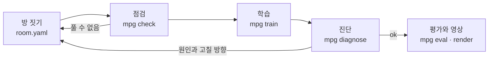

<p align="center"><b>한국어</b> · <a href="docs/README.en.md">English</a> · <a href="docs/README.ja.md">日本語</a></p>

<p align="center">
  <picture>
    <source media="(prefers-color-scheme: dark)" srcset="assets/banner-dark.svg">
    
  </picture>
</p>

# mujoco-puzzle-gym — 에이전트가 만드는 퍼즐 실험장

AI 에이전트가 MuJoCo 물리 시뮬레이션 안에 퍼즐 방을 직접 짓고, 그 방에서 로봇 몸을 학습시키는 프레임워크입니다. 퍼즐은 정해진 장면이 아니라 프로그램입니다. 발판, 문, 신호, 논리를 이어 상태가 바뀌는 방을 YAML로 짓고, 모자란 부품은 파이썬 클래스로 하나 더 등록하면 됩니다. 에이전트는 방을 짓고, 풀 수 있는지 점검하고, 짧게 학습시키고, 실패하면 이유를 진단받아 고치는 순환을 스스로 돕니다.

<p align="center"></p>
<p align="center"><sub>15분 학습한 정책이 처음 보는 배치에서 발판을 밟아 문을 열고 골에 가는 모습입니다. 로봇 모델: Pollen Robotics 마이크로덕(CC BY-NC-SA 4.0).</sub></p>

## 이게 뭔가요

공개된 로봇 학습 환경은 대부분 장면이 고정되어 있습니다. 부엌, 책상, 미로가 미리 만들어져 있고, 새 과제를 넣으려면 환경 코드를 직접 고쳐야 합니다. 장치의 상태가 바뀌는 여러 단계 퍼즐(발판을 밟으면 문이 열리고, 그 문 너머의 버튼이 다른 장치를 켜는 식)을 실제 걷는 로봇 몸으로 학습시키는 일은 특히 손이 많이 갑니다.

mujoco-puzzle-gym은 이 일을 에이전트에게 맡길 수 있게 만든 프레임워크입니다.

- **퍼즐을 프로그램처럼 짓습니다.** 방은 `room.yaml` 하나로 정합니다. 벽, 부품 위치, 무작위 배치 범위, 부품 사이의 신호 연결을 적으면 됩니다. 새 장치가 필요하면 `Part` 클래스를 하나 쓰고 등록합니다. 라이브러리 코드는 고치지 않습니다.
- **풀 수 있는지 먼저 확인합니다.** 학습에 몇 시간을 쓰기 전에, 풀이 순서가 존재하는지, 몸이 가만히 서 있어도 물리가 안정한지, 정답을 아는 스크립트가 실제로 푸는지를 몇 초 안에 봅니다.
- **학습하고, 왜 실패했는지 알려 줍니다.** 학습이 안 되면 원인을 네 가지(환경 버그, 몸이 넘어짐, 탐색 부족, 보상 꼼수) 중 하나로 짚고, 근거 숫자와 실패 영상, 고칠 방향을 줍니다.
- **모든 명령이 JSON을 냅니다.** 에이전트가 사람 없이 결과를 읽고 다음 행동을 정할 수 있습니다.

첫 몸은 Pollen Robotics의 작은 이족 로봇 [마이크로덕](https://github.com/pollen-robotics/microduck_rl)입니다. 공개된 걷기 정책을 그대로 쓰고, 그 위에서 "어느 방향으로 얼마나 빨리 걸을지"만 새로 학습합니다. 몸은 어댑터 뒤에 있어서 다른 몸으로 바꿀 수 있습니다.

## 어떻게 돌아가나요



1. **방 짓기**: 에이전트(또는 사람)가 `room.yaml`과 학습 설정 `task.yaml`을 씁니다. `mpg build`로 MJCF와 위에서 본 그림을 만들어 눈으로 확인합니다.
2. **점검**: `mpg check`가 세 단계를 봅니다. (a) 신호 연결과 벽 배치로 볼 때 골까지 가는 풀이 순서가 있는지, (b) 명령 0으로 10초 동안 넘어지거나 계산이 터지지 않는지, (c) 정답을 아는 스크립트가 무작위 배치 20개 중 18개 이상을 푸는지.
3. **학습**: `mpg train`이 정해진 시간 동안 학습하고 체크포인트, 학습 곡선, 에피소드 기록을 `runs/<id>/`에 남깁니다.
4. **진단**: `mpg diagnose`가 학습 기록과 새 롤아웃을 보고 원인을 분류합니다. 고친 뒤 다시 학습합니다.
5. **평가와 영상**: `mpg eval`이 학습에 쓰지 않은 배치에서 성공률을 재고, `mpg render`가 성공 영상을 만듭니다.

## 주요 기능

- **YAML로 짓는 방**: 방 크기와 벽, 부품 배치, 부품마다의 무작위 범위, 출발 자세, 부품 사이 신호 연결(`links`).
- **확장 가능한 부품, 관측, 보상, 알고리즘**: 모두 같은 등록 함수(`register_part`, `register_obs`, `register_reward`, `register_algo`)로 들어갑니다. 내장 부품도 같은 방식으로 등록되어 있습니다.
- **세 단계 점검**: 풀이 순서, 물리 안정성, 스크립트 해답 성공률.
- **학습**: Stable-Baselines3의 PPO(기본), SAC, A2C. 직접 만든 알고리즘은 `Trainer` 인터페이스로 붙입니다. 병렬 환경, 체크포인트, 보상 항목별 기록, 학습 곡선.
- **진단**: 환경 버그, 몸 실패, 탐색 부족, 보상 꼼수 네 가지 분류와 근거 숫자, 실패 영상, 고칠 방향.
- **평가와 영상**: 학습에 쓰지 않은 시드에서의 성공률과 평균 소요 시간, 무작위 정책과의 비교, 오프스크린 MP4.
- **몸 어댑터**: 퍼즐 쪽 코드는 몸을 모릅니다. 어댑터가 이동 명령을 받아 몸을 움직이고 몸 상태를 돌려줍니다.
- **고정된 자산**: 로봇 모델과 걷기 정책을 공식 저장소의 고정 커밋에서 받아 SHA256으로 확인합니다.

## 빠른 시작

[uv](https://docs.astral.sh/uv/)와 Python 3.12가 필요합니다. macOS(Apple Silicon)에서 확인했습니다.

```bash
git clone https://github.com/Song-Seng-Hun/mujoco-puzzle-gym.git
cd mujoco-puzzle-gym
uv sync
```

로봇 모델과 걷기 정책을 받습니다(43개 파일, 약 22 MB). 받은 파일은 해시로 확인하고, 출처와 라이선스를 함께 출력합니다.

```bash
uv run mpg fetch-assets
```

예제 방이 풀 수 있는 방인지 점검합니다. 몇 초면 끝납니다.

```bash
uv run mpg check examples/switch_door.yaml
```

예제 방에서 정책을 학습하고, 평가하고, 영상을 만듭니다. 12코어 기준으로 15분 학습이면 처음 보는 배치에서 99%를 풀었습니다(기록: [docs/training-log.md](docs/training-log.md)).

```bash
uv run mpg train examples/task_ppo.yaml --minutes 15 --id first
```

```bash
uv run mpg eval runs/first --episodes 100
```

```bash
uv run mpg render runs/first
```

## 명령

모든 명령은 `--json`을 받고, 실패하면 0이 아닌 종료 코드를 냅니다.

| 명령 | 하는 일 |
|---|---|
| `mpg fetch-assets` | 로봇 모델과 걷기 정책을 고정 커밋에서 받아 해시로 확인 |
| `mpg build <room.yaml>` | 몸과 방을 합친 MJCF와 위에서 본 PNG 만들기 |
| `mpg check <room.yaml>` | 풀이 순서, 물리 안정성, 스크립트 해답 성공률 점검 |
| `mpg train <task.yaml> --minutes N` | 정해진 시간 동안 학습, 결과는 `runs/<id>/` |
| `mpg diagnose runs/<id>` | 실패 원인 분류, 근거 숫자, 실패 영상 |
| `mpg eval runs/<id>` | 학습에 쓰지 않은 배치에서 성공률과 평균 시간 (`--policy random`으로 기준선) |
| `mpg render runs/<id>` | 성공 에피소드 MP4 |
| `mpg bench` | 걷기 몸과 환경의 시뮬레이션 속도 측정 |
| `mpg version` | 버전 출력 |

## 퍼즐 방 짓기

예제 방 [`examples/switch_door.yaml`](examples/switch_door.yaml)입니다. 발판을 밟으면 칸막이의 문이 열리고, 문 너머 골에 닿으면 성공입니다.

```yaml
name: switch_door
size: [2.4, 1.8]                  # 방 안쪽 크기 [m], 원점이 가운데
wall: {thickness: 0.06, height: 0.25}
walls:                            # x = 0.3의 칸막이, 가운데 0.5 m가 뚫려 있음
  - {from: [0.3, -0.9], to: [0.3, -0.28]}
  - {from: [0.3, 0.28], to: [0.3, 0.9]}
spawn: {pos: [-0.75, 0.0], yaw: 0.0, random: [0.2, 0.35, 3.14]}
parts:
  - {name: switch_a, type: switch, pos: [-0.25, 0.5], size: [0.3, 0.3], random: [0.15, 0.1]}
  - {name: door_b, type: door, pos: [0.3, 0.0], width: 0.5, axis: y}
  - {name: goal, type: goal, pos: [0.85, 0.0], radius: 0.15, random: [0.1, 0.45]}
links:
  - {from: switch_a, to: door_b}  # switch_a가 켜지면 door_b가 열림
```

- `random`은 에피소드마다 배치를 흔드는 범위입니다. 평가는 학습에 쓰지 않은 시드의 배치에서 합니다.
- 문은 `require: all | any`로 여러 발판을 함께 요구할 수 있습니다. 발판은 기본으로 한 번 밟으면 켜진 채로 있고, `latch: false`면 밟고 있는 동안만 켜집니다.
- 일부러 고장 낸 방과 설정이 [`examples/broken/`](examples/broken/)에 있습니다. 점검과 진단이 원인을 제대로 짚는지 보는 시험용입니다.

## 학습 설정

[`examples/task_ppo.yaml`](examples/task_ppo.yaml)은 방, 관측, 보상, 알고리즘을 정합니다. 빠진 키는 기본값을 쓰고, 채워진 전체 설정은 `runs/<id>/task.resolved.yaml`에 저장됩니다.

```yaml
room: switch_door.yaml
env: {hz: 10, episode_seconds: 40}       # 위층 정책은 초당 10번 결정
obs: [gravity, ang_vel, lin_vel, part_pos, part_state]
reward: {progress: 10.0, stage: 2.0, success: 10.0, fall: -5.0}
termination: {success: true, fall: true}
algo: ppo
algo_kwargs: {learning_rate: 0.0003, n_steps: 256, batch_size: 1024, gamma: 0.99}
net: [128, 128]
n_envs: 12
plugins: []                              # 직접 만든 부품·관측·보상 모듈
```

## 새 부품, 관측, 보상, 알고리즘 넣기

퍼즐 장치는 `Part`를 상속한 파이썬 클래스입니다. 장면에 자기 몸체를 더하고(`build`), 몸 스텝마다 상태를 읽고(`update`), 상태 값을 냅니다(`state`, `satisfied`). 역할(`switch`, `gate`, `goal`, `prop`)을 정하면 점검과 환경이 그 부품을 풀이 순서에 넣어 다룹니다.

```python
# my_parts.py
from mujoco_puzzle_gym.parts.base import Part
from mujoco_puzzle_gym.registry import register_part, register_reward

@register_part("timed_switch")
class TimedSwitch(Part):
    role = "switch"
    ...

@register_reward("upright")
def upright(env):                 # 가중치를 곱하기 전의 항목 값
    return -float(env.body_state.gravity[2])
```

`task.yaml`에 `plugins: [my_parts]`를 적으면, 본 프로세스와 병렬 학습의 모든 작업자 프로세스에서 이 모듈이 먼저 불러와집니다. 학습 알고리즘은 `algos.base.Trainer`를 구현해 `register_algo`로 등록하거나, 패키지 진입점 `mujoco_puzzle_gym.algos`로 내놓습니다.

## 몸 어댑터

퍼즐 쪽 코드는 어떤 몸이 걷는지 모릅니다. `BodyAdapter`가 경계입니다.

- `spawn`: 장면에 몸을 더합니다.
- `reset`: 서 있는 자세로 놓고 제어기 상태를 지웁니다.
- `step`: 이동 명령 (앞뒤 속도, 옆 속도, 회전 속도)을 한 제어 주기 동안 따릅니다.
- `state`: 위치, 자세, 속도, 넘어짐 여부를 돌려줍니다.

마이크로덕 어댑터는 공식 걷기 정책 `velstand.onnx`를 50 Hz로 돌리고, 공식 저장소의 모터 모델(BAM)을 씁니다. 몸 이름(관절, 사이트)은 `bodies/` 안에서만 다룹니다. 다른 몸을 붙이려면 이 네 메서드와 명령 범위를 구현하면 됩니다.

## 현재 상태와 한계

- **마일스톤 1 완료**: 발판 → 문 → 골 퍼즐을 짓고, 점검하고, 학습하고, 진단하고, 평가하는 전체 순환이 돕니다. 내장 부품은 아직 발판, 문, 골 세 가지입니다. 다른 장치는 플러그인으로 넣을 수 있습니다.
- **다음 단계(마일스톤 2)**: 버튼, 센서, 논리 게이트, 카운터, 워프, 함정, 부리로 집기, 스스로 움직이는 로봇, 견인 끈, 체크포인트와 단계별 학습 같은 부품 카탈로그를 설계하고 있습니다.
- 위층 정책은 퍼즐 상태를 그대로 보는 특권 관측을 씁니다. 실물 센서(카메라, 거리 센서)만으로 푸는 정책은 아직 없습니다.
- 걷기 정책은 공식 것을 고정해 씁니다. 이 정책은 뒤로 걷지 못하고, 앞으로는 약 0.12–0.22 m/s로 걷습니다. 방 크기와 시간 제한은 이 속도에 맞춰야 합니다.
- 시뮬레이션만 다룹니다. 실물 오리로 옮기는 일(sim2real)은 범위 밖입니다.
- macOS(Apple Silicon, CPU MuJoCo)에서 확인했습니다. 리눅스 렌더링은 아직 확인하지 않았습니다.

## AI와 함께 만든 프로젝트

이 저장소의 기획, 설계 문서, 코드, 테스트, 학습 실험은 사용자와 Claude(Anthropic)가 함께 만들었습니다. 설계 문서는 [docs/specs/](docs/specs/)에 있습니다.

## 출처와 라이선스

- 이 저장소의 코드: [Apache-2.0](LICENSE).
- 로봇 모델과 메시: © Pollen Robotics, [microduck_rl](https://github.com/pollen-robotics/microduck_rl) 고정 커밋 `0daab160`. MJCF는 Apache-2.0, 3D 메시(`*.stl`)는 [CC BY-NC-SA 4.0](https://creativecommons.org/licenses/by-nc-sa/4.0/)(비상업, 동일 조건)입니다. 메시는 이 저장소에 들어 있지 않고, `mpg fetch-assets`가 원본 그대로 받아 옵니다. MJCF는 메모리 안에서만 고칩니다.
- 걷기 정책: [pollen-robotics/microduck-policies](https://huggingface.co/pollen-robotics/microduck-policies)의 `velstand.onnx`, Apache-2.0.
- 데모 영상과 그림에는 CC BY-NC-SA 4.0 메시가 보입니다.
- 이 프로젝트는 비공식 프로젝트이며 Pollen Robotics와 관계가 없습니다.

## 더 보기

- [docs/training-log.md](docs/training-log.md): 학습 기록과 망가진 설정에 대한 진단 결과
- [docs/bench.md](docs/bench.md): 시뮬레이션 속도 측정
- [docs/specs/](docs/specs/): 의도, 요구사항, 구현 계획 문서
