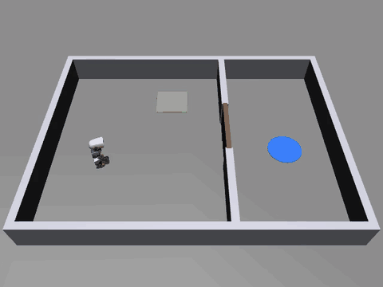

<p align="center"><b>한국어</b> · <a href="docs/README.en.md">English</a> · <a href="docs/README.ja.md">日本語</a></p>

<p align="center">
  <picture>
    <source media="(prefers-color-scheme: dark)" srcset="assets/banner-dark.svg">
    
  </picture>
</p>

# mujoco-puzzle-gym — 에이전트가 만드는 퍼즐 실험장

AI 코딩 에이전트가 MuJoCo 물리 시뮬레이션 안에 퍼즐 방을 직접 짓고, 그 방에서 로봇을 학습시키는 프레임워크입니다. 로봇을 움직이는 것은 그 방에서 강화학습한 정책이고, 에이전트가 로봇을 직접 조종하지는 않습니다. 퍼즐은 정해진 장면이 아니라 프로그램입니다. 발판, 문, 신호, 논리를 이어 상태가 바뀌는 방을 YAML로 짓고, 모자란 부품은 파이썬 클래스로 하나 더 등록하면 됩니다. 에이전트는 방을 짓고, 풀 수 있는지 점검하고, 짧게 학습시키고, 실패하면 이유를 진단받아 고치는 과정을 스스로 반복합니다.

<p align="center"></p>
<p align="center"><sub>15분 학습한 정책이 처음 보는 배치에서 발판을 밟아 문을 열고 골에 가는 모습입니다. 로봇 모델: Pollen Robotics 마이크로덕(CC BY-NC-SA 4.0).</sub></p>

## 이게 뭔가요

- **퍼즐을 프로그램처럼 짓습니다.** 방 하나는 `room.yaml` 하나입니다. 벽, 부품 위치, 에피소드마다 위치를 무작위로 바꿀 범위, 부품 사이 신호 연결을 적습니다. 새 장치는 파이썬 클래스 하나로 더합니다.
- **풀 수 있는지 먼저 봅니다.** 학습에 시간을 쓰기 전에, 풀이 순서가 있는지, 물리 시뮬레이션이 안정적인지, 정답을 아는 스크립트로 실제로 풀리는지를 몇 초 만에 확인합니다.
- **학습하고, 왜 안 되는지 알려 줍니다.** 실패하면 원인(환경 버그, 넘어짐, 탐색 부족, 보상 꼼수)과 근거, 고칠 방향을 줍니다. AI 에이전트가 사람 없이 이 과정을 반복할 수 있습니다.
- **보상도 설계합니다.** 보상은 항목과 가중치로 `task.yaml`에 적습니다(진행, 단계, 성공, 넘어짐 등). 진단이 "보상 꼼수"나 "탐색 부족"을 짚으면 에이전트가 가중치를 고치거나 새 보상 항목을 파이썬 함수 하나로 등록해 다시 학습합니다.

에이전트는 이 저장소에 들어 있지 않습니다. 평소 쓰는 AI 코딩 에이전트(Claude Code 등)에게 YAML과 파이썬 파일 수정과 `mpg` 명령 실행을 맡기면 됩니다. 사람도 같은 명령으로 직접 쓸 수 있습니다.

처음 들어 있는 로봇은 Pollen Robotics의 [마이크로덕](https://github.com/pollen-robotics/microduck_rl)입니다. 공개된 걷기 정책을 그대로 쓰고, 그 위에서 "어디로 얼마나 빨리 걸을지"만 새로 학습합니다.

## 주요 기능

- **부품은 여러 속성의 묶음입니다.** 부품 하나는 종류(`type`)와 속성(위치, 크기, 한 번 밟으면 켜진 채로 남는지, 열리는 방향, 에피소드마다 위치를 무작위로 바꿀 범위 등)으로 이루어집니다. 부품 종류와 각 속성은 [부품과 프리셋 안내](docs/parts-guide.md)에 정리했습니다.
- **에이전트가 부품을 조립해 퍼즐을 설계합니다.** 부품을 골라 놓고 신호선(`links`)으로 이으면 퍼즐이 됩니다. 발판 → 문 → 골 같은 단순한 방부터 발판 여러 개가 모두 켜져야 열리는 문(`require: all`)처럼 조건을 겹친 방까지 같은 방식으로 짓고, 모자란 부품은 직접 만들어 끼웁니다.
- **랜덤화를 지원합니다.** 지금은 부품 위치와 출발 위치·방향을 정한 범위 안에서 매 에피소드 조금씩 다르게 배치해, 정책이 배치를 외우지 않고 퍼즐을 풀게 합니다. 구역 안 아무 곳에 놓기, 후보 중 하나 고르기, 방의 배선과 방 자체를 바꾸는 랜덤화도 들어 있습니다.
- **기준(베이스라인) 환경이 들어 있습니다.** 예제 방, 검증한 PPO 학습 설정, 미리 학습한 정책(`mpg demo`), 같은 시드에서 무작위 정책과 비교(`mpg eval --policy random`), 일부러 망가뜨린 설정 모음([`examples/broken/`](examples/broken/))이 있어서 새 방이나 새 알고리즘을 견줄 출발점이 됩니다.
- **로봇을 바꿀 수 있습니다.** 퍼즐 쪽 코드는 어떤 로봇인지 모르고, 몸 어댑터가 이동 명령을 받아 로봇을 움직입니다. 몸 어댑터를 새로 만들어 붙이면 다른 로봇도 같은 방에서 학습합니다(방법은 [사용 안내](docs/guide.md#몸-어댑터)). 지금 들어 있는 몸은 넷입니다 — 두 발, 네 발, 휴머노이드, 그리고 **걷지 않는 고정 베이스 팔**. 몸마다 할 수 있는 일이 다르므로, 부품은 필요한 능력을 선언하고 `mpg check`가 못 하는 몸을 **이유를 말하며 거부**합니다 — 어떤 부품이 어떤 몸에서 되는지는 [몸과 부품](docs/bodies.md)에 표로 있습니다.

## 들어 있는 부품

내장 부품 **68종**과, 그 부품들을 바로 쓸 수 있게 값까지 맞춰 둔 **프리셋 87종**, 방 하나가 통째로 들어 있는 **방 프리셋 44종**이 있습니다. 발판·문·골 같은 기본 부품부터 논리 게이트와 카운터, 움직이는 플랫폼과 컨베이어, 함정, 자석과 빛(거울·분광기·광전지), 집어 다루는 물체와 레버·다이얼까지 들어 있습니다.

종류별 목록과 속성, 값을 맞춰 둔 프리셋은 [부품과 프리셋 안내](docs/parts-guide.md)에 있고, 모자란 부품은 플러그인으로 직접 끼울 수 있습니다.

## 도전해 보세요

방 프리셋이 **44개**인데, **학습된 정책의 기록이 있는 방은 세 개**입니다. 나머지 **41칸은 비어 있습니다.**

<table>
<tr>
<td width="50%"><br><b>마감시간</b> — 40초 뒤 프레스가 코인 자물쇠를 부순다. 그 전에 문을 열지 못하면 그 판은 영구히 끝</td>
<td width="50%"><br><b>손가락으로 집기</b> — 용접 없이 두 손가락이 눌러서 든다. 학습된 정책 최고 <b>0.52</b></td>
</tr>
<tr>
<td width="50%"><br><b>빛의 몫</b> — 한 줄기를 분광기로 나눠 두 광전지의 문턱을 동시에 넘겨야 한다</td>
<td width="50%"><br><b>연쇄</b> — 공을 밀어 핀 세 개를 쓰러뜨리면 문이 열린다</td>
</tr>
</table>

대본 해답은 모든 방을 풉니다(저장소가 매번 20시드로 확인합니다). 균일 무작위 정책은 거의 모든 방에서
0입니다. **그 사이가 당신 알고리즘의 자리입니다.**

> `puzzles/tabletop/pick_and_place` — PPO로 **25 M 스텝, 성공률 0.00**.
> 방의 대본 해답을 복제하면 **1.7 M 스텝에 1.00**.
> 당신 알고리즘은 몇 스텝에 얼마입니까?

```bash
uv run mpg train examples/task_pick_and_place.yaml --minutes 15 --id mine
uv run mpg eval runs/mine --episodes 100                   # held-out 시드 1,000,000~
uv run mpg eval runs/mine --episodes 100 --policy random    # 같은 시드의 기준선
```

도전 방 나머지, 44방 사다리, 규약과 알려진 기록은 [도전 문서](docs/challenges.md)에 있습니다.

## 설치

macOS나 리눅스에서 아래 한 줄이면 됩니다. 필요한 것(uv, Python 3.12, 의존성, 로봇 모델과 걷기 정책 약 22 MB)을 모두 설치하고, 예제 방으로 잘 깔렸는지 확인까지 합니다.

```bash
git clone https://github.com/Song-Seng-Hun/mujoco-puzzle-gym.git && cd mujoco-puzzle-gym && ./install.sh
```

macOS(Apple Silicon)에서 확인했습니다. 윈도우는 아직 시험하지 않았습니다.

## 해 보기

학습된 오리가 예제 방을 푸는 영상을 바로 만듭니다(`demo.mp4`).

```bash
uv run mpg demo
```

직접 학습시켜 봅니다. 12코어 환경에서 15분 학습했을 때 처음 보는 배치의 99%를 풀었습니다([학습 기록](docs/training-log.md)).

```bash
uv run mpg train examples/task_ppo.yaml --minutes 15 --id first
```

```bash
uv run mpg render runs/first
```

## 내 퍼즐 방 만들기

예제 방 [`examples/switch_door.yaml`](examples/switch_door.yaml)을 복사해 고치고, 풀 수 있는지 점검한 뒤 학습시키면 됩니다. 발판을 밟으면 문이 열리고 골에 닿으면 성공인 방입니다.

```yaml
name: switch_door
size: [2.4, 1.8]                  # 방 안쪽 크기 [m], 원점이 가운데
wall: {thickness: 0.06, height: 0.25}
walls:                            # x = 0.3의 칸막이, 가운데 0.5 m가 뚫려 있음
  - {from: [0.3, -0.9], to: [0.3, -0.28]}
  - {from: [0.3, 0.28], to: [0.3, 0.9]}
spawn: {pos: [-0.75, 0.0], yaw: 0.0, random: [0.2, 0.35, 3.14]}
parts:
  - {name: switch_a, type: switch, pos: [-0.25, 0.5], size: [0.3, 0.3], random: [0.15, 0.1]}
  - {name: door_b, type: door, pos: [0.3, 0.0], width: 0.5, axis: y}
  - {name: goal, type: goal, pos: [0.85, 0.0], radius: 0.15, random: [0.1, 0.45]}
links:
  - {from: switch_a, to: door_b}  # switch_a가 켜지면 door_b가 열림
```

```bash
uv run mpg check my_room.yaml
```

이 방으로 학습하려면 [`examples/task_ppo.yaml`](examples/task_ppo.yaml)도 `my_task.yaml`로 복사해 `room: my_room.yaml`로 바꾸고 `uv run mpg train my_task.yaml --minutes 15 --id my-room`을 실행합니다. 방 경로는 학습 설정 파일이 있는 폴더를 기준으로 찾습니다.

명령 전체, 학습 설정, 새 부품·보상 넣기, 몸 바꾸기는 [사용 안내](docs/guide.md)에 있습니다.

## 결과

**완결된 상태입니다.** 마일스톤 일곱 개로 아래까지 왔고, 더 키우는 중이 아닙니다. 방을 짓고, 점검하고, 학습하고, 진단하는 순환이 돌고, 몸 넷(두 발 오리, 네 발 로봇, 휴머노이드, 그리고 걷지 않는 고정 베이스 팔)이 **같은 몸 어댑터 인터페이스**를 씁니다. 부품은 자기가 필요한 능력을 선언하고 못 하는 몸은 `mpg check`가 이유를 말하며 거부하므로, 탁상 방은 다리 없는 몸만 풀고 넓은 방은 큰 몸만 풉니다.

숫자는 둘을 구별해서 읽어야 합니다 — **대본 해답**(정답을 아는 스크립트, 방이 풀리는지 확인하는 용도)과 **학습된 정책**(강화학습이나 대본 복제로 얻은 것)입니다.

- **학습된 정책, 걷는 몸**: 오리가 예제 방 [`examples/switch_door.yaml`](examples/switch_door.yaml)에서, 12코어 기준 15분 학습으로 처음 보는 배치의 **99%**. 네 발과 휴머노이드는 방을 풀지만 **대본 해답으로**이고, 학습 기록은 없습니다.
- **학습된 정책, 실물에 가까운 관측**: 팔이 센서만 보는 관측(자기수용감각 + 관절 + 손목 카메라 시선)으로 `tabletop/reach_the_marker`에서 도달 **0.93**. 같은 방에 액추에이터 지연과 검출 오차 네 가지(위치 잡음·드롭아웃·캘리브레이션 편향·렌즈 왜곡)를 모델에 넣고 그 아래에서 학습해 **0.94**.
- **대본 해답**: 팔이 물건을 집어 상자·탑·컨베이어로 옮기고, 용접 제약 없이 손가락 접촉만으로 쥐는 집기도 `mpg check` **20시드 전부** 풉니다. 그 방을 **학습된 정책**이 완주한 최고 기록은 0.52이고, 그런 정책이 나오는 건 세 번에 한 번입니다(아래 한계).

마일스톤별 상세, 되돌린 설계와 그 측정값은 [학습 기록](docs/training-log.md)과 [설계 문서](docs/specs/)에 있습니다. 방 44개의 대본·무작위·학습 기록을 한 표로 본 것은 [도전 문서](docs/challenges.md)에 있습니다.

## 한계

끝내지 못한 것은 추측이 아니라 측정해서 적었습니다.

- **손가락으로 쥐어 옮기는 방**: 완주하는 정책은 **있지만**(50시드 0.52), 그런 정책이 나오는 건 세 번에 한 번입니다. 분산은 학습 초기화가 아니라 그 시드가 뽑는 데이터 분포 쪽이었습니다.
- **액추에이터 지연 40 ms**: 팔 방 열 개 중 다섯이 안 풀립니다. 원인은 한 가지가 아니라 **넷이고 서로 다릅니다** — ① `fetch_the_steel`은 용접이 붙은 다음 스텝에 찢기고(3.04 N, 한계 3.0) ② `conveyor_triage`는 붙은 뒤 끌려가 다섯 스텝 뒤 11.39 N에 찢기고 ③ `pick_by_hand`는 손가락이 아예 닫히지 않고 ④ `dead_wedge`와 `lever_arm`은 마지막 `goto goal`에서 멈춥니다. 일곱 번의 수정 시도가 각각 다른 방을 깨거나 아무 방도 못 열었고, 어느 방이 어느 하위 목표에서 멈추는지는 `uv run python tools/latency_stall.py`가 찍습니다.
- **관측**: 상위 정책(퍼즐을 보고 어디로 얼마나 빨리 갈지 정하는 정책)은 기본으로 퍼즐 상태를 그대로 읽는 특권 관측을 씁니다. `obs:`에 거리 센서와 카메라를 넣으면 센서 관측으로 학습할 수 있고 `critic_obs:`로 가치 함수에만 특권 관측을 줄 수 있지만, 영상 관측 학습이 약 15배 느려서 센서만 보는 정책들은 영상 자체가 아니라 거리·관절·마커 시선을 읽습니다.
- **순서 추론**: 단서 없이 순서를 찾는 방(`order_blind`)의 최고 기록은 **0.29**입니다. 세 순서 중 하나를 찍으면 1/3이므로, 이건 단서를 못 읽는 정책이 낼 수 있는 최선에 정확히 붙은 값이고 그 위로 올라간 정책은 없습니다. 걷는 몸의 기본 방들은 순서가 늘 같습니다(스위치 → 문 → 골).
- **걷기 정책**은 공식 배포된 것을 그대로 고정해 씁니다. 뒤로 걷지 못하고 앞으로 약 0.12–0.22 m/s로 걸으므로, 방 크기와 시간 제한을 이 속도에 맞춰야 합니다.
- 시뮬레이션만 다룹니다. 실물로 옮기는 일(sim2real)은 범위 밖입니다. macOS(Apple Silicon, CPU MuJoCo)에서 확인했고, 리눅스 렌더링과 윈도우는 확인하지 않았습니다.

## AI와 함께 만든 프로젝트

이 저장소의 기획, 설계 문서, 코드, 테스트, 학습 실험은 제작자와 Claude(Anthropic)가 함께 만들었습니다. 설계 문서는 [docs/specs/](docs/specs/)에 있습니다.

## 출처와 라이선스

- 이 저장소의 코드: [Apache-2.0](LICENSE).
- 로봇 모델과 메시: © Pollen Robotics, [microduck_rl](https://github.com/pollen-robotics/microduck_rl) 고정 커밋 `0daab160`. MJCF는 Apache-2.0, 3D 메시(`*.stl`)는 [CC BY-NC-SA 4.0](https://creativecommons.org/licenses/by-nc-sa/4.0/)(비상업, 동일 조건)입니다. 메시는 이 저장소에 들어 있지 않고, `mpg fetch-assets`가 원본 그대로 받아 옵니다. MJCF 원본은 고치지 않고, 실행 중 메모리에서만 고칩니다.
- 걷기 정책: [pollen-robotics/microduck-policies](https://huggingface.co/pollen-robotics/microduck-policies)의 `velstand.onnx`, Apache-2.0.
- 두 번째 몸의 모델: [MuJoCo Menagerie](https://github.com/google-deepmind/mujoco_menagerie) 고정 커밋 `370c4396`의 `unitree_go2/`, BSD-3-Clause. 모델과 메시 모두 해당합니다.
- 고정 베이스 팔의 모델: [MuJoCo Menagerie](https://github.com/google-deepmind/mujoco_menagerie) 고정 커밋 `370c4396`의 `robotstudio_so101/`, Apache-2.0. 쓸 수 있는 라이선스의 사전학습 정책이 없어 제어는 역기구학입니다.
- 휴머노이드의 모델: 같은 커밋의 `unitree_g1/`, BSD-3-Clause. 걷기 정책은 [unitree_rl_gym](https://github.com/unitreerobotics/unitree_rl_gym) 고정 커밋의 `deploy/pre_train/g1/motion.pt`, BSD-3-Clause — **이 정책도 공식 동결 배포가 아니라** 그 저장소의 배포 예제 체크포인트입니다.
- 두 번째 몸의 걷기 정책: [diasAiMaster/unitree-go2-velocity-flat](https://huggingface.co/diasAiMaster/unitree-go2-velocity-flat) 고정 리비전 `9a723b7a`, BSD-3-Clause. **이 정책은 Unitree의 공식 배포가 아니라 커뮤니티가 올린 체크포인트입니다.** 평지에서 학습했고(`gait_phase` 없음, action scale 0.5), 학습 코드는 업스트림을 고치지 않았습니다. 자세한 사실은 [몸과 부품](docs/bodies.md)에 있습니다.
- 데모 영상과 그림에는 CC BY-NC-SA 4.0 메시가 쓰였습니다.
- 이 프로젝트는 비공식 프로젝트이며 Pollen Robotics와 관계가 없습니다.

## 더 보기

- [사용 안내](docs/guide.md): 동작 흐름, 명령, 학습 설정, 확장, 몸 어댑터
- [에이전트 안내](AGENTS.md): AI 에이전트가 이 저장소에서 일할 때 먼저 읽는 문서(영어)
- [방과 정책 나누기](docs/community.md): 만든 방을 PR로 올리기, 정책을 ONNX로 나누기, 다른 사람의 pickle을 열지 않는 이유
- [부품과 프리셋 안내](docs/parts-guide.md): 부품 종류 한눈에 보기, 각 속성과 값, 프리셋으로 방 짜기
- [몸과 부품](docs/bodies.md): 어떤 부품이 어떤 몸에서 되는지, 몸마다 측정한 값
- [도전 과제](docs/challenges.md): 방 44개의 대본·무작위·학습 기록 표와 규약
- [부품 목록과 속성](docs/parts.md): 첫 마일스톤 부품 세 가지의 속성 설명
- [학습 기록](docs/training-log.md): 학습 결과와 일부러 망가뜨린 설정에 대한 진단
- [속도 측정](docs/bench.md)
- [설계 문서](docs/specs/)
