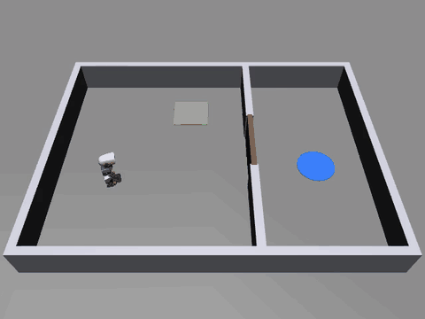

<p align="center"><b>한국어</b> · <a href="docs/README.en.md">English</a> · <a href="docs/README.ja.md">日本語</a></p>

<p align="center">
  <picture>
    <source media="(prefers-color-scheme: dark)" srcset="assets/banner-dark.svg">
    
  </picture>
</p>

# mujoco-puzzle-gym — 에이전트가 만드는 퍼즐 실험장

AI 에이전트가 MuJoCo 물리 시뮬레이션 안에 퍼즐 방을 직접 짓고, 그 방에서 로봇 몸을 학습시키는 프레임워크입니다. 퍼즐은 정해진 장면이 아니라 프로그램입니다. 발판, 문, 신호, 논리를 이어 상태가 바뀌는 방을 YAML로 짓고, 모자란 부품은 파이썬 클래스로 하나 더 등록하면 됩니다. 에이전트는 방을 짓고, 풀 수 있는지 점검하고, 짧게 학습시키고, 실패하면 이유를 진단받아 고치는 순환을 스스로 돕니다.

<p align="center"></p>
<p align="center"><sub>15분 학습한 정책이 처음 보는 배치에서 발판을 밟아 문을 열고 골에 가는 모습입니다. 로봇 모델: Pollen Robotics 마이크로덕(CC BY-NC-SA 4.0).</sub></p>

## 이게 뭔가요

- **퍼즐을 프로그램처럼 짓습니다.** 방 하나는 `room.yaml` 하나입니다. 벽, 부품 위치, 매 에피소드 흔들 범위, 부품 사이 신호 연결을 적습니다. 새 장치는 파이썬 클래스 하나로 더합니다.
- **풀 수 있는지 먼저 봅니다.** 학습에 시간을 쓰기 전에, 풀이 순서가 있는지, 물리가 안정한지, 정답을 아는 스크립트가 푸는지를 몇 초 만에 확인합니다.
- **학습하고, 왜 안 되는지 알려 줍니다.** 실패하면 원인(환경 버그, 넘어짐, 탐색 부족, 보상 꼼수)과 근거, 고칠 방향을 줍니다. 모든 명령이 JSON을 내서 AI 에이전트가 사람 없이 이 순환을 돌 수 있습니다.

첫 몸은 Pollen Robotics의 [마이크로덕](https://github.com/pollen-robotics/microduck_rl)입니다. 공개된 걷기 정책을 그대로 쓰고, 그 위에서 "어디로 얼마나 빨리 걸을지"만 새로 학습합니다.

## 설치

macOS나 리눅스에서 아래 한 줄이면 됩니다. 필요한 것(uv, Python 3.12, 의존성, 로봇 모델과 걷기 정책 약 22 MB)을 모두 설치하고, 예제 방으로 잘 깔렸는지 확인까지 합니다.

```bash
git clone https://github.com/Song-Seng-Hun/mujoco-puzzle-gym.git && cd mujoco-puzzle-gym && ./install.sh
```

macOS(Apple Silicon)에서 확인했습니다. 윈도우는 아직 시험하지 않았습니다.

## 해 보기

학습된 오리가 예제 방을 푸는 영상을 바로 만듭니다(`demo.mp4`).

```bash
uv run mpg demo
```

직접 학습시켜 봅니다. 12코어 기준 15분이면 처음 보는 배치의 99%를 풀었습니다([학습 기록](docs/training-log.md)).

```bash
uv run mpg train examples/task_ppo.yaml --minutes 15 --id first
```

```bash
uv run mpg render runs/first
```

## 내 퍼즐 방 만들기

예제 방 [`examples/switch_door.yaml`](examples/switch_door.yaml)을 복사해 고치고, 풀 수 있는지 점검한 뒤 학습시키면 됩니다. 발판을 밟으면 문이 열리고 골에 닿으면 성공인 방입니다.

```yaml
name: switch_door
size: [2.4, 1.8]                  # 방 안쪽 크기 [m], 원점이 가운데
wall: {thickness: 0.06, height: 0.25}
walls:                            # x = 0.3의 칸막이, 가운데 0.5 m가 뚫려 있음
  - {from: [0.3, -0.9], to: [0.3, -0.28]}
  - {from: [0.3, 0.28], to: [0.3, 0.9]}
spawn: {pos: [-0.75, 0.0], yaw: 0.0, random: [0.2, 0.35, 3.14]}
parts:
  - {name: switch_a, type: switch, pos: [-0.25, 0.5], size: [0.3, 0.3], random: [0.15, 0.1]}
  - {name: door_b, type: door, pos: [0.3, 0.0], width: 0.5, axis: y}
  - {name: goal, type: goal, pos: [0.85, 0.0], radius: 0.15, random: [0.1, 0.45]}
links:
  - {from: switch_a, to: door_b}  # switch_a가 켜지면 door_b가 열림
```

```bash
uv run mpg check my_room.yaml
```

명령 전체, 학습 설정, 새 부품·보상 넣기, 몸 바꾸기는 [사용 안내](docs/guide.md)에 있습니다.

## 현재 상태와 한계

- **마일스톤 1 완료**: 발판 → 문 → 골 퍼즐을 짓고, 점검하고, 학습하고, 진단하고, 평가하는 전체 순환이 돕니다. 내장 부품은 아직 발판, 문, 골 세 가지입니다. 다른 장치는 플러그인으로 넣을 수 있습니다.
- **다음 단계(마일스톤 2)**: 버튼, 센서, 논리 게이트, 카운터, 워프, 함정, 부리로 집기, 스스로 움직이는 로봇, 견인 끈, 체크포인트와 단계별 학습 같은 부품 카탈로그를 설계하고 있습니다.
- 위층 정책은 퍼즐 상태를 그대로 보는 특권 관측을 씁니다. 실물 센서(카메라, 거리 센서)만으로 푸는 정책은 아직 없습니다.
- 걷기 정책은 공식 것을 고정해 씁니다. 이 정책은 뒤로 걷지 못하고, 앞으로는 약 0.12–0.22 m/s로 걷습니다. 방 크기와 시간 제한은 이 속도에 맞춰야 합니다.
- 시뮬레이션만 다룹니다. 실물 오리로 옮기는 일(sim2real)은 범위 밖입니다.
- macOS(Apple Silicon, CPU MuJoCo)에서 확인했습니다. 리눅스 렌더링은 아직 확인하지 않았습니다.

## AI와 함께 만든 프로젝트

이 저장소의 기획, 설계 문서, 코드, 테스트, 학습 실험은 사용자와 Claude(Anthropic)가 함께 만들었습니다. 설계 문서는 [docs/specs/](docs/specs/)에 있습니다.

## 출처와 라이선스

- 이 저장소의 코드: [Apache-2.0](LICENSE).
- 로봇 모델과 메시: © Pollen Robotics, [microduck_rl](https://github.com/pollen-robotics/microduck_rl) 고정 커밋 `0daab160`. MJCF는 Apache-2.0, 3D 메시(`*.stl`)는 [CC BY-NC-SA 4.0](https://creativecommons.org/licenses/by-nc-sa/4.0/)(비상업, 동일 조건)입니다. 메시는 이 저장소에 들어 있지 않고, `mpg fetch-assets`가 원본 그대로 받아 옵니다. MJCF는 메모리 안에서만 고칩니다.
- 걷기 정책: [pollen-robotics/microduck-policies](https://huggingface.co/pollen-robotics/microduck-policies)의 `velstand.onnx`, Apache-2.0.
- 데모 영상과 그림에는 CC BY-NC-SA 4.0 메시가 보입니다.
- 이 프로젝트는 비공식 프로젝트이며 Pollen Robotics와 관계가 없습니다.

## 더 보기

- [사용 안내](docs/guide.md): 동작 순환, 명령, 학습 설정, 확장, 몸 어댑터
- [학습 기록](docs/training-log.md): 학습 결과와 망가진 설정에 대한 진단
- [속도 측정](docs/bench.md)
- [설계 문서](docs/specs/)
