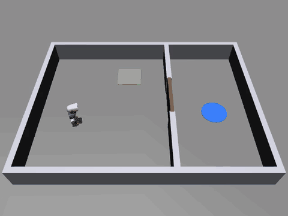
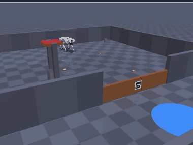
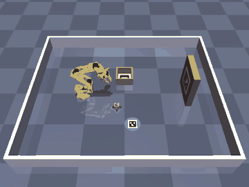
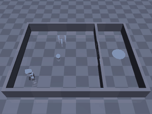

<p align="center"><a href="../README.md">한국어</a> · <b>English</b> · <a href="README.ja.md">日本語</a></p>

<p align="center">
  <picture>
    <source media="(prefers-color-scheme: dark)" srcset="../assets/banner-dark.svg">
    
  </picture>
</p>

# mujoco-puzzle-gym — a puzzle lab that agents build

A framework in which AI coding agents build puzzle rooms inside a MuJoCo physics simulation and train a robot body in them. The robot is driven by a policy learned in those rooms - by reinforcement learning, or by cloning the room's scripted solution; the agent never steers the robot directly. A puzzle is a program, not a fixed scene. You build a room whose state changes by wiring floor switches, doors, signals and logic together in YAML, and when a part is missing you register one more Python class. The agent runs the loop itself: build a room, check that it can be solved, train briefly, and when training fails, get a diagnosis and fix the room.

<p align="center"></p>
<p align="center"><sub>A policy trained for 15 minutes steps on the switch, opens the door and reaches the goal on a layout it has not seen. Robot model: Pollen Robotics Microduck (CC BY-NC-SA 4.0).</sub></p>

## What is this?

- **Puzzles are built like programs.** A room is one `room.yaml`: walls, part positions, how much their positions vary each episode, and the signal links between parts. A new device is one Python class.
- **It checks a room can be solved first.** Before you spend time training, it checks in seconds that a solution order exists, that the physics is stable, and that a scripted solver can actually solve the room.
- **It trains, and tells you why training fails.** On failure it names the cause (environment bug, falling, not enough exploration, reward hacking) with evidence and a fix direction. An AI agent can run this loop without a person.
- **Rewards are configurable too.** Rewards are terms with weights in `task.yaml` (progress, stage, success, falling and so on). When `mpg diagnose` reports reward hacking or poor exploration, the agent changes the weights or registers a new reward term as one Python function, and trains again.

The agent is not included: you have the AI coding agent you already use (Claude Code, for example) edit the YAML and Python files and run the `mpg` commands. A person can use the same commands directly.

The first body is [Microduck](https://github.com/pollen-robotics/microduck_rl) by Pollen Robotics. Its published walking policy is used as is, and only "where to walk and how fast" is learned on top.

## Features

- **A part is a bundle of attributes.** Each part is a type (`type`) plus attributes: position, size, whether it stays on once stepped on, which way it opens, how much its position varies each episode, and so on. Every type and its attributes are in the [parts and presets guide](parts-guide.en.md).
- **The agent designs puzzles by assembling parts.** Pick parts, place them and wire them with signal links (`links`), and you have a puzzle. Simple rooms like switch → door → goal and rooms with stacked conditions, such as a door that opens only when several switches are all on (`require: all`), are built the same way. A missing part can be written and plugged in.
- **Randomization is supported.** Today, part positions and the start position and heading are randomized within set ranges every episode, so a policy solves the puzzle instead of memorising the layout. Placing anywhere in a region, choosing one of several candidates, and randomizing the room's wiring and the room itself are in as well.
- **Baseline environments are included.** The example room, a verified PPO training config, a pretrained policy (`mpg demo`), a random-policy comparison on the same seeds (`mpg eval --policy random`), and a set of deliberately broken configs ([`examples/broken/`](../examples/broken/)) give a starting point to compare new rooms or new algorithms against.
- **The body can be swapped.** The puzzle code does not know the body; a body adapter takes movement commands and drives the body. Build a new body adapter and another robot trains in the same rooms (how: [guide](guide.en.md#body-adapter)). Four bodies are included today: two legs, four legs, a humanoid, and a **fixed-base arm that does not walk at all**. Because bodies differ in what they can do, a part declares the capabilities it needs and `mpg check` **refuses a body that lacks them, with the reason** — which part works with which body is tabulated in [bodies and parts](bodies.en.md).

## The parts that come with it

**68 built-in part types**, **87 presets** (the same parts with their values already set) and **44 room presets** (a whole room each). From switches, doors and goals to logic gates and counters, moving platforms and conveyors, traps, magnets and light (mirrors, splitters, photocells), and objects a gripper handles including levers and dials.

Every type, its fields and the presets are in the [parts and presets guide](parts-guide.en.md), and a part that is missing can be added as a plugin.

## Take the challenge

There are **44 room presets**. **Three** have a trained policy's number. The other **41 cells are empty.**

<table>
<tr>
<td width="50%"><br><b>A deadline</b> - at 40 s a press smashes the coin lock. Fail to open the door first and the episode is over for good</td>
<td width="50%"><br><b>A real grasp</b> - no weld, two fingers pressing. Best trained policy <b>0.52</b></td>
</tr>
<tr>
<td width="50%"><br><b>Shares of a beam</b> - split one beam so two photocells each clear their threshold</td>
<td width="50%"><br><b>A chain</b> - push the ball, knock three pins down, the door opens</td>
</tr>
</table>

The scripted solution solves every room (the repository checks that over 20 seeds, every
time). A uniform random policy scores zero in almost all of them. **The gap between the two
is where your algorithm goes.**

> `puzzles/tabletop/pick_and_place` - PPO: **25 M steps, success 0.00**.
> Cloning the room's own scripted solution: **1.00 in 1.7 M steps**.
> How many steps does yours need, and for how much?

```bash
uv run mpg train examples/task_pick_and_place.yaml --minutes 15 --id mine
uv run mpg eval runs/mine --episodes 100                   # held-out seeds from 1,000,000
uv run mpg eval runs/mine --episodes 100 --policy random    # the baseline on the same seeds
```

The other challenge rooms, the ladder over all 44, the protocol and the known records are in
[the challenge document](challenges.en.md).

## Install

On macOS or Linux, one line does it. It installs everything needed (uv, Python 3.12, dependencies, the robot model and walking policy, about 22 MB) and checks the example room to confirm the setup.

```bash
git clone https://github.com/Song-Seng-Hun/mujoco-puzzle-gym.git && cd mujoco-puzzle-gym && ./install.sh
```

Tested on macOS (Apple Silicon). Windows has not been tested yet.

## Try it

Make a video of the trained duck solving the example room (`demo.mp4`).

```bash
uv run mpg demo
```

Train your own. On a 12-core machine, 15 minutes of training solved 99% of unseen layouts ([training log](training-log.md)).

```bash
uv run mpg train examples/task_ppo.yaml --minutes 15 --id first
```

```bash
uv run mpg render runs/first
```

## Make your own puzzle room

Copy the example room [`examples/switch_door.yaml`](../examples/switch_door.yaml), change it, check that it can be solved, then train. In this room, stepping on the switch opens the door, and reaching the goal is success.

```yaml
name: switch_door
size: [2.4, 1.8]                  # interior size [m], centred at the origin
wall: {thickness: 0.06, height: 0.25}
walls:                            # divider at x = 0.3 with a 0.5 m opening in the middle
  - {from: [0.3, -0.9], to: [0.3, -0.28]}
  - {from: [0.3, 0.28], to: [0.3, 0.9]}
spawn: {pos: [-0.75, 0.0], yaw: 0.0, random: [0.2, 0.35, 3.14]}
parts:
  - {name: switch_a, type: switch, pos: [-0.25, 0.5], size: [0.3, 0.3], random: [0.15, 0.1]}
  - {name: door_b, type: door, pos: [0.3, 0.0], width: 0.5, axis: y}
  - {name: goal, type: goal, pos: [0.85, 0.0], radius: 0.15, random: [0.1, 0.45]}
links:
  - {from: switch_a, to: door_b}  # door_b opens when switch_a is on
```

```bash
uv run mpg check my_room.yaml
```

To train on this room, copy [`examples/task_ppo.yaml`](../examples/task_ppo.yaml) to `my_task.yaml`, set `room: my_room.yaml` and run `uv run mpg train my_task.yaml --minutes 15 --id my-room`. The room path is resolved from the folder of the training config.

All commands, training settings, adding parts and rewards, and swapping the body are in the [guide](guide.en.md).

## Results

**This project is finished**: seven milestones got it to the state below, and it is not being grown further. The loop of building, checking, training and diagnosing a room runs, and four bodies - a two-legged duck, a quadruped, a humanoid and a fixed-base arm that does not walk - share **one body-adapter interface**. A part declares the capability it needs and `mpg check` refuses a body that lacks it, naming the reason, so a tabletop room is solved only by the body with no legs and a wide room only by a large one.

Read the numbers as two kinds: the **scripted solution** (a script that knows the answer, used to prove a room is solvable) and a **trained policy** (reinforcement learning, or cloning the scripted solution).

- **Trained policy, walking body**: the duck on the example room [`examples/switch_door.yaml`](../examples/switch_door.yaml) solves **99%** of unseen layouts after 15 minutes of training on 12 cores. The quadruped has a trained record of its own: 30 minutes of PPO on the room built to its dimensions (`puzzles/wide/switch_door`) scores **0.96** over 100 unseen layouts, against 0.00 for a random policy on the same seeds. The humanoid solves that room too, but **by the scripted solution**; it has no trained record.
- **Trained policy, close to hardware**: the arm, from sensors alone (proprioception + joint encoders + wrist-camera gaze), reaches **0.93** on `tabletop/reach_the_marker`. With actuator latency and four detection errors (position noise, dropout, calibration bias, lens distortion) in the model, a policy trained under all of it scores **0.94** on the same room.
- **Scripted solution**: the arm picks objects up and moves them into boxes, towers and conveyors, and holds one by finger contact alone with no weld constraint - `mpg check` solves those rooms on **all 20 seeds**. The best a *trained* policy has done on the finger-grasp room is 0.52, and that policy comes out of one fit in three (see Limits).

The milestones in detail, the designs that were reverted and the numbers that sent them back are in the [training log](training-log.md) and the [specs](specs/). All 44 rooms with their scripted, random and trained records are in one table in the [challenge document](challenges.en.md).

## Limits

What is unfinished is written as measurements, not guesses.

- **The room held by two fingers**: a policy that finishes it **does exist** (0.52 over 50 seeds), but that policy comes out of one fit in three. The variance is in the data distribution a seed draws, not in the initialization.
- **40 ms of actuator latency**: five of the ten arm rooms collapse, and not for one reason but **four different ones** - (1) in `fetch_the_steel` the weld catches and is torn off the next step (3.04 N against a 3.0 N limit), (2) in `conveyor_triage` it catches, is dragged, and tears five steps later at 11.39 N, (3) in `pick_by_hand` the contact grasp never forms (`_pinched` is never once true, which is a separate thing from whether the fingers closed), and (4) `dead_wedge` and `lever_arm` stall on the final `goto goal`. Seven attempted fixes each broke another room or opened none; which room stops at which sub-goal is printed by `uv run python tools/latency_stall.py`.
- **Observations**: the high-level policy (the one that reads the puzzle and decides where to go and how fast) uses privileged observations that read the puzzle state directly by default. Adding a distance sensor and a camera to `obs:` trains on sensor observations, and `critic_obs:` gives privileged observations to the value function only, but camera training is about 15× slower, so the sensors-only policies read distances, joint encoders and marker gaze rather than the image itself.
- **Order without a cue**: the best score on `order_blind` is **0.29**. Guessing one of three orders gives 1/3, so that is exactly the ceiling for a policy that cannot read the cue, and nothing has gone above it. The walking bodies' basic rooms still have one fixed order (switch → door → goal).
- **The walking policy** is the published one, frozen. It cannot walk backwards and moves forward at about 0.12-0.22 m/s, so room sizes and time limits have to match that speed.
- Simulation only; moving to hardware (sim2real) is out of scope. Verified on macOS (Apple Silicon, CPU MuJoCo); Linux rendering and Windows are unverified.

## Built with AI

The planning, design documents, code, tests and training experiments in this repository were made by the author together with Claude (Anthropic). The design documents are in [specs/](specs/).

## Credits and license

- Code in this repository: [Apache-2.0](../LICENSE).
- Robot model and meshes: © Pollen Robotics, [microduck_rl](https://github.com/pollen-robotics/microduck_rl) pinned commit `0daab160`. The MJCF is Apache-2.0; the 3D meshes (`*.stl`) are [CC BY-NC-SA 4.0](https://creativecommons.org/licenses/by-nc-sa/4.0/) (non-commercial, share-alike). The meshes are not in this repository; `mpg fetch-assets` downloads them unmodified. The MJCF is edited only in memory.
- Walking policy: `velstand.onnx` from [pollen-robotics/microduck-policies](https://huggingface.co/pollen-robotics/microduck-policies), Apache-2.0.
- Second body's model: `unitree_go2/` from [MuJoCo Menagerie](https://github.com/google-deepmind/mujoco_menagerie) pinned commit `370c4396`, BSD-3-Clause, model and meshes alike.
- The fixed-base arm's model: `robotstudio_so101/` from [MuJoCo Menagerie](https://github.com/google-deepmind/mujoco_menagerie) pinned commit `370c4396`, Apache-2.0. No usably licensed pretrained policy exists for it, so it is driven by inverse kinematics.
- The humanoid's model: `unitree_g1/` from the same commit, BSD-3-Clause. Its walking policy is `deploy/pre_train/g1/motion.pt` from [unitree_rl_gym](https://github.com/unitreerobotics/unitree_rl_gym) at a pinned commit, BSD-3-Clause — **this policy is not an official frozen release either**, but the checkpoint that repository ships with its deployment example.
- Second body's walking policy: [diasAiMaster/unitree-go2-velocity-flat](https://huggingface.co/diasAiMaster/unitree-go2-velocity-flat) pinned revision `9a723b7a`, BSD-3-Clause. **This policy is not an official Unitree release but a community checkpoint.** It was trained on flat ground (no `gait_phase`, action scale 0.5) with the upstream training code unmodified. The details are in [bodies and parts](bodies.en.md).
- The demo video and images show the CC BY-NC-SA 4.0 meshes.
- This is an unofficial project, not affiliated with Pollen Robotics.

## More

- [Guide](guide.en.md): the loop, commands, training settings, extending, body adapter
- [Agent guide](../AGENTS.md): what an AI agent working in this repository reads first
- [Sharing rooms and policies](community.en.md): submitting your rooms as PRs, sharing policies as ONNX, why we don't open other people's pickles
- [Parts and presets guide](parts-guide.en.md): every part type at a glance, each one's fields and values, building a room from presets
- [Bodies and parts](bodies.md): which part works with which body, and the measurements behind each verdict
- [Challenges](challenges.en.md): all 44 rooms with their scripted, random and trained records, and the protocol
- [Parts and attributes](parts.en.md): the three milestone-1 parts in detail
- [Training log](training-log.md): training results and diagnoses of broken settings
- [Speed measurements](bench.md)
- [Design documents](specs/)
