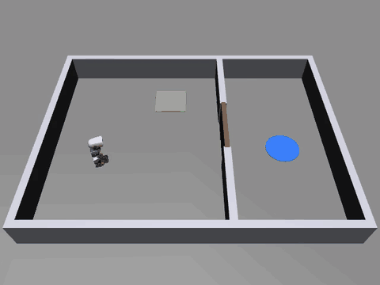
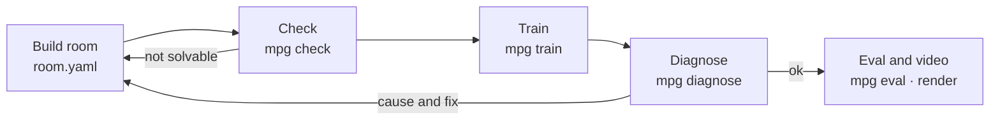

<p align="center"><a href="../README.md">한국어</a> · <b>English</b> · <a href="README.ja.md">日本語</a></p>

# mujoco-puzzle-gym — a puzzle lab that agents build

A framework in which AI agents build puzzle rooms inside a MuJoCo physics simulation and train a robot body in them. A puzzle is a program, not a fixed scene. You build a room whose state changes by wiring floor switches, doors, signals and logic together in YAML, and when a part is missing you register one more Python class. The agent runs the loop itself: build a room, check that it can be solved, train briefly, and when training fails, get a diagnosis and fix the room.

<p align="center"></p>
<p align="center"><sub>A policy trained for 15 minutes steps on the switch, opens the door and reaches the goal on a layout it has not seen. Robot model: Pollen Robotics Microduck (CC BY-NC-SA 4.0).</sub></p>

## What is this?

Most public robot learning environments have fixed scenes. The kitchen, desk or maze is built in advance, and a new task means editing the environment code. Training a real walking robot body on multi-step puzzles where device states change (step on a switch, a door opens, a button behind it turns on another device) takes a lot of hand work.

mujoco-puzzle-gym is built so that an agent can do this work.

- **Puzzles are built like programs.** A room is one `room.yaml`: walls, part positions, randomisation ranges and the signal links between parts. A new device is one `Part` class plus a registration call. No library code changes.
- **Check that a room can be solved first.** Before spending hours on training, it checks in seconds that a solution order exists, that the physics stays stable while the body stands still, and that a scripted solver that knows the answer actually solves it.
- **Train, and learn why training failed.** When training does not work, it names one of four causes (environment bug, the body falls, not enough exploration, reward hacking) with evidence numbers, a failure video and a direction for the fix.
- **Every command prints JSON.** An agent can read the results and choose its next step without a person.

The first body is [Microduck](https://github.com/pollen-robotics/microduck_rl), a small biped robot by Pollen Robotics. Its published walking policy is used as is, and only "which way to walk and how fast" is learned on top of it. The body sits behind an adapter, so another body can take its place.

## How it works



1. **Build**: an agent (or a person) writes `room.yaml` and the training settings `task.yaml`. `mpg build` makes the MJCF and a top-view image to look at.
2. **Check**: `mpg check` runs three stages. (a) Given the signal links and walls, is there a solution order that reaches the goal? (b) Does the body stay up with no NaN for 10 s at zero command? (c) Does a scripted solver that knows the answer solve at least 18 of 20 random layouts?
3. **Train**: `mpg train` trains for a set time and leaves a checkpoint, learning curves and an episode log in `runs/<id>/`.
4. **Diagnose**: `mpg diagnose` reads the training log and fresh rollouts and classifies the cause. Fix it and train again.
5. **Eval and video**: `mpg eval` measures the success rate on layouts not used in training, and `mpg render` makes a success video.

## Features

- **Rooms in YAML**: room size and walls, part layout, per-part randomisation ranges, start pose, and signal links between parts (`links`).
- **Extensible parts, observations, rewards and algorithms**: all go through the same registration functions (`register_part`, `register_obs`, `register_reward`, `register_algo`). The built-in parts are registered the same way.
- **Three-stage check**: solution order, physics stability, scripted-solver success rate.
- **Training**: PPO (default), SAC and A2C from Stable-Baselines3. Your own algorithm plugs in through the `Trainer` interface. Parallel environments, checkpoints, per-term reward logs, learning curves.
- **Diagnosis**: four causes (environment bug, body failure, exploration, reward hacking) with evidence numbers, a failure video and a fix direction.
- **Eval and video**: success rate and mean time on held-out seeds, comparison with a random policy, offscreen MP4.
- **Body adapter**: the puzzle code knows nothing about the body. The adapter takes a motion command, moves the body and returns the body state.
- **Pinned assets**: the robot model and walking policy come from fixed commits of the official repositories and are checked by SHA256.

## Quick start

You need [uv](https://docs.astral.sh/uv/) and Python 3.12. Tested on macOS (Apple Silicon).

```bash
git clone https://github.com/Song-Seng-Hun/mujoco-puzzle-gym.git
cd mujoco-puzzle-gym
uv sync
```

Download the robot model and walking policy (43 files, about 22 MB). The files are checked by hash, and their source and license are printed.

```bash
uv run mpg fetch-assets
```

Check that the example room can be solved. It takes a few seconds.

```bash
uv run mpg check examples/switch_door.yaml
```

Train a policy in the example room, evaluate it and render a video. On a 12-core machine, 15 minutes of training solved 99% of unseen layouts (log: [training-log.md](training-log.md)).

```bash
uv run mpg train examples/task_ppo.yaml --minutes 15 --id first
```

```bash
uv run mpg eval runs/first --episodes 100
```

```bash
uv run mpg render runs/first
```

## Commands

Every command accepts `--json` and exits non-zero on failure.

| Command | What it does |
|---|---|
| `mpg fetch-assets` | Download the robot model and walking policy from pinned commits and verify hashes |
| `mpg build <room.yaml>` | Make the body + room MJCF and a top-view PNG |
| `mpg check <room.yaml>` | Check solution order, physics stability and scripted-solver success |
| `mpg train <task.yaml> --minutes N` | Train for a set time; results in `runs/<id>/` |
| `mpg diagnose runs/<id>` | Classify the failure cause, with evidence numbers and a failure video |
| `mpg eval runs/<id>` | Success rate and mean time on held-out layouts (`--policy random` for a baseline) |
| `mpg render runs/<id>` | MP4 of a success episode |
| `mpg bench` | Measure simulation speed of the walking body and the environment |
| `mpg version` | Print the version |

## Building a puzzle room

The example room [`examples/switch_door.yaml`](../examples/switch_door.yaml). Stepping on the switch opens the door in the divider; reaching the goal behind it is success.

```yaml
name: switch_door
size: [2.4, 1.8]                  # interior size [m], centred at the origin
wall: {thickness: 0.06, height: 0.25}
walls:                            # divider at x = 0.3 with a 0.5 m opening in the middle
  - {from: [0.3, -0.9], to: [0.3, -0.28]}
  - {from: [0.3, 0.28], to: [0.3, 0.9]}
spawn: {pos: [-0.75, 0.0], yaw: 0.0, random: [0.2, 0.35, 3.14]}
parts:
  - {name: switch_a, type: switch, pos: [-0.25, 0.5], size: [0.3, 0.3], random: [0.15, 0.1]}
  - {name: door_b, type: door, pos: [0.3, 0.0], width: 0.5, axis: y}
  - {name: goal, type: goal, pos: [0.85, 0.0], radius: 0.15, random: [0.1, 0.45]}
links:
  - {from: switch_a, to: door_b}  # door_b opens when switch_a is on
```

- `random` is the range by which the layout is shaken each episode. Evaluation uses layouts from seeds not used in training.
- A door can require several switches together with `require: all | any`. A switch stays on once stepped on by default; with `latch: false` it is on only while pressed.
- Deliberately broken rooms and settings are in [`examples/broken/`](../examples/broken/). They test whether check and diagnose name the cause correctly.

## Training settings

[`examples/task_ppo.yaml`](../examples/task_ppo.yaml) sets the room, observations, rewards and algorithm. Missing keys take defaults, and the full resolved settings are saved as `runs/<id>/task.resolved.yaml`.

```yaml
room: switch_door.yaml
env: {hz: 10, episode_seconds: 40}       # the high-level policy decides 10 times a second
obs: [gravity, ang_vel, lin_vel, part_pos, part_state]
reward: {progress: 10.0, stage: 2.0, success: 10.0, fall: -5.0}
termination: {success: true, fall: true}
algo: ppo
algo_kwargs: {learning_rate: 0.0003, n_steps: 256, batch_size: 1024, gamma: 0.99}
net: [128, 128]
n_envs: 12
plugins: []                              # your own part / observation / reward modules
```

## Adding parts, observations, rewards and algorithms

A puzzle device is a Python class that inherits `Part`. It adds its own body to the scene (`build`), reads its state every body step (`update`) and reports a state value (`state`, `satisfied`). Once it declares a role (`switch`, `gate`, `goal`, `prop`), the check and the environment put it into the solution order.

```python
# my_parts.py
from mujoco_puzzle_gym.parts.base import Part
from mujoco_puzzle_gym.registry import register_part, register_reward

@register_part("timed_switch")
class TimedSwitch(Part):
    role = "switch"
    ...

@register_reward("upright")
def upright(env):                 # the term value before its weight is applied
    return -float(env.body_state.gravity[2])
```

Put `plugins: [my_parts]` in `task.yaml` and the module is imported first, in the main process and in every parallel training worker. A training algorithm implements `algos.base.Trainer` and is registered with `register_algo`, or published through the package entry point `mujoco_puzzle_gym.algos`.

## Body adapter

The puzzle code does not know which body is walking. `BodyAdapter` is the boundary.

- `spawn`: add the body to the scene.
- `reset`: put the body in its standing pose and clear the controller state.
- `step`: follow a motion command (forward speed, lateral speed, turn rate) for one control period.
- `state`: return position, orientation, velocities and whether the body has fallen.

The Microduck adapter runs the official walking policy `velstand.onnx` at 50 Hz with the motor model (BAM) from the official repository. Body names (joints, sites) are handled only inside `bodies/`. To add another body, implement these four methods and its command limits.

## Status and limits

- **Milestone 1 done**: the full loop of building, checking, training, diagnosing and evaluating a switch → door → goal puzzle works. The built-in parts are still three: switch, door and goal. Other devices can be added as plugins.
- **Next (milestone 2)**: a part catalog is being designed: buttons, sensors, logic gates, counters, warps, traps, beak grabbing, self-moving robots, tow ropes, checkpoints and curriculum training.
- The high-level policy uses privileged observations that read the puzzle state directly. There is no policy yet that solves puzzles from real sensors (camera, distance sensor) alone.
- The official walking policy is used frozen. It cannot walk backward and walks forward at about 0.12–0.22 m/s. Room sizes and time limits have to fit this speed.
- Simulation only. Transfer to the real robot (sim2real) is out of scope.
- Tested on macOS (Apple Silicon, CPU MuJoCo). Rendering on Linux has not been checked yet.

## Built with AI

The planning, design documents, code, tests and training experiments in this repository were made by the author together with Claude (Anthropic). The design documents are in [specs/](specs/).

## Credits and license

- Code in this repository: [Apache-2.0](../LICENSE).
- Robot model and meshes: © Pollen Robotics, [microduck_rl](https://github.com/pollen-robotics/microduck_rl) pinned commit `0daab160`. The MJCF is Apache-2.0; the 3D meshes (`*.stl`) are [CC BY-NC-SA 4.0](https://creativecommons.org/licenses/by-nc-sa/4.0/) (non-commercial, share-alike). The meshes are not in this repository; `mpg fetch-assets` downloads them unmodified. The MJCF is edited only in memory.
- Walking policy: `velstand.onnx` from [pollen-robotics/microduck-policies](https://huggingface.co/pollen-robotics/microduck-policies), Apache-2.0.
- The demo video and images show the CC BY-NC-SA 4.0 meshes.
- This is an unofficial project, not affiliated with Pollen Robotics.

## More

- [training-log.md](training-log.md): training log and diagnosis results on broken settings
- [bench.md](bench.md): simulation speed measurements
- [specs/](specs/): intent, requirements and implementation plan documents
