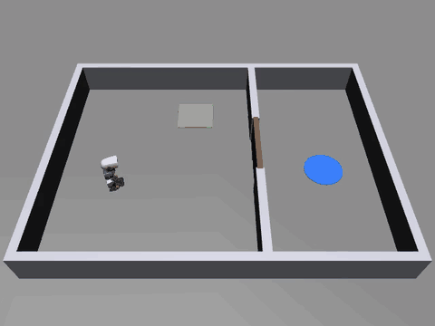

<p align="center"><a href="../README.md">한국어</a> · <a href="README.en.md">English</a> · <b>日本語</b></p>

<p align="center">
  <picture>
    <source media="(prefers-color-scheme: dark)" srcset="../assets/banner-dark.svg">
    
  </picture>
</p>

# mujoco-puzzle-gym — エージェントが作るパズル実験場

AIコーディングエージェントがMuJoCoの物理シミュレーションの中にパズル部屋を自分で組み立て、その部屋でロボットの体を学習させるフレームワークです。ロボットを動かすのはその部屋で強化学習したポリシーで、エージェントがロボットを直接操作するわけではありません。パズルは決まった場面ではなく、プログラムです。床スイッチ、ドア、信号、論理をつないで状態が変わる部屋をYAMLで組み、足りない部品はPythonのクラスを一つ登録すれば足せます。エージェントは「部屋を作る → 解けるか点検する → 短く学習させる → 失敗したら原因の診断を受けて直す」というサイクルを自分で回します。

<p align="center"></p>
<p align="center"><sub>15分学習したポリシーが、初めて見る配置でスイッチを踏んでドアを開け、ゴールへ向かう様子です。ロボットモデル: Pollen Robotics マイクロダック(CC BY-NC-SA 4.0)。</sub></p>

## これは何ですか

- **パズルをプログラムのように組み立てます。** 部屋一つは`room.yaml`一つです。壁、部品の位置、エピソードごとに位置をランダムに変える範囲、部品どうしの信号のつながりを書きます。新しい装置はPythonのクラス一つで足せます。
- **解けるかどうかを先に確かめます。** 学習に時間を使う前に、解く順序があるか、物理が安定しているか、答えを知っているスクリプトが解けるかを数秒で確認します。
- **学習し、うまくいかない理由を教えます。** 失敗すると原因(環境のバグ、転倒、探索不足、報酬ハッキング)と根拠、直す方向を出します。AIエージェントが人の手を借りずにこのサイクルを回せます。
- **報酬も設計します。** 報酬は項目と重みで`task.yaml`に書きます(進み具合、段階、成功、転倒など)。診断が「報酬ハッキング」や「探索不足」を指摘すると、エージェントが重みを直すか、新しい報酬項目をPythonの関数一つで登録して、もう一度学習します。

エージェントはこのリポジトリに含まれていません。お使いのAIコーディングエージェント(Claude Codeなど)にYAMLとPythonのファイルを編集させ、`mpg`コマンドを実行させて使います。人も同じコマンドで直接使えます。

最初の体はPollen Roboticsの[マイクロダック](https://github.com/pollen-robotics/microduck_rl)です。公開されている歩行ポリシーをそのまま使い、その上で「どこへどれくらいの速さで歩くか」だけを新しく学習します。

## 主な機能

- **部品は複数の属性の組み合わせです。** 部品一つは種類(`type`)と属性(位置、大きさ、一度踏むとオンのまま残るか、開く向き、エピソードごとに位置をランダムに変える範囲など)でできています。部品の一覧と各属性は別の[部品の文書](parts.ja.md)にまとめました。
- **エージェントが部品を組み立ててパズルを設計します。** 部品を選んで置き、信号線(`links`)でつなげばパズルになります。スイッチ → ドア → ゴールのような単純な部屋から、複数のスイッチがすべてオンのときだけ開くドア(`require: all`)のように条件を重ねた部屋まで同じやり方で作れ、足りない部品は自分で作ってはめ込めます。
- **ランダム化に対応しています。** いまは部品の位置と出発位置・向きをエピソードごとに決めた範囲でエピソードごとに少しずつ変えて配置し、ポリシーが配置を覚えるのではなくパズルを解くようにします。エリア内のどこかに置く、候補から一つ選ぶ、部屋の配線や部屋そのものを変えるランダム化も入っています。
- **基準(ベースライン)環境が入っています。** サンプルの部屋、検証済みのPPO学習設定、学習済みポリシー(`mpg demo`)、同じシードでのランダムポリシーとの比較(`mpg eval --policy random`)、わざと壊した設定集([`examples/broken/`](../examples/broken/))があり、新しい部屋や新しいアルゴリズムを比べる出発点になります。
- **体を取り替えられます。** パズル側のコードは体を知らず、体のアダプターが移動の指示を受けて体を動かします。体のアダプターを新しく作ってつなげば、別のロボットも同じ部屋で学習できます(方法は[使い方ガイド](guide.ja.md#体のアダプター))。いま入っている体は四つです — 二足、四足、ヒューマノイド、そして**まったく歩かない固定ベースのアーム**。体によってできることが違うので、部品は必要な能力を宣言し、`mpg check`がそれを持たない体を**理由を述べて拒否します** — どの部品がどの体で動くかは[体と部品](bodies.ja.md)に表があります。

## 入っている部品

内蔵部品**68種**、それらの値まで整えた**プリセット87種**、部屋ひとつがまるごと入った**部屋プリセット44種**があります。スイッチ・ドア・ゴールといった基本の部品から、論理ゲートとカウンター、動く台とコンベヤー、罠、磁石と光(鏡・分光器・光電池)、つかんで扱う物体やレバー・ダイヤルまで入っています。

種類ごとの一覧と項目、値を整えたプリセットは[部品とプリセットの案内](parts-guide.ja.md)にあり、足りない部品はプラグインで足せます。

## 挑戦してみてください

部屋プリセットは**44個**あり、**学習した方策の記録があるのは三つ**です。残り**41マスは空**です。

<table>
<tr>
<td width="50%"><br><b>締め切り</b> — 40秒後にプレスがコイン錠を壊す。先に扉を開けられなければその回は永久に終わり</td>
<td width="50%"><br><b>指でつかむ</b> — 溶接なし、指二本で押さえて持つ。学習した方策の最高は<b>0.52</b></td>
</tr>
<tr>
<td width="50%"><br><b>光の分け前</b> — 一本の光を分けて二つの光電池のしきい値を同時に越える</td>
<td width="50%"><br><b>連鎖</b> — ボールを押してピン三つを倒すと扉が開く</td>
</tr>
</table>

台本の解法はすべての部屋を解きます(リポジトリが毎回20シードで確認します)。均一ランダムな方策は
ほとんどの部屋で0です。**その間があなたのアルゴリズムの場所です。**

> `puzzles/tabletop/pick_and_place` — PPOで**25 Mステップ、成功率0.00**。
> 部屋の台本解法を複製すると**1.7 Mステップで1.00**。
> あなたのアルゴリズムは何ステップでいくらですか?

```bash
mpg train examples/task_pick_and_place.yaml --minutes 15 --id mine
mpg eval runs/mine --episodes 100                   # held-outシード 1,000,000〜
mpg eval runs/mine --episodes 100 --policy random    # 同じシードの基準線
```

残り六つの部屋、44部屋のはしご、規約と既知の記録は[挑戦のドキュメント](challenges.ja.md)にあります。

## インストール

macOSかLinuxなら、次の一行で済みます。必要なもの(uv、Python 3.12、依存パッケージ、ロボットモデルと歩行ポリシー約22 MB)をすべて入れ、サンプルの部屋で正しく入ったかまで確かめます。

```bash
git clone https://github.com/Song-Seng-Hun/mujoco-puzzle-gym.git && cd mujoco-puzzle-gym && ./install.sh
```

macOS(Apple Silicon)で確認しました。Windowsはまだ試していません。

## 試してみる

学習済みのアヒルがサンプルの部屋を解く動画をすぐに作ります(`demo.mp4`)。

```bash
uv run mpg demo
```

自分で学習させてみます。12コアの環境では、15分で初めて見る配置の99%を解きました([学習の記録](training-log.md))。

```bash
uv run mpg train examples/task_ppo.yaml --minutes 15 --id first
```

```bash
uv run mpg render runs/first
```

## 自分のパズル部屋を作る

サンプルの部屋[`examples/switch_door.yaml`](../examples/switch_door.yaml)をコピーして書き換え、解けるか点検してから学習させます。スイッチを踏むとドアが開き、ゴールに着けば成功の部屋です。

```yaml
name: switch_door
size: [2.4, 1.8]                  # 部屋の内寸 [m]、原点が中央
wall: {thickness: 0.06, height: 0.25}
walls:                            # x = 0.3の仕切り、中央の0.5 mが開いている
  - {from: [0.3, -0.9], to: [0.3, -0.28]}
  - {from: [0.3, 0.28], to: [0.3, 0.9]}
spawn: {pos: [-0.75, 0.0], yaw: 0.0, random: [0.2, 0.35, 3.14]}
parts:
  - {name: switch_a, type: switch, pos: [-0.25, 0.5], size: [0.3, 0.3], random: [0.15, 0.1]}
  - {name: door_b, type: door, pos: [0.3, 0.0], width: 0.5, axis: y}
  - {name: goal, type: goal, pos: [0.85, 0.0], radius: 0.15, random: [0.1, 0.45]}
links:
  - {from: switch_a, to: door_b}  # switch_aがオンになるとdoor_bが開く
```

```bash
uv run mpg check my_room.yaml
```

この部屋で学習するには、[`examples/task_ppo.yaml`](../examples/task_ppo.yaml)も`my_task.yaml`にコピーして`room: my_room.yaml`に書き換え、`uv run mpg train my_task.yaml --minutes 15 --id my-room`を実行します。部屋のパスは学習設定ファイルのあるフォルダーを基準に探します。

コマンドの一覧、学習設定、部品や報酬の足し方、体の取り替えは[使い方ガイド](guide.ja.md)にあります。

## 結果

マイルストーン七つでここまで来ました。部屋を組み、点検し、学習し、診断するサイクルが回り、四つの体(二足のダック、四足、ヒューマノイド、そして歩かない固定ベースのアーム)が同じ境界を使います。部品は自分に必要な能力を宣言し、できない体は `mpg check` が理由を言って断るので、卓上の部屋は脚のない体だけが解き、広い部屋は大きな体だけが解きます。

- **歩く体**: 12コアで15分の学習で、初めて見る配置の**99%**。
- **アーム**: 物をつかんで箱・塔・コンベヤーへ運び、溶接なしに指の接触だけで保持するつかみも**20/20**。
- **実機に近い条件**: センサーだけの観測(自己受容感覚 + 関節 + 手首カメラ視線)で到達**0.93**、アクチュエーターの遅延と検出誤差(位置ノイズ・ドロップアウト・キャリブレーション偏り・レンズ歪み)をモデルに入れ、その下で学習して**0.94**。

マイルストーンごとの詳細、取り消した設計とその測定値は[学習ログ](training-log.md)と[設計ドキュメント](specs/)にあります。

## 限界

終えられなかったことは、推測ではなく測って書きました。

- **指二本で押さえて運ぶ部屋**: 完走するポリシーは**あります**(50シードで0.52)。ただしそういうポリシーが出るのは三回に一回で、ばらつきは学習の初期化ではなく、そのシードが引くデータ分布の側でした。
- **アクチュエーター遅延40 ms**: アームの部屋十のうち五つが解けません。原因は一つではなく**四つ**です — 三つは `grab` を終えられず、二つだけが移動段階まで進みます。七回の修正はいずれも別の部屋を壊すか、どの部屋も開けませんでした。どの部屋がどのサブゴールで止まるかは `python tools/latency_stall.py` が出力します。
- **観測**: 上位ポリシーは標準でパズルの状態をそのまま読みます。`obs:` に距離センサーとカメラを入れればセンサー観測で学習でき、`critic_obs:` で価値関数にだけ特権観測を渡せますが、カメラでの学習は約15倍遅いため、センサーだけのポリシーは画像そのものではなく距離・関節エンコーダー・マーカー視線を読みます。
- **手がかりなしの順序推論**: 手がかりを切った部屋(`order_blind`)の最高記録は、理論上の上限にぴったり付いた0.29です。歩く体の基本の部屋は順序が常に同じです(スイッチ → ドア → ゴール)。
- **歩行ポリシー**は公式に配布されたものをそのまま固定して使います。後ろには歩けず、前には約0.12〜0.22 m/sで歩くので、部屋の大きさと制限時間はこの速さに合わせる必要があります。
- シミュレーションだけを扱います。実機へ移すこと(sim2real)は範囲外です。macOS(Apple Silicon, CPU MuJoCo)で確認し、Linuxの描画とWindowsは未確認です。

## AIと一緒に作ったプロジェクト

このリポジトリの企画、設計文書、コード、テスト、学習実験は、作者とClaude(Anthropic)が一緒に作りました。設計文書は[specs/](specs/)にあります。

## 出典とライセンス

- このリポジトリのコード: [Apache-2.0](../LICENSE)。
- ロボットモデルとメッシュ: © Pollen Robotics、[microduck_rl](https://github.com/pollen-robotics/microduck_rl)の固定コミット`0daab160`。MJCFはApache-2.0、3Dメッシュ(`*.stl`)は[CC BY-NC-SA 4.0](https://creativecommons.org/licenses/by-nc-sa/4.0/)(非営利、継承)です。メッシュはこのリポジトリに含まれておらず、`mpg fetch-assets`が元のまま取得します。MJCFはメモリ上でのみ書き換えます。
- 歩行ポリシー: [pollen-robotics/microduck-policies](https://huggingface.co/pollen-robotics/microduck-policies)の`velstand.onnx`、Apache-2.0。
- 二つめの体のモデル: [MuJoCo Menagerie](https://github.com/google-deepmind/mujoco_menagerie)の固定コミット`370c4396`の`unitree_go2/`、BSD-3-Clause。モデルもメッシュも同じです。
- 固定ベースのアームのモデル: [MuJoCo Menagerie](https://github.com/google-deepmind/mujoco_menagerie)の固定コミット`370c4396`の`robotstudio_so101/`、Apache-2.0。使えるライセンスの事前学習ポリシーが無いため、制御は逆運動学です。
- ヒューマノイドのモデル: 同じコミットの`unitree_g1/`、BSD-3-Clause。歩行ポリシーは[unitree_rl_gym](https://github.com/unitreerobotics/unitree_rl_gym)の固定コミットの`deploy/pre_train/g1/motion.pt`、BSD-3-Clause — **このポリシーも公式に凍結された配布ではなく**、そのリポジトリが配布例と一緒に置いているチェックポイントです。
- 二つめの体の歩行ポリシー: [diasAiMaster/unitree-go2-velocity-flat](https://huggingface.co/diasAiMaster/unitree-go2-velocity-flat)の固定リビジョン`9a723b7a`、BSD-3-Clause。**このポリシーはUnitreeの公式な配布ではなく、コミュニティが上げたチェックポイントです。** 平地で学習しており(`gait_phase`なし、action scale 0.5)、学習コードは上流を変更していません。詳しい事実は[体と部品](bodies.ja.md)にあります。
- デモ動画と画像にはCC BY-NC-SA 4.0のメッシュが写っています。
- これは非公式のプロジェクトで、Pollen Roboticsとは関係ありません。

## もっと見る

- [使い方ガイド](guide.ja.md): 動作サイクル、コマンド、学習設定、拡張、体のアダプター
- [エージェント向け案内](../AGENTS.md): AIエージェントがこのリポジトリで作業するとき最初に読む文書(英語)
- [部屋とポリシーを共有する](community.ja.md): 作った部屋をPRで送る、ポリシーをONNXで共有する、他人のpickleを開かない理由
- [部品の一覧と属性](parts.ja.md): いま入っている部品とその属性
- [学習の記録](training-log.md): 学習結果と、わざと壊した設定に対する診断
- [速度の測定](bench.md)
- [設計文書](specs/)
