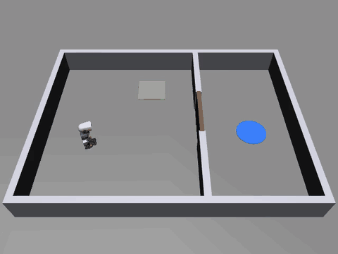
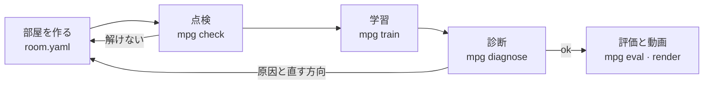

<p align="center"><a href="../README.md">한국어</a> · <a href="README.en.md">English</a> · <b>日本語</b></p>

# mujoco-puzzle-gym — エージェントが作るパズル実験場

AIエージェントがMuJoCoの物理シミュレーションの中にパズル部屋を自分で組み立て、その部屋でロボットの体を学習させるフレームワークです。パズルは決まった場面ではなく、プログラムです。床スイッチ、ドア、信号、論理をつないで状態が変わる部屋をYAMLで組み、足りない部品はPythonのクラスを一つ登録すれば足せます。エージェントは「部屋を作る → 解けるか点検する → 短く学習させる → 失敗したら原因の診断を受けて直す」というサイクルを自分で回します。

<p align="center"></p>
<p align="center"><sub>15分学習したポリシーが、初めて見る配置でスイッチを踏んでドアを開け、ゴールへ向かう様子です。ロボットモデル: Pollen Robotics マイクロダック(CC BY-NC-SA 4.0)。</sub></p>

## これは何ですか

公開されているロボット学習環境の多くは、場面が固定されています。キッチン、机、迷路があらかじめ作られていて、新しい課題を入れるには環境のコードを直接書き換える必要があります。装置の状態が変わる多段階パズル(スイッチを踏むとドアが開き、その先のボタンが別の装置を動かす、など)を実際に歩くロボットの体で学習させるのは、とくに手間がかかります。

mujoco-puzzle-gymは、この作業をエージェントに任せられるように作ったフレームワークです。

- **パズルをプログラムのように組み立てます。** 部屋は`room.yaml`一つで決まります。壁、部品の位置、ランダム配置の範囲、部品どうしの信号のつながりを書くだけです。新しい装置が必要なら`Part`クラスを一つ書いて登録します。ライブラリのコードは変えません。
- **解けるかどうかを先に確かめます。** 何時間も学習に使う前に、解く順序が存在するか、体が立っているだけで物理が安定しているか、答えを知っているスクリプトが本当に解けるかを数秒で調べます。
- **学習し、失敗した理由を教えます。** 学習がうまくいかないとき、原因を四つ(環境のバグ、体が転ぶ、探索不足、報酬のすり抜け)のうち一つに絞り、根拠の数値、失敗動画、直す方向を出します。
- **すべてのコマンドがJSONを出します。** エージェントは人の手を借りずに結果を読み、次の行動を決められます。

最初の体は、Pollen Roboticsの小さな二足ロボット[マイクロダック](https://github.com/pollen-robotics/microduck_rl)です。公開されている歩行ポリシーをそのまま使い、その上で「どの方向にどれくらいの速さで歩くか」だけを新しく学習します。体はアダプターの向こう側にあるので、別の体に取り替えられます。

## どう動くのか



1. **部屋を作る**: エージェント(または人)が`room.yaml`と学習設定`task.yaml`を書きます。`mpg build`でMJCFと上から見た画像を作り、目で確かめます。
2. **点検**: `mpg check`が三段階を見ます。(a) 信号のつながりと壁の配置から見て、ゴールまでの解く順序があるか。(b) 指令0で10秒間、転んだり計算が発散したりしないか。(c) 答えを知っているスクリプトが、ランダム配置20個のうち18個以上を解けるか。
3. **学習**: `mpg train`が決めた時間だけ学習し、チェックポイント、学習曲線、エピソード記録を`runs/<id>/`に残します。
4. **診断**: `mpg diagnose`が学習記録と新しいロールアウトを見て原因を分類します。直してからもう一度学習します。
5. **評価と動画**: `mpg eval`が学習に使っていない配置で成功率を測り、`mpg render`が成功動画を作ります。

## 主な機能

- **YAMLで組む部屋**: 部屋の大きさと壁、部品の配置、部品ごとのランダム範囲、出発姿勢、部品どうしの信号のつながり(`links`)。
- **拡張できる部品・観測・報酬・アルゴリズム**: すべて同じ登録関数(`register_part`、`register_obs`、`register_reward`、`register_algo`)で入ります。内蔵部品も同じ方法で登録されています。
- **三段階の点検**: 解く順序、物理の安定性、スクリプト解答の成功率。
- **学習**: Stable-Baselines3のPPO(既定)、SAC、A2C。自作のアルゴリズムは`Trainer`インターフェースでつなぎます。並列環境、チェックポイント、報酬項目ごとの記録、学習曲線。
- **診断**: 環境のバグ、体の失敗、探索不足、報酬のすり抜けの四分類と、根拠の数値、失敗動画、直す方向。
- **評価と動画**: 学習に使っていないシードでの成功率と平均所要時間、ランダムポリシーとの比較、オフスクリーンMP4。
- **体のアダプター**: パズル側のコードは体のことを知りません。アダプターが移動指令を受けて体を動かし、体の状態を返します。
- **固定されたアセット**: ロボットモデルと歩行ポリシーを公式リポジトリの固定コミットから取得し、SHA256で確認します。

## クイックスタート

[uv](https://docs.astral.sh/uv/)とPython 3.12が必要です。macOS(Apple Silicon)で確認しました。

```bash
git clone https://github.com/Song-Seng-Hun/mujoco-puzzle-gym.git
cd mujoco-puzzle-gym
uv sync
```

ロボットモデルと歩行ポリシーを取得します(43ファイル、約22 MB)。取得したファイルはハッシュで確認し、出典とライセンスもあわせて表示します。

```bash
uv run mpg fetch-assets
```

例の部屋が解ける部屋かどうか点検します。数秒で終わります。

```bash
uv run mpg check examples/switch_door.yaml
```

例の部屋でポリシーを学習し、評価して、動画を作ります。12コアの環境では、15分の学習で初めて見る配置の99%を解きました(記録: [training-log.md](training-log.md))。

```bash
uv run mpg train examples/task_ppo.yaml --minutes 15 --id first
```

```bash
uv run mpg eval runs/first --episodes 100
```

```bash
uv run mpg render runs/first
```

## コマンド

すべてのコマンドは`--json`を受け付け、失敗すると0以外の終了コードを返します。

| コマンド | すること |
|---|---|
| `mpg fetch-assets` | ロボットモデルと歩行ポリシーを固定コミットから取得し、ハッシュで確認 |
| `mpg build <room.yaml>` | 体と部屋を合わせたMJCFと、上から見たPNGを作る |
| `mpg check <room.yaml>` | 解く順序、物理の安定性、スクリプト解答の成功率を点検 |
| `mpg train <task.yaml> --minutes N` | 決めた時間だけ学習、結果は`runs/<id>/` |
| `mpg diagnose runs/<id>` | 失敗の原因を分類、根拠の数値と失敗動画 |
| `mpg eval runs/<id>` | 学習に使っていない配置での成功率と平均時間(`--policy random`で基準線) |
| `mpg render runs/<id>` | 成功エピソードのMP4 |
| `mpg bench` | 歩く体と環境のシミュレーション速度を測る |
| `mpg version` | バージョンを表示 |

## パズル部屋を作る

例の部屋[`examples/switch_door.yaml`](../examples/switch_door.yaml)です。スイッチを踏むと仕切りのドアが開き、ドアの先のゴールに着けば成功です。

```yaml
name: switch_door
size: [2.4, 1.8]                  # 部屋の内寸 [m]、原点が中央
wall: {thickness: 0.06, height: 0.25}
walls:                            # x = 0.3の仕切り、中央の0.5 mが開いている
  - {from: [0.3, -0.9], to: [0.3, -0.28]}
  - {from: [0.3, 0.28], to: [0.3, 0.9]}
spawn: {pos: [-0.75, 0.0], yaw: 0.0, random: [0.2, 0.35, 3.14]}
parts:
  - {name: switch_a, type: switch, pos: [-0.25, 0.5], size: [0.3, 0.3], random: [0.15, 0.1]}
  - {name: door_b, type: door, pos: [0.3, 0.0], width: 0.5, axis: y}
  - {name: goal, type: goal, pos: [0.85, 0.0], radius: 0.15, random: [0.1, 0.45]}
links:
  - {from: switch_a, to: door_b}  # switch_aがオンになるとdoor_bが開く
```

- `random`はエピソードごとに配置を揺らす範囲です。評価は学習に使っていないシードの配置で行います。
- ドアは`require: all | any`で複数のスイッチを同時に求められます。スイッチは既定では一度踏むとオンのままで、`latch: false`なら踏んでいる間だけオンです。
- わざと壊した部屋と設定が[`examples/broken/`](../examples/broken/)にあります。点検と診断が原因を正しく指摘するかを見るためのテスト用です。

## 学習設定

[`examples/task_ppo.yaml`](../examples/task_ppo.yaml)は部屋、観測、報酬、アルゴリズムを決めます。足りないキーは既定値を使い、埋めた後の設定全体は`runs/<id>/task.resolved.yaml`に保存されます。

```yaml
room: switch_door.yaml
env: {hz: 10, episode_seconds: 40}       # 上位ポリシーは1秒に10回決める
obs: [gravity, ang_vel, lin_vel, part_pos, part_state]
reward: {progress: 10.0, stage: 2.0, success: 10.0, fall: -5.0}
termination: {success: true, fall: true}
algo: ppo
algo_kwargs: {learning_rate: 0.0003, n_steps: 256, batch_size: 1024, gamma: 0.99}
net: [128, 128]
n_envs: 12
plugins: []                              # 自作の部品・観測・報酬モジュール
```

## 部品・観測・報酬・アルゴリズムを足す

パズルの装置は`Part`を継承したPythonクラスです。場面に自分の物体を足し(`build`)、体のステップごとに状態を読み(`update`)、状態の値を出します(`state`、`satisfied`)。役割(`switch`、`gate`、`goal`、`prop`)を決めれば、点検と環境がその部品を解く順序に入れて扱います。

```python
# my_parts.py
from mujoco_puzzle_gym.parts.base import Part
from mujoco_puzzle_gym.registry import register_part, register_reward

@register_part("timed_switch")
class TimedSwitch(Part):
    role = "switch"
    ...

@register_reward("upright")
def upright(env):                 # 重みを掛ける前の項目の値
    return -float(env.body_state.gravity[2])
```

`task.yaml`に`plugins: [my_parts]`と書くと、メインプロセスと並列学習のすべてのワーカープロセスで、このモジュールが最初に読み込まれます。学習アルゴリズムは`algos.base.Trainer`を実装して`register_algo`で登録するか、パッケージのエントリーポイント`mujoco_puzzle_gym.algos`で公開します。

## 体のアダプター

パズル側のコードは、どの体が歩いているかを知りません。`BodyAdapter`が境界です。

- `spawn`: 場面に体を足します。
- `reset`: 立った姿勢に置き、制御器の状態を消します。
- `step`: 移動指令(前後の速度、横の速度、回転の速度)に一制御周期のあいだ従います。
- `state`: 位置、姿勢、速度、転んだかどうかを返します。

マイクロダックのアダプターは、公式の歩行ポリシー`velstand.onnx`を50 Hzで動かし、公式リポジトリのモーターモデル(BAM)を使います。体の名前(関節、サイト)は`bodies/`の中だけで扱います。別の体をつなぐには、この四つのメソッドと指令の範囲を実装します。

## 現状と限界

- **マイルストーン1完了**: スイッチ → ドア → ゴールのパズルを組み、点検し、学習し、診断し、評価するサイクル全体が動きます。内蔵部品はまだスイッチ、ドア、ゴールの三つです。ほかの装置はプラグインで足せます。
- **次の段階(マイルストーン2)**: ボタン、センサー、論理ゲート、カウンター、ワープ、罠、くちばしでつかむ動作、自分で動くロボット、牽引ロープ、チェックポイントと段階的学習といった部品カタログを設計しています。
- 上位ポリシーは、パズルの状態をそのまま読む特権観測を使います。実機のセンサー(カメラ、距離センサー)だけで解くポリシーはまだありません。
- 歩行ポリシーは公式のものを固定して使います。このポリシーは後ろに歩けず、前へは約0.12–0.22 m/sで歩きます。部屋の大きさと制限時間はこの速さに合わせる必要があります。
- シミュレーションだけを扱います。実機のアヒルへの移行(sim2real)は範囲外です。
- macOS(Apple Silicon、CPU MuJoCo)で確認しました。Linuxでのレンダリングはまだ確認していません。

## AIと一緒に作ったプロジェクト

このリポジトリの企画、設計文書、コード、テスト、学習実験は、作者とClaude(Anthropic)が一緒に作りました。設計文書は[specs/](specs/)にあります。

## 出典とライセンス

- このリポジトリのコード: [Apache-2.0](../LICENSE)。
- ロボットモデルとメッシュ: © Pollen Robotics、[microduck_rl](https://github.com/pollen-robotics/microduck_rl)の固定コミット`0daab160`。MJCFはApache-2.0、3Dメッシュ(`*.stl`)は[CC BY-NC-SA 4.0](https://creativecommons.org/licenses/by-nc-sa/4.0/)(非営利、継承)です。メッシュはこのリポジトリに含まれておらず、`mpg fetch-assets`が元のまま取得します。MJCFはメモリ上でのみ書き換えます。
- 歩行ポリシー: [pollen-robotics/microduck-policies](https://huggingface.co/pollen-robotics/microduck-policies)の`velstand.onnx`、Apache-2.0。
- デモ動画と画像にはCC BY-NC-SA 4.0のメッシュが写っています。
- これは非公式のプロジェクトで、Pollen Roboticsとは関係ありません。

## もっと見る

- [training-log.md](training-log.md): 学習の記録と、壊した設定に対する診断結果
- [bench.md](bench.md): シミュレーション速度の測定
- [specs/](specs/): 意図、要件、実装計画の文書
