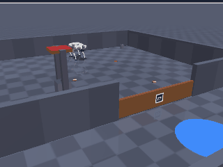
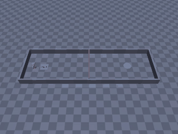
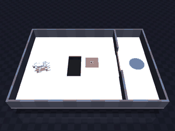
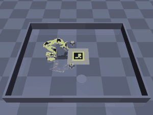
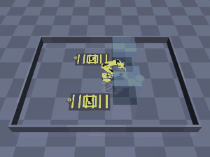
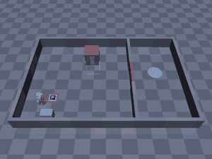
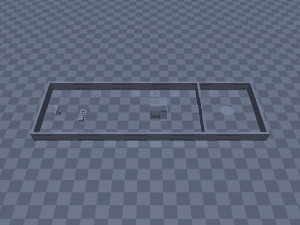

# The challenge - one empty cell per room

This repository has **44 room presets**. **Four of them have a trained policy's number.**
The other 41 "trained policy" cells are **empty**, and the table below is that emptiness.

The scripted solution solves every room (the repository checks that over 20 seeds, every
time). A uniform random policy scores zero in almost all of them. The gap between those two
is where your algorithm goes.

One line, if you read nothing else:

> `puzzles/tabletop/pick_and_place` - PPO: **25 M steps, success 0.00**.
> Cloning the room's own scripted solution: **1.00 in 1.7 M steps**.
> How many steps does yours need, and for how much?

<p align="center"></p>

<p align="center"><b>That is the run you lose.</b> Once the press hits the lock (it turns dark red) the counter that was adding up coins reads zero for the rest of the episode, so the cable from the lock to the door has nothing to carry - and the door never opens again.</p>

<p align="center"></p>

<p align="center">And this is the run you win - open the door at 28 s and the press falling at 40 s is <b>too late</b> (the door is <code>oneshot</code>: once open, it stays open).</p>

## The protocol - one number, fixed seeds, a declared budget

A challenge has to be comparable. In this repository the same room has scored **0.00 and
0.52** with nothing changed but the seed, so three things are reported together.

```bash
uv run mpg train examples/task_<room>.yaml --minutes <budget> --id mine
uv run mpg eval runs/mine --episodes 100            # held-out seeds 1,000,000-1,000,099
uv run mpg eval runs/mine --episodes 100 --policy random   # the baseline on the same seeds
```

- **One number**: `success_rate` from `mpg eval`. Not the training-time success rate.
- **Fixed seeds**: the eval seeds are a range training never touches (`EVAL_SEED_BASE`).
- **A declared budget**: wall-clock minutes **and** environment steps. Both are in
  `runs/<id>/summary.json`.

## The gallery - what the conditions look like

Ten rooms, four bodies, ten different mechanisms. Every number is one this repository measured: **scripted** is the mean time of the 20-seed check, **random** is a uniform random policy over the same 20 seeds, and **trained** is the record where one exists.

| | body | what happens on screen | scripted | random | trained |
|---|---|---|---:|---:|---|
|  | quadruped | `coins/beat_the_hammer` - after 40 s a press smashes the coin lock; the door has to be open before that | 45.6s | 0/20 | **empty** |
|  | arm | `tabletop/pick_by_hand` - lift the block with **two fingers pressing on it**, no weld, and put it in the box | 11.66s | 0/20 | 0.52 |
|  | duck | `light/split_the_beam` - split one beam with a splitter and match the **share** that reaches two photocells | 11.1s | 1/20 | **empty** |
|  | duck | `ball/bowling` - push the ball, and knocking any one of three pins down opens the door | 23.82s | 0/20 | **empty** |
|  | duck (roller) | `roller/glide_under` - put the rollers on and **slide under a low bar** | 14.66s | 0/20 | **empty** |
|  | quadruped | `wide/pit_detour` - go around the pit in a 5x4 m room; the only route is where a large body can stand | 30.78s | 0/20 | **empty** |
|  | arm | `tabletop/build_a_tower` - **stack** two blocks (a part that reads the stack decides it) | 10.6s | 0/20 | **empty** |
|  | arm | `tabletop/conveyor_triage` - two belts, two bins; sort blocks of different colours one at a time | 18.8s | 0/20 | **empty** |
|  | duck | `circuit/fuse_repair` - bring a cut circuit back by **carrying a fuse in the beak and plugging it in** | 26.73s | 0/20 | **empty** |
|  | duck | `tow/sled_delivery` - **drag** the sled on a rope and deliver it | 19.36s | 1/20 | **empty** |

## The ladder

The stars are measured, not opinions: **a room a random policy solves three times or more is
★**, one it solves once or twice (or whose scripted solution takes under 12 s) is ★★, under
25 s is ★★★, and longer is ★★★★. The body is the one that room's task file names.

### go2

| | room | scripted | random | trained policy |
|---|---|---:|---:|---|
| ★★★ | `wide/switch_door` | 24.58s | 0/20 | **0.96** (quadruped, PPO 30 min) |
| ★★★★ | `wide/pit_detour` | 30.78s | 0/20 | **empty** |
| ★★★★ | `coins/beat_the_hammer` | 45.6s | 0/20 | **empty** |

### microduck

| | room | scripted | random | trained policy |
|---|---|---:|---:|---|
| ★★★ | `light/aim_the_mirror` | 33.4s | 1/20 | **empty** |
| ★ | `roller/brake_strip` | 15.82s | 4/20 | **empty** |
| ★ | `roller/mode_switch_route` | 16.0s | 3/20 | **empty** |
| ★★ | `roller/speed_gate` | 10.4s | 1/20 | **empty** |
| ★★ | `light/split_the_beam` | 11.1s | 1/20 | **empty** |
| ★★ | `circuit/clock_door` | 14.23s | 1/20 | **empty** |
| ★★ | `tow/sled_delivery` | 19.36s | 1/20 | **empty** |
| ★★★ | `roller/crosswind` | 12.46s | 0/20 | **empty** |
| ★★★ | `budget/two_openings` | 13.2s | 0/20 | **empty** |
| ★★★ | `circuit/press_relay` | 13.27s | 0/20 | **empty** |
| ★★★ | `roller/glide_under` | 14.66s | 0/20 | **empty** |
| ★★★ | `ball/ball_ramp` | 14.78s | 0/20 | **empty** |
| ★★★ | `roller/timed_corridor` | 16.38s | 0/20 | **empty** |
| ★★★ | `tow/cleat_hold` | 17.25s | 0/20 | **empty** |
| ★★★ | `tow/drop_and_go` | 17.29s | 0/20 | **empty** |
| ★★★ | `circuit/jam_the_turret` | 17.83s | 0/20 | **empty** |
| ★★★ | `tow/npc_leash` | 20.23s | 0/20 | **empty** |
| ★★★ | `tow/tethered_start` | 20.32s | 0/20 | **empty** |
| ★★★ | `ball/mini_soccer` | 22.0s | 0/20 | **empty** |
| ★★★ | `ball/bowling` | 23.82s | 0/20 | **empty** |
| ★★★ | `circuit/cut_the_lock` | 24.36s | 0/20 | **empty** |
| ★★★ | `roller/one_way_station` | 24.52s | 0/20 | **empty** |
| ★★★★ | `circuit/wrong_wire` | 25.05s | 0/20 | **empty** |
| ★★★★ | `tow/chain_dropoff` | 25.43s | 0/20 | **empty** |
| ★★★★ | `circuit/peck_cable` | 25.73s | 0/20 | **empty** |
| ★★★★ | `tow/pit_bridge` | 26.19s | 0/20 | **empty** |
| ★★★★ | `circuit/fuse_repair` | 26.73s | 0/20 | **empty** |
| ★★★★ | `circuit/sabotage_order` | 29.52s | 0/20 | **empty** |
| ★★★★ | `ball/color_sort` | 30.1s | 0/20 | **empty** |
| ★★★★ | `roller/roll_delivery` | 37.45s | 0/20 | **empty** |
| ★★★★ | `tow/overload` | 49.7s | 0/20 | **empty** |

### so101

| | room | scripted | random | trained policy |
|---|---|---:|---:|---|
| ★ | `tabletop/reach_target` | 0.6s | 5/20 | **empty** |
| ★★ | `tabletop/reach_the_marker` | 1.44s | 1/20 | 0.93 (PPO 15 min, sensors only) |
| ★★ | `tabletop/weigh_it_down` | 7.6s | 0/20 | **empty** |
| ★★ | `tabletop/lever_arm` | 7.8s | 0/20 | **empty** |
| ★★ | `tabletop/pick_and_place` | 8.2s | 0/20 | 1.00 (cloned, privileged) |
| ★★ | `tabletop/fetch_the_steel` | 9.6s | 0/20 | **empty** |
| ★★ | `tabletop/build_a_tower` | 10.6s | 0/20 | **empty** |
| ★★ | `tabletop/pick_by_hand` | 11.66s | 0/20 | 0.52 (cloned, sensors only; one run in three) |
| ★★★ | `tabletop/dead_wedge` | 13.1s | 0/20 | **empty** |
| ★★★ | `tabletop/conveyor_triage` | 18.8s | 0/20 | **empty** |

## Three things nobody has done

| What | The measured state |
|---|---|
| **Carry something held by two fingers** (`tabletop/pick_by_hand`) | A policy that finishes it **exists** - 0.52 over 50 seeds. The recipe lands one such policy in **three runs**, and nine more fits on a third seed changed nothing, so the variance is in the data a seed draws |
| **40 ms of actuator latency** | **Five** of the ten arm rooms collapse there, and not for one reason but **four**: three never finish their `grab` (the weld tears at 3.04-11.39 N, or `_pinched` stays false so the contact grasp never forms), and only two reach the `goto goal` the fixes were written for. Seven attempted fixes each broke another room or opened none. Which room stops at which sub-goal is printed by `uv run python tools/latency_stall.py` |
| **Order reasoning with the cue off** (`order_blind`) | **0.29, exactly against the 1/3 ceiling** a policy that cannot read the cue is limited to. Nothing has gone above it |

## Known records

| Room | Body | Observation | Record | How |
|---|---|---|---|---|
| `tabletop/reach_the_marker` | arm | **sensors only** | **0.93** | PPO 15 min, 4.08 M steps |
| `tabletop/pick_and_place` | arm | privileged | **1.00** | cloned (`algo: bc`), 1.70 M steps |
| `tabletop/pick_by_hand` | arm | **sensors only** | **0.52** | cloned + DAgger, one run in three |
| `wide/switch_door` | quadruped | privileged | **0.96** | PPO 30 min, 2.85 M steps |
| `examples/switch_door.yaml` | duck | privileged | 0.99 | PPO 15 min (an example room, not a preset) |

Where those numbers come from, and the attempts that failed, are in the
[training log](training-log.md) - which also lists the **ten** measuring traps this project
walked into. There turned out to be that many ways to fool yourself while measuring.

## The new challenge room

**`puzzles/coins/beat_the_hammer`** (the GIF above): three coins open the door, but at 40
seconds a hammer comes down and smashes the lock in one strike, and a broken lock reads zero
for the rest of the episode. The scripted solution is 20/20 at a mean of 45.6 s, random is
0/20, and **with the fuse at 15 s even the scripted solution scores 0/5**.
