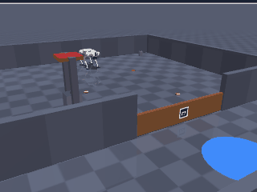
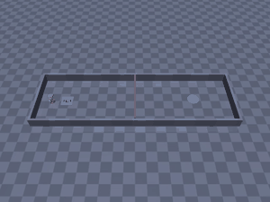
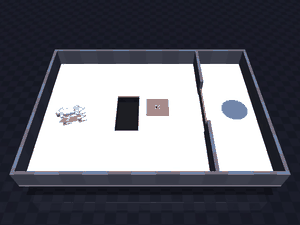
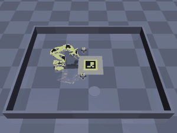
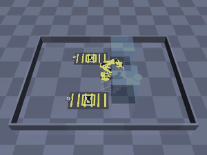
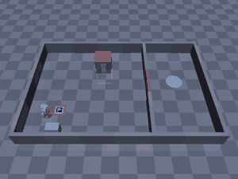
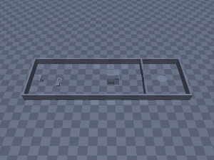

# 挑戦 — 部屋ごとに空いた一マス

このリポジトリには部屋プリセットが**44個**あり、そのうち**学習した方策の記録があるのは四つ**です。
残り41個の「学習した方策」のマスは**空**で、下の表がその空白です。

台本の解法はすべての部屋を解きます(リポジトリが毎回20シードで確認します)。ランダムな方策はほとんどの
部屋で0です。その間があなたのアルゴリズムの場所です。

一行だけ読むなら、これです:

> `puzzles/tabletop/pick_and_place` — PPOで**25 Mステップ、成功率0.00**。
> 部屋の台本解法を複製すると**1.7 Mステップで1.00**。
> あなたのアルゴリズムは何ステップでいくらですか?

<p align="center"></p>

<p align="center"><b>これが負ける回です。</b> プレスが錠を叩くと(赤くなります)コインを数えていたカウンターがそのエピソードのあいだ0を読み、錠から扉へのケーブルは運ぶものを失います — 扉は<b>二度と</b>開きません。</p>

<p align="center"></p>

<p align="center">勝つ回はこうです — 28秒で扉を開けておけば、40秒にプレスが降りても<b>もう遅い</b>(扉は<code>oneshot</code>、一度開けば固定)。</p>

## 規約 — 数字ひとつ、固定シード、宣言した予算

比べられなければ挑戦になりません。このリポジトリでは同じ部屋の成功率が**0.00と0.52に分かれた**ことが
あります(違いはシードだけでした)。だから三つを一緒に書きます。

```bash
uv run mpg train examples/task_<部屋>.yaml --minutes <予算> --id mine
uv run mpg eval runs/mine --episodes 100            # held-outシード 1,000,000〜1,000,099
uv run mpg eval runs/mine --episodes 100 --policy random   # 同じシードの基準線
```

- **数字ひとつ**: `mpg eval`の`success_rate`。学習中の成功率ではありません。
- **固定シード**: 評価シードは学習が決して使わない区間です(`EVAL_SEED_BASE`)。
- **宣言した予算**: 実時間の分**と**環境ステップ。どちらも`runs/<id>/summary.json`にあります。

## 部屋のギャラリー — どんな条件があるか

十の部屋、四つの体、十通りの仕掛けです。数字はすべてこのリポジトリが測ったものです: **台本**は20シード検査の平均所要、**ランダム**は同じ20シードでの均一乱数、**学習した方策**は記録があればその数字です。

| | 体 | 画面で起きること | 台本 | ランダム | 学習した方策 |
|---|---|---|---:|---:|---|
|  | 四足 | `coins/beat_the_hammer` — 40秒後にプレスがコイン錠を壊す。その前に扉を開けなければならない | 45.6s | 0/20 | **空** |
|  | 팔 | `tabletop/pick_by_hand` — 용접 없이 **손가락 둘로 눌러** 블록을 들어 상자에 넣는다 | 11.66s | 0/20 | 0.52 |
|  | 오리 | `light/split_the_beam` — 한 줄기 빛을 분광기로 나눠 두 광전지에 **몫**을 맞춘다 | 11.1s | 1/20 | **空** |
|  | 오리 | `ball/bowling` — 공을 밀어 핀 세 개를 쓰러뜨리면 문이 열린다 | 23.82s | 0/20 | **空** |
|  | 오리(롤러) | `roller/glide_under` — 롤러를 달고 **낮은 바 밑을 미끄러져** 지나간다 | 14.66s | 0/20 | **空** |
|  | 네 발 | `wide/pit_detour` — 5×4 m 방에서 구덩이를 돌아간다 — 큰 몸이 설 수 있는 곳만 길이다 | 30.78s | 0/20 | **空** |
|  | 팔 | `tabletop/build_a_tower` — 블록 둘을 **쌓는다**(쌓임을 읽는 부품이 판정) | 10.6s | 0/20 | **空** |
|  | 팔 | `tabletop/conveyor_triage` — 두 벨트, 두 통 — 색이 다른 블록을 한 번에 하나씩 분류 | 18.8s | 0/20 | **空** |
|  | 오리 | `circuit/fuse_repair` — 끊긴 회로를 **퓨즈를 물어다 끼워** 되살린다 | 26.73s | 0/20 | **空** |
|  | 오리 | `tow/sled_delivery` — 썰매를 로프로 **끌어서** 배달한다 | 19.36s | 1/20 | **空** |

## はしご

星は意見ではなく測定から出ます — **ランダムな方策が三回以上解く部屋は★**、一、二回解くか台本が12秒
未満なら★★、25秒未満なら★★★、それより長ければ★★★★です。体はその部屋のtaskファイルが決めた体です。

### go2

| | 部屋 | 台本の解法 | ランダム | 学習した方策 |
|---|---|---:|---:|---|
| ★★★ | `wide/switch_door` | 24.58s | 0/20 | **0.96**(四足、PPO 30分) |
| ★★★★ | `wide/pit_detour` | 30.78s | 0/20 | **空** |
| ★★★★ | `coins/beat_the_hammer` | 45.6s | 0/20 | **空** |

### microduck

| | 部屋 | 台本の解法 | ランダム | 学習した方策 |
|---|---|---:|---:|---|
| ★★★ | `light/aim_the_mirror` | 33.4s | 1/20 | **空** |
| ★ | `roller/brake_strip` | 15.82s | 4/20 | **空** |
| ★ | `roller/mode_switch_route` | 16.0s | 3/20 | **空** |
| ★★ | `roller/speed_gate` | 10.4s | 1/20 | **空** |
| ★★ | `light/split_the_beam` | 11.1s | 1/20 | **空** |
| ★★ | `circuit/clock_door` | 14.23s | 1/20 | **空** |
| ★★ | `tow/sled_delivery` | 19.36s | 1/20 | **空** |
| ★★★ | `roller/crosswind` | 12.46s | 0/20 | **空** |
| ★★★ | `budget/two_openings` | 13.2s | 0/20 | **空** |
| ★★★ | `circuit/press_relay` | 13.27s | 0/20 | **空** |
| ★★★ | `roller/glide_under` | 14.66s | 0/20 | **空** |
| ★★★ | `ball/ball_ramp` | 14.78s | 0/20 | **空** |
| ★★★ | `roller/timed_corridor` | 16.38s | 0/20 | **空** |
| ★★★ | `tow/cleat_hold` | 17.25s | 0/20 | **空** |
| ★★★ | `tow/drop_and_go` | 17.29s | 0/20 | **空** |
| ★★★ | `circuit/jam_the_turret` | 17.83s | 0/20 | **空** |
| ★★★ | `tow/npc_leash` | 20.23s | 0/20 | **空** |
| ★★★ | `tow/tethered_start` | 20.32s | 0/20 | **空** |
| ★★★ | `ball/mini_soccer` | 22.0s | 0/20 | **空** |
| ★★★ | `ball/bowling` | 23.82s | 0/20 | **空** |
| ★★★ | `circuit/cut_the_lock` | 24.36s | 0/20 | **空** |
| ★★★ | `roller/one_way_station` | 24.52s | 0/20 | **空** |
| ★★★★ | `circuit/wrong_wire` | 25.05s | 0/20 | **空** |
| ★★★★ | `tow/chain_dropoff` | 25.43s | 0/20 | **空** |
| ★★★★ | `circuit/peck_cable` | 25.73s | 0/20 | **空** |
| ★★★★ | `tow/pit_bridge` | 26.19s | 0/20 | **空** |
| ★★★★ | `circuit/fuse_repair` | 26.73s | 0/20 | **空** |
| ★★★★ | `circuit/sabotage_order` | 29.52s | 0/20 | **空** |
| ★★★★ | `ball/color_sort` | 30.1s | 0/20 | **空** |
| ★★★★ | `roller/roll_delivery` | 37.45s | 0/20 | **空** |
| ★★★★ | `tow/overload` | 49.7s | 0/20 | **空** |

### so101

| | 部屋 | 台本の解法 | ランダム | 学習した方策 |
|---|---|---:|---:|---|
| ★ | `tabletop/reach_target` | 0.6s | 5/20 | **空** |
| ★★ | `tabletop/reach_the_marker` | 1.44s | 1/20 | 0.93 (PPO 15分、センサーのみ) |
| ★★ | `tabletop/weigh_it_down` | 7.6s | 0/20 | **空** |
| ★★ | `tabletop/lever_arm` | 7.8s | 0/20 | **空** |
| ★★ | `tabletop/pick_and_place` | 8.2s | 0/20 | 1.00 (台本の複製、特権) |
| ★★ | `tabletop/fetch_the_steel` | 9.6s | 0/20 | **空** |
| ★★ | `tabletop/build_a_tower` | 10.6s | 0/20 | **空** |
| ★★ | `tabletop/pick_by_hand` | 11.66s | 0/20 | 0.52 (台本の複製、センサーのみ、三回に一回) |
| ★★★ | `tabletop/dead_wedge` | 13.1s | 0/20 | **空** |
| ★★★ | `tabletop/conveyor_triage` | 18.8s | 0/20 | **空** |

## まだ誰もできていない三つ

| 何 | 測定された状態 |
|---|---|
| **指二本で押さえて運ぶ** (`tabletop/pick_by_hand`) | 完走する方策は**あります** — 50シードで0.52。ただしその組み合わせがそういう方策を出すのは**三回に一回**で、三つめのシードで九回適合しても変わりませんでした(分散はデータ側) |
| **40 msのアクチュエータ遅延** | アームの部屋十のうち**五つ**がここで崩れます。原因は一つではなく**四つ**です: 三つは`grab`を終えられず(溶接が3.04〜11.39 Nで引き剥がされる、または `_pinched` が偽のままで接触によるつかみが成立しない)、`goto goal`に届くのは二つだけです。七回の修正はいずれも別の部屋を壊すか、どの部屋も開けませんでした。どの部屋がどのサブゴールで止まるかは`uv run python tools/latency_stall.py`が出力します |
| **手がかりなしの順序推論** (`order_blind`) | 理論上の上限1/3に**ぴったり張りついた0.29**。手がかりを読めない方策の最善で、その上に行った方策はありません |

## 既知の記録

| 部屋 | 体 | 観測 | 記録 | 方法 |
|---|---|---|---|---|
| `tabletop/reach_the_marker` | アーム | **センサーのみ** | **0.93** | PPO 15分、4.08 Mステップ |
| `tabletop/pick_and_place` | アーム | 特権 | **1.00** | 台本の複製(`algo: bc`)、1.70 Mステップ |
| `tabletop/pick_by_hand` | アーム | **センサーのみ** | **0.52** | 台本の複製 + DAgger、三回に一回 |
| `wide/switch_door` | 四足 | 特権 | **0.96** | PPO 30分、2.85 Mステップ |
| `examples/switch_door.yaml` | アヒル | 特権 | 0.99 | PPO 15分(例の部屋、プリセットではない) |

数字の出どころと失敗した試みは[学習ログ](training-log.md)にあります。そこには測定の罠**十個**も
書いてあります — 測る側で騙される方法がそれだけありました。

## 新しい挑戦の部屋

**`puzzles/coins/beat_the_hammer`**(上のGIF): コイン三つで扉が開きます。しかし40秒後にハンマーが
落ちて錠を一撃で壊し、壊れた錠はそのエピソードのあいだ0を読みます。台本の解法は20/20(平均45.6秒)、
ランダムは0/20、そして**ヒューズを15秒にすると台本でも0/5**です。
