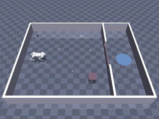

# 도전 — 방마다 비어 있는 칸 하나

이 저장소에는 방 프리셋 **44개**가 있고, 그중 **학습된 정책의 기록이 있는 방은 세 개**입니다.
나머지 41개의 "학습된 정책" 칸은 **비어 있습니다.** 아래 표가 그 빈 칸입니다.

대본 해답은 모든 방을 풉니다(저장소가 매번 20시드로 확인합니다). 무작위 정책은 거의 모든 방에서
0입니다. 그 사이가 당신 알고리즘의 자리입니다.

한 줄만 먼저 보고 가셔도 됩니다:

> `puzzles/tabletop/pick_and_place` — PPO로 **25 M 스텝, 성공률 0.00**.
> 방의 대본 해답을 복제하면 **1.7 M 스텝에 1.00**.
> 당신 알고리즘은 몇 스텝에 얼마입니까?

<p align="center"></p>

## 규약 — 숫자 하나, 고정 시드, 선언된 예산

비교할 수 있어야 도전입니다. 이 저장소에서 같은 방의 성공률이 **0.00과 0.52로 갈린 적이
있습니다**(시드만 달랐습니다). 그래서 세 가지를 같이 적습니다.

```bash
mpg train examples/task_<방>.yaml --minutes <예산> --id mine
mpg eval runs/mine --episodes 100            # held-out 시드 1,000,000~1,000,099
mpg eval runs/mine --episodes 100 --policy random   # 같은 시드의 기준선
```

- **숫자 하나**: `mpg eval`의 `success_rate`. 학습 중 성공률이 아닙니다.
- **고정 시드**: 평가 시드는 학습이 절대 쓰지 않는 구간입니다(`EVAL_SEED_BASE`).
- **선언된 예산**: 벽시계 분 **그리고** 환경 스텝. 둘 다 `runs/<id>/summary.json`에 있습니다.

## 사다리

별은 의견이 아니라 측정에서 나옵니다 — **무작위 정책이 세 번 이상 푸는 방은 ★**, 한두 번 풀거나
대본이 12초 미만이면 ★★, 25초 미만이면 ★★★, 그 이상이면 ★★★★입니다. 몸은 그 방의 task
파일이 정한 몸입니다.

### go2

| | 방 | 대본 해답 | 무작위 | 학습된 정책 |
|---|---|---:|---:|---|
| ★★★ | `wide/switch_door` | 24.58s | 0/20 | **비어 있음** |
| ★★★★ | `wide/pit_detour` | 30.78s | 0/20 | **비어 있음** |
| ★★★★ | `coins/beat_the_hammer` | 45.6s | 0/20 | **비어 있음** |

### microduck

| | 방 | 대본 해답 | 무작위 | 학습된 정책 |
|---|---|---:|---:|---|
| ★ | `light/aim_the_mirror` | 11.0s | 11/20 | **비어 있음** |
| ★ | `roller/brake_strip` | 15.82s | 4/20 | **비어 있음** |
| ★ | `roller/mode_switch_route` | 16.0s | 3/20 | **비어 있음** |
| ★★ | `roller/speed_gate` | 10.4s | 1/20 | **비어 있음** |
| ★★ | `light/split_the_beam` | 11.1s | 1/20 | **비어 있음** |
| ★★ | `circuit/clock_door` | 14.23s | 1/20 | **비어 있음** |
| ★★ | `tow/sled_delivery` | 19.36s | 1/20 | **비어 있음** |
| ★★★ | `roller/crosswind` | 12.46s | 0/20 | **비어 있음** |
| ★★★ | `budget/two_openings` | 13.2s | 0/20 | **비어 있음** |
| ★★★ | `circuit/press_relay` | 13.27s | 0/20 | **비어 있음** |
| ★★★ | `roller/glide_under` | 14.66s | 0/20 | **비어 있음** |
| ★★★ | `ball/ball_ramp` | 14.78s | 0/20 | **비어 있음** |
| ★★★ | `roller/timed_corridor` | 16.38s | 0/20 | **비어 있음** |
| ★★★ | `tow/cleat_hold` | 17.25s | 0/20 | **비어 있음** |
| ★★★ | `tow/drop_and_go` | 17.29s | 0/20 | **비어 있음** |
| ★★★ | `circuit/jam_the_turret` | 17.83s | 0/20 | **비어 있음** |
| ★★★ | `tow/npc_leash` | 20.23s | 0/20 | **비어 있음** |
| ★★★ | `tow/tethered_start` | 20.32s | 0/20 | **비어 있음** |
| ★★★ | `ball/mini_soccer` | 22.0s | 0/20 | **비어 있음** |
| ★★★ | `ball/bowling` | 23.82s | 0/20 | **비어 있음** |
| ★★★ | `circuit/cut_the_lock` | 24.36s | 0/20 | **비어 있음** |
| ★★★ | `roller/one_way_station` | 24.52s | 0/20 | **비어 있음** |
| ★★★★ | `circuit/wrong_wire` | 25.05s | 0/20 | **비어 있음** |
| ★★★★ | `tow/chain_dropoff` | 25.43s | 0/20 | **비어 있음** |
| ★★★★ | `circuit/peck_cable` | 25.73s | 0/20 | **비어 있음** |
| ★★★★ | `tow/pit_bridge` | 26.19s | 0/20 | **비어 있음** |
| ★★★★ | `circuit/fuse_repair` | 26.73s | 0/20 | **비어 있음** |
| ★★★★ | `circuit/sabotage_order` | 29.52s | 0/20 | **비어 있음** |
| ★★★★ | `ball/color_sort` | 30.1s | 0/20 | **비어 있음** |
| ★★★★ | `roller/roll_delivery` | 37.45s | 0/20 | **비어 있음** |
| ★★★★ | `tow/overload` | 49.7s | 0/20 | **비어 있음** |

### so101

| | 방 | 대본 해답 | 무작위 | 학습된 정책 |
|---|---|---:|---:|---|
| ★ | `tabletop/reach_target` | 0.6s | 5/20 | **비어 있음** |
| ★★ | `tabletop/reach_the_marker` | 1.44s | 1/20 | 0.93 (PPO 15분, 센서만) |
| ★★ | `tabletop/weigh_it_down` | 7.6s | 0/20 | **비어 있음** |
| ★★ | `tabletop/lever_arm` | 7.8s | 0/20 | **비어 있음** |
| ★★ | `tabletop/pick_and_place` | 8.2s | 0/20 | 1.00 (대본 복제, 특권) |
| ★★ | `tabletop/fetch_the_steel` | 9.6s | 0/20 | **비어 있음** |
| ★★ | `tabletop/build_a_tower` | 10.6s | 0/20 | **비어 있음** |
| ★★ | `tabletop/pick_by_hand` | 11.66s | 0/20 | 0.52 (대본 복제, 센서만; 세 번에 한 번) |
| ★★★ | `tabletop/dead_wedge` | 13.1s | 0/20 | **비어 있음** |
| ★★★ | `tabletop/conveyor_triage` | 18.8s | 0/20 | **비어 있음** |

## 아직 아무도 못 푼 세 가지

| 무엇 | 측정된 상태 |
|---|---|
| **손가락으로 집어 운반** (`tabletop/pick_by_hand`) | 완주하는 정책이 **있습니다** — 50시드 0.52. 그런데 그 조합이 그런 정책을 내는 건 **세 번에 한 번**이고, 아홉 번 적합을 더 돌려도 바뀌지 않았습니다(분산은 데이터 쪽) |
| **40 ms 액추에이터 지연** | 팔 방 열 개 중 **다섯**이 여기서 무너집니다. 턱 높이 가설은 다섯 번의 측정으로 배제됐고, 원인은 아직 특정되지 않았습니다 |
| **단서 없는 순서 추론** (`order_blind`) | 이론적 상한 1/3에 **정확히 붙은 0.29**. 단서를 못 읽는 정책이 낼 수 있는 최선이고, 그 위로 올라간 정책은 없습니다 |

## 알려진 기록

| 방 | 몸 | 관측 | 기록 | 방법 |
|---|---|---|---|---|
| `tabletop/reach_the_marker` | 팔 | **센서만** | **0.93** | PPO 15분, 4.08 M 스텝 |
| `tabletop/pick_and_place` | 팔 | 특권 | **1.00** | 대본 복제(`algo: bc`), 1.70 M 스텝 |
| `tabletop/pick_by_hand` | 팔 | **센서만** | **0.52** | 대본 복제 + DAgger, 세 번에 한 번 |
| `examples/rooms/switch_door` | 오리 | 특권 | 0.99 | PPO 15분 (예제 방, 프리셋 아님) |

숫자의 출처와 실패한 시도들은 [학습 기록](training-log.md)에 있습니다. 그 문서에는 측정 함정
**열 개**도 같이 적혀 있습니다 — 재는 쪽에서 속는 방법이 그만큼 많았습니다.

## 새 도전 방

**`puzzles/coins/beat_the_hammer`** (위 GIF): 코인 셋을 모으면 문이 열립니다. 그런데 40초 뒤
망치가 내려와 자물쇠를 한 방에 부수고, 부서진 자물쇠는 그 판 내내 0을 읽습니다. 대본 해답은
20/20(평균 45.6초), 무작위는 0/20, **퓨즈를 15초로 줄이면 대본도 0/5**입니다.
