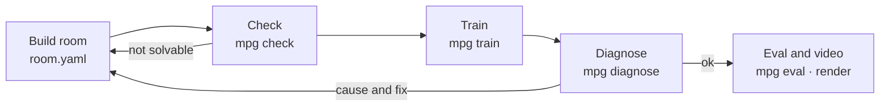

# Guide

[Back to README](README.en.md)

## How it works



1. **Build**: an agent (or a person) writes `room.yaml` and the training settings `task.yaml`. `mpg build` makes the MJCF and a top-view image to look at.
2. **Check**: `mpg check` runs three stages. (a) Given the signal links and walls, is there a solution order that reaches the goal? (b) Does the body stay up with no NaN for 10 s at zero command? (c) Does a scripted solver that knows the answer solve at least 18 of 20 random layouts?
3. **Train**: `mpg train` trains for a set time and leaves a checkpoint, learning curves and an episode log in `runs/<id>/`.
4. **Diagnose**: `mpg diagnose` reads the training log and fresh rollouts and classifies the cause. Fix it and train again.
5. **Eval and video**: `mpg eval` measures the success rate on layouts not used in training, and `mpg render` makes a success video.

## Features

- **Rooms in YAML**: room size and walls, part layout, per-part randomisation ranges, start pose, and signal links between parts (`links`).
- **Extensible parts, observations, rewards and algorithms**: all go through the same registration functions (`register_part`, `register_obs`, `register_reward`, `register_algo`). The built-in parts are registered the same way.
- **Three-stage check**: solution order, physics stability, scripted-solver success rate.
- **Training**: PPO (default), SAC and A2C from Stable-Baselines3. Your own algorithm plugs in through the `Trainer` interface. Parallel environments, checkpoints, per-term reward logs, learning curves.
- **Diagnosis**: four causes (environment bug, body failure, exploration, reward hacking) with evidence numbers, a failure video and a fix direction.
- **Eval and video**: success rate and mean time on held-out seeds, comparison with a random policy, offscreen MP4.
- **Body adapter**: the puzzle code knows nothing about the body. The adapter takes a motion command, moves the body and returns the body state.
- **Pinned assets**: the robot model and walking policy come from fixed commits of the official repositories and are checked by SHA256.

## Commands

Every command accepts `--json` and exits non-zero on failure.

| Command | What it does |
|---|---|
| `mpg fetch-assets` | Download the robot model and walking policy from pinned commits and verify hashes |
| `mpg build <room.yaml>` | Make the body + room MJCF and a top-view PNG |
| `mpg check <room.yaml>` | Check solution order, physics stability and scripted-solver success |
| `mpg train <task.yaml> --minutes N` | Train for a set time; results in `runs/<id>/` |
| `mpg diagnose runs/<id>` | Classify the failure cause, with evidence numbers and a failure video |
| `mpg eval runs/<id>` | Success rate and mean time on held-out layouts (`--policy random` for a baseline) |
| `mpg render runs/<id>` | MP4 of a success episode |
| `mpg demo` | Video of the bundled trained policy solving the example room (`demo.mp4`) |
| `mpg bench` | Measure simulation speed of the walking body and the environment |
| `mpg version` | Print the version |

## Building a puzzle room

The example room [`examples/switch_door.yaml`](../examples/switch_door.yaml). Stepping on the switch opens the door in the divider; reaching the goal behind it is success.

```yaml
name: switch_door
size: [2.4, 1.8]                  # interior size [m], centred at the origin
wall: {thickness: 0.06, height: 0.25}
walls:                            # divider at x = 0.3 with a 0.5 m opening in the middle
  - {from: [0.3, -0.9], to: [0.3, -0.28]}
  - {from: [0.3, 0.28], to: [0.3, 0.9]}
spawn: {pos: [-0.75, 0.0], yaw: 0.0, random: [0.2, 0.35, 3.14]}
parts:
  - {name: switch_a, type: switch, pos: [-0.25, 0.5], size: [0.3, 0.3], random: [0.15, 0.1]}
  - {name: door_b, type: door, pos: [0.3, 0.0], width: 0.5, axis: y}
  - {name: goal, type: goal, pos: [0.85, 0.0], radius: 0.15, random: [0.1, 0.45]}
links:
  - {from: switch_a, to: door_b}  # door_b opens when switch_a is on
```

- `random` is the range within which the layout is randomized each episode. Evaluation uses layouts from seeds not used in training.
- A door can require several switches together with `require: all | any`. A switch stays on once stepped on by default; with `latch: false` it is on only while pressed.
- Deliberately broken rooms and settings are in [`examples/broken/`](../examples/broken/). They test whether check and diagnose name the cause correctly.

## Training settings

[`examples/task_ppo.yaml`](../examples/task_ppo.yaml) sets the room, observations, rewards and algorithm. Missing keys take defaults, and the full resolved settings are saved as `runs/<id>/task.resolved.yaml`.

```yaml
room: switch_door.yaml
env: {hz: 10, episode_seconds: 40}       # the high-level policy decides 10 times a second
obs: [gravity, ang_vel, lin_vel, part_pos, part_state]
reward: {progress: 10.0, stage: 2.0, success: 10.0, fall: -5.0}
termination: {success: true, fall: true}
algo: ppo
algo_kwargs: {learning_rate: 0.0003, n_steps: 256, batch_size: 1024, gamma: 0.99}
net: [128, 128]
n_envs: 12
plugins: []                              # your own part / observation / reward modules
```

## Adding parts, observations, rewards and algorithms

A puzzle device is a Python class that inherits `Part`. It adds its own body to the scene (`build`), reads its state every body step (`update`) and reports a state value (`state`, `satisfied`). Once it declares a role (`switch`, `gate`, `goal`, `prop`), the check and the environment put it into the solution order.

```python
# my_parts.py
from mujoco_puzzle_gym.parts.base import Part
from mujoco_puzzle_gym.registry import register_part, register_reward

@register_part("timed_switch")
class TimedSwitch(Part):
    role = "switch"
    ...

@register_reward("upright")
def upright(env):                 # the term value before its weight is applied
    return -float(env.body_state.gravity[2])
```

Put `plugins: [my_parts]` in `task.yaml` and the module is imported first, in the main process and in every parallel training worker. A training algorithm implements `algos.base.Trainer` and is registered with `register_algo`, or published through the package entry point `mujoco_puzzle_gym.algos`.

## Body adapter

The puzzle code does not know which body is walking. `BodyAdapter` is the boundary.

- `spawn`: add the body to the scene.
- `reset`: put the body in its standing pose and clear the controller state.
- `step`: follow a motion command (forward speed, lateral speed, turn rate) for one control period.
- `state`: return position, orientation, velocities and whether the body has fallen.

The Microduck adapter runs the official walking policy `velstand.onnx` at 50 Hz with the motor model (BAM) from the official repository. Body names (joints, sites) are handled only inside `bodies/`. To add another body, implement these four methods and its command limits, register the new body name in `bodies.make_body()`, and set that name as `body:` in `task.yaml`.
