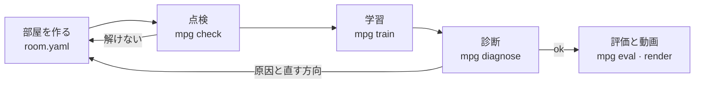

# 使い方ガイド

[READMEに戻る](README.ja.md)

## どう動くのか



1. **部屋を作る**: エージェント(または人)が`room.yaml`と学習設定`task.yaml`を書きます。`mpg build`でMJCFと上から見た画像を作り、目で確かめます。
2. **点検**: `mpg check`が二つの段階で見ます。静的段階はシミュレーションなしで、値の範囲(`values`)、信号のつながり(`channels`)、解答のサブゴール(`demo`)、体の能力(`body`)、部品ごとの点検(`parts`)、重なり(`overlap`)、ゴールまでの解く順序(`order`)を見ます。動的段階は、指令0で10秒間、転んだり計算が発散したりしないか(`stability`)、答えを知っているスクリプトがランダム配置20個のうち18個以上を解けるか(`solver`)を見ます。各段階の説明は[部品とプリセットの案内](parts-guide.ja.md#点検の二段階)にあります。
3. **学習**: `mpg train`が決めた時間だけ学習し、チェックポイント、学習曲線、エピソード記録を`runs/<id>/`に残します。
4. **診断**: `mpg diagnose`が学習記録と新しいロールアウトを見て原因を分類します。直してからもう一度学習します。
5. **評価と動画**: `mpg eval`が学習に使っていない配置で成功率を測り、`mpg render`が成功動画を作ります。

## 主な機能

- **YAMLで組む部屋**: 部屋の大きさと壁、部品の配置、部品ごとのランダム範囲、出発姿勢、部品どうしの信号のつながり(`links`)。
- **拡張できる部品・観測・報酬・アルゴリズム**: すべて同じ登録関数(`register_part`、`register_obs`、`register_reward`、`register_algo`)で入ります。内蔵部品も同じ方法で登録されています。
- **部品プリセット**: ボタン、ゲート、ドア、床タイル、ボールなどの部品をプリセット名で呼び出し、値だけ変えて使います。複数の部品をまとめた組み立てプリセットもあります。[部品とプリセットの案内](parts-guide.ja.md)
- **二段階の点検**: 静的段階(値、信号、重なり、解く順序など)と動的段階(物理の安定性、スクリプト解答の成功率)。
- **学習**: Stable-Baselines3のPPO(既定)、SAC、A2C。自作のアルゴリズムは`Trainer`インターフェースでつなぎます。並列環境、チェックポイント、報酬項目ごとの記録、学習曲線。
- **診断**: 環境のバグ、体の失敗、探索不足、報酬ハッキングの四分類と、根拠の数値、失敗動画、直す方向。
- **評価と動画**: 学習に使っていないシードでの成功率と平均所要時間、ランダムポリシーとの比較、オフスクリーンMP4。
- **体のアダプター**: パズル側のコードは体のことを知りません。アダプターが移動指令を受けて体を動かし、体の状態を返します。
- **固定されたアセット**: ロボットモデルと歩行ポリシーを公式リポジトリの固定コミットから取得し、SHA256で確認します。

## コマンド

すべてのコマンドは`--json`を受け付け、失敗すると0以外の終了コードを返します。

| コマンド | すること |
|---|---|
| `mpg fetch-assets` | ロボットモデルと歩行ポリシーを固定コミットから取得し、ハッシュで確認 |
| `mpg build <room.yaml>` | 体と部屋を合わせたMJCFと、上から見たPNGを作る |
| `mpg check <room.yaml>` | 静的段階(値、信号、重なり、解く順序)と動的段階(物理の安定性、スクリプト解答の成功率)を点検。`--static`なら静的段階だけ、`--community`なら共有する部屋の制限まで([部屋とポリシーを共有する](community.ja.md)) |
| `mpg parts` | 登録された部品、値のスキーマ、プリセットの一覧(`--json`)、値の表(`--markdown`) |
| `mpg train <task.yaml> --minutes N` | 決めた時間だけ学習、結果は`runs/<id>/` |
| `mpg diagnose runs/<id>` | 失敗の原因を分類、根拠の数値と失敗動画 |
| `mpg eval runs/<id>` | 学習に使っていない配置での成功率と平均時間(`--policy random`で基準線)。`--onnx policy.onnx --task task.yaml`なら書き出したポリシーをpickleなしで評価。`--difficulty k`は難易度段階kで(既定は最後の段階) |
| `mpg export-onnx runs/<id>` | ポリシーを`policy.onnx`と`policy.json`に書き出す(共有用) |
| `mpg render runs/<id>` | 成功エピソードのMP4 |
| `mpg demo` | リポジトリに同梱の学習済みポリシーがサンプルの部屋を解く動画(`demo.mp4`) |
| `mpg bench` | 歩く体と環境のシミュレーション速度を測る |
| `mpg version` | バージョンを表示 |

`train`、`eval`、`diagnose`、`render`、`export-onnx`は、現在のフォルダの`runs/`の外にあるrunフォルダやチェックポイントの保存ファイルを開きません。これらのファイルはpickleなので、開くときにコードを実行できます。自分で作ったファイルだけを`--trust`で開きます。

## パズル部屋を作る

サンプルの部屋[`examples/switch_door.yaml`](../examples/switch_door.yaml)です。スイッチを踏むと仕切りのドアが開き、ドアの先のゴールに着けば成功です。

```yaml
name: switch_door
size: [2.4, 1.8]                  # 部屋の内寸 [m]、原点が中央
wall: {thickness: 0.06, height: 0.25}
walls:                            # x = 0.3の仕切り、中央の0.5 mが開いている
  - {from: [0.3, -0.9], to: [0.3, -0.28]}
  - {from: [0.3, 0.28], to: [0.3, 0.9]}
spawn: {pos: [-0.75, 0.0], yaw: 0.0, random: [0.2, 0.35, 3.14]}
parts:
  - {name: switch_a, type: switch, pos: [-0.25, 0.5], size: [0.3, 0.3], random: [0.15, 0.1]}
  - {name: door_b, type: door, pos: [0.3, 0.0], width: 0.5, axis: y}
  - {name: goal, type: goal, pos: [0.85, 0.0], radius: 0.15, random: [0.1, 0.45]}
links:
  - {from: switch_a, to: door_b}  # switch_aがオンになるとdoor_bが開く
```

- 床スイッチ`switch`は、M1の名前のまま使う床ボタンです。ボタンのプリセット`input/floor_oneshot`(体で一度踏むとオンのまま)と同じで、`latch: false`なら踏んでいる間だけオンになる`momentary`です。
- 新しい部屋はプリセットで組むほうが簡単です。`{name: b, preset: input/floor_oneshot, pos: [x, y]}`のように書き、変えたい値だけを書き足します。サンプルの部屋の一覧とプリセットの使い方は[部品とプリセットの案内](parts-guide.ja.md)にあります。サンプルは[`examples/rooms/`](../examples/rooms/)(ボタンと論理ゲート、三種類のドア、旗4本、コイン、ボール、文字マップ、エレベーターとスプリング)と、ボールの組み立てプリセット(`mini_soccer`、`ball_ramp`、`bowling`、`color_sort`)です。
- `random`はエピソードごとに配置をランダムに変える範囲です。評価は学習に使っていないシードの配置で行います。
- ドアは`require: all | any`で複数のスイッチを同時に求められます。
- 目で見分ける部品(ボタンと床スイッチ、センサー板、チェックポイント、ドア、ソケット、ワープ、床タイル)には、ArUcoマーカー(`DICT_4X4_50`)が空いている番号で付きます。`marker: {id, size, face}`で指定し、`marker: none`で外します。番号の重複、0–49の外の番号、面より大きいマーカーは、部屋を読み込むときに拒否します。
- 視線センサーは認識センサーではなく、幾何学的な判定です。画像は読みません。頭のカメラから見て、マーカーが視野角`fov/2`・距離`max_dist`・傾き`max_tilt`の内側にあり、光線がさえぎられていなければ「見えている」とみなします。`dwell`秒続けて見ると`<部品>.seen`チャンネルが1になり、「見つめると開くドア」(`in: [door_a.seen]`)を作れます。部屋の値は`gaze: {fov: 60, max_dist: 2.0, max_tilt: 70, dwell: 0.5}`、観測項目は`markers_seen`(使われている番号ごとに一枠、番号順)です。
- わざと壊した部屋と設定が[`examples/broken/`](../examples/broken/)にあります。点検と診断が原因を正しく指摘するかを見るためのテスト用です。

## 学習設定

[`examples/task_ppo.yaml`](../examples/task_ppo.yaml)は部屋、観測、報酬、アルゴリズムを決めます。足りないキーは既定値を使い、埋めた後の設定全体は`runs/<id>/task.resolved.yaml`に保存されます。

```yaml
room: switch_door.yaml
env: {hz: 10, episode_seconds: 40}       # 上位ポリシーは1秒に10回決める
obs: [gravity, ang_vel, lin_vel, part_pos, part_state]
reward: {progress: 10.0, stage: 2.0, success: 10.0, fall: -5.0}
termination: {success: true, fall: true}
algo: ppo
algo_kwargs: {learning_rate: 0.0003, n_steps: 256, batch_size: 1024, gamma: 0.99}
net: [128, 128]
n_envs: 12
plugins: []                              # 自作の部品・観測・報酬モジュール
```

## 段階的な学習と区間の評価

チェックポイントの旗(`type: checkpoint`、`order: 1, 2, …`)がある部屋は区間に分かれます。旗が2本なら`start->f1`、`f1->f2`、`f2->goal`の三区間です。最初の区間は普通のエピソードと同じように始まり、残りは`mpg check`が残した旗のスナップショット(`runs/check/<部屋>/checkpoints/<旗>.pkl`)から始まります。そのため、先に`mpg check`を実行します。

```bash
mpg check room.yaml
mpg train task.yaml --minutes 60 --curriculum forward --advance-at 0.8 --replay 0.2
mpg eval runs/<id> --full --segments
```

- `--curriculum forward`: 最初の区間だけを学習し、その区間の最近の成功率(`window`エピソード)が`--advance-at`に届くと次の区間を開きます。エピソードのうち`--replay`の割合は、すでに開いた前の区間から始まります。区間のエピソードは、区間の終わりの旗に着くと成功で終わります。
- `--curriculum reverse`: 最後の区間からゴールまでを出発点にして、出発点を前へずらしていきます。`none`(既定)は最初からゴールまでです。
- 同じ値はtask.yamlに`curriculum: {mode: forward, advance_at: 0.8, replay: 0.2, window: 50, snapshots: null}`と書けます。`snapshots`はスナップショットのフォルダーです(空なら`runs/check/<部屋>/checkpoints`)。
- 進み具合は`runs/<id>/curriculum.json`に、時刻、開いた区間、区間ごとの成功率として残ります。
- task.yamlに`difficulty:`(罠の強さのような値の段階、[部品ガイドの難易度段階](parts-guide.ja.md#難易度段階))があれば、(区間、難易度)の組を一つずつ開きます。`curriculum.order`が`difficulty_first`(既定)なら一つの区間の難易度を上げきってから次の区間へ、`segment_first`なら一つの難易度ですべての区間を開いてから次の難易度へ。`curriculum.json`のレベル名は`<区間>@d<段階>`です。
- 旗は解く順序に入るので、報酬`progress`と観測`target_pos`は旗を順にたどります。観測項目`checkpoints`は、次の旗(one-hot、最後の枠はゴール)と旗ごとの到達の有無です。
- `mpg eval --full`はスナップショットなしで最初からゴールまでの成功率(`full_success_rate`)を、`--segments`は区間ごとの成功率(`segment_success_rates`)を出します。両方を使うと、「区間はすべて成功したのに、通しで走ると失敗した割合」(`chain_gap_rate`)も出します。

## 部品・観測・報酬・アルゴリズムを足す

パズルの装置は`Part`を継承したPythonクラスです。場面に自分の物体を足し(`build`)、体のステップごとに状態を読み(`update`)、状態の値を出します(`state`、`satisfied`)。役割(`switch`、`gate`、`goal`、`prop`)を決めれば、点検と環境がその部品を解く順序に入れて扱います。

```python
# my_parts.py
from mujoco_puzzle_gym.parts.base import Part
from mujoco_puzzle_gym.registry import register_part, register_reward

@register_part("timed_switch")
class TimedSwitch(Part):
    role = "switch"
    ...

@register_reward("upright")
def upright(env):                 # 重みを掛ける前の項目の値
    return -float(env.body_state.gravity[2])
```

`task.yaml`に`plugins: [my_parts]`と書くと、メインプロセスと並列学習のすべてのワーカープロセスで、このモジュールが最初に読み込まれます。学習アルゴリズムは`algos.base.Trainer`を実装して`register_algo`で登録するか、パッケージのエントリーポイント`mujoco_puzzle_gym.algos`で公開します。

## 体のアダプター

パズル側のコードは、どの体が歩いているかを知りません。`BodyAdapter`が境界です。

- `spawn`: 場面に体を足します。
- `reset`: 立った姿勢に置き、制御器の状態を消します。
- `step`: 移動指令(前後の速度、横の速度、回転の速度)に一制御周期のあいだ従います。
- `state`: 位置、姿勢、速度、転んだかどうかを返します。

マイクロダックのアダプターは、公式の歩行ポリシー`velstand.onnx`を50 Hzで動かし、公式リポジトリのモーターモデル(BAM)を使います。体の名前(関節、サイト)は`bodies/`の中だけで扱います。別の体をつなぐには、この四つのメソッドと指令の範囲を実装し、`bodies.make_body()`に新しい体の名前を登録して、`task.yaml`の`body:`にその名前を書きます。
