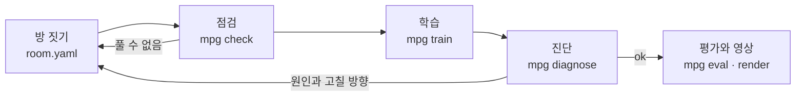

# 사용 안내

[README로 돌아가기](../README.md)

## 어떻게 돌아가나요



1. **방 짓기**: 에이전트(또는 사람)가 `room.yaml`과 학습 설정 `task.yaml`을 씁니다. `mpg build`로 MJCF와 위에서 본 그림을 만들어 눈으로 확인합니다.
2. **점검**: `mpg check`가 두 단계로 봅니다. 정적 단계는 시뮬레이션 없이 값 범위(`values`), 신호 연결(`channels`), 해답 하위 목표(`demo`), 몸 능력(`body`), 부품별 점검(`parts`), 겹침(`overlap`), 골까지의 풀이 순서(`order`)를 봅니다. 동적 단계는 명령 0으로 10초 동안 넘어지거나 계산이 터지지 않는지(`stability`), 정답을 아는 스크립트가 무작위 배치 20개 중 18개 이상을 푸는지(`solver`)를 봅니다. 단계별 설명은 [부품과 프리셋 안내](parts-guide.md#점검-두-단계)에 있습니다.
3. **학습**: `mpg train`이 정해진 시간 동안 학습하고 체크포인트, 학습 곡선, 에피소드 기록을 `runs/<id>/`에 남깁니다.
4. **진단**: `mpg diagnose`가 학습 기록과 새 롤아웃을 보고 원인을 분류합니다. 고친 뒤 다시 학습합니다.
5. **평가와 영상**: `mpg eval`이 학습에 쓰지 않은 배치에서 성공률을 재고, `mpg render`가 성공 영상을 만듭니다.

## 주요 기능

- **YAML로 짓는 방**: 방 크기와 벽, 부품 배치, 부품마다의 무작위 범위, 출발 자세, 부품 사이 신호 연결(`links`).
- **확장 가능한 부품, 관측, 보상, 알고리즘**: 모두 같은 등록 함수(`register_part`, `register_obs`, `register_reward`, `register_algo`)로 들어갑니다. 내장 부품도 같은 방식으로 등록되어 있습니다.
- **부품 프리셋**: 버튼, 게이트, 문, 바닥 타일, 공 같은 부품을 프리셋 이름으로 불러 값만 바꿔 씁니다. 여러 부품을 묶은 조립 프리셋도 있습니다. [부품과 프리셋 안내](parts-guide.md)
- **두 단계 점검**: 정적 단계(값, 신호, 겹침, 풀이 순서 등)와 동적 단계(물리 안정성, 스크립트 해답 성공률).
- **학습**: Stable-Baselines3의 PPO(기본), SAC, A2C. 직접 만든 알고리즘은 `Trainer` 인터페이스로 붙입니다. 병렬 환경, 체크포인트, 보상 항목별 기록, 학습 곡선.
- **진단**: 환경 버그, 몸 실패, 탐색 부족, 보상 꼼수 네 가지 분류와 근거 숫자, 실패 영상, 고칠 방향.
- **평가와 영상**: 학습에 쓰지 않은 시드에서의 성공률과 평균 소요 시간, 무작위 정책과의 비교, 오프스크린 MP4.
- **몸 어댑터**: 퍼즐 쪽 코드는 몸을 모릅니다. 어댑터가 이동 명령을 받아 몸을 움직이고 몸 상태를 돌려줍니다.
- **고정된 자산**: 로봇 모델과 걷기 정책을 공식 저장소의 고정 커밋에서 받아 SHA256으로 확인합니다.

## 명령

모든 명령은 `--json`을 받고, 실패하면 0이 아닌 종료 코드를 냅니다.

| 명령 | 하는 일 |
|---|---|
| `mpg fetch-assets` | 로봇 모델과 걷기 정책을 고정 커밋에서 받아 해시로 확인 |
| `mpg build <room.yaml>` | 몸과 방을 합친 MJCF와 위에서 본 PNG 만들기 |
| `mpg check <room.yaml>` | 정적 단계(값, 신호, 겹침, 풀이 순서)와 동적 단계(물리 안정성, 스크립트 해답 성공률) 점검. `--static`은 정적 단계만, `--community`는 공유 방 제한까지([방과 정책 나누기](community.md)) |
| `mpg parts` | 등록된 부품, 값 스키마, 프리셋 목록(`--json`), 값 표(`--markdown`) |
| `mpg train <task.yaml> --minutes N` | 정해진 시간 동안 학습, 결과는 `runs/<id>/` |
| `mpg diagnose runs/<id>` | 실패 원인 분류, 근거 숫자, 실패 영상 |
| `mpg eval runs/<id>` | 학습에 쓰지 않은 배치에서 성공률과 평균 시간 (`--policy random`으로 기준선). `--onnx policy.onnx --task task.yaml`은 내보낸 정책을 pickle 없이 평가 |
| `mpg export-onnx runs/<id>` | 정책을 `policy.onnx`와 `policy.json`으로 내보내기(나누기용) |
| `mpg render runs/<id>` | 성공 에피소드 MP4 |
| `mpg demo` | 저장소에 든 학습된 정책이 예제 방을 푸는 영상(`demo.mp4`) |
| `mpg bench` | 걷기 몸과 환경의 시뮬레이션 속도 측정 |
| `mpg version` | 버전 출력 |

`train`, `eval`, `diagnose`, `render`, `export-onnx`는 현재 폴더의 `runs/` 밖에 있는 run 폴더와 체크포인트 저장본을 열지 않습니다. 이 파일들은 pickle이라 열 때 코드를 실행할 수 있습니다. 직접 만든 파일만 `--trust`로 엽니다.

## 퍼즐 방 짓기

예제 방 [`examples/switch_door.yaml`](../examples/switch_door.yaml)입니다. 발판을 밟으면 칸막이의 문이 열리고, 문 너머 골에 닿으면 성공입니다.

```yaml
name: switch_door
size: [2.4, 1.8]                  # 방 안쪽 크기 [m], 원점이 가운데
wall: {thickness: 0.06, height: 0.25}
walls:                            # x = 0.3의 칸막이, 가운데 0.5 m가 뚫려 있음
  - {from: [0.3, -0.9], to: [0.3, -0.28]}
  - {from: [0.3, 0.28], to: [0.3, 0.9]}
spawn: {pos: [-0.75, 0.0], yaw: 0.0, random: [0.2, 0.35, 3.14]}
parts:
  - {name: switch_a, type: switch, pos: [-0.25, 0.5], size: [0.3, 0.3], random: [0.15, 0.1]}
  - {name: door_b, type: door, pos: [0.3, 0.0], width: 0.5, axis: y}
  - {name: goal, type: goal, pos: [0.85, 0.0], radius: 0.15, random: [0.1, 0.45]}
links:
  - {from: switch_a, to: door_b}  # switch_a가 켜지면 door_b가 열림
```

- 발판 `switch`는 M1 이름 그대로 쓰는 바닥 버튼입니다. 버튼 프리셋 `input/floor_oneshot`(몸으로 한 번 밟으면 계속 켜짐)과 같고, `latch: false`면 밟고 있는 동안만 켜지는 `momentary`입니다.
- 새 방은 프리셋으로 짜는 편이 쉽습니다. `{name: b, preset: input/floor_oneshot, pos: [x, y]}`처럼 쓰고 바꿀 값만 덧붙입니다. 예제 방 목록과 프리셋 사용법은 [부품과 프리셋 안내](parts-guide.md)에 있습니다. 예제는 [`examples/rooms/`](../examples/rooms/)(버튼과 논리 게이트, 문 세 가지, 깃발 4개, 코인, 공, 글자 지도)와 공 조립 프리셋(`mini_soccer`, `ball_ramp`, `bowling`, `color_sort`)입니다.
- `random`은 에피소드마다 배치를 무작위로 바꾸는 범위입니다. 평가는 학습에 쓰지 않은 시드의 배치에서 합니다.
- 문은 `require: all | any`로 여러 발판을 함께 요구할 수 있습니다.
- 눈으로 구별할 부품(버튼과 발판, 센서판, 체크포인트, 문, 소켓, 워프, 바닥 타일)에는 ArUco 마커(`DICT_4X4_50`)가 빈 번호로 붙습니다. `marker: {id, size, face}`로 정하고 `marker: none`으로 뺍니다. 번호 중복, 0–49 밖 번호, 면보다 큰 마커는 방을 읽을 때 거절합니다.
- 시선 센서는 인식 센서가 아니라 기하 판정입니다. 영상을 읽지 않고, 머리 카메라에서 마커가 시야각 `fov/2`·거리 `max_dist`·기울기 `max_tilt` 안에 있고 광선이 가려지지 않으면 "보임"으로 칩니다. `dwell`초 동안 이어서 보면 `<부품>.seen` 채널이 1이 되어 "쳐다보면 열리는 문"(`in: [door_a.seen]`)을 만들 수 있습니다. 방 값 `gaze: {fov: 60, max_dist: 2.0, max_tilt: 70, dwell: 0.5}`, 관측 항목 `markers_seen`(쓰인 번호마다 한 칸, 번호 순).
- 일부러 고장 낸 방과 설정이 [`examples/broken/`](../examples/broken/)에 있습니다. 점검과 진단이 원인을 제대로 짚는지 보는 시험용입니다.

## 학습 설정

[`examples/task_ppo.yaml`](../examples/task_ppo.yaml)은 방, 관측, 보상, 알고리즘을 정합니다. 빠진 키는 기본값을 쓰고, 채워진 전체 설정은 `runs/<id>/task.resolved.yaml`에 저장됩니다.

```yaml
room: switch_door.yaml
env: {hz: 10, episode_seconds: 40}       # 상위 정책은 초당 10번 결정
obs: [gravity, ang_vel, lin_vel, part_pos, part_state]
reward: {progress: 10.0, stage: 2.0, success: 10.0, fall: -5.0}
termination: {success: true, fall: true}
algo: ppo
algo_kwargs: {learning_rate: 0.0003, n_steps: 256, batch_size: 1024, gamma: 0.99}
net: [128, 128]
n_envs: 12
plugins: []                              # 직접 만든 부품·관측·보상 모듈
```

## 단계별 학습과 구간 평가

체크포인트 깃발(`type: checkpoint`, `order: 1, 2, …`)이 있는 방은 구간으로 나뉩니다. 깃발이 2개면 `start->f1`, `f1->f2`, `f2->goal` 세 구간입니다. 첫 구간은 보통 에피소드처럼 시작하고, 나머지는 `mpg check`가 남긴 깃발 저장본(`runs/check/<방>/checkpoints/<깃발>.pkl`)에서 시작합니다. 그래서 먼저 `mpg check`를 돌립니다.

```bash
mpg check room.yaml
mpg train task.yaml --minutes 60 --curriculum forward --advance-at 0.8 --replay 0.2
mpg eval runs/<id> --full --segments
```

- `--curriculum forward`: 첫 구간만 학습하다가, 그 구간의 최근 성공률(`window` 에피소드)이 `--advance-at`에 닿으면 다음 구간을 엽니다. 에피소드의 `--replay` 비율은 이미 연 앞 구간에서 시작합니다. 구간 에피소드는 구간 끝 깃발에 닿으면 성공으로 끝납니다.
- `--curriculum reverse`: 마지막 구간에서 골까지부터 시작해 시작점을 앞으로 당깁니다. `none`(기본)은 처음부터 골까지입니다.
- 같은 값은 task.yaml에 `curriculum: {mode: forward, advance_at: 0.8, replay: 0.2, window: 50, snapshots: null}`로 적을 수 있습니다. `snapshots`는 저장본 폴더입니다(비우면 `runs/check/<방>/checkpoints`).
- 진행은 `runs/<id>/curriculum.json`에 시각, 열린 구간, 구간별 성공률로 남습니다.
- 깃발은 풀이 순서에 들어가므로 보상 `progress`와 관측 `target_pos`가 깃발을 차례로 거쳐 갑니다. 관측 항목 `checkpoints`는 다음 깃발(one-hot, 마지막 칸은 골)과 깃발별 도달 여부입니다.
- `mpg eval --full`은 저장본 없이 처음부터 골까지의 성공률(`full_success_rate`)을, `--segments`는 구간별 성공률(`segment_success_rates`)을 냅니다. 둘을 함께 쓰면 "구간은 모두 성공했지만 이어 달리면 실패한 비율"(`chain_gap_rate`)도 냅니다.

## 새 부품, 관측, 보상, 알고리즘 넣기

퍼즐 장치는 `Part`를 상속한 파이썬 클래스입니다. 장면에 자기 몸체를 더하고(`build`), 몸 스텝마다 상태를 읽고(`update`), 상태 값을 냅니다(`state`, `satisfied`). 역할(`switch`, `gate`, `goal`, `prop`)을 정하면 점검과 환경이 그 부품을 풀이 순서에 넣어 다룹니다.

```python
# my_parts.py
from mujoco_puzzle_gym.parts.base import Part
from mujoco_puzzle_gym.registry import register_part, register_reward

@register_part("timed_switch")
class TimedSwitch(Part):
    role = "switch"
    ...

@register_reward("upright")
def upright(env):                 # 가중치를 곱하기 전의 항목 값
    return -float(env.body_state.gravity[2])
```

`task.yaml`에 `plugins: [my_parts]`를 적으면, 본 프로세스와 병렬 학습의 모든 작업자 프로세스에서 이 모듈이 먼저 불러와집니다. 학습 알고리즘은 `algos.base.Trainer`를 구현해 `register_algo`로 등록하거나, 패키지 진입점 `mujoco_puzzle_gym.algos`로 내놓습니다.

## 몸 어댑터

퍼즐 쪽 코드는 어떤 몸이 걷는지 모릅니다. `BodyAdapter`가 경계입니다.

- `spawn`: 장면에 몸을 더합니다.
- `reset`: 서 있는 자세로 놓고 제어기 상태를 지웁니다.
- `step`: 이동 명령 (앞뒤 속도, 옆 속도, 회전 속도)을 한 제어 주기 동안 따릅니다.
- `state`: 위치, 자세, 속도, 넘어짐 여부를 돌려줍니다.

마이크로덕 어댑터는 공식 걷기 정책 `velstand.onnx`를 50 Hz로 돌리고, 공식 저장소의 모터 모델(BAM)을 씁니다. 몸 이름(관절, 사이트)은 `bodies/` 안에서만 다룹니다. 다른 몸을 붙이려면 이 네 메서드와 명령 범위를 구현하고, `bodies.make_body()`에 새 몸 이름을 등록한 뒤 `task.yaml`의 `body:`에 그 이름을 적습니다.
