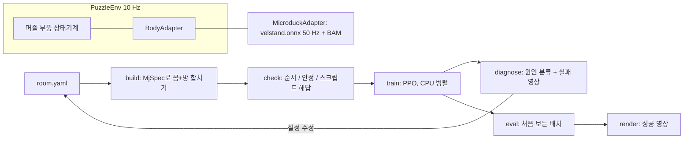

# Spec: mujoco-puzzle-gym 첫 마일스톤 (발판 → 문 → 골, 마이크로덕)
Status: approved 2026-11-11 (user: "승인")
View (read-only copy): (아직 없음)

근거: intent.md (approved 2026-11-11). 사실 출처: `pollen-robotics/microduck_rl` (develop, 2026-11-10 push), Hugging Face `pollen-robotics/microduck-policies` (manifest schema 2, 2026-11-06).

## Requirements
- R1: `mpg fetch-assets` 한 번으로 공식 저장소 고정 커밋의 MJCF·메시와 Hugging Face 고정 리비전의 `velstand.onnx`를 `~/.cache/mujoco-puzzle-gym/`에 받고, 파일마다 SHA256을 확인하고, 메시 라이선스(CC BY-NC-SA 4.0)와 출처를 출력한다. 두 번째 실행은 내려받지 않고 확인만 한다. Check: `mpg fetch-assets --json` 출력의 `verified: true`, 해시 불일치 파일을 넣은 테스트에서 실패 종료(`tests/test_assets.py`).
- R2: 몸 어댑터 경계 `BodyAdapter`가 있다. 입력은 이동 명령(vx, vy, wz), 출력은 몸 상태(위치, 방향, 넘어짐 여부). 퍼즐·환경·학습 코드는 `mujoco_puzzle_gym/bodies/` 밖에서 마이크로덕 이름이나 관절을 참조하지 않는다. Check: `tests/test_boundary.py`가 `bodies/` 밖 소스에서 `microduck`, `velstand`, 관절 이름 문자열을 찾으면 실패.
- R3: `MicroduckAdapter`가 CPU MuJoCo(timestep 5 ms, 4스텝마다 정책 1회 = 50 Hz) + BAM 모터 모델 + `velstand.onnx`로 걷는다. 관측 61차원은 공식 순서(각속도 3, 투영 중력 3, 관절 위치 14, 관절 속도 14, 직전 행동 14, 명령 13)를 따른다. 명령은 vx ±0.4, vy ±0.3, wz ±1.0으로 자른다. Check: `tests/test_walk.py` — 평지에서 vx=0.3을 5초 주면 넘어지지 않고 전진 거리가 1.5 m의 ±30% 안, 명령 0을 5초 주면 이동이 0.1 m 미만.
- R4: 퍼즐 부품 3종이 있다. 발판(몸이 올라서면 켜짐), 문(발판이 켜지면 열림, 꺼지면 닫힘, 미닫이), 골(몸 중심이 반경 안에 들어오면 성공). 부품 상태는 매 스텝 읽을 수 있다. Check: `tests/test_parts.py` — 몸을 발판 위에 놓으면 문이 2초 안에 열림, 문이 닫혀 있으면 골로 가는 길이 막힘(문 너머로 순간이동 없이 직선 이동 시 충돌).
- R5: 방 설정 파일(YAML)에서 장면을 만든다. 방 크기, 벽, 부품 배치, 부품 사이 연결(발판 A → 문 B), 배치 무작위 범위를 적는다. `mpg build room.yaml`이 몸 + 방을 합친 MJCF를 만들고 그림 한 장을 저장한다. Check: `mpg build examples/switch_door.yaml --json`이 `ok: true`와 MJCF·PNG 경로를 내고, 잘못된 연결(없는 문 이름)은 `ok: false`와 이유.
- R6: `mpg check room.yaml`이 세 가지를 확인하고 결과를 JSON으로 낸다. (a) 풀이 순서 존재: 연결 그래프에서 골까지의 순서를 찾는다. (b) 물리 안정: 명령 0으로 10초 동안 NaN·넘어짐 없음. (c) 실제로 풀림: 특권 상태를 쓰는 스크립트 해답(발판으로 걸어가기 → 골로 걸어가기)이 무작위 배치 20개 중 18개 이상에서 성공. Check: 예제 방은 세 항목 모두 통과, 문이 영원히 닫힌 방은 (a) 실패, 발판이 벽 안에 있는 방은 (c) 실패.
- R7: Gymnasium 환경 `PuzzleEnv`가 있다. 위층 행동은 (vx, vy, wz)이고 10 Hz(위층 1스텝 = 걷기 정책 5스텝)다. 관측은 몸 감각 일부(투영 중력, 각속도, 몸 속도)와 특권 상태(발판·문·골까지 몸 기준 상대 위치, 발판·문 상태)다. 보상은 진척 보상(다음 목표까지 거리 감소) + 단계 보상(발판 켜짐) + 성공 보상 + 넘어짐 벌점이며, 항목별 값이 `info`에 따로 들어간다. Check: `gymnasium.utils.env_checker.check_env` 통과, `tests/test_reward_terms.py`.
- R8: `mpg train task.yaml --minutes N`이 CPU 병렬 환경으로 학습하고 체크포인트, 보상 곡선, 항목별 보상 기여를 저장한다. 알고리즘은 기본 PPO이고 `--algo`나 task.yaml의 `algo:`로 바꾼다. 바꿀 수 있는 것: Stable-Baselines3의 다른 알고리즘(예: SAC, A2C), 그리고 작은 `Trainer` 인터페이스(train, save, load, predict)를 구현한 사용자 알고리즘(파이썬 진입점 `mujoco_puzzle_gym.algos`로 등록). Check: `--minutes 5`(PPO) 후 `runs/<id>/` 아래 체크포인트, `curves.png`, `summary.json`이 생기고 무작위 정책보다 평균 보상이 높다. `tests/test_algo_plugin.py`가 가짜 알고리즘을 등록해 train → eval이 끝까지 돈다. `--algo sac --minutes 1`이 오류 없이 끝난다.
- R9: `mpg diagnose runs/<id>`가 실패 원인을 다음 넷 중 하나 이상으로 분류해 근거 숫자와 함께 낸다: 환경 버그(NaN·부품 상태 모순), 보상 해킹(보상은 오르는데 성공률이 그대로), 탐색 부족(발판을 한 번도 안 밟음), 몸 실패(넘어짐 비율 높음). 실패 장면 영상 1개를 저장한다. Check: 일부러 망가뜨린 세 설정(진척 보상만 크게, 발판을 아주 멀리, 명령을 범위 밖으로)에서 각각 기대한 분류가 나온다(`tests/test_diagnose.py`).
- R10: `mpg eval runs/<id> --episodes 100`이 학습에 쓰지 않은 시드의 배치에서 성공률과 평균 소요 시간을 낸다. Check: 성공률 ≥ 80%.
- R11: `mpg render runs/<id>`가 성공 장면 MP4를 화면 없이(offscreen) 만든다. Check: 맥과 CI(리눅스)에서 MP4 파일 생성, 길이 > 0.
- R12: 에이전트 친화: 모든 `mpg` 명령은 `--json`으로 기계가 읽을 결과를 내고, 실패는 0이 아닌 종료 코드 + 이유를 낸다. 저장소 루트에 에이전트용 안내 `AGENTS.md`(방 설정 문법, 명령 순서 build → check → train → diagnose → eval)가 있다. Check: `tests/test_cli_json.py`가 모든 명령의 `--json` 출력을 JSON으로 파싱.
- R13: 속도 측정: `mpg bench`가 위층 환경 스텝/초(단일, 병렬)를 낸다. Check: 맥 스튜디오에서 측정값을 `docs/bench.md`에 기록. 첫 측정으로 보아 1회 학습이 2시간 안에 R10 목표에 닿기 어려우면 학습 단계 전에 멈추고 사용자와 다시 정한다.
- R14: README를 사용자의 다른 저장소(예: ai_chatroom_site, llm_music_lens)와 같은 꼴로 만든다. 한국어 본문 + `README.en.md` + `README.ja.md`와 맨 위 언어 전환 줄, 밝은/어두운 테마 배너 SVG(대체 글 포함), 그리고 섹션: 이게 뭔가요 / 주요 기능 / 빠른 시작 / 명령 표 / 방 설정과 정책 바꾸기 / 몸 어댑터 / 에이전트에게 맡기기(스킬) / 출처와 라이선스. 빠른 시작은 새 환경에서 `uv sync` → `mpg fetch-assets` → `mpg demo`(예제 방을 스크립트 해답으로 풀고 영상 저장) 세 줄로 돈다. 라이선스: 우리 코드 Apache-2.0, 메시 CC BY-NC-SA 4.0은 저장소에 포함하지 않음. Check: 빈 디렉터리에 clone 후 세 줄 실행 기록, 세 언어 파일의 섹션 수 일치, GitHub에서 밝은/어두운 테마 배너 스크린샷.
- R15: CI(GitHub Actions, ubuntu)가 push마다 자산 받기 + 빠른 테스트(R1–R7, R9, R12)를 돌린다. 학습이 필요한 테스트는 제외한다. Check: Actions 실행 녹색, README 배지.
- R17: 환경과 정책을 설정으로 바꿀 수 있다. `task.yaml`이 방 파일, 관측 항목, 보상 항목과 가중치, 위층 주기, 종료 조건, 알고리즘과 하이퍼파라미터, 망 크기를 적는다. 새 관측·보상 항목과 새 퍼즐 부품은 등록 함수(`register_obs`, `register_reward`, `register_part`)로 코드 수정 없이 추가한다. Check: `tests/test_registry.py`가 사용자 보상 항목 하나와 부품 하나를 등록해 build → check → 1분 train이 돈다. 바꾼 설정은 `runs/<id>/task.resolved.yaml`로 저장된다.
- R18: 에이전트용 스킬 파일 `skills/mujoco-puzzle-gym/SKILL.md`(Claude Code 스킬 형식, `AGENTS.md`가 가리킴)를 둔다. 내용: 언제 쓰나, 순환 순서(build → check → train → diagnose → 고치기 → eval → render), room.yaml·task.yaml 문법, 정책·보상·부품·알고리즘을 바꾸고 등록하는 법, diagnose 분류별 고치는 법, 지켜야 할 규칙(`bodies/` 밖에서 몸 이름 금지, 자산 해시 고정, 결과는 `--json`으로 읽기). 설치법은 README에 적는다. Check: 이 대화를 모르는 새 Claude 작업자에게 스킬과 저장소만 주고 "발판 2개를 모두 밟아야 열리는 문" 방을 만들게 하면, 사람 도움 없이 새 부품 조합의 room.yaml을 쓰고 `mpg check`를 통과시킨다(작업 기록 보관).
- R16: 끝에서 끝까지: `mpg build` → `mpg check` → `mpg train` → `mpg eval` → `mpg render`를 예제 방에 순서대로 돌려 성공률(R10 목표 이상)과 성공 영상이 나온다. Check: 실행 로그 + `runs/<id>/summary.json` + MP4.

## Out of scope
- 에이전트 자동 순환(에이전트가 스스로 명령을 이어 돌리는 루프)과 MCP 서버. 이번에는 사람이나 Claude가 명령을 하나씩 친다. R12는 그 준비다.
- 다른 몸 어댑터 구현, 시간 제한 문, 밀기 블록, 경사로, 퍼즐 자동 생성기.
- 실물 센서만 쓰는 학생 정책(ToF, 카메라), sim2real, 실물 오리.
- 윈도우 2060 MJX 학습, 걷기 정책 재학습.
- 저장소 공개(사용자가 나중에 정한다).

## Design

- 설정 두 단계: `room.yaml`(장면: 방, 부품, 연결, 무작위 범위)과 `task.yaml`(학습: 관측, 보상, 알고리즘, 망). 에이전트는 둘 다 고칠 수 있다(R17, R18).
- 파이썬 3.12 고정(BAM이 <3.13 요구), `uv`로 관리. 패키지 `mujoco_puzzle_gym`, 명령 `mpg`.
- `mujoco_puzzle_gym/assets.py`(R1), `bodies/base.py`(R2), `bodies/microduck.py`(R3, 공식 `scripts/infer_policy.py`의 관측·BAM 처리를 참고해 다시 작성하고 출처 표기), `parts/`(R4), `room.py`(R5), `check.py`(R6), `env.py`(R7), `train.py`·`diagnose.py`·`eval.py`·`render.py`(R8–R11), `cli.py`(R12), `bench.py`(R13), `registry.py`(R17), `algos/`(R8: `base.py`의 `Trainer`, `sb3.py`), `skills/mujoco-puzzle-gym/SKILL.md`(R18), `README.md`·`README.en.md`·`README.ja.md`·`assets/banner-{light,dark}.svg`(R14).
- 학습 라이브러리: 기본은 Stable-Baselines3 PPO(CPU, SubprocVecEnv). 맥 CPU에서 바로 돌고 Gymnasium 표준이다. `Trainer` 인터페이스 뒤에 두어 바꿀 수 있다(R8).

## How each constraint is met
- 라이선스: 메시·MJCF는 저장소에 넣지 않고 R1이 받아 온다. 정책 ONNX는 Apache-2.0이지만 같은 방식으로 받는다. 출처는 README와 R1 출력에 적는다.
- 맥 CPU 현실적 시간: R13에서 먼저 재고, 한도 밖이면 학습 전에 멈춘다.
- 비밀·내부 데이터 금지: 코드와 예제에 키·토큰·개인 정보 없음. CI는 공개 자산만 받는다.
- 승인: 저장소 push·PR은 사용자 승인 후, 병합은 사용자.
- 작은 범위: 부품 3종, 방 1종, 몸 1종. 확장은 등록 함수와 스킬로 열어 두되 구현은 하나씩만.

## Open questions
- [x] 첫 마일스톤 성공률 목표: 80% (사용자 승인 2026-11-11)
- [x] 학습 시간 한도: 맥 스튜디오에서 1회 학습 2시간 이내 (사용자 승인 2026-11-11)
- [ ] 공식 저장소에서 고정할 커밋과 HF 리비전: 구현 첫 단계에서 정해 spec에 적는다. (Claude)
- [ ] 걷기 정책 위에서 10 Hz 위층이 충분히 부드러운지: R3·R13 결과를 보고 5–25 Hz 사이에서 조정할 수 있다. (Claude)

## Areas of concern
- 메시 라이선스: 데모 영상과 README 그림에 CC BY-NC-SA 메시가 보인다. 비상업 포트폴리오로는 출처 표기로 충분하다고 보지만, 공개 전 한 번 더 확인한다.
- 상위 저장소 변화: 공식 저장소는 매일 바뀐다. 커밋·리비전·SHA256을 고정해 깨짐을 막는다. BAM 버전도 고정한다.
- 시뮬레이션 비용: 위층 1스텝마다 물리 20스텝 + ONNX 5회다. 너무 느리면 학습이 한도 안에 안 끝난다(R13이 먼저 막는다).
- 되돌릴 수 없는 단계: 없음. 저장소는 private이다.
