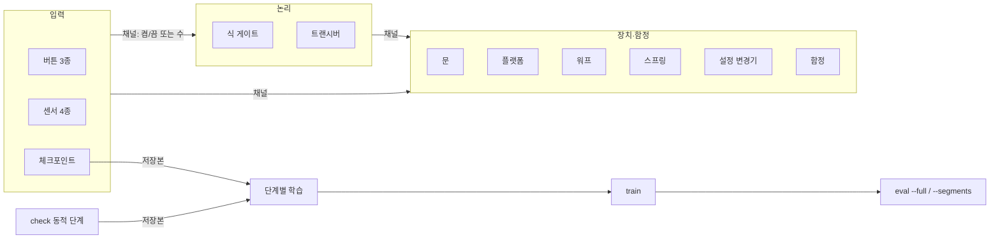

# Spec: mujoco-puzzle-gym 마일스톤 2 (부품 카탈로그, 신호, 체크포인트, 단계별 학습)
Status: approved 2026-11-13 (16c 2b: R30 low bar part + `glide` step, `fast_herd` dropped, `roll_delivery` detach before placing: "승인"); approved 2026-11-13 (16c OQ7: R30 mounted collision set = official roller model's, trunk height from geometry, roller command range, station `max_speed` 0.1 m/s, `crouch_min_speed` 0.2 m/s, pad braking optional, Open question 7 closed: "승인"); approved 2026-11-13 (E3b-4: R28 laundry on 0.18 m stands, Open question 8 partly decided: "승인"); approved 2026-11-12 (E3b-3 plan: R28 dispenser parks copies off-stage like the cannon pool, receptacle `consume` and pit return for `recycle`: "승인"; E3b-2 drawer strap about 10 cm: "승인"; E3b-2 measurements: R28 `dial` pushed by spokes, `drawer` opened by a strap and in-place turn: "승인"; E3a review: R4 wall press window 6 cm in front / thickness + 1 cm behind, OQ2 closed with head mapping: "승인"; E2b review: R16 pit has no `power`, R21 example `cannon_a.power`: "승인"; E2a review: R11 joints only on moving axes, `path` as offsets from `pos`: "승인"; E2a measurements: R11/R12 joints instead of mocap, OQ1 closed as (c): "승인"; E1 bundle-4 results (OQ11 closed, R20 overlap rule): "응"; E1 bundle-3 results (OQ5/OQ10 closed, R38 pin, R28 handle_ball, R10 field names): "승인"; E1 bundle-2 decisions R2/R4/R5/R6: "승인"; R35 order-reasoning test + OQ12 added: "승인"; R39 sensor observations added: "승인"; R37 added: 방향 "너의 추천대로 부탁해", 문안 "승인"; R38 ball/goal_net added: "승인"). Previous: approved 2026-11-11 (사용자 "전부 승인": R31-R36 + R2b + review rounds 2-4 fixes. Previous: approved after R30 ... re-review 1-7)
View (read-only copy): (아직 없음)

근거
- 사용자 요청 (2026-11-11, 이 대화):
  - "퍼즐 파츠를 많이 생각해줘. 나중에 자유롭게 조립할 수 있게 -> 그리고 이 프리셋들을 적당한 폴더에 모으고 가이드를 남겨"
  - "체크포인트 깃발도 필요하겠네 / 여러 차례 순서가 요구되는 퍼즐 학습을 위해 자연스럽게 A->B, B->C, C-> D를 순서대로 마스터하고 A->B->C->D로 테스트할 수 있게 도와주는 장치가 필요해"
  - 초안 작성 승인: "승인". 이때 기본값으로 정한 것: 잡기는 weld 구속, 스크립트는 "YAML에는 안전한 식만, 파이썬은 플러그인으로만".
- 선행 문서: `../2026-11-10-duck-puzzle/{intent,spec,plan}.md`. 첫 마일스톤의 R 번호는 앞에 `M1-`을 붙여 부른다(예: M1-R2).
- 확인한 사실 (2026-11-11, 캐시된 상위 MJCF `robot_allcollisions_backlash.xml`):
  - 구동 관절은 다리 10개(hip_yaw/roll/pitch, knee, ankle × 좌우)와 머리 4개(neck_pitch, head_pitch, head_yaw, head_roll)다.
  - 부리를 여닫는 관절은 없다.
  - 걷기 정책 명령 13차원 중 머리 자세 4개는 현재 어댑터에서 0으로 둔다(`bodies/microduck.py` `CMD_DIM`).
  - 머리에 `head_camera` 카메라와 같은 이름의 사이트가 있고, 부리 끝에는 `mouth_tip` 사이트가 있다. `jaw_soft` 몸체는 있지만 관절이 없다.
  - 이 저장소의 환경에는 OpenCV가 설치되어 있지 않다.
- 사용자 추가 요청 (2026-11-11): "아루코마커 번호를 시각적으로 알아야하는 케이스에는 달자 (에이전트를 위한 신호변환기 이런거에는 필요없으니) / 실제로 인식 센서는 없지만 그쪽을 쳐다보면 신호를 주는걸로?"

## Requirements

### 신호와 공통
- R1: 신호 버스.
  - 신호는 이름 붙은 채널이고 값은 실수다. 켬/끔 신호는 0과 1을 쓰고, 0.5를 넘으면 켬으로 읽는다. 카운터(R8b)처럼 숫자를 내는 부품은 정수를 그대로 싣는다.
  - 부품은 받는 채널(`in`), 내보내는 채널(`out`), 전원 채널(`enable`, 생략하면 항상 켜짐)을 갖는다.
  - 매 몸 스텝(50 Hz)마다 입력 부품 → 논리 부품 → 장치 부품 순서로 한 번씩 평가한다.
  - 상태가 없는 부품만으로 이루어진 순환은 거절한다. 지연·래치처럼 상태를 가진 부품을 거치는 순환은 허용한다.
  - Check: `tests/test_signals.py`.
    - 버튼 → 문 연결이 같은 스텝에 반영된다.
    - 상태 없는 순환(NOT → NOT)은 `mpg check`의 정적 단계에서 실패한다.
    - 지연 게이트를 낀 순환은 통과한다.
- R2: 첫 마일스톤과의 호환.
  - 기존 `links: [{from, to}]` 표기는 채널로 바꿔 읽는다.
  - `examples/switch_door.yaml`과 M1 테스트는 수정 없이 통과한다.
  - M1 `switch`는 바닥 버튼 `oneshot`의 별칭이다(한 번 밟으면 계속 켜짐, M1 동작과 같음).
  - Check: M1의 기존 테스트 전부(2026-11-11 기준 54개, slow 포함)가 통과한다. 예제 방에서 `mpg check`의 solver 결과가 18/20 이상이다.
- R2b: 몸 능력 태그 (사용자 2026-11-11: "마일스톤 3번째로는 다른 로봇을 위한 퍼즐 부품 추가로 하면 될거 같아", 태그 자리를 비워 두는 안에 "응 승인").
  - `BodyAdapter`에 `capabilities`를 둔다. 능력 이름 집합(예: `walk`, `beak_grab`)과 수치 사전(예: 닿는 높이)으로 이루어지고, 값은 몸 어댑터가 정한다.
  - 부품은 필요한 능력을 `requires_body: [...]`로 선언할 수 있다. 생략하면 요구가 없다. M2 부품은 마이크로덕이 가진 능력만 요구한다.
  - M2에서는 검사만 한다. 방의 부품이 요구하는 능력이 몸에 없으면 `mpg check`의 정적 단계가 부품 이름과 빠진 능력을 이유로 내고 실패한다.
  - 다른 몸용 능력 이름과 부품은 마일스톤 3에서 정한다.
  - Check: `tests/test_body_caps.py`.
    - 기본 마이크로덕 어댑터로 M1 예제와 M2 예제 방이 그대로 통과한다.
    - `requires_body: [grip]`인 시험 부품이 든 방은 `mpg check`가 `grip`을 이유에 넣고 실패한다.
- R3: 값 스키마와 프리셋.
  - 부품의 모든 값(크기, 힘, 속도, 질량, 시간)은 스키마에 이름, 단위, 기본값, 최소·최대, 실행 중 변경 가능 여부를 적는다.
  - 범위 밖 값이 있으면 `mpg build`/`mpg check`가 실패하고, 이유와 허용 범위를 낸다.
  - 프리셋은 `src/mujoco_puzzle_gym/presets/parts/<분류>/<이름>.yaml`에 두어 패키지에 포함한다.
  - 방 YAML은 `preset: input/toggle_wall`로 프리셋을 불러오고 값 일부만 덮어쓴다.
  - 프리셋 폴더(분류)는 하나로 정한다: `input`(버튼·센서·시선), `logic`(게이트·카운터·트랜시버), `device`(문·플랫폼·워프·스프링·설정 변경기·애드온 장착대), `floor`, `trap`, `object`, `beak`, `npc`. 여러 부품을 묶은 조립 프리셋(`lap_counter`, 바퀴 퍼즐 등)은 `puzzles/<주제>/`에 둔다. spec의 `분류` 표기와 plan의 폴더 목록은 이 목록을 따른다.
  - `mpg parts --json`은 등록된 부품, 프리셋, 값 스키마를 낸다.
  - Check: `tests/test_presets.py`.
    - 모든 프리셋이 단독 방에서 build된다.
    - 범위 밖 값은 `ok: false`가 되고 이유에 범위가 들어간다.
    - 덮어쓴 값이 `task.resolved.yaml`에 남는다.

### 공간 형태
- R37: 글자 지도 `map` (사용자 2026-11-11: "공간을 더 자유롭게 설정하지는 못해? 방의 높이라던가 계단이라던가, 방의 변끼리 닿는 부분을 없애서 정사각형이 아니게 한다던가 낭떠러지라던가 다른 방이라던가", 글자 지도 방식으로 모양·낭떠러지·벽 높이·층을 넣고 이어진 방은 지도로 표현하는 제안에 "너의 추천대로 부탁해").
  - 방 YAML에 `map:`(여러 줄 글자)과 `cell`(칸 한 변, 기본 0.1 m)을 적을 수 있다. 지도 가운데가 원점이고, 윗줄이 +y, 왼쪽이 -x다. 부품 위치는 지금처럼 `pos`로 적는다.
  - 기본 기호:
    - `#`: 벽. 높이는 `wall.height`.
    - `.`: 바닥, 높이 0.
    - `1`–`9`: 높은 바닥. 높이는 숫자 × `step_height`(방 값, 기본은 Open question 5에서 정함).
    - 공백: 바닥 없음(낭떠러지). 지도 바깥도 바닥 없음이다.
  - `legend:`로 기호를 더 정의한다. 종류는 `wall`(높이), `floor`(높이, 마찰), `ramp`(오르는 방향, 시작·끝 높이). 낮은 담, 벽마다 다른 높이, 경사로는 이것으로 적는다.
  - `map`이 있으면 바깥 벽을 자동으로 만들지 않는다. `map`과 `size`/`walls`를 함께 쓰면 거절한다. `map`이 없으면 M1 표기 그대로다(R2).
  - 바닥은 R10의 타일 바닥으로 만든다. 같은 높이의 이웃 칸은 하나의 상자로 합친다. 넘어짐 높이 기준은 R10의 규칙(오리 아래 칸의 윗면)을 따른다. 바닥 없음 칸에 빠지면 R16 구덩이와 같은 낙하 판정(`on_fall`, 방 값, 기본 `fail`)이다.
  - 층(단상, 위층)은 높이 단계와 경사로로 적는다. 위아래로 겹치는 층(다리 밑 통로)은 범위 밖이다.
  - 이어진 여러 방은 지도 하나에 벽과 문(R9)으로 나누어 적는다. 별도 "방 연결" 표기는 만들지 않는다.
  - 점검:
    - 풀이 순서 격자는 지도 칸을 쓴다. 이웃 칸으로는 높이 차가 몸의 `max_step` 이하일 때만, 경사로는 기울기가 `max_slope` 이하일 때만 지나간다. 바닥 없음 칸은 지나갈 수 없다. 두 값은 몸 능력 수치(R2b)이고, 마이크로덕 값은 Open question 5에서 잰다.
    - 부품, 출발 위치, 무작위화 범위가 벽이나 바닥 없음 칸에 걸치면 정적 단계에서 실패하고 칸 좌표를 이유에 넣는다.
    - 스크립트 해답은 같은 격자 경로를 따른다.
  - 무작위화: R35 `region`은 지도의 바닥 칸 안에서만 뽑는다. `rooms` 후보에 지도 방을 써도 된다.
  - Check: `tests/test_map.py`.
    - 'ㄱ'자 지도 방이 build되고, 바닥 없음 칸으로 밀려난 몸은 2초 안에 낙하로 판정된다.
    - `map`과 `size`를 함께 쓴 방은 build에서 거절된다.
    - 높이 차가 `max_step`을 넘는 턱만 있는 방은 order 단계가 실패하고 이유에 칸 좌표가 들어간다. 경사로를 더하면 통과한다.
    - `legend`의 낮은 담 높이가 지정값과 같다(±1 mm).
    - 예제 `examples/rooms/two_rooms_map.yaml`(지도로 이은 방 두 개와 문)이 `mpg check`를 통과한다(solver 18/20 이상).
    - 예제 `examples/rooms/stairs_map.yaml`(단상으로 오르는 계단이나 경사로 뒤 골)이 `mpg check`를 통과한다. 단 높이는 Open question 5의 측정값을 쓴다.

### 입력 부품
- R4: 버튼 3종.
  - 종류: `momentary`(누르는 동안만 1), `oneshot`(한 번 눌리면 계속 1), `toggle`(누를 때마다 0↔1).
  - `mount: floor | wall`. 바닥형은 몸이나 물체가 올라서면 눌리고, 벽형은 부리 끝 사이트가 누름판 앞 6 cm 안(뒤는 판 두께 + 1 cm)에 오면 눌린다(머리를 숙이고 벽에 붙으면 가슴이 먼저 닿아 부리 끝이 판에서 0.1–5.4 cm 떨어진다).
  - `trigger: body | object | npc | any`(버튼 기본 `body`)로 무엇에 눌리는지 정한다. `any`는 오리, 물체, NPC(R29)를 모두 포함하고 대포알과 끈 매듭(R31)은 포함하지 않는다. R5의 압력판·구역 `trigger`도 같다.
  - `enable`이 0이면 눌려도 출력이 바뀌지 않는다.
  - Check: `tests/test_buttons.py`가 종류 3개 × 설치 2곳 × enable 켬/끔의 출력 순서를 확인한다. 몸을 놓거나 부리 사이트를 옮기는 식으로 시험한다.
- R5: 센서 4종.
  - 압력판: 올려진 질량의 합이 `min_mass` 이상일 때 1. 접촉력의 수직 성분 합 ÷ g로 잰다.
    - `trigger: body | object | npc | any`(기본 `object`)로 무엇을 셀지 정한다. 오리가 물고 있는 물체는 세지 않는다. 오리가 서기만 해도 "추를 올리는" 퍼즐이 풀리는 일을 막는다.
  - 구역 센서: 상자 영역 안에 지정한 대상(몸, 특정 물체, 아무거나)이 있으면 1.
    - `rearm: leave`이면 대상이 영역을 완전히 벗어난 뒤에야 다시 켜질 수 있다. 서 있거나 경계에서 흔들려도 한 번 통과를 한 번으로 센다.
    - `direction: [dx, dy]`이면 그 방향으로 들어올 때만 켜진다.
  - 레이저 센서: 두 점 사이의 광선(`mj_ray`)이 가려지면 1. 광선은 보이게 그린다.
  - 소켓: 지정한 큐브가 정해진 위치 오차와 각도 오차 안에 놓이면 1. `receptacle`의 프리셋이다.
  - 정해진 물건 상자 `receptacle` (사용자 2026-11-11: "정해진 물건을 올려놔야 신호를 쏘는 상자도 좋고"). 소켓, 걸이(`hook`), 바구니(`basket`)는 모두 이 부품의 프리셋이다(판정 코드 하나).
    - 모양: 위가 열린 상자, 받침판(소켓), 공중 걸이 중 하나. 크기와 벽 높이를 설정한다.
    - `accept`: 받을 물건. 물체 종류(`key`, `egg` …), 이름, 마커 번호 중 하나 이상.
    - `require`: `all`(목록 모두) | `count: n` | `mass: kg` | `order: [a, b]`(넣은 순서).
      - `order`에서 받는 물건이라도 차례를 어겨 들어오면 `wrong`으로 다룬다(순서 잠금 게이트와 같은 규칙).
    - `wrong`(받지 않는 물건이 들어왔을 때): `ignore` | `eject`(물건을 벽 너머로 들어 밖으로 던짐) | `lock`(뚜껑이 닫혀 더는 못 넣음) | `fail`(에피소드 실패).
    - `close_on_ok: true`면 조건을 채운 순간 뚜껑이 닫힌다.
    - 오리가 물고 있는 물체는 들어 있는 것으로 세지 않는다(놓아야 센다).
    - 출력: `<이름>.ok`, `<이름>.count`, `<이름>.wrong`.
  - 과녁 `target` (사용자 2026-11-11: "대포로 쏴 맞춰야 하는 과녁 -> 맞으면 신호를 쏘는 과녁"): 대포알만 센다(`trigger: shell`). R16의 탄 제외 규칙의 예외는 과녁과 R34 `breakable`(`by: shell`) 두 가지다.
    - 탄의 충돌 속도가 `min_speed` 이상일 때만 맞은 것으로 센다. 속도는 접촉이 시작되기 직전 물리 스텝의 탄 속도로 재고, 한 탄의 한 접촉(접촉이 끝날 때까지)은 한 번만 센다. 부품은 몸 스텝(20 ms)마다 한 번만 `update`되고 그 사이 물리 스텝 4개를 보지 못하므로, 맞음과 접촉력이 필요한 부품은 아래 `substep` 훅을 쓴다.
    - `substep` 훅: `BodyAdapter.step(data, cmd, on_substep=None)`이 `mj_step`마다 콜백을 부르고, `env.advance`가 부품들의 `Part.substep(model, data)`를 묶은 콜백을 넘긴다(기본 None이라 `bench.py` 등 기존 호출은 그대로). 몸 어댑터는 부품을 모른다(M1-R2 경계, `parts/base.py`가 `bodies`를 가져오므로 반대 방향 가져오기는 순환). 과녁과 R34 `breakable`(`shell`, `crush`)처럼 충돌 순간이나 최대 힘이 필요한 부품이 여기서 접촉 시작, 직전 속도, 최대 접촉력을 기록하고 `update`에서 판정한다. 압력판은 이 훅을 쓰지 않는다: 순간 최대 힘은 30 g 큐브를 5 cm 떨어뜨려도 0.35 kg으로 읽혀(probe) 무게 퍼즐이 틀린 무게로 풀리므로, 지금처럼 `update` 때의 수직 힘 합으로 잰다. M1 `env.py`의 `advance()`는 몸 스텝마다 한 번만 부품을 부르고(`env.py:150`), `microduck.py`는 그 안에서 `mj_step` 4번을 돈다(`DECIMATION = 4`).
    - 출력 방식 `mode: pulse | latch`, 맞은 횟수 `<이름>.hits`. 마커(R26)를 붙일 수 있다. 움직이는 과녁은 R11 플랫폼 위에 올린다.
  - Check: `tests/test_sensors.py`. 센서마다 켜지는 경우와 켜지지 않는 경우를 하나씩 확인한다. `receptacle`은 `require` 4종과 `wrong` 4종을 하나씩, 과녁은 탄이 맞을 때와 오리가 부딪힐 때(안 켜짐)를 확인한다. 압력판은 기준보다 가벼운 큐브 하나와 무거운 큐브 하나로 시험한다.
- R6: 체크포인트 깃발.
  - `order: 1, 2, …`로 순서를 정한다.
  - 몸이 반경 안에 들어오면 켜지고 1을 낸다.
  - 켜지는 순간 다음을 저장한다: MuJoCo 전체 상태(`mj_getState`, 플래그 `mjSTATE_INTEGRATION`. `PHYSICS`/`FULLPHYSICS`는 `eq_active`를 담지 않아 복원하면 잡기 용접과 끈 연결이 풀린다), 모든 부품의 내부 상태, 신호 값, 걷기 정책의 이력.
    - 또 모델 쪽에 있어 `mj_getState`가 담지 않는 값도 저장한다: 부품 배치(`body_pos`), 스키마에서 "실행 중 변경 가능"인 모든 모델 값(마찰, 설정 변경기·난이도가 바꾼 값), 잡기 용접과 끈 연결 구속의 `eq_data`, 애드온 상태(R30), 끈 `length`의 현재값과 목표값(R31).
    - `reset()`은 이 모델 값들을 스키마 기본값(또는 난이도 단계 값)으로 되돌린다. `mj_resetData`는 모델 값을 되돌리지 않기 때문이다.
    - 알려진 오차: 복원 뒤 재생은 정확히 같지 않다(1초에 약 2 mm 어긋남). 모터 모델이 직전 물리 스텝의 힘을 읽는데 복원 때 `mj_forward`로 다시 계산되기 때문이다. R21 시작 상태 허용 오차(1 cm) 안이라 받아들인다(사용자 2026-11-11 "승인").
  - 그 뒤의 실패, 낙하, `reset` 워프는 마지막으로 켜진 깃발의 저장본에서 다시 시작한다. 단 `respawn: checkpoint`일 때만이고, 기본은 처음부터 다시 시작한다.
    - `respawn: checkpoint`이면 넘어짐은 에피소드를 끝내지 않고 저장본으로 돌아간다. 대신 보상 항목 `respawn_penalty`(기본 음수)를 준다. 일부러 넘어져 체크포인트로 돌아가는 꼼수를 막는다.
  - 순서를 건너뛰고 닿았을 때의 동작은 `skip: ignore | fail`로 정한다.
  - Check: `tests/test_checkpoint.py`.
    - 깃발 2를 켠 뒤 넘어지면, 깃발 2의 위치와 부품 상태로 다시 시작한다.
    - `skip: fail`에서 2를 먼저 밟으면 에피소드가 실패한다.

### 논리 부품
- R7: 식 게이트.
  - `expr`에 안전한 식만 쓴다. 허용하는 것:
    - 채널 이름과 숫자
    - `and or not xor`
    - 비교 연산
    - 함수 `delay(x, s)`, `hold(x, s)`, `pulse(x)`, `latch(set, reset)`, `count(x)`, `timer(x)`
  - 식은 파이썬 `ast`의 허용 목록으로 검사한 뒤 자체 평가기로 계산한다. `eval`/`exec`는 쓰지 않는다.
  - 실제 파이썬 로직은 `register_logic(name, fn)` 플러그인으로만 넣는다. YAML에서는 등록된 이름만 부른다.
  - 프리셋: and, or, not, xor, 지연, 타이머, 순서 잠금(`sequence: [a, b, c]`). 횟수 세기는 R8b 카운터 부품을 쓴다(`count(x)` 식 함수는 간단한 경우용). 순서 잠금은 순서가 틀린 입력이 들어온 순간 `<이름>.wrong` 펄스를 낸다.
  - Check: `tests/test_logic.py`.
    - 각 함수의 시간 동작을 확인한다.
    - `__import__('os')`, 속성 접근, 람다, 컴프리헨션은 build 단계에서 거절한다.
    - 순서 잠금은 맞는 순서일 때만 1이 된다.
    - 순서 잠금은 기본으로 한 번 펄스(1 스텝)를 내고 처음 상태로 돌아가 다시 기다린다. `latch: true`면 1을 유지한다. 순서가 틀리면 `.wrong`이 한 스텝 1이 된다.
- R8b: 카운터 (사용자 2026-11-11: "감지기를 오리가 통과한 횟수를 카운트해서 몇번 순회했는지 ... 워프의 상태를 바꿔서 다시 처음으로 보낼지 다음방으로 보낼지").
  - 입력 채널 `up`(필수), `down`, `reset`. 각 입력의 상승 순간마다 1씩 더하거나 뺀다.
  - 값: `start`, `min`, `max`, `wrap`(최대를 넘으면 최소로 돌아감), `target`.
  - 출력 채널:
    - `<이름>.count`: 현재 수, 정수.
    - `<이름>.reached`: `count >= target`이면 1.
  - 값은 체크포인트 저장본(R6)에 포함된다. 리셋 워프로 처음에 돌아가도 `persist: true`이면 유지된다(기본 false).
  - 프리셋 `lap_counter`: 구역 센서 A와 B를 순서 잠금(A→B)으로 묶고, 그 출력을 카운터 `up`에 연결한다. 한 바퀴를 제대로 돈 경우만 센다. 역방향 바퀴도 A→B 순서를 만들기 때문에, 프리셋은 구역 A와 B에 진행 방향 조건(`direction`)을 건다.
  - 관측 항목 `counters`: 카운터 값과 목표의 비율.
  - Check: `tests/test_counter.py`.
    - 상승 순간마다 정확히 1씩 센다. 입력이 1로 머물러 있으면 더하지 않는다.
    - `wrap`, `reset`, `persist`가 동작한다.
    - 오리 스크립트가 원형 경로를 3바퀴 돌면 `lap_counter`가 3이 된다. 역방향으로 돌면 0이다(slow).
- R8: 트랜시버.
  - 송신기는 `in` 채널 값을 `band`로 보내고, 수신기는 같은 `band`의 값을 `out`으로 낸다.
  - `delay`(초)를 줄 수 있다.
  - 방 안에서 위치가 보이는 부품이라, 그림과 가이드에서 연결을 따라갈 수 있다.
  - Check: `tests/test_logic.py`. 송신 → 수신 지연이 설정값 ±1 스텝이다.

### 장치 부품
- R9: 문 3종.
  - 미닫이 문과 여닫이 문은 `mode: follow`(신호를 따라 열고 닫힘)와 `mode: oneshot`(한 번 열리면 계속 열림)을 지원한다.
  - 트랩도어는 바닥 타일로 만들고, 열리면 아래로 꺼진다. 빠진 몸은 낙하로 판정한다.
  - 크기, 열림 속도, 경첩 방향을 설정할 수 있다.
  - Check: `tests/test_doors.py`.
    - 열린 문 너머로 직선 이동이 통과한다.
    - 닫힌 문에서는 충돌한다.
    - oneshot은 신호가 0이 되어도 열려 있다.
    - 트랩도어 위의 몸은 열린 뒤 2초 안에 낙하로 판정된다.
- R10: 바닥도 퍼즐 부품이다(`floor_tile`, 사용자 2026-11-11: "바닥도 퍼즐의 일부일지도 마찰력 기울기 같은 속성을 설정 가능하고, 퍼즐에 의해 조절 가능할테니").
  - 방 YAML의 `floor:`에 기본 바닥 속성(마찰)을 적고, `floor_tile` 부품으로 영역별 속성을 덮어쓴다.
  - 타일 값:
    - 크기, 마찰(미끄럼·구름·비틀림)
    - 기울기: 경사 방향 축 기준 각도. 경첩 관절 + 위치 구동기로 만든다.
    - 높이: 단차. 슬라이드 관절 + 위치 구동기로 만든다.
    - 값 이름은 납작하게 쓴다: `friction`/`on_friction`, `tilt`/`on_tilt`, `height`/`on_height`, 변화 속도 `friction_rate`·`tilt_speed`·`height_speed`. 기울기 단위는 도(°)다.
  - 바닥 부품은 위치 무작위화(`random`)를 받지 않는다. 0이 아니면 build에서 거절한다.
  - 넘어짐 판정의 높이 기준은 월드 z가 아니라, 오리 아래 칸의 바닥 타일 윗면 높이(배치에서 정해지는 값, 광선으로 재지 않음)에서 잰 몸통 높이다. 내려간 타일이나 기운 타일 위에서 서 있는데 넘어졌다고 판정하지 않게 한다. 열린 트랩도어와 구덩이 칸은 "바닥 없음"으로 보고, 몸통이 주변 타일 윗면 아래로 내려가면 넘어짐이다(R9 트랩도어, R16 구덩이 판정 유지).
  - 마찰, 기울기, 높이는 "실행 중 변경 가능"이다. 신호(`in`)에 따라 두 값 사이를 오가게 할 수도 있고(`on_value`/`off_value`, 변화 속도), 설정 변경기(R13)로 바꿀 수도 있다.
  - 미끄러운 바닥, 끈끈한 바닥, 기우는 다리, 솟는 계단은 이 부품의 프리셋이다.
  - 방에 `floor_tile`, 트랩도어, 구덩이가 하나라도 있으면 바닥을 평면 대신 빈틈없는 타일로 만든다. 없으면 M1처럼 평면을 쓴다.
  - 기울기와 단차의 기본 허용 범위는 걷기 정책이 넘어지지 않는 값으로 정한다(Open question 5).
  - Check:
    - 타일 바닥에서 M1-R3 걷기 시험(vx=0.3, 5초, 0.5–1.1 m)이 통과한다.
    - `tests/test_floor.py`:
      - 신호 0→1에서 마찰 계수, 기울기 각도, 높이가 설정 속도로 목표값에 닿는다(±2%).
      - 기울어진 타일 위에서 큐브는 마찰이 낮으면 미끄러지고 높으면 멈춘다.
      - 범위 밖 기울기는 build 단계에서 거절한다.
      - `random`이 0이 아닌 바닥 부품은 build 단계에서 거절한다.
- R11: 궤도 플랫폼과 엘리베이터.
  - 경로가 움직이는 축(x, y, z)마다 미끄럼 관절과 위치 액추에이터를 하나씩 단다(중력 보상). mocap은 위에 놓인 물체를 마찰로 나르지 못한다(2026-11-12 측정: 0.3 m/s로 3초 움직이면 큐브가 94 cm 뒤처짐, 관절 방식 0.0 cm).
  - 설정: `path: [[dx,dy,z], …]`(`pos` 기준 오프셋, z는 바닥 위 윗면 높이), `speed`, `mode: loop | pingpong | once`.
  - `while_signal`이면 신호가 1인 동안만 움직이고, `on_signal`이면 신호의 상승 순간에 출발한다.
  - 엘리베이터는 수직 경로를 쓰는 프리셋이다.
  - Check: `tests/test_platform.py`.
    - 경로를 따라 설정 속도 ±5%로 움직인다.
    - 위에 놓인 큐브가 플랫폼과 함께 이동한다(상대 위치 변화 < 5 cm).
    - 몸이 탄 채로 3초 동안 넘어지지 않는지는 slow 테스트로 기록만 하고, 통과 기준으로 쓰지 않는다.
- R12: 기타 장치.
  - 승강 기둥: 신호에 따라 바닥에서 솟아 벽이 된다. 미끄럼 관절과 위치 액추에이터.
  - 회전판: 신호가 들어오는 동안 정한 각속도로 돈다. 경첩 관절과 속도 액추에이터.
  - 컨베이어: 띠 위에 선 몸과 물체를 매 몸 스텝 띠 속도만큼 옮긴다(Open question 1 (c)). 표면 마찰은 정상이다.
  - Check: `tests/test_devices.py`. 장치마다 신호 0일 때와 1일 때의 위치 또는 속도를 확인한다.
- R13: 설정 변경기.
  - 신호의 상승 순간에 `target: <부품>.<값> = <새 값>`을 적용한다.
  - `revert: true`이면 신호가 0이 될 때 원래 값으로 돌린다.
  - 값 연결 `bind` (사용자 2026-11-11: "레버와 조작을 토대로 조준을 바꿔서 쏠 수 있게 회전속성을 바꿀 수 있다면"): 실행 중 변경 가능한 값을 실수 채널에 직선으로 잇는다. 예: `aim_yaw: {from: lever_a.angle, map: [-1, 1, -45, 45]}`. 매 몸 스텝 적용하고 스키마 범위로 자른다.
    - 같은 값이 `bind` 대상이면서 설정 변경기, 난이도 단계(R21), 무작위화(R35)의 대상이면 정적 점검이 거절한다. `bind`가 매 스텝 덮어써 다른 쪽이 조용히 무시되기 때문이다.
  - 스키마에서 "실행 중 변경 가능"으로 표시된 값만 대상이 될 수 있다. 크기나 형상처럼 충돌 범위를 다시 계산해야 하는 값은 표시하지 않는다.
  - Check: `tests/test_setter.py`.
    - 스프링 세기와 바람 세기는 바뀐다.
    - 문 크기를 대상으로 하면 build 단계에서 거절한다.
    - `bind`로 이은 값이 채널을 따라가고, 범위 밖 채널 값은 잘린다.
- R14: 워프 발판.
  - 밟는 순간 대상(몸 또는 물체)을 `to: {pos, yaw}`로 옮긴다.
  - 또는 `to: reset`(마지막 체크포인트나 처음으로)이나 `to: next_stage`(다음 방 파일, `stages:` 목록)로 바꾼다.
    - `stages:`의 모든 방은 build 때 한 모델 안의 떨어진 구역으로 함께 만든다. `next_stage`는 다음 구역으로의 순간이동이다. 관측 크기와 저장본 크기가 에피소드 중에 바뀌지 않게 하기 위해서다.
    - 구역들은 채널 이름 공간 하나를 함께 쓴다(구역마다 접두사를 붙이지 않음). 지도 방(R37)과 `stages:`는 아직 함께 쓰지 않는다.
    - 워프는 오리가 물고 있는 물체도 용접 상대 자세를 지켜 함께 옮긴다. 남겨 두면 용접이 한 스텝에 물체를 끌어와 계산이 터진다.
    - 끈(R31)으로 오리에 이어진 자유 몸체 묶음 전체(끈을 따라 이어진 물체, 매듭, 다시 그 물체에 이어진 것까지)를 같은 상대 자세로 함께 옮긴다. 묶음 안에 고정 끝(`anchor`, `rope_door`, 고정 부품)이 있는 끈은 워프 전에 푼다. 끈에 묶인 NPC와 주인(R29, R32)은 평면 관절 값(x, y, 회전)을 같은 상대 자세로 바꿔 함께 옮긴다. 오리가 문 매듭의 반대쪽 끝도 묶음에 든다. 물체만 워프되면 그 물체의 끈을 먼저 푼다.
  - 몸을 옮길 때는 `BodyAdapter.teleport(pose)`를 쓴다. 이 메서드는 걷기 정책의 이력과 속도를 초기화한다.
  - 직후의 재발동을 막는 대기 시간 `cooldown`을 둔다.
  - 조건부 목적지 `routes`: `[{when: "laps.count >= 3", to: next_stage}, {else: reset}]`처럼 위에서부터 첫 번째로 참인 목적지로 보낸다. `when`은 R7의 안전한 식을 쓴다. 밟는 순간의 값으로 정한다.
  - 지금 고른 목적지 번호를 `<이름>.route` 채널로 내고, 발판 색으로도 보인다.
  - 목적지가 위치(`{pos, yaw}`)이면 몸만 옮기고 퍼즐 상태(카운터, 버튼)는 그대로 둔다. `reset`이면 저장본으로 되돌리므로, 카운터 값은 `persist: true`일 때만 남는다. 바퀴 수 예제는 위치 워프를 쓴다.
  - Check: `tests/test_warp.py`.
    - 몸과 큐브 각각의 이동 위치 오차가 1 cm 미만이다.
    - 워프 후 3초 동안 몸이 넘어지지 않는다.
    - `next_stage`는 `info["stage_changed"]`를 낸다.
- R15: 스프링.
  - 위에 놓인 대상에 정한 속도 벡터를 준다.
  - 몸에는 `BodyAdapter.kick(velocity)`를, 물체에는 자유 관절 속도를 쓴다.
  - Check: `tests/test_spring.py`. 큐브의 발사 직후 속도가 설정값 ±5%이고, 착지 거리가 탄도 계산 ±15%이다.

### 함정
- R16: 함정 6종. 모두 신호가 1인 동안만 작동하고, 세기는 `power`(단위는 종류별 스키마)로 정한다(세기가 없는 구덩이는 제외).
  - 바람: 영역 안의 대상에 일정한 힘을 준다(`xfrc_applied`).
  - 밀대: 옆에서 정한 거리와 속도로 민다.
  - 회전 막대: 바닥 높이에서 돈다.
  - 진자: 흔들린다.
  - 구덩이: 빠지면 `on_fall: fail | reset`.
  - 대포 (사용자 2026-11-11: "함정에 설정한 속성값으로 쏘는 대포도 넣어줘"):
    - 신호가 1인 동안 정한 주기로 공(돌)을 쏜다.
    - 값: 탄 질량과 반지름, 발사 속도, 주기, 연사 수(`burst`), 퍼짐 각, 조준 방식(`fixed`(고정 방향) | `at_body`(쏘는 순간의 오리 위치) | `lead`(오리 속도를 반영해 앞을 겨눔)), 탄 수명.
    - 탄은 디스펜서처럼 미리 만들어 보관 선반에 두고 재사용한다(`pool`, 기본 10).
    - 탄은 어떤 버튼, 압력판, 구역의 `trigger`에도 세지 않는다. 탄을 버튼 누르는 도구로 쓰는 꼼수를 막는다. 예외는 과녁(R5)과 `by: shell`인 R34 `breakable`이다.
    - 출력 채널: `<이름>.fired`(발사 순간 1), `<이름>.hits`(오리에 맞은 횟수, 수).
    - 조준 방식 `signal`: 좌우 각 `aim_yaw`와 앙각 `aim_pitch`를 채널로 받는다(R13 `bind`).
    - 프리셋 `cannon_turret`: 오리가 다루는 도구 포대. 자동 발사 대신 `fire` 입력의 상승 순간에 한 발 쏜다. 기본 조준은 `signal`이고 오리 쪽을 향하지 않는다. 퍼짐 각 0, 연사 1이 기본이다. 레버(R28)로 조준하고 버튼으로 쏘아 과녁(R5)을 맞히는 퍼즐에 쓴다.
    - 정적 점검: `cannon_turret`과 과녁이 함께 있으면 탄도(중력, 공기 저항 없음)를 계산해 조준 채널 범위(레버면 칸마다) 안에 과녁을 맞히는 값이 하나 이상 있는지 본다. 퍼짐 각이 0보다 크면 퍼짐 원뿔 전체가 과녁에 들어오는 값이어야 한다. 없으면 거절한다. `by: shell`인 R34 부서질 수 있는 부품도 같은 탄도 점검 대상이다.
    - 넘어뜨리는 것이 목적이므로 낙하 판정과 함께 쓴다. 맞아도 버티는지는 걷기 정책의 학습 범위 밖이라 실측으로 기본 세기를 정한다.
  - 미끄러운 바닥과 끈끈한 바닥은 R10 `floor_tile`의 프리셋으로 둔다(분류 trap).
  - Check: `tests/test_traps.py`.
    - 신호 0에서는 몸 근처 대상에 아무 영향이 없다.
    - 신호 1에서는 설정 세기에 맞는 영향(힘, 속도, 마찰 계수)이 난다.

### 물체와 잡기
- R17: 큐브 무게추.
  - 자유 관절 상자다. 설정: 크기, 질량, 마찰, 손잡이 면(`handles: [+x, -x, +y, -y, +z]` 중 고름), 손잡이 크기.
  - Check: `tests/test_cube.py`. 지정한 질량을 갖고, 손잡이가 지정한 면에만 생긴다. 압력판(R5)과 함께 시험한다.
- R18: 부리 잡기. 물리적으로 쥐는 방식이 아니라 구속으로 붙이는 방식이다.
  - 사용자 확인 (2026-11-11): 실물 오리는 부리로 빨래를 집어 옮기는 시연이 있다. 시뮬레이션 모델에는 부리 관절이 없으므로(`jaw_soft`는 머리에 고정된 부품), 실물의 집기를 구속으로 흉내 내는 것으로 본다.
  - 들 수 있는 질량 한도 `max_lift_mass`를 둔다(어댑터 값, 기본은 실측 전이라 보수적으로 0.05 kg). 넘는 물체는 잡히지 않고 `beak.too_heavy` 신호를 낸다.
  - 구속 세기는 `solref`/`solimp`로 정하고, 잡힌 물체에 걸리는 힘이 `max_hold_force`를 넘으면 놓친다(`<물체>.dropped`).
  - 부리 끝 사이트(마이크로덕은 `mouth_tip`, 어댑터가 제공)가 손잡이에서 `grab_radius` 안에 있고 잡기 행동이 0.5를 넘으면, 그 손잡이와 부리 사이의 weld 구속을 켠다(`eq_active`). 잡기 행동이 0.5 아래로 내려가면 놓는다.
  - 몸 쪽 이름은 `bodies/` 안에서만 다룬다(M1-R2 경계 유지). 퍼즐 쪽은 `BodyAdapter.grab_site()`만 쓴다.
  - 신호: `beak.holding`(잡고 있으면 1), `beak.held_id`(잡은 물체의 마커 번호, 없으면 -1), 물체마다 `<물체>.held`.
  - 관측 항목 `beak`: 잡기 여부, 잡은 물체 종류, 부리 끝 기준 가장 가까운 손잡이의 상대 위치.
  - 가이드와 README에 "실물 오리로 옮길 수 없는 시뮬레이션 단순화"라고 적는다.
  - Check: `tests/test_grab.py`.
    - 잡은 큐브는 몸을 0.3 m 옮기는 동안 부리와의 거리가 2 cm 안이다.
    - 놓으면 떨어진다.
    - 반경 밖에서는 잡히지 않는다.
- R28: 부리 기믹 프리셋. 모두 R17/R18의 잡기, R4의 벽 버튼, R27의 시선 위에 만든다. 분류 `beak`.
  - 집을 물체 (`object`):
    - `cube_weight`: 무게추. 손잡이 면을 고른다(R17).
    - `laundry`: 납작하고 가벼운 천 조각. 강체 판으로 흉내 내고, 시각 메시만 주름 모양이다. 위쪽 가장자리를 집는다.
    - `key`: 마커 번호가 있는 열쇠. 같은 번호의 소켓에서만 켜진다.
    - `handle_ball`: 고리 손잡이가 달린 공. 놓으면 굴러간다. R38의 `ball`과 겹치지 않게 이 이름을 쓴다.
    - `egg`: 깨지기 쉬운 물체. 놓을 때 낙하 높이나 충격이 기준을 넘으면 `<이름>.broken`을 내고, `on_break: fail | none`으로 처리한다.
    - `stick`: 긴 막대. 한쪽 끝을 집어 다른 버튼을 누르는 데 쓴다(부리 연장).
  - 부리로 다루는 장치 (`device`):
    - `wall_button_beak`: 부리 높이 벽 버튼. 높이에 따라 `low`(머리를 숙여야 함)와 `mid`(서서 닿음) 두 가지.
    - `pull_cord`: 천장이나 벽에서 늘어진 줄 끝 손잡이. 집고 정한 거리만큼 멀어지면 켜진다. 줄은 1D flexcomp로 만든다.
    - `dial`: 바닥 다이얼. 축에서 뻗은 살(높이 0.07–0.12 m, 발은 아래로 지나감)을 몸이 축 옆 약 0.10 m 선으로 앞으로 걸어 지나가며 밀면 한 칸(살 4개면 90°)씩 한 방향으로 돈다. 다시 돌리려면 시계 방향으로 걸어 돌아와 같은 쪽으로 다시 지나간다. 칸 번호가 `angle` 채널로 나가고, 목표 칸 범위 안이면 1. (E3b-2 측정: 물고 vy+wz로 도는 방식은 0.14–1초 만에 손잡이가 빠져 바꿨다.)
    - `drawer`: 받침 높이(0.17 m)의 서랍. 앞판에 무게 없는 띠(약 10 cm)와 손잡이가 달려 있어, 손잡이를 물고 제자리에서 시계 방향으로 돌면 열린다. 다 열리면 열린 채로 걸리고 띠 손잡이는 더 잡히지 않는다. 안의 물체는 서랍과 함께 나와 부리 높이에 온다. (E3b-2 측정: 옆걸음으로 여는 방식은 9% 넘게 열지 못해 바꿨다.)
    - `hook`: 물체를 걸면 켜지는 걸이. `receptacle`(R5)의 프리셋이다.
    - `basket`: 넣은 물체의 개수나 무게를 채널로 낸다. 빨래 바구니 퍼즐에 쓴다. `receptacle`(R5)의 프리셋이다.
    - `lever`: 한 축으로 도는 레버. 각도를 `<이름>.angle`(-1~1)로 낸다.
      - `push`: 부리나 몸으로 밀어 넘기는 방식(앞으로 걷기만 필요). `grab`: 손잡이를 물고 옆걸음(vy)으로 당기는 방식. 손잡이는 호를 그리고 옆걸음은 직선이라, `grab`의 최대 각도는 E3에서 용접이 빠지지 않는 범위를 재서 정한다.
      - `detents`: 딸깍 걸리는 칸 수(기본 3, 0이면 연속). 연속 각도는 학습이 어려워 칸을 기본으로 한다.
      - 다이얼도 같은 `angle` 채널을 내므로 조준 입력으로 쓸 수 있다.
    - `dispenser` (사용자 2026-11-11: "누르면 물건을 제공하는 디스펜서도 있어야겠네"): 신호의 상승 순간마다 물체를 하나 내보내는 상자.
      - 버튼 내장 여부(`button: floor | wall_beak | none`)를 고를 수 있다. `none`이면 외부 신호(`in`)를 받는다.
      - 내보낼 것(`item`): 아무 물체 프리셋(R28)이나 NPC(R29)와 그 덮어쓸 값.
      - `stock`: 총 개수. `max_active`: 동시에 밖에 나와 있을 수 있는 개수. `refill`: 재고를 채우는 채널. `cooldown`: 다시 내보내기까지의 대기.
      - 내보내는 위치와 초기 속도(굴려 내보내기)를 정한다.
      - 출력 채널: `<이름>.stock`(남은 수), `<이름>.empty`.
      - MuJoCo는 실행 중에 몸체를 새로 만들 수 없다. 그래서 `stock`만큼 몸체를 미리 만들어 무대 밖 보관 자리에 서로 떨어뜨려 두고, 내보낼 때 출구로 옮긴다. 그러므로 `stock` 상한을 둔다(기본 최대 20).
      - 보관 자리: 대포 탄 풀(R16 `pool.py`)과 같이 충돌을 끄고(contype·conaffinity 0) 중력을 보정해 세워 둔다. 물체는 바닥 아래(−5 m), NPC는 위아래 관절이 없어 바닥 높이 그대로 방 밖 먼 곳에 두고 구동을 끈다. 벽 바깥 선반은 글자 지도 방(R37)의 이어진 방·낭떠러지와 겹칠 수 있어 쓰지 않는다(E3b-3 계획, 사용자 승인).
      - 소비와 회수: 받는 부품(R5 `receptacle`)에 `consume: true`(기본 false)를 두면 받아들인 물체는 사라지고 받은 개수는 쌓인다. 사라진 물체가 디스펜서 복제품이고 `recycle: true`이면 그 디스펜서 재고로 돌아간다(아니면 보관 자리에 남는다). 구덩이·낭떠러지로 떨어진 복제품은 밖에 나와 있는 수에서 빼고 보관 자리로 돌린다(`max_active`가 막히지 않게). 이때 재고로 돌리는지도 `recycle`을 따른다.
      - 같은 디스펜서에서 나온 복제품은 원본 물체의 마커 번호(R26)를 함께 쓴다.
    - `scale`: 올린 질량을 수로 내는 저울. 압력판(R5)의 수 출력판이다.
  - 걸음 제약 반영:
    - 현재 위층 행동은 뒤로 걷지 않는다(M1 어댑터, vx 0.25–0.4).
    - 그래서 "당기는" 장치중 `pull_cord`는 집은 뒤 제자리에서 돌아 앞으로 걸어가며 당긴다(줄은 휘어서 따라온다). `drawer`는 띠 손잡이를 물고 제자리에서 시계 방향으로 돌아 연다.
    - 이 방식은 가이드에 그림과 함께 적는다.
  - 빨래 옮기기 데모 방 `examples/rooms/laundry.yaml`: 받침대(0.18 m) 위의 빨래 2장을 집어 바구니에 넣으면 문이 열린다(부리 끝이 0.135 m 아래로 닿지 않음, Open question 8).
  - Check:
    - `tests/test_beak_presets.py`: 프리셋마다 스크립트 해답이 해당 동작으로 신호를 켠다. 대상 동작은 집기, 놓기, 돌리기, 당기기, 걸기, 넣기, 깨기, 디스펜서 꺼내기다. 디스펜서는 `stock`, `max_active`, `recycle`도 확인한다.
    - `laundry.yaml`이 `mpg check`를 통과하고 데모 영상이 나온다(slow).
- R29: 스스로 움직이는 로봇(NPC) 프리셋 (사용자 2026-11-11: "가까이 가면 도망치는 로봇? 같은걸로 버튼을 누르고 있게 위치를 조정시킨다던지"). 분류 `npc`.
  - 몸체: 바닥을 미끄러지는 작은 로봇. 평면 관절 3개(x, y 미끄럼, z 회전)와 속도 구동기로 움직인다.
    - 질량이 있어서 바닥 버튼과 압력판을 누를 수 있고, 몸이나 물체와 부딪힌다.
    - 크기, 질량, 최대 속도, 가속, 감지 반경을 설정할 수 있고, 마커(R26)를 붙인다.
  - 행동은 매 몸 스텝마다 규칙으로 정한다. 같은 시드면 같은 움직임을 낸다. 벽 회피는 광선 5개로 한다.
  - 행동 프리셋:
    - `flee`: 오리가 감지 반경 안에 오면 반대 방향으로 도망친다. 막히면 벽을 따라 미끄러진다. 몰아서 구석의 버튼 위에 세우는 퍼즐에 쓴다.
    - `follow`: 오리를 일정 거리를 두고 따라온다. 오리가 버튼 근처에서 멈추면 그 위로 데려갈 수 있다.
    - `lure`: 오리가 특정 물체(R28)를 물고 있으면 그 물체 쪽으로 온다. 미끼 퍼즐에 쓴다.
    - `patrol`: 정한 경로를 돈다. 오리가 경로를 막으면 멈춰 기다린다.
    - `guard`: 정한 자리를 지키다가 오리가 다가오면 막아선다. 신호로 끌 수 있다.
    - `shy_gaze`: 오리가 쳐다보면(R27) 멈추고, 안 보면 움직인다(또는 반대로).
    - `seek_button`: 신호를 받으면 지정 버튼으로 가서 올라선다. 협동 장치로 쓴다.
    - `sleepy`: 정한 시간마다 멈췄다 움직인다. 타이밍 퍼즐에 쓴다.
  - 공통 값:
    - `enable` 채널: 0이면 그 자리에 멈춘다.
    - `leash`: 활동 영역 상자. 영역 밖으로 나가지 않는다.
    - `speed`: 기본값은 오리 실제 속도(약 0.16 m/s)보다 느린 0.08 m/s다. 오리 속도 이상으로 설정하면 정적 점검이 경고한다.
  - 신호와 관측:
    - 신호: `<이름>.moving`, `<이름>.on`(어떤 버튼 위에 있는지, 그 버튼의 마커 번호 또는 -1).
    - 관측 항목 `npcs`: 상대 위치, 속도, 행동 상태.
  - 점검: `demo:`에 `herd <npc> <위치나 부품>` 하위 목표를 더한다. 스크립트 해답은 로봇의 반대편에서 목표 쪽으로 걸어가 몬다(`flee`). `follow`/`lure`는 끌고 간다.
  - 예제 방 `examples/rooms/herd.yaml`: 도망치는 로봇을 구석의 버튼 위로 몰아서, 그 버튼이 눌려 있는 동안만 열리는 문을 지난다.
  - Check:
    - `tests/test_npc.py`:
      - 행동마다 기대한 방향으로 움직인다(오리 위치를 고정하고 2초 뒤 거리 변화의 부호).
      - `leash` 밖으로 나가지 않는다.
      - 같은 시드면 같은 궤적이 나온다.
      - 로봇이 버튼 위에 있는 동안 버튼이 켜진다.
    - `herd.yaml`이 `mpg check`의 동적 단계를 18/20 이상 통과한다(slow).
- R30: 애드온 장착대 (사용자 2026-11-11: "마이크로덕 애드온 부품중에 스케이트 보드가 있더라고 / 신호를 받으면 이 애드온을 추가/제거하는 장치도 괜찮아 보여"). 분류 `device`.
  - 근거(2026-11-11 조사, 고정 커밋 0daab160의 공식 저장소):
    - 공식 정책 목록에 `roller.onnx`(계속 실행, `mode: roller`, `action_scale` 0.8)와 `roller_crouch.onnx`(3.5초 한 번 동작)가 있다.
    - 바퀴 몸은 별도 모델 `robot_groundcontact_rollers_backlash.xml`이다. 양 발목 아래에 수동 바퀴 2개씩(관절 `passive_{L,R}{F,R}_wheel`, 바퀴당 약 4.5 g)이 있고, 관절 순서에 바퀴가 끼어 있다.
    - 선 키는 발 모델 0.115 m, 바퀴 모델 0.138 m다. 관측은 같은 61차원이다.
  - 모델: 방에 `roller` 애드온이 하나라도 있으면 build가 발 모델에 바퀴 몸을 미리 붙인 합친 모델을 만든다. 실행 중에 몸을 만들 수 없기 때문이다.
    - 뗀 상태: 바퀴 충돌을 끄고(`geom_contype`/`conaffinity` 0) 보이지 않게 하며, 발 충돌을 켠다.
    - 단 상태: 공식 바퀴 모델의 충돌 목록(바퀴 포함 13개)만 켜고 나머지 몸 충돌은 끈다. 발 충돌만 끄면 바퀴로 밀 때 몸통 베어링이 엉덩이 부품에 닿아 속도가 절반으로 떨어진다(Open question 7 측정).
    - 몸통 높이는 바꾸는 순간의 자세에서 메시 최저점으로 계산한다. 잰 값: 달 때 +23.6 mm, 뗄 때 −17.7 ~ −19.3 mm.
    - 바꾸는 일은 몸 어댑터의 `set_addon(mode)` 하나가 모두 맡는다: 몸통 높이를 먼저 맞추고 몸 속도를 0으로 한 뒤, 충돌 그룹·보임·아래층 정책·정책 이력을 함께 바꾸고 `mj_forward`를 한다. 순서가 바뀌면 바퀴가 바닥에 박히거나 발이 떨어진다.
    - `reset()`과 체크포인트 복원은 항상 `set_addon`을 부른다. 충돌 그룹은 모델 값이라 `mj_resetData`나 `mj_getState`로는 되돌아가지 않기 때문이다.
  - 장착대: 바닥 패드. 오리가 패드 안에 있고 거의 멈춰 있을 때(`max_speed`) 신호를 받으면 바꾼다. `max_speed` 기본값은 0.1 m/s다(Open question 7: 명령 0에서 저절로 움직이는 속도 최대 0.083 m/s, 걷기 0.12 m/s 이상). 바퀴 관절 마찰이 0보다 크면 명령 0으로 1초 안에 멈추므로, 패드 위 제동(`frictionloss`/`damping` 올리기, `brake_strip`과 같은 방식)은 선택이다.
    - 방식: `attach` / `detach` / `toggle`. `enable` 입력과 `cooldown`을 둔다.
    - 바꾸는 순간 몸 어댑터가 아래층 정책을 `velstand` ↔ `roller`로 바꾼다. 관절은 이름으로 맞춘다.
    - 모드마다 위층 명령 범위를 따로 둔다. `roller`(Open question 7 측정): vx는 미는 세기 −0.5 ~ 0.6(|vx| ≤ 0.15는 움직이지 않음, 0.6에서 약 0.33 m/s, −0.5는 후진 약 −0.28 m/s), vy는 0 고정(0.2에서 공식 모델도 넘어지거나 멈춤), 세 번째 칸은 목표 방향과의 각도 차이를 ±0.5로 잘라 매 스텝 넣는다(고정값은 1.5–4.4 rad/s로 계속 돈다). 행동에서 목표 방향으로 바꾸는 매핑은 구현 때 잰다.
  - 선택 동작: `roller` 상태에서만 `crouch`(`roller_crouch.onnx`)를 행동으로 열 수 있다. 낮은 통로 아래로 미끄러져 지나가는 퍼즐에 쓴다.
    - task.yaml이 `crouch`를 켜면 행동 칸은 항상 있고, `roller` 상태가 아니거나 속도가 `crouch_min_speed`(기본 0.2 m/s) 미만이면 무시한다. 숙이기는 이미 가진 속도로 미끄러지는 동작이라 멈춘 상태에서는 나아가지 않기 때문이다.
    - 숙이는 3.5초 동안 넘어짐 판정은 기울기만 본다. 목표 몸통 높이(약 0.075 m)가 높이 기준(0.07 m)과 거의 같기 때문이다.
  - 바퀴 퍼즐 조립 프리셋 `puzzles/roller/` (사용자 2026-11-11: "스케이트 기믹을 고려한 퍼즐 프리셋도 생각해줘"). 속도 기준, 시간, 세기 숫자는 Open question 7의 측정값으로 정한다.
    - `speed_gate`: 구역 센서(R5)에 `min_speed`를 더해 빠르게 지날 때만 켜진다. 걷기 속도로는 못 넘는다.
    - `timed_corridor`: 긴 복도 끝의 시간제 문. 걸어서는 시간 안에 못 닿는다.
    - `glide_under`: 가속 구간 뒤 낮은 막대를 `crouch`로 미끄러져 지난다.
      - 새 정적 부품 "낮은 막대" `low_bar`(분류 `device`, 승강 기둥처럼 길을 막는 고정 구조물이라서). 복도를 가로지르는 상자 하나(깊이 4 cm, 두께 3 cm)이고 몸과 부딪힌다. 값 `bottom`(막대 아랫면 높이) 기본 0.228 m, 허용 범위 0.21–0.246 m. 범위는 잰 값이다(2026-11-13): 숙이기는 몸통을 낮추지만 머리(`jaw_soft`) 꼭대기는 0.256–0.268 m에서 0.197–0.200 m로 7 cm쯤만 내려간다(숙인 뒤 약 0.7–2.3초 동안). 그래서 아랫면은 숙인 머리 + 1 cm 위, 선 바퀴 몸 − 1 cm 아래여야 한다. 상태가 없어 저장본에 담을 것이 없다.
      - 잰 값(0.228 m, 1.5 m 복도, 시드 20개): 숙이지 않으면 20/20 막힌다. 진입 속도 약 0.38–0.40 m/s에서 막대 중심 앞 0.25–0.30 m에서 숙이기 시작하면 20/20 닿지 않고 지나고, 진입 0.29–0.35 m/s면 9/20 이하다. 끝까지 밀면 3–4초 도움닫기 뒤 0.38–0.45 m/s다. 통과에는 진입 약 0.35 m/s 이상이 필요하다. `crouch_min_speed` 0.2는 숙이기를 시작할 수 있는 문턱으로 그대로 둔다.
      - 해답 하위 목표 `glide <막대>`: 막대 앞 1 m 이상 떨어진 곳에서 막대를 마주 보고 끝까지 밀며 곧게 도움닫기하고, 몸통이 막대 중심 앞 약 0.28 m에 오면 `crouch`를 보내 미끄러져 지난다. task `actions`에 `crouch`가 있어야 한다(점검 `actions` 단계).
      - 풀이 순서(정적 점검): 막대는 걷는 몸을 벽처럼 막지만, 방에 바퀴를 다는 장착대(`attach`/`toggle`)가 있으면 미끄러져 지나는 몸은 막지 않는 것으로 본다.
    - `mode_switch_route`: 평지 뒤 계단, 계단 앞에 떼는 장착대. 정적 점검은 바퀴 상태로 계단에 닿는 경로를 경고한다.
    - `brake_strip`: 제동 띠. 오리가 띠 위에 있는 동안 바퀴 관절의 `frictionloss`/`damping`을 높인다(실행 중 변경 가능한 모델 값, 저장본에 포함). 바퀴 상태로 버튼이나 장착대 위에 멈추게 한다.
    - ~~`fast_herd`~~: 뺐다(2026-11-13 측정). 도망 NPC(R29)는 `sense` 0.4 m 안에서만 움직여서, NPC 속도 0.25–0.30 m/s에서도 걷기로 20/20 몰린다. 바퀴가 필요한 몰기는 새 NPC 행동(예: 감지 거리 밖에서도 달아나기)과 함께 다시 본다.
    - `one_way_station`: 붙이기만 하는 장착대와 방 반대편의 떼기 장착대. 경로 순서를 계획해야 한다.
    - `roll_delivery`: 물건을 문 채 바퀴로 옮겨 시간 안에 상자(R5 `receptacle`)에 넣는다.
      - 바퀴 상태에서는 머리 명령이 0으로 고정되어(정책 관측) 바퀴로 놓기는 0/20이다. 그래서 발로 물건을 문 뒤 장착대에서 문 채로 바퀴를 달고 굴러, 받는 부품 옆의 넓은 떼기 패드(복도 폭, 0.7 × 1.08 m)에서 떼고 발로 놓는다. 문 채 1.5 m 구르기: 열쇠 20/20. 넓은 패드 이어 놓기: 열쇠 17/20, `cube_weight` 12/20(용접 힘 한도 3 N 때문에 발로 놓다가 떨어뜨림), 0.3 m 패드 0/20(지나쳐 감). 가벼운 물건(열쇠 같은 것)을 쓴다.
      - 시간 제한은 걸어서 끝까지 가면 넘는 값으로 재서 정한다.
    - `crosswind`: 옆바람(R16)으로 미끄러지는 바퀴를 방해한다. 세기는 난이도 단계(R21)로 올린다.
    - 경사를 쓰는 프리셋은 두지 않는다. 경사용 공식 바퀴 정책(roller_slope)은 받은 정책 목록에 없다.
  - 신호와 관측:
    - 신호: `<이름>.attached`, `body.addon`(0 없음, 1 roller).
    - 관측 항목 `addon`: 현재 모드 원-핫.
  - 체크포인트와 리셋 워프는 애드온 상태도 저장하고 되돌린다(R6, R14).
  - 점검: `demo:`에 `addon <장착대>` 하위 목표를 더한다.
  - 예제 방 `examples/rooms/roller_rink.yaml`: 장착대에서 바퀴를 달고, 걷기로는 시간 안에 못 가는 긴 복도를 지나 시간제 문을 통과한다. 복도 끝 장착대에서 바퀴를 떼고 계단 발판을 오른다.
  - Check:
    - `tests/test_addon.py`:
      - 신호에 따라 충돌 그룹, 정책 파일, 관측 `addon`이 바뀐다.
      - 패드 밖이거나 움직이는 중이면 바꾸지 않는다.
      - 붙이고 뗀 직후 명령 0으로 2초 동안 넘어지지 않는다. 평지와 계단 타일 위 모두.
      - 바퀴 상태로 에피소드가 끝난 뒤 `reset()`하면 걷기 상태(발 충돌, velstand)로 시작한다. 바퀴 상태 체크포인트를 뗀 뒤 복원하면 바퀴 상태로 돌아온다.
      - 최소 속도 이상에서 `crouch`로 높이 h의 막대 밑을 지나고, 멈춘 상태의 `crouch`는 무시된다.
      - `puzzles/roller/` 프리셋마다 `mpg check` 정적 단계를 통과한다.
      - 같은 시드면 같은 궤적이 나온다.
    - `roller_rink.yaml`이 `mpg check`를 통과한다.
- R31: 견인 끈 (사용자 2026-11-11: "끈같이 오리 뒤에 물건을 이어서 질질 끌고가는 기믹을 고려한 프리셋을 만들어줘 / 끈 추가 해제 같은거 포함"). 분류 `device`.
  - 구조: 끈 하나는 양 끝 매듭 몸체 2개(각 20 g 이상, 자유 관절. 2 g이면 구속이 물러 0.3 kg 썰매에서 끈이 3 cm 넘게 늘어난다)와 그 사이의 길이 제한 spatial tendon(`limited`, 범위 0~`length`)이다. 매듭 사이가 `length` 안이면 힘이 0(느슨함), 넘으면 팽팽해져 끌린다.
    - 매듭이 걸이에 붙고 떨어지는 것은 걸이마다 미리 만든 `connect` 구속을 `eq_active`로 켜고 끈다. 실행 중에 몸체를 만들 수 없기 때문이다.
      - 구속은 `connect`를 `site1`(매듭)과 `site2`(걸이) 두 사이트로 정의한다. 이 방식은 실행 중 사이트 위치를 써서 `eq_data`를 다시 쓸 필요가 없다(MuJoCo 4.0 probe). 몸체 기준으로 정의하면 기준점이 컴파일 때 배치로 고정되어 붙을 자리가 어긋난다. 붙일 때는 매듭을 걸이 위치로 옮기고 속도를 0으로 한 뒤 `eq_active`를 켠다. `reset()`도 기본 연결을 같은 순서로 만든다.
      - 풀린 매듭은 풀린 자리 바닥에 놓인다. 시작부터 풀린 끈은 설정의 `rest:` 위치에 놓는다. 매듭에는 `ball`처럼 위로 솟은 고리 손잡이를 달아, 부리 끝이 바닥 높이에 닿지 않아도(Open question 8) 집을 수 있게 한다. 손잡이 높이는 OQ8 측정값으로 정한다.
      - 매듭은 바닥하고만 충돌한다(오리 다리, 벽, 물체와는 충돌하지 않음). 오리 걸이에 붙은 매듭이 다리 사이에서 걸음을 흐트러뜨리지 않게 하기 위해서다.
      - 매듭은 어떤 버튼, 압력판, 구역의 `trigger`에도 세지 않는다(R4). 후보 걸이 수 × 매듭 수만큼 구속이 생기므로 방마다 걸이 수 상한을 둔다(기본 16).
    - 걸이 종류: 오리 엉덩이 아래(`BodyAdapter.tow_site()`, 몸 이름은 `bodies/` 안에서만), `hitch: true`인 물체(R17, R28), NPC(R29), 움직일 수 있는 중계기(R34 `relay`, `movable: true`), 고정 기둥 `anchor`. 오리 걸이는 높게 두면 당길 때 몸이 뒤로 젖혀지므로 낮게 둔다.
    - 오리는 뒤로 걷지 못하므로(M1 어댑터) 끌기는 앞으로 걸으며 뒤의 물건을 따라오게 하는 방식이다.
  - 추가와 해제:
    - 정적 점검: `hitch_radius`와 `clip_radius`는 `length` 이하, 기본 연결의 양 끝 배치(무작위 영역 포함)는 `length` 안이어야 한다.
    - 연결 패드 `hitch_station`: 오리가 패드 안에 있고 `max_speed` 아래일 때 신호를 받으면, 오리 걸이와 반경 `hitch_radius` 안의 가장 가까운 걸이를 끈으로 잇거나 푼다. 방식 `attach` / `detach` / `toggle`, `enable` 입력과 `cooldown`.
    - 채널: 끈마다 입력 `attach_a`, `detach_a`, `attach_b`, `detach_b`. 어느 논리 신호로든 풀고 묶는다. 붙일 걸이는 설정의 `a`/`b`로 정하고, 비어 있으면 반경 안 가장 가까운 걸이. 붙일 걸이가 끈 반대쪽 끝에서 `length`보다 멀면 묶지 않고 `<끈>.attach_failed` 펄스를 낸다(패드와 부리 경로도 같다).
    - 부리: 풀린 매듭은 손잡이가 있어 R18로 집을 수 있다. 집은 매듭을 걸이에서 `clip_radius` 안에서 놓으면 연결된다. 연결된 매듭을 `untie_time` 동안 물고 있으면 풀린다.
    - 끊어짐: 장력(tendon 한계 힘)이 `max_tension`을 `snap_time` 이상 넘으면 양 끝이 풀리고 `<끈>.snapped`를 낸다. `on_snap: fail | none`. `snap_time`은 출발 순간의 장력 튐(정상 상태의 약 2배)보다 길게 잡는다. 기본값은 Open question 9에서 정한다.
  - `length`는 실행 중 바꿀 수 있는 모델 값(tendon 범위)이다. R13 `bind`로 신호에 묶으면 감는 윈치가 된다.
    - 실제 길이는 목표값을 향해 `reel_speed`(m/s, 기본 0.05) 이하로만 움직인다. 레버 칸(R28)이 바뀌는 순간 길이가 한 번에 0.4→0.1 m로 줄면 0.3 kg 썰매에서 200 N 넘는 충격이 나기 때문이다.
    - 현재값과 목표값을 저장본에 넣는다.
  - 끈은 tendon이라 벽과 충돌하지 않는 직선이다. 모서리에 감기지 않아 화면에서는 벽을 통과해 보이고, 모서리를 돌며 끌면 물체가 모서리에 걸린다. 정적 점검은 데모 경로에서 끌리는 물체가 문 폭보다 넓을 때와 `length`보다 급한 꺾임이 있을 때 경고한다. 질량이 Open question 9의 한도를 넘는 끌기도 경고한다.
  - 신호: `<끈>.attached_a`, `<끈>.attached_b`, `<끈>.tension`(0~1, `max_tension` 기준), `<끈>.snapped`, `body.towing`.
  - 관측 항목 `tow`: 오리 걸이 연결 여부, 정규화 장력, 끌리는 걸이의 상대 위치.
  - 체크포인트와 리셋 워프는 끈 연결 상태와 `length`를 저장하고 되돌린다(R6, R14). `reset()`은 기본값으로 되돌린다.
  - 순간이동과 함께 쓸 때:
    - 워프와 `next_stage`는 오리에 끈으로 이어진 물체를 함께 옮긴다(R14).
    - 스프링 발판(R15), 디스펜서 회수(R28 `recycle`), 상자 튕겨내기(R5 `eject`)처럼 끈이 걸린 물체를 순간이동하거나 크게 밀어내는 동작은 먼저 그 물체의 끈을 푼다.
    - `set_addon`(R30)은 몸통 높이를 바꾸기 전에 오리 걸이의 끈을 먼저 푼다.
  - 점검: `demo:`에 `tow <끈> <걸이>`와 `untow <끈>` 하위 목표를 더한다.
  - 견인 퍼즐 조립 프리셋 `puzzles/tow/`. 질량, 마찰, 장력 숫자는 Open question 9의 측정값으로 정한다.
    - `sled_delivery`: 부리로 못 드는(`max_lift_mass` 초과) 썰매를 끌어 압력판(R5)에 올린다.
    - `drop_and_go`: 수레가 문보다 넓다. 판 위 연결 패드에서 끈을 풀어 두고 오리만 문을 지난다.
    - `chain_dropoff`: 끈으로 이어진 수레 2대. 첫 판에서 뒷수레를 떼고(채널 `detach`), 앞수레를 둘째 판까지 끈다.
    - `tethered_start`: 오리가 기둥에 묶여 시작한다. 끈 길이 안의 버튼을 눌러 끈을 풀어야 나간다.
    - `cleat_hold`: 수동 문 `rope_door`(미끄럼 관절, 중력으로 닫힘, 구동기 없음. R9 문은 구동기로 움직여 끈으로 들 수 없다)를 천장 도르래 지점(tendon 경로 사이트)을 지나는 끈으로 들어 올린다. 바닥 고정구(`anchor`) 위 연결 패드에서 신호를 주면 같은 스텝 안에 끈 끝을 오리에서 고정구로 옮겨 문을 열어 둔다. 부리로 장력 걸린 끈 끝을 옮기지 않는다(`max_hold_force`를 넘음).
    - `npc_leash`: 도망 NPC(R29)의 목줄 걸이에 끈을 걸어 버튼 위로 끈다. 끈이 걸려 있는 동안 그 NPC 구동기의 이득(`actuator_gainprm`, `biasprm`)을 0으로 하고(끌려오기만 함. `ctrl=0`은 속도 구동기가 브레이크처럼 버텨 오리가 멈추거나 끈이 끊어진다) 활동 영역(`leash`) 제한도 풀어 NPC가 오리를 끌고 가지 않게 한다. 이득과 활동 영역 제한은 저장하지 않고, 리셋·복원·끈 연결이 바뀔 때마다 끈 상태에서 다시 정한다(R34 부서짐 모양과 같은 방식). 리셋은 기본 끈 연결을 만든 뒤 이 계산을 한다. 활동 영역 밖에서 끈이 풀리면 NPC는 영역 안으로 돌아간다.
    - `overload`: 큐브 여러 개를 실은 수레를 그대로 끌면 끈이 끊어진다. 부리로 큐브를 덜어 낸 뒤 끈다. 큐브 하나(최대 0.05 kg)는 장력을 약 0.25 N만 줄이므로 개수와 `max_tension` 사이 폭은 Open question 9에서 20개 시드로 정한다.
    - `pit_bridge`: 상자를 구덩이에 끌어 넣고 끈을 푼 뒤 그 위를 걸어 건넌다. 상자 윗면이 바닥 높이와 맞아야 하므로 정적 점검이 크기를 확인한다. 상자는 오리 뒤를 따라오므로 데모 경로는 구덩이 가장자리를 스쳐 상자가 모서리를 잘라 빠지게 한다. 넘어짐은 이미 높이 기준이라(R10) 상자 위를 걸어도 넘어짐이 아니다.
    - 바퀴(R30) 상태로 끄는 프리셋은 두지 않는다. 바퀴는 마찰이 거의 없어 짐을 끌면 오리가 밀릴 가능성이 크다. Open question 9 측정 뒤 다시 정한다.
  - 예제 방 `examples/rooms/tow_yard.yaml`: 기둥에 묶인 채 시작해 버튼으로 풀고, 썰매를 연결 패드에서 이어 압력판까지 끌고, 판 위에서 풀어 열린 문을 지난다.
  - Check:
    - `tests/test_rope.py`:
      - 매듭 사이가 `length` 안이면 끌리는 물체에 힘이 없고, 넘으면 물체가 따라온다(0.3 kg 썰매를 0.3 m 끈 뒤 매듭 사이 거리 `length`+1 cm 안).
      - `length`보다 먼 걸이에 묶으려 하면 묶이지 않고 `attach_failed`가 나온다.
      - 패드, 채널, 부리 세 경로로 각각 붙이고 풀린다. 붙은 매듭은 걸이에서 1 cm 안이다(배치를 무작위로 바꾼 뒤에도). 패드 밖이거나 움직이는 중이면 바뀌지 않는다.
      - 레버로 `length` 목표가 한 번에 바뀌어도 장력이 `reel_speed` 기준 상한 안이다.
      - 끈이 걸린 채 워프하면 물체가 같은 상대 위치로 오고, 디스펜서 회수와 `set_addon`은 끈을 먼저 푼다.
      - 매듭은 버튼을 누르지 않는다.
      - `max_tension`을 넘는 짐에서 끊어지고 `snapped`가 나온다.
      - `bind`로 `length`를 줄이면 물체가 걸이 쪽으로 온다.
      - 끈 연결 상태로 저장한 체크포인트를 푼 뒤 복원하면 다시 연결된다. `reset()` 뒤에는 기본 연결로 시작한다.
      - 같은 시드면 같은 궤적이 나온다.
    - `puzzles/tow/` 프리셋마다 `mpg check` 정적 단계를 통과한다.
    - `tow_yard.yaml`이 `mpg check` 동적 단계를 18/20 이상 통과한다(slow).
- R32: 주인과 동행 (사용자 2026-11-11: "주인을 따라가서 같이 있거나 해야하는 기믹도 좋을지도 애완봇이니"). 분류 `npc`.
  - 주인 NPC `owner`: R29 몸체(평면 관절 3개, 속도 구동기)를 쓰고 겉모양만 키 큰 기둥형이다. 마커(R26)를 붙인다.
    - 정한 경로(`route`)를 걷는다. `waits: true`면 오리가 `wait_radius` 밖에 있는 동안 멈춰 기다린다.
    - 속도 기본값은 R29와 같이 오리보다 느리다. 오리는 뒤로 걷지 못하지만 따라가기는 앞으로 걷기만 필요하다.
    - 주인 경로에 닫힌 문이 있으면 열릴 때까지 그 앞에서 기다린다.
  - 곁에 있기 센서: R5 구역 센서와 `receptacle`에 `attach_to: <npc>`를 더한다. 구역은 그 NPC를 따라 움직이는 판정 영역이고, `receptacle`은 build 때 그 NPC 몸체의 자식 몸체로 만든다. `attach_to` 부품의 `pos`는 NPC 기준 상대 위치이고, 배치 무작위화와 `place()`(M1은 월드 xy를 `body_pos`에 씀)는 이 부품을 건너뛴다. 점검과 관측의 위치는 `xpos`에서 읽는다.
    - 출력: `.near`(반경 안), `.near_ratio`(경로 시작 뒤 반경 안에 있던 시간 비율), `.lost`(`lose_radius` 밖에서 `lose_time` 이상).
    - `on_lost: fail | owner_returns | none`. `owner_returns`는 주인이 오리 쪽으로 되돌아온다.
  - 명령: `stay`(기다려), `come`(이리 와), `heel`(옆에 붙어). 경로의 지점이나 입력 채널로 바꾼다.
    - 주인 머리 색 표시로 보이고, 관측에 원-핫으로 들어간다.
    - `stay` 동안 오리 속도가 `max_speed`를 넘으면 `.disobey`를 낸다. `stay` 동안은 `near_ratio` 시계와 `lost` 타이머를 멈추고 `waits`도 끈다(주인이 멀어질 수 있게). `come`이나 `heel`이 되면 다시 켠다. `come`은 `.near`가 되면 끝난다.
  - 신호: `<주인>.near`, `.near_ratio`, `.lost`, `.disobey`, `.command`, `.arrived`(경로 끝 도착).
  - 관측 항목 `owner`: 상대 위치와 속도, 현재 명령, 곁에 있는지 여부.
  - 저장본에 주인 경로 진행 위치와 명령 상태를 넣는다(R6).
  - 정적 점검: 주인 경로에 오리가 지날 수 없는 폭이나 계단이 있으면 경고한다. 주인이 오리보다 빠르면 경고한다(`roller_walk`만 예외).
  - 동행 퍼즐 조립 프리셋 `puzzles/pet/`:
    - `walkies`: 경로 내내 `near_ratio`를 기준 이상으로 지키고 함께 도착하면 골이 열린다.
    - `stay_come`: 주인이 `stay`를 하고 멀어진다. 오리는 멈춰 있다가 `come`이 나오면 다가간다.
    - `together_door`: 주인과 오리가 동시에 문 구역 안에 있어야 문이 열린다.
    - `help_owner`: 주인 경로를 막은 문을 오리가 버튼이나 레버로 열어 줘야 주인이 지나간다.
    - `fetch`: 주인 옆 디스펜서가 공을 굴려 낸다. 오리가 물어 와서 주인에 붙은 받침(R5 `receptacle`, `attach_to: owner`)에 놓는다.
    - `find_owner`: 비슷한 NPC 여럿 가운데 마커 번호가 맞는 주인을 따라가야 한다.
    - `leash_walk`: R31 끈으로 주인과 묶여 걷는다. 끈이 걸린 동안 주인 구동은 R31 `npc_leash`와 달리 켜져 있고, 힘 상한은 Open question 9의 끌기 한도 아래로 둔다. 너무 뒤처지면 끈이 끊어진다(`on_snap: fail`).
    - `roller_walk`: 주인이 걷기보다 빠르다. 바퀴(R30)를 달아야 따라갈 수 있다. 이 프리셋에 한해 속도 경고를 끈다.
  - 점검: `demo:`에 `follow <주인>` 하위 목표를 더한다(주인 뒤 일정 거리를 유지하며 걷는 스크립트).
  - 예제 방 `examples/rooms/walkies.yaml`: 주인을 따라 산책 경로를 돌다가, `stay`에서 멈추고 `come`에 다가간 뒤 함께 문을 지난다.
  - Check:
    - `tests/test_owner.py`:
      - 움직이는 구역이 주인을 따라가고 `.near`가 맞게 켜진다.
      - `lost`, `owner_returns`, `waits`가 동작한다.
      - `stay` 중 움직이면 `.disobey`가 나온다. `stay` 중 멈춰 있으면 `near_ratio`가 줄지 않고 `lost`가 나오지 않으며 주인이 멀어진다.
      - 저장본 복원 뒤 주인이 같은 경로 위치에서 이어 간다. 같은 시드면 같은 궤적이 나온다.
    - `puzzles/pet/` 프리셋마다 `mpg check` 정적 단계를 통과한다.
    - `walkies.yaml`이 `mpg check` 동적 단계를 18/20 이상 통과한다(slow).
- R33: 신호기 `source` (사용자 2026-11-11: "상시 연결된 회로에 신호를 보내는 신호기"). 분류 `logic`.
  - 방에 놓이는 상자이고, 연결된 채널에 매 스텝 값을 보낸다. 위의 등이 현재 값을 보인다.
  - 방식: `const`(고정값), `clock`(주기 `period`, 켜짐 비율 `duty`, 위상 `phase`), `pattern`(값 목록을 `step` 초마다 반복), `random`(시드에 따른 값, `hold` 초마다 바뀜). `enable` 채널을 둔다(0이면 `off_value`, 기본 0).
  - 회로 부품의 몸체: 지금까지 논리 부품(R7 게이트, R8 트랜시버, R8b 카운터)은 위치 없는 채널이었다. `body: true`이면 방 안에 작은 상자로 놓인다. R34의 파괴 대상이 되려면 몸체가 있어야 한다.
  - 전선 `wire`: 두 부품 사이(또는 경유점 목록)에 보이는 케이블을 깐다.
    - 무엇을 나르는지: `carries: <채널>`, `to: [<부품>.<입력>]`. 전선이 부서지면 `to`의 입력들은 그 채널 대신 전선의 `broken_value`(기본 0)를 읽는다. 같은 채널을 읽는 다른 부품은 영향이 없다. 회로 그래프 점검(R34)은 이 간선으로 계산한다. 전선 끝은 고정 부품에만 둘 수 있다. `movable: true` 부품(R34 중계기 등)에 전선을 이으면 정적 점검이 거절하고, 그런 연결은 트랜시버(R8)로 한다.
    - 그림만 있는 전선(`breakable` 없음)은 충돌이 없다. 부서질 수 있는 전선은 바닥에서 솟은 맞는 부피(낮은 케이블 덮개나 기둥 구간)를 갖고, 그 부피는 탄과 물체와만 충돌한다(오리와는 충돌하지 않음). 쪼기는 부리 끝 사이트와 이 부피 사이 거리로 판정한다. 높이는 Open question 8 측정값으로 정한다.
    - 전선 구분 마커(R26)는 케이블이 아니라 전선에 단 꼬리표 판에 붙인다(마커가 면보다 크면 R26이 거절한다).
  - 저장본에 `clock`/`pattern`의 위상과 `random`의 난수 상태를 넣는다.
  - 프리셋은 `parts/logic/`에 `source_const`, `source_clock`, `source_pattern`, `wire`.
  - Check: `tests/test_source.py`. 방식마다 출력 순서가 설정과 맞고(±1 스텝), `enable`이 동작하고, 저장본 복원 뒤 위상이 이어지고, 같은 시드면 같은 `random` 값이 나온다.
- R34: 파괴 속성과 파괴기 (사용자 2026-11-11: "특정 회로 부품을 파괴할 수 있는 파괴기"). 분류 `device`.
  - 파괴 속성 `breakable`: 몸체가 있는 회로 부품(R33 신호기, 몸체를 켠 R7/R8/R8b 부품, 전선, 중계기 `relay`)에 켤 수 있다.
    - `by`: 허용할 원인 목록. `shell`(R16 대포알이 `min_speed` 이상으로 맞음), `crush`(R17/R28 물체가 떨어지거나 눌러 접촉력이 `crush_force` 이상. 대포알은 세지 않고 대포알 접촉은 `shell`로만 판정), `peck`(부리 끝이 닿은 채 잡기 행동을 켰다 끈 횟수), `destroyer`(파괴기).
    - `hp`: 부서지기까지 맞아야 하는 횟수(기본 1).
    - 부서지면 출력이 `broken_value`(기본 0)로 고정되고, 모양이 부서진 상태로 바뀌며, `<부품>.broken`을 낸다. 전선이 부서지면 그 전선을 지나는 연결이 끊긴다.
    - `on_break: fail | none`(기본 none). `wrong_wire`처럼 부수면 안 되는 부품에 `fail`을 쓴다.
    - 고치기: `repair_with: <마커 번호>`이면 그 번호의 퓨즈 물체를 부품의 소켓(R5 `receptacle`)에 넣으면 복구된다. `repair` 채널이 켜져도 복구된다. 복구되면 `hp`가 처음 값으로 돌아간다.
  - 파괴기 `destroyer`: 망치나 프레스 모양의 장치. `in` 신호의 상승 순간마다 영역(`area`) 안이나 지정 목록(`targets`)의 부서질 수 있는 부품에 1회 타격한다. `cooldown`, `charges`(사용 횟수, 기본 무제한). 부서질 수 있는 부품에만 작용하고 오리와 물체에는 힘을 주지 않는다.
  - 중계기 `relay`: 받은 채널을 그대로 내보내는 몸체 있는 상자. 끊을 지점을 퍼즐에 두는 데 쓴다. `movable: true`면 자유 관절 상자라 밀거나 끌 수 있다(R31). `movable`이면 `hitch: true`로 끈(R31)을 걸 수 있고 R31 걸이 수 상한에 들어간다.
  - 부서진 상태, 남은 `hp`, 파괴기의 남은 횟수는 저장본에 넣는다(R6). `reset()`은 처음 상태로 되돌린다. 부서진 모양(색, 보임, 맞는 부피의 충돌 비트)은 모델 값이라 상태에서 다시 입힌다: 복원과 `reset()` 뒤 각 부품이 자기 부서짐 상태에 맞는 모양을 다시 적용한다.
  - 정적 점검:
    - 회로 그래프에서 부품마다 "부서지면 꺼지는 채널" 집합을 계산한다. 데모 해답이 부수는 부품과 결과(문이 열림 등)가 맞는지 본다.
    - 정답 경로에 필요한 부품이 고칠 수단 없이 부서질 수 있으면 경고한다.
    - `by`에 `shell`이 있는데 방에 대포가 없거나, `peck`인데 부리 높이에 닿지 않으면 경고한다.
  - 신호와 관측: `<부품>.broken`, `<부품>.hp`, `<파괴기>.charges`. 관측 항목 `circuit`: 부서질 수 있는 부품마다 상대 위치와 부서짐 여부.
  - 회로 퍼즐 조립 프리셋 `puzzles/circuit/`:
    - `cut_the_lock`: 신호기 → 전선 → 중계기 → 잠금. 신호가 있는 동안 문이 잠겨 있다. 대포로 중계기를 쏘아 끊으면 문이 열린다.
    - `wrong_wire`: 색이 다른 전선 두 개. 맞는 하나를 쪼아 끊어야 하고, 틀린 전선은 `on_break: fail`(경보)이다. 맞는 전선은 마커와 색으로 알 수 있다.
    - `fuse_repair`: 부서진 중계기. 디스펜서(R28)에서 퓨즈를 꺼내 부리로 꽂아 고치면 문이 열린다.
    - `clock_door`: 시계 신호기로 열리고 닫히는 문의 타이밍을 맞춰 지난다. 파괴를 쓰지 않는 기본 프리셋.
    - `press_relay`: 움직일 수 있는 중계기를 프레스 아래로 밀어 넣거나 끌고 와서(R31) 버튼으로 프레스를 내린다.
    - `jam_the_turret`: 옆바람이나 대포(R16)를 움직이는 신호기를 부숴 위험을 멈춘다.
    - `peck_cable`: 얇은 케이블을 부리로 `hp`번 쪼아 끊는다.
    - `sabotage_order`: 중계기 두 개를 정한 순서로 부숴야 한다. R7 순서 잠금이 틀린 순서를 `.wrong`으로 알리면 그 펄스가 두 중계기의 `repair` 채널을 켜 다시 고쳐진다.
  - 점검: `demo:`에 `break <부품> via <shell|peck|crush|destroyer>`와 `repair <부품>` 하위 목표를 더한다. 스크립트 해답은 원인별로 기존 하위 목표로 풀어 쓴다: `shell`은 조준 레버 칸 맞추기 → 발사 버튼, `peck`은 부품 앞에 서서 머리 숙이기와 잡기 켰다 끄기를 `hp`번, `crush`는 물체를 부품 위로 밀거나 끌기, `destroyer`는 부품을 영역에 넣고(움직일 수 있으면) 파괴기 버튼. `repair`는 퓨즈 집기 → 소켓에 놓기 또는 `repair` 채널 버튼. 하위 목표 완료는 `.broken`/`.hp`로 확인한다.
  - 예제 방 `examples/rooms/power_cut.yaml`: 시계 문을 지나고, 대포로 중계기를 끊어 잠금을 풀고, 퓨즈를 꽂아 마지막 문의 회로를 살린다.
  - Check:
    - `tests/test_breakable.py`:
      - 원인 네 가지(`shell`, `crush`, `peck`, `destroyer`)가 각각 `hp`를 줄이고, `by`에 없는 원인은 무시된다. 대포알 한 발의 한 접촉은 `hp`를 1만 줄이고, 같은 충돌을 몸 스텝 위상만 바꿔 여러 번 쏴도 `min_speed` 판정이 같다.
      - 부서지면 출력이 `broken_value`로 고정되고, 부서진 전선을 지나는 연결이 끊긴다.
      - 퓨즈와 `repair` 채널로 복구된다.
      - 파괴기는 영역 안의 부서질 수 있는 부품만 치고, 오리와 물체에 힘을 주지 않는다.
      - 저장본 복원과 `reset()`이 부서짐 상태를 되돌린다. 같은 시드면 같은 결과가 나온다.
    - `puzzles/circuit/` 프리셋마다 `mpg check` 정적 단계를 통과한다.
    - `power_cut.yaml`이 `mpg check` 동적 단계를 18/20 이상 통과한다(slow).
- R19: 위층 행동 확장.
  - task.yaml의 `actions: [move]`(기본, M1과 같음)에 `head`(머리 숙이기 1차원)와 `grab`(1차원)을 더할 수 있다.
  - `head`는 걷기 정책의 머리 자세 명령으로 보낸다. 범위는 상위 학습 설정에서 확인한 값으로 자른다(Open question 2).
  - Check:
    - `tests/test_actions.py`: 행동 차원이 설정과 일치하고, `check_env`를 통과한다.
    - 벽 버튼이 있는 방에서 스크립트 해답이 머리를 숙여 버튼을 누른다(slow).

- R36: 코인과 코인 잠금 (사용자 2026-11-11: "퍼즐 부품에 코인도 괜찮겠다. 방의 코인을 전부 모을때까지 문이 안열린다던가", 안에 "전부 승인"). 분류 `floor`.
  - `coin`: 바닥에 놓이는 수집물. 몸 중심이 반경(`radius`, 기본 0.08 m) 안에 들어오면 주운 것으로 보고 보이지 않게 된다. 충돌은 없다. 주운 순간 `<이름>.picked` 펄스를 내고, 상태 `picked`는 에피소드 끝까지 1이다. 리셋하면 다시 놓인다.
  - 코인 묶음: 같은 `group`의 코인 수와 주운 수를 채널 `<group>.count`, `<group>.total`로 낸다.
  - 조립 프리셋 `coin_lock`(`puzzles/coins/`): 묶음의 `.picked` 펄스를 R8b 카운터 `up`에 잇고, 목표(`need`, 기본 `all` = 묶음 전체, 정수도 가능)에 닿으면 문을 연다.
  - 관측 항목 `coins`: 묶음별 주운 비율과 남은 코인의 상대 위치(가까운 순 최대 `k`개, 빈자리는 마스크).
  - 보상 항목 `coin_pick`(선택): 코인을 하나 주울 때마다 한 번 준다.
  - 무작위화: R35 샘플러(`region`, `candidates`)를 코인 위치에 그대로 쓴다.
  - 점검: 풀이 순서에 "묶음의 코인을 목표 수만큼 줍기"를 넣는다. 스크립트 해답은 남은 코인 중 가까운 것부터 돈 뒤 문으로 간다. 닿을 수 없는 자리(벽 안, 닫힌 문 너머 순환)의 코인은 정적 단계에서 거절한다.
  - Check: `tests/test_coin.py`.
    - 코인 3개 방에서 스크립트가 3개를 모두 주우면 문이 열리고, 2개만 주우면 닫혀 있다.
    - `need: 2`이면 2개에서 열린다.
    - 리셋 후 코인이 모두 다시 보이고 `count`가 0이다.
    - 벽 안에 놓인 코인은 `mpg check`의 정적 단계에서 실패한다.

- R38: 공과 골대 (사용자 2026-11-11: "퍼즐 요소에 공과 골대도 괜찮겠다 공에도 뭐 질량이나 크기나 탄성계수등 속성이 있겠지 뭐", 초안 방향과 E1 5b 뒤 배치에 "승인"). 분류 `object`(공), `device`(골대).
  - `ball`: 자유 관절 구. 값(R3 스키마): 반지름, 질량, 탄성(접촉 `solref`로 근사한 반발계수, 시험으로 실제 튀는 높이 비율을 잰다), 미끄럼·구름 마찰, 굴림 감쇠, 색. R28의 손잡이 달린 `handle_ball`과는 다른 부품이다.
  - `goal_net`: 세 면이 막힌 틀(폭, 깊이, 높이, 방향). 공 중심이 안쪽 영역에 들어오면 `<이름>.scored` 펄스, 들어 있는 공 수를 `<이름>.count`로 낸다. `accepts: [색 ...]`이면 그 색 공만 센다.
  - 오리는 몸으로 민다(드리블). 차기 동작은 없고 뒤로 걷지 못한다. E3 이후에는 부리로 들고 가서 넣을 수도 있다.
  - 스크립트 해답 `demo:` 하위 목표 `push <공> to <골대>`: 공 뒤 접근점으로 가서 골 방향으로 민다.
  - 정적 점검: 공 지름이 골대 입구보다 크면, 또는 공이나 골대가 닿을 수 없는 칸(R37 바닥 없음 너머, 벽 안)에 있으면 실패하고 이유를 낸다.
  - `pin`: 볼링 핀. 쓰러지면 `<이름>.down` 채널을 낸다.
  - 부품별 정적 점검(입구 크기, 닿지 않는 칸 등)은 `mpg check`의 `parts` 단계에서 한다.
  - 관측 `balls`: 가까운 순 공 3개 × 5값(몸 기준 상대 위치 x·y, 속도 x·y, 있음 표시). 빈자리는 0. 보상 항목 `ball_progress`(선택): 공과 목표 골대 사이 거리 감소.
  - 프리셋: `mini_soccer`, `ball_ramp`, `bowling`(핀 3개, 쓰러지면 `.down`), `color_sort`(색별 골대 2개, R8b 카운터로 문, `require: all`).
    - `ball_ramp`는 R10의 기운 타일이 아니라 R37 글자 지도의 경사로(3.4°)로 만든다. 기운 타일은 가장자리에 2 cm 넘는 턱이 생겨 1 cm 턱 한도(Open question 5)를 넘기 때문이다.
  - 걷기 정책이 밀 수 있는 공 질량과 미는 동안 넘어지지 않는 한도는 Open question 10에서 잰다. 공 기본 질량은 그 값 안에서 정한다.
  - Check: `tests/test_ball.py`(`pin`, `ball_ramp` 포함).
    - 탄성이 다른 두 공을 같은 높이에서 떨어뜨리면 튀는 높이 비율이 설정 순서대로이고, 0인 공은 거의 튀지 않는다.
    - 스크립트가 공을 밀어 골대에 넣으면 `.scored`가 한 번 나오고 `.count`가 1이다. 다른 색 공은 `accepts`에 없으면 세지 않는다.
    - 입구보다 큰 공이 든 방은 `mpg check` 정적 단계에서 실패한다.
    - 예제 `examples/rooms/mini_soccer.yaml`이 `mpg check`를 통과한다(solver 18/20 이상).

### 점검, 학습, 평가
- R20: `mpg check`를 두 단계로 나눈다.
  - 정적 단계는 다음을 확인한다: 정의되지 않은 채널, 아무도 내지 않는 입력 채널, 상태 없는 순환(R1), 값 범위(R3), 부품끼리·부품과 벽의 겹침, 골까지의 신호 경로 존재.
    - 구현된 정적 단계 이름과 순서: `values`(값 범위), `channels`(채널, 순환, 링크), `demo`(하위 목표 이름과 대상), `body`(R2b 능력), `parts`(부품별 정적 점검, R38), `overlap`(겹침), `order`(골까지의 순서, 코인, 지도 칸). 앞의 세 단계는 방을 읽을 때 실패하며, 그때 결과에는 실패한 단계만 있고 해답 단계는 건너뛴다. 동적 단계는 `stability`, `solver`다.
    - 겹침 규칙: 기본 배치에서 부품의 고체 geom이 벽이나 다른 부품에 5 mm(`OVERLAP_DEPTH`)보다 깊이 들어가 있으면 `overlap` 단계가 실패한다. 충돌 geom이 없는 바닥 패드, 깃발, 골 구역과 바닥 부품은 빠진다. 문(`gate` 역할)은 벽 틈에 놓이고 벽 속으로 미끄러지므로 벽과의 겹침은 재지 않는다(다른 부품과는 잰다).
  - 동적 단계: 방 YAML의 `demo:`(하위 목표 목록: `goto <부품>`, `press <부품>`, `grab <큐브>`, `place <큐브> <소켓>`, `wait <초>`)를 스크립트 해답이 실제로 시뮬레이션해서 따라간다. `demo:`가 없으면 M1 격자 해답을 쓴다.
  - 동적 단계를 실행하면 각 체크포인트의 저장본(R6)을 `runs/check/<room>/checkpoints/`에 남긴다.
  - Check: `tests/test_check2.py`.
    - 예제 방 전부: 정적 단계 통과, 동적 단계 18/20 이상.
    - 망가진 방 4개는 각각 기대한 이유로 실패한다: 끊긴 채널, 상태 없는 순환, 손이 닿지 않는 버튼, 범위 밖 값.
- R21: 단계별 학습 장치(`curriculum`).
  - 체크포인트 깃발 A < B < C < D가 있는 방에서, 구간 A→B, B→C, C→D의 시작 상태로 R20의 저장본을 쓴다. 저장본이 없으면 YAML의 `checkpoint_states:` 선언(부품 상태, 몸 자세, 끈 연결과 `length`)을 쓴다.
  - `--curriculum forward`:
    - 첫 구간만 학습한다.
    - 최근 N 에피소드의 구간 성공률이 `--advance-at`(기본 0.8)을 넘으면 다음 구간을 연다.
    - 열린 구간 중 이전 구간을 `--replay`(기본 0.2) 비율로 섞는다.
  - `--curriculum reverse`: 마지막 구간부터 시작해 시작점을 앞으로 당긴다.
  - `--curriculum none`: M1과 같다.
  - 난이도 단계 `difficulty` (사용자 2026-11-11: "A를 통과하면 약한 돌을 옆에서 쏘는 A로 강화해서 방해를 뚫고 나아가는 훈련으로 이어지게"):
    - task.yaml에 `difficulty: [{param: cannon_a.power, from: 0.5, to: 2.0, steps: 4}, {param: cannon_a.enabled, from: 0, to: 1, at_step: 1}]`처럼 부품 값의 단계표를 적는다.
    - 현재 단계에서 성공률이 `--advance-at`을 넘으면 다음 단계로 올린다. 앞 단계는 `--replay` 비율로 섞는다.
    - 구간과 난이도를 함께 쓸 수 있다. 예: A→B를 함정 없이 익힌다 → 같은 A→B에 약한 대포를 켠다 → 대포를 세게 한다 → B→C를 연다. 순서는 `order: segment_first | difficulty_first`로 정한다.
    - 바꿀 수 있는 값은 스키마에서 "실행 중 변경 가능"이거나 "에피소드 시작 때 변경 가능"으로 표시된 것만이다. 에피소드 시작 때만 바꾼다.(또 R35의 `randomize.<층>` 세기도 `param`으로 쓸 수 있다.)
    - 평가 `--full`은 기본으로 마지막 단계(최고 난이도)에서 하고, `--difficulty <단계>`로 고를 수 있다.
  - 관측에 "다음 목표 깃발 번호(one-hot)"와 "깃발별 도달 여부"를 넣는다(관측 항목 `checkpoints`).
  - 진행 기록 `runs/<id>/curriculum.json`에 시각, 열린 구간, 구간별 성공률을 남긴다.
  - Check: `tests/test_curriculum.py`. 아래 셋에 더해, 난이도 단계가 가짜 성공률에 따라 정한 순서대로 오르고, 단계마다 부품 값이 단계표와 같은지도 확인한다.
    - 가짜 성공률을 주면 구간이 정한 순서와 시점에 열린다.
    - replay 비율이 ±5% 안이다.
    - 구간 시작 상태가 저장본과 같다(부품 상태 일치, 몸 위치 오차 1 cm 미만).
- R35: 에피소드 무작위화 `randomize` (사용자 2026-11-11: "암기를 원하지 않는 사람들이 있을 수 있으니 매 에피소드 일정범위 랜더마이제이션 가능성도 생각해보자", "영역 랜덤화, 후보 랜덤화, 실험방 랜덤화 등 여러가지 원하는게 있을수 있겠지").
  - 방(room.yaml)은 무엇이 어디까지 바뀔 수 있는지를 적고, 학습 설정(task.yaml)은 이번 학습에서 어느 층을 얼마나 켤지를 정한다. 같은 방을 고정으로도 무작위로도 학습할 수 있다.
  - 뽑는 방식(샘플러). 위치, 부품 값, 방 모두 같은 방식 이름을 쓴다:
    - `range`: 기준값 ± 범위(M1의 `random: [dx, dy]`가 이것이다).
    - `region`: 영역 안 아무 곳. 상자나 다각형 목록, 다른 부품·벽과의 최소 간격 `min_gap`. 예: 발판을 방 왼쪽 절반 어디든.
    - `candidates`: 후보 목록에서 고르기. `pick: k`(기본 1), 가중치, 중복 금지. 위치 후보, 부품 종류 후보(`type: [switch, wall_button_beak]`), 값 후보에 모두 쓴다.
    - `shuffle`: 같은 종류 부품끼리 자리나 역할 바꾸기. 예: 발판 3개 중 어느 것이 문과 연결되는지(`links`의 `from`을 후보로).
    - `rooms`: 실험방 무작위화. 방 파일 후보 목록에서 에피소드마다 하나를 고른다. `stages:`와 같이 모든 후보 방을 build 때 한 모델 안의 떨어진 구역으로 만들고, 고른 구역으로 출발한다. 관측과 저장본 크기는 후보 중 가장 큰 방에 맞춰 고정하고 없는 칸은 0과 마스크로 채운다. 후보 수가 늘면 모델과 build 시간이 커지므로 상한을 둔다(기본 8). 고르지 않은 구역의 부품은 `update`, `substep`, NPC·대포 구동을 하지 않는다(쉬는 구역). 채널 이름은 구역마다 접두사(`<방>/`)를 붙여 서로 섞이지 않게 한다.
  - 층과 대상:
    - 배치: 부품 위치, 방향(`yaw`), 출발 자세. 기본으로 켜져 있다(M1과 같음).
    - 구조: 부품 종류, 연결(`links`), 부품 개수(`count: [lo, hi]`, 안 쓰는 부품은 보관 선반에 둠), 문 여는 방향, 순서 잠금의 순서. 종류 후보와 개수는 후보 종류 모두를 최대 개수까지 미리 만들어 보관 선반에 두고 고른 것만 방으로 옮긴다. 관측은 부품 칸마다 "사용 중" 마스크 비트를 두고, 쓰지 않는 칸은 위치 0과 마스크 0이다. 연결 비트는 (신호 출처, 받는 부품) 쌍마다 하나다(M1의 부품당 상태 한 칸으로는 어느 문에 이어졌는지 말할 수 없음).
    - 물리: 스키마에서 "에피소드 시작 때 변경 가능"이거나 "실행 중 변경 가능"인 값(마찰, 질량, 문 속도, 타이머 길이, NPC 속도, 바람 세기 등).
    - 몸: 관측 잡음(항목별 표준편차), 명령 지연(몸 스텝 단위), 걷기 명령 배율. 몸 어댑터 밖에서 감싼다(M1-R2 경계).
    - 겉모양: 부품 색, 마커 번호의 짝(R26). 나중의 카메라·마커 정책용.
  - task.yaml: `randomize: {layout: 1.0, structure: true, physics: 0.5, body: 0.0, look: false, rooms: true}`. 숫자는 방에 적힌 범위의 몇 배를 쓸지(0이면 기준값). R21 `difficulty`의 `param`으로 `randomize.physics` 같은 세기를 올려 학습이 진행될수록 넓힐 수 있다.
  - 풀 수 있는 방만: 뽑은 뒤 (1) 신호 그래프로 정한 목표 순서(R1·plan의 `walkmap.py` 길찾기와 함께, M1 `solution_order`를 대신함)와 순환 검사(R1, `links` 섞은 뒤), (2) 뽑힌 값이 입력인 정적 점검(R16 탄도, R31 기본 연결 양 끝 ≤ `length`, R5 압력판 `min_mass`와 R18 `max_lift_mass` 대 물체 질량, 최소 간격)을 모두 통과해야 한다. 하나라도 실패하면 다시 뽑는다(최대 `max_resample`, 기본 20). 한 번 뽑기와 점검은 switch_door에서 약 1 ms라(probe) 비용은 작다. `mpg check`는 시드 100개로 다시 뽑기 비율을 재고 0.3을 넘으면 경고, 한도에 걸린 시드가 있으면 거절한다.
  - 단서: 구조 무작위화로 정답이 바뀌면 그 단서가 관측에 있어야 한다. `shuffle`·`candidates`로 연결이 바뀌는 부품은 연결 표시(같은 색 등, 관측 `part_state`의 연결 비트)를 자동으로 켠다. `hidden: true`로 끄면 정적 점검이 "기억이나 탐색이 필요함, 순환 정책 없이는 성공률 상한 있음"을 경고한다.
  - 결정성: 모든 뽑기는 에피소드 시드의 난수 하나로 정한 순서대로 한다. 같은 시드면 같은 방이 나온다. 뽑힌 결과는 에피소드 기록과 저장본에 넣는다(체크포인트 복원은 뽑힌 방을 그대로 쓴다). 단계별 학습(R21)이 저장본에서 시작할 때는 물리·몸 층만 다시 뽑고, 배치·구조 층을 켰으면 저장본 대신 `checkpoint_states:`를 그 에피소드에 새로 뽑은 배치에 놓아 시작한다(저장본 20개 남짓만 쓰면 다시 외우게 된다).
  - 평가: `mpg eval --randomize nominal | train | wide`.
    - `nominal`: 모든 샘플러를 기준값으로.
    - `train`: 학습 마지막 난이도 단계(R21)의 세기.
    - `wide`: 방이 적은 평가 전용 값(`holdout:`)만 쓴다. 샘플러마다 평가 전용 후보를 적을 수 있다: `candidates`/`shuffle`/`rooms`는 `holdout:` 후보(학습 뽑기에서 빠짐), `region`은 `holdout_region:`, `range`는 범위 바깥 띠(`holdout_scale`, 기본 1.5배, 스키마 최소·최대로 자름). 평가 전용 값이 하나도 없는 방에서 `wide`는 거절한다.
    - 세 성공률을 함께 내서 외우기만 했는지 보인다.
    - 평가 전용 방(`rooms`의 `holdout:`)도 학습 모델 안에 구역으로 미리 만들고(학습 중에는 뽑지 않음), 관측 크기는 학습 후보와 평가 전용 후보 전체 중 최대로 정한다. 평가 때 모델을 새로 만들지 않아 정책 입력 크기가 같다.
  - 관측 항목 `randomized`(선택): 물리 층에서 뽑힌 값의 정규화 값. 기본은 끔(정책이 모르는 채 버티게 학습).
  - Check:
    - `tests/test_randomize.py`:
      - 샘플러 다섯 가지가 범위와 최소 간격을 지키고, 같은 시드면 같은 결과, 다른 시드면 분포가 설정과 맞는다(10,000번 뽑기의 범위·빈도).
      - 풀 수 없는 뽑기는 다시 뽑히고, 한도에 걸리면 `mpg check`가 거절한다.
      - `shuffle`로 연결이 바뀌면 연결 표시와 관측 비트가 따라 바뀐다.
      - `rooms`에서 관측 크기가 에피소드마다 같다.
      - 체크포인트 복원 뒤 같은 뽑힌 방이다.
    - 예제 `examples/rooms/shuffle_switches.yaml`: 발판 3개 중 무작위 하나가 문과 연결(색 표시). `layout` 무작위만으로 학습한 정책과 `structure`까지 켠 정책의 `--randomize wide` 성공률을 `docs/training-log.md`에 함께 적는다(slow).
    - 순서 추론 시험 (사용자 2026-11-11: "버튼으로 가, 문으로 가, 골로 가 이렇게 시켜놓고 성공했다 하는건 아니지?", 시험안 "승인"). 정책이 정답 순서를 외운 것이 아니라 단서를 보고 고르는지 확인한다.
      - 보상 항목 `progress_free`: 아직 풀리지 않은 부품 중 가장 가까운 것 쪽으로 줄어든 거리. 풀이 순서를 쓰지 않는다. 기존 `progress`(다음 목표 쪽)는 기본값으로 남긴다.
      - 시험 설정: 보상은 `progress_free`, `stage`(문이 열릴 때만), `success`, `fall`. 관측에 `target_pos`를 넣지 않는다. `randomize: {layout: 1.0, structure: true}`.
      - 대조군: 같은 설정에 연결 단서를 끈 방(`hidden: true`)으로 학습·평가한다.
      - 판정: `--randomize wide`에서 단서 켬 성공률이 목표 이상이고, 단서 끔보다 정한 차이 이상 높다. 두 숫자는 학습 전에 Open question 12에서 정한다. 결과는 `docs/training-log.md`에 두 정책을 나란히 적는다(slow).
- R22: 평가 확장.
  - `mpg eval runs/<id> --full`: 저장본 없이 첫 시작점에서 마지막 골까지, 처음 보는 배치로 돈다.
  - `--segments`: 구간별 성공률을 낸다.
  - 결과 JSON에 전체 성공률, 구간별 성공률, "구간은 성공했지만 이어 붙이면 실패한 비율"을 함께 낸다.
  - Check: `tests/test_eval_full.py`(가짜 정책).
  - 데모 방 `examples/rooms/four_flags.yaml`에서 forward 학습 1회 결과: 목표치는 Open question 3에서 정한다. 결과는 Open question 3에 적었다(달성, `docs/training-log.md`).

### 마커와 시선
- R26: ArUco 마커.
  - 눈으로 구별해야 하는 부품에 마커를 붙인다: 버튼, 센서판, 체크포인트, 문, 소켓, 큐브, 워프, 플랫폼, 바닥 타일.
  - 붙이지 않는 부품: 식 게이트, 트랜시버 같은 신호 변환 부품. 이들은 장면에 보이는 몸체가 있어도 기본은 마커 없음이다.
  - 부품 값 `marker: {id, size, face}`. 생략하면 마커를 붙이는 부품에는 빈 번호를 자동으로 주고, `marker: none`이면 끈다.
  - 사전은 `DICT_4X4_50`을 기본으로 한다. 마커 그림은 사전 비트 표에서 PNG 텍스처를 만들어 박는다. 생성 방식(미리 만든 PNG를 저장소에 둘지, OpenCV를 개발용 의존성으로 쓸지)은 Open question 6.
  - 정적 점검은 번호 중복, 사전 범위 밖 번호, 붙일 면보다 큰 마커를 거절한다. 같은 디스펜서의 복제품끼리는 중복으로 보지 않는다.
  - Check: `tests/test_markers.py`.
    - 부품마다 지정한 번호와 면에 텍스처가 생긴다.
    - 중복 번호는 build 단계에서 거절한다.
    - offscreen 렌더 한 장에서 OpenCV ArUco 검출기가 번호를 읽는다(개발용 시험만).
- R27: 시선 센서. 실제 영상 인식은 하지 않고, 기하 계산으로 "그쪽을 보고 있다"를 판정한다.
  - 판정은 어댑터의 `view_frame()`(마이크로덕은 `head_camera`)을 기준으로 하며, 아래 넷을 모두 만족하면 "보임"이다.
    - 마커 중심이 시야각 `fov/2` 안에 있다.
    - 거리가 `max_dist` 안에 있다.
    - 마커 면이 카메라 쪽을 향한다(면 법선과의 각도가 `max_tilt` 안).
    - 광선(`mj_ray`)이 다른 물체에 가려지지 않는다.
  - `dwell`(초) 동안 계속 보이면 그 부품의 `seen` 채널이 1이 된다. 그래서 "쳐다보면 열리는 문" 같은 퍼즐을 신호 버스로 만들 수 있다.
  - 관측 항목 `markers_seen`은 길이가 고정이다: 방에 쓰인 마커 번호마다 슬롯 하나(보임 여부, 상대 위치, 방향)를 번호 순으로 둔다. 특권 상태 대신 이 항목만 쓰는 과제도 task.yaml로 만들 수 있다. 이는 나중의 카메라 학생 정책 준비이며, 실제 검출 오차는 흉내 내지 않는다.
  - 가이드와 README에 "인식 센서가 아니라 기하 판정"이라고 적는다.
  - Check: `tests/test_gaze.py`.
    - 정면을 볼 때는 보임이다.
    - 시야각 밖, 거리 밖, 뒷면, 벽에 가려진 경우는 각각 안 보임이다.
    - `dwell`보다 짧게 보면 신호가 0이다.
- R39: 실물 센서 관측 (사용자 2026-11-11: "원하면 카메라 거리 센서도 쓸 수 있게 해줘 지금건 기본값인거고").
  - 기본값은 그대로 특권 관측이다. 센서는 task.yaml `obs:` 목록에 넣는 관측 항목이고, 넣지 않으면 M1과 같다.
  - `camera`: 어댑터 `view_frame()`(마이크로덕은 `head_camera`)의 영상. `{item: camera, mode: rgb | depth | rgbd, size: [64, 64]}`. 깊이는 `max_dist`로 잘라 0–1로 정규화한다.
    - 렌더는 상위 정책이 결정하는 스텝에만 한다(몸 스텝마다 하지 않음). 렌더러는 환경마다 하나를 재사용한다.
  - `rangefinder`: 머리 기준 수평 부채꼴 광선 N개(MuJoCo `rangefinder` 센서). `{item: rangefinder, rays: 9, fov: 120, max_dist: 2.0}`. 닿지 않으면 `max_dist`. 값은 `max_dist`로 나눈다.
  - 고유 감각 항목(`gravity`, `ang_vel`, `lin_vel`)은 센서와 함께 쓸 수 있다. 특권 항목(`part_pos`, `part_state`, `target` 등)을 하나도 넣지 않은 설정을 "센서만" 설정이라 하고, `mpg train`이 JSON에 `obs_kind: sensors_only`로 표시한다.
  - 관측에 `camera`가 있으면 관측 공간은 Dict(`image`, `vector`)가 되고 학습은 CNN 특징 추출기가 붙은 `MultiInputPolicy`를 쓴다. 없으면 M1과 같은 Box다.
  - `critic_obs:`(선택): 학습 중 가치 함수만 보는 관측 목록(보통 특권 항목). 행동 정책은 `obs:`만 본다(비대칭 actor-critic). 평가·데모·저장 정책은 `obs:`만 필요하다. 기본은 없음(`obs:`와 같음).
  - 센서 무작위화: R35 `body` 층의 관측 잡음을 센서 항목에도 적용한다(거리 표준편차, 영상 밝기 잡음).
  - 성공률 목표는 두지 않는다. 렌더 비용은 Open question 11에서 재고 `mpg bench`에 카메라 켬 수치를 더한다.
  - 가이드와 README의 "센서만으로 푸는 정책은 아직 없다" 문장은 이 R이 구현된 뒤 실제 상태로 고친다.
  - 구현에서 정한 것 (E1 7c):
    - 머리 카메라는 프레임 사이트의 렌즈 축을 따라 다시 겨눴다.
    - `rangefinder` 광선은 수평이고 몸 방향을 중심으로 펼친다. 머리의 12° 숙임을 따라가지 않는다.
    - `camera` 값은 uint8 (C, H, W)이고 깊이도 0–255로 맞춘다. `size: [h, w]`는 36–256이다.
    - `camera` 항목은 하나만 둘 수 있고 `critic_obs`에는 넣지 못한다.
    - `critic_obs`는 ppo와 a2c에서만 쓴다. sac는 거절한다.
    - 잡음: 모든 관측 항목이 `noise` 값을 받고, task의 `randomize: {body: k}`가 그 크기를 k배 한다. R35·16g 전까지는 이 최소 형태다.
  - Check: `tests/test_sensor_obs.py`.
    - 항목별 관측 형태와 범위가 설정과 같다(Box/Dict 전환 포함).
    - 벽 정면에서 `rangefinder` 가운데 광선 값이 실제 거리와 1 cm 안이다. 가려지지 않은 방향은 `max_dist`다.
    - 같은 시드·같은 상태면 `camera` 영상이 같다.
    - 센서만 설정과 `critic_obs` 설정이 각각 `mpg train --minutes 1`에서 오류 없이 돌고 정책을 저장한다. 저장된 정책으로 `mpg eval`이 돈다.

### 문서와 예제
- R23: 가이드 `docs/parts-guide.md`.
  - 내용: 신호 버스, 부품별 값 표(스키마에서 자동 생성한 부분 + 사람이 쓴 주의), 조립 예 5개 이상, 점검 두 단계, 체크포인트와 단계별 학습 사용법, 잡기의 단순화 고지, 식 게이트 문법, 파이썬 플러그인 등록법.
  - 부품별 값 표는 `mpg parts --markdown`의 출력으로 갱신한다.
  - Check: `tests/test_guide.py`.
    - 등록된 모든 부품 이름과 프리셋 이름이 가이드에 있다.
    - 표 부분이 `mpg parts --markdown` 출력과 같다.
- R24: 예제 방 `examples/rooms/` 6개 이상.
  - 분류마다 1개 이상: 버튼·논리, 문·트랩도어, 플랫폼·워프, 함정, 큐브·소켓, 체크포인트 4개. 더해서 `turret.yaml`(레버로 조준 → 버튼으로 발사 → 과녁 → 문)과 `roller_route.yaml`(`mode_switch_route` + `speed_gate`).
  - 모두 `mpg check`를 통과하고, `mpg demo <방>`으로 스크립트 해답 영상이 나온다.
  - Check: `tests/test_examples.py`(slow), MP4 6개.
- R25: 에이전트 안내 연결. M1의 `AGENTS.md`와 `skills/mujoco-puzzle-gym/SKILL.md`에서 가이드로 연결하고, 프리셋으로 방을 짜는 순서를 적는다.
  - Check: 이 대화를 모르는 새 Claude 작업자에게 스킬과 저장소만 주고 "버튼 순서 잠금 + 체크포인트 3개 + 워프로 다음 방" 방을 만들게 한다. 사람 도움 없이 `mpg check`를 통과시키면 통과다. 작업 기록을 보관한다.

## Out of scope
- 퍼즐 자동 생성기, 여러 몸의 협동, 실제로 쥐는 그리퍼 물리(부리 관절 추가 포함). 천을 2D flexcomp로 만드는 진짜 변형체 빨래.
- 모든 예제 방의 학습 성공률 목표. 학습 목표는 데모 방 하나(R22)만 둔다.
- YAML 안의 임의 파이썬 실행(R7에서 막는다).
- 실행 중 부품 크기나 형상 변경(R13에서 막는다).
- 몸 어댑터 새 구현(SO-101 등). 단 R14·R15·R18을 위해 `BodyAdapter`에 `teleport`, `kick`, `grab_site`를 추가한다.
- 다른 로봇을 위한 퍼즐 부품(마일스톤 3, 사용자 2026-11-11). M2는 R2b의 능력 태그 자리만 둔다.
- 계단을 오르는 걷기 정책(step-capable walking policy). 지금 정책은 1 cm 턱까지만 오른다(Open question 5). 나중에 다룬다.

## Design

- 부품 코드는 `parts/<분류>/`에 두고 `register_part`로 등록한다. 프리셋은 부품 종류 + 기본값 묶음일 뿐이라 코드가 없다.
- 신호 평가는 `signals.py`(버스, 위상 정렬, 순환 검사)가 맡는다. `logic.py`(M1)의 격자 계산은 이름을 `walkmap.py`로 바꿔 동적 단계의 길 찾기에 계속 쓴다.
- 식 평가는 `expr.py`에서 `ast` 허용 목록 검사와 노드별 계산으로 한다. 함수 상태(지연 버퍼, 카운터)는 게이트 인스턴스가 갖는다.
- 체크포인트 저장본은 `mj_getState(mjSTATE_INTEGRATION)`의 전체 상태 + 모델 쪽 가변 값(배치, 실행 중 변경 값, `eq_data`, 애드온) + 부품 상태 dict + 신호 dict + 어댑터 이력이다. 저장과 복원은 `snapshot.py`가 맡는다.
- 행동 확장(R19)은 `env.py`의 행동 공간을 task.yaml로 정한다. 어댑터 경계는 그대로 둔다.

## How each constraint is met
- 자유로운 크기 설정: 모든 값을 스키마화하고, 범위 검사와 프리셋 덮어쓰기를 한다(R3).
- 안전: YAML은 코드를 실행하지 않는다(R7). 공개 후 남의 방 파일을 열어도 안전하다.
- 어댑터 경계: 몸 관련 기능은 `BodyAdapter` 메서드로만 노출하고, M1-R2 경계 테스트가 계속 지킨다.
- 첫 마일스톤 호환: R2.
- 범위 관리: PR 3개로 나누고(plan), 학습 목표는 데모 방 하나로 한정한다.

## Open questions
- [x] 1. 컨베이어 구현: (a) 표면을 이루는 mocap 띠 조각을 순환시키는 방식, (b) 접촉한 대상에 접선 방향 힘을 주는 방식. (a)가 물리적으로 정직하지만 무겁다. 1번 PR에서 두 방식을 측정한 뒤 정한다. (Claude) → 결정(2026-11-12, 사용자 "승인"): (c) 띠 위의 몸과 물체 위치를 띠 속도만큼 옮긴다. 측정: (a) mocap은 물체를 나르지 못함(큐브 94 cm 뒤처짐). (b) 큐브는 띠 속도의 98%로 따라가지만 띠 마찰을 0.02로 낮춰야 했다(정상 마찰이면 0.014 m/s). 얼음 같은 표면은 걷기에 맞지 않는다.
- [x] 2. 걷기 정책이 학습 때 받은 머리 자세 명령의 범위, 그리고 머리를 숙인 채로 걸어도 넘어지지 않는지. 상위 학습 설정과 짧은 시험으로 확인한다. 확인 전에는 R19의 `head`를 실험 기능으로 표시한다. (Claude) → 확인(E3 14단계, 2026-11-12): 상위 학습 설정(microduck_rl 0daab160, `microduck_velocity_env_cfg.py`의 `head_pose_range` 마지막 단계, velstand는 warm start로 이 마지막 단계에 고정)의 머리 명령은 HOME 기준 차이 4개(neck_pitch, head_pitch, head_yaw, head_roll)이고 범위는 ±1.10, ±1.10, ±1.40, ±0.31 rad이다. 몸 자세 명령과 달리 걸을 때도 켜져 있다. 측정(velstand, 시드 10개: `vin` 6.5–8.2, 명령 지연 3–6 물리 스텝): neck −1.1·head +1.1(가장 낮음)로 서기, vx 0.25·0.3·0.4로 6초 걷기, 제자리 돌기(wz ±1), 걸으며 돌기, 옆걸음, 1초마다 머리 숙임·들기 모두 넘어짐 0/10. 숙이면 걷는 속도가 약 25% 준다(vx 0.3, 6초 0.91 → 0.69 m). 부리 끝(`mouth_tip`) 높이는 머리를 든 채 0.21 m, 가장 숙여 0.135 m, 몸통 중심 앞으로 0.085 → 0.053 m다(neck 명령은 따라가는 폭이 좁아 −1.1에 약 −0.66). 벽으로 걸어 들어가면 머리를 든 채 부리 끝이 벽에서 0.1–1.3 cm, 숙이면 3.7–5.4 cm까지 가고 넘어지지 않는다(8초, 10/10). 결정: `head` 행동 a ∈ [−1, 1]을 숙임 정도 t = (a + 1)/2로 바꾸고, 머리 명령 (neck_pitch, head_pitch) = t × (−1.1, +1.1) rad를 보낸다. 바닥 높이(0.135 m 아래) 물체는 머리 숙이기만으로 닿지 않는다(Open question 8에 넘기는 값).
- [x] 3. 데모 방 `four_flags`의 학습 목표: 전체 성공률 몇 % 이상을 몇 시간 안에 낼지. 또 forward 학습이 같은 시간의 `none`보다 나아야 한다는 비교를 넣을지. (사용자) → 결정: 2시간 안에 `--full` 성공률 70% 이상, 같은 시간의 `none`과 비교한다. 결과(2026-11-11, 9단계): 달성. 2시간 뒤 `forward`와 `none` 모두 `--full` 1.00(100회). 이 방은 깃발이 풀이 순서라 `target_pos`와 진행 보상이 길을 알려 주어 `none`도 약 1분에 80%를 넘었고, 단계별 학습의 이득은 보이지 않았다. 이득 비교는 보상이 길을 잘 못 알려 주는 방(12단계 난이도)에서 다시 한다.
- [x] 4. `next_stage` 워프로 이어진 여러 방을 한 에피소드로 볼지, 방마다 따로 볼지. 기본 제안은 한 에피소드이고, 방마다 체크포인트를 둔다. (사용자) → 결정: 한 에피소드, 방마다 체크포인트. 구현: 모든 방을 한 모델의 구역으로 만든다(R14).

- [x] 5. 걷기 정책이 견디는 바닥 기울기, 단차, 마찰 범위. 같은 측정으로 마이크로덕 몸 능력 수치 `max_step`, `max_slope`와 R37 `step_height` 기본값도 정한다. 상위 학습은 거친 지형으로 했지만 범위 값은 확인하지 않았다. 1번 PR에서 각도와 단차를 나눠 시험해 기본 허용 범위를 정한다. (Claude) → 측정(E1 5단계): 오르막 5° 10/10, 6° 9/10, 7° 2/10. 내리막은 13°까지 넘어짐 없음, 15°에서 3/5 넘어짐. 오르는 턱 1 cm 10/10, 1.2 cm 8/10, 2 cm 0/5. 내려가는 턱 2 cm는 괜찮고 3 cm 이상은 넘어진다. 마찰 0.2 이상이면 걷고 0.05 이하면 제자리에 갇힌다. 타일은 geom `priority` 1이 필요하다. 결정: `max_step` 0.01 m, `max_slope` 5°, `step_height` 0.01 m. 타일 기울기 범위 ±13°, 높이 ±0.1 m. 바닥 마찰 0.2 이상.

- [x] 6. 마커 텍스처 생성: (a) 사전 50개를 미리 PNG로 만들어 패키지에 넣는다. 의존성은 없다. (b) OpenCV를 개발용 의존성으로 두고 build 때 만든다. 제안은 (a)이고, 검출 시험(R26)에만 OpenCV를 개발용으로 쓴다. (사용자) → 결정: (a).

- [x] 7. 합친 모델(발 모델 + 바퀴 몸)에서 `roller.onnx`가 공식 바퀴 모델과 같은 동작을 내는지, 그리고 `roller`의 명령 범위. E3 첫 단계에서 공식 바퀴 모델과 합친 모델을 나란히 돌려 비교한다. 다르면 애드온을 에피소드 시작 때만 정하는 방식(공식 바퀴 모델을 통째로 씀)으로 물러난다. (Claude) → 결정(2026-11-13, 사용자 "승인"): 합친 모델을 쓴다. 단 상태는 공식 바퀴 모델의 충돌 목록을 쓰면 모든 명령에서 공식 모델과 맞는다(속도 10%, 회전 0.1 rad/s 이내, 넘어짐 증가 없음; 예 vx 0.4: 0.30 → 0.29 m/s). 모드 바꾸기는 시드 20개 × 명령 3가지에서 처음 2초 넘어짐 0회, 최대 기울기 15°. `crouch`는 넘어짐 0회, 미끄러짐 최대 0.38 m. 명령 범위와 기본값은 R30에 적었다.
- [ ] 8. 공식 정책 목록에 `alpha_ground_pick.onnx`(바닥 집기, 2.8초 한 번 동작)가 있다. R18의 용접 잡기 앞에 이 동작을 실제 집는 자세로 쓸 수 있는지 E3에서 확인한다. 같은 단계에서 머리 숙이기(R19 `head`)만으로 `mouth_tip`이 바닥 높이 물체(빨래, 바닥 다이얼)에 닿는지 잰다. 닿지 않으면 `laundry.yaml`과 바닥 다이얼은 ground_pick 동작이나 받침대 높이로 바꾼다. 확인 전에는 R18을 바꾸지 않는다. (Claude) 같은 측정으로 끈 매듭 고리 손잡이 높이(R31)와 부술 수 있는 전선의 맞는 부피 높이(R34)도 정한다. → 부분 결정(2026-11-13, 사용자 "승인"): 머리 숙이기만으로 부리 끝은 0.135 m까지 내려간다(Open question 2 측정). 그래서 `laundry.yaml`은 빨래를 0.18 m 받침대에 둔다(E3b-4 `mpg check` 18/20). `alpha_ground_pick.onnx` 사용 여부와 R31·R34 높이는 아직 열려 있다.
- [ ] 9. 걷기 정책(`velstand`)이 오리 걸이로 짐을 끌 때 넘어지지 않고 속도를 유지하는 한도: 끌 수 있는 최대 질량과 바닥 마찰 조합, 그때의 장력(`max_tension` 기본값), 출발 순간 장력 튐의 길이(`snap_time`), 매듭 질량별 끈 늘어남, 걸이 높이, 명령 0으로 서 있을 때 뒤로 당기는 고정 짐을 얼마까지 버티는지(`cleat_hold`의 `rope_door` 무게와 연결 패드 `max_speed`를 이 값으로 정함). E3에서 질량을 올려 가며 잰다. 한도가 작으면 `sled_delivery`, `overload`, `pit_bridge`의 짐을 가볍게 다시 정한다. (Claude)
- [x] 10. 걷기 정책(`velstand`)으로 공을 밀 때 넘어지지 않는 공 질량·반지름 한도와 밀리는 속도. E1 5d 첫 단계에서 빈 방에서 질량을 올려 가며 잰다(R38). → 측정: 반지름 0.05 m 이상이면 0.3 kg까지, 0.08 m 이상이면 1 kg까지 넘어짐 없음. 작고 무거운 공은 넘어진다. 밀리는 속도 0.18–0.24 m/s. 결정: 공 기본값 반지름 0.05 m, 질량 0.05 kg, 탄성 0.5, 미끄럼 마찰 0.8, 구름 마찰 0.005. `goal_net` 입구 0.36 × 0.2 × 0.12 m.
- [x] 11. 카메라 관측의 렌더 비용. 64×64 `rgb`·`depth`를 켰을 때 단일 환경 스텝/초와 병렬 학습 처리량이 특권 관측 대비 얼마나 떨어지는지 Mac(CPU MuJoCo)과 CI(OSMesa)에서 잰다. 기본 해상도와 결정 주기는 이 값으로 정한다(R39). → 측정(Mac M4 Max, CPU MuJoCo, 64×64, 환경 스텝마다 렌더 1회, 환경 스텝/초 단일 / 병렬 16): 특권 559 / 3,980, `rgb` 카메라 추가 150 / 761(0.19배), `depth` 추가 205 / 1,227(0.31배). PPO 학습 처리량(환경 12개): 특권 2,983, `rangefinder`+`rgbd` 196(약 1/15), 같은 설정에 `critic_obs` 189. 결정: 64×64, 10 Hz. 그림자와 반사는 끈다(`rgb` 렌더 9.5 ms → 4 ms). Linux(OSMesa)는 재지 않았다. 카메라 학습을 실제로 돌릴 때 잰다.
- [ ] 12. 순서 추론 시험(R35)의 통과 기준: 단서 켬의 `wide` 성공률 목표와 단서 끔 대비 최소 차이. 발판 3개에서 단서 없이 고르면 이론상 약 1/3이라는 점을 기준으로, E3 16g 학습 전에 정한다.

## Areas of concern
- 대포에 맞은 뒤의 몸 반응은 걷기 정책의 학습 범위 밖이다. 약한 탄에도 쉽게 넘어지면 난이도 단계의 첫 값을 낮추고, 실측한 버틸 수 있는 세기를 가이드에 적는다.
- 몰기(`herd`)는 오리가 느리고 뒤로 걷지 못해 스크립트 해답과 학습 모두 어렵다. 로봇 속도 기본값을 오리의 절반으로 두고, 구석이 막히지 않게 정적 점검에서 활동 영역과 벽을 함께 본다.
- 바퀴 상태의 몸은 모델이 바뀌는 순간 균형을 잃을 수 있고, 바퀴로 경사·단차를 넘는 능력은 걷기와 다르다. R30 시험에서 바꾼 직후 2초 안정성을 재고, 바퀴 상태에서 막히는 지형은 정적 점검이 경고한다.
- 몸 위에 탄 플랫폼, 스프링, 워프 후 걷기 정책의 안정성은 학습 분포 밖이라 넘어질 수 있다. R11과 R14에서 측정하고, 실패가 많으면 프리셋 기본값(속도, 세기)을 낮춘다.
- 단계별 학습의 시작 상태가 실제 진행과 다르면 이어 붙일 때 실패한다. R22의 "구간 성공·전체 실패" 지표로 드러낸다.
- 부품 수가 늘면 PuzzleEnv 스텝이 느려진다(M1 측정: 단일 576 스텝/초). PR마다 `mpg bench`로 다시 잰다.
