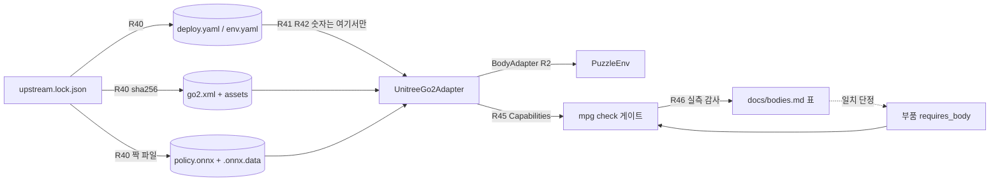

# Spec: M3 두 번째 몸 (Unitree Go2)
Status: approved 2026-11-15 (user: "응 추천대로" — R44의 좁힌 명령 범위 유지, Go2 첫 성공률 목표 60%)
View (read-only copy): (아직 없음)

근거: intent.md (approved 2026-11-15, user: "응"). R 번호는 기존 R39 다음부터 이어 쓴다.

사실 출처(2026-11-15 직접 확인):
- MJCF: `google-deepmind/mujoco_menagerie` `unitree_go2/go2.xml` (BSD-3-Clause). 관절 순서 FL, FR, RL, RR (hip/thigh/calf). `base` 충돌 박스 half-extents `0.1881 0.04675 0.057`, 앞쪽 실린더 `pos x=0.285`·구 `pos x=0.293`, 질량 6.921 kg, 키프레임 `home`의 몸통 높이 `z=0.27`. 카메라 없음(`site name="imu"` 하나뿐).
- 정책: Hugging Face `diasAiMaster/unitree-go2-velocity-flat` (bsd-3-clause). `policy.onnx` 14,196 B + `policy.onnx.data` 757,248 B. ONNX 서명 **입력 `obs [1, 45]`, 출력 `actions [1, 12]`** (onnxruntime으로 직접 확인).
- `params/deploy.yaml`: `step_dt 0.02`; 관측 6항목 전부 `history_length 1`; action `scale 0.5`, `offset = default_joint_pos`; `stiffness [20,20,40]×4`, `damping [1,1,2]×4`; `joint_ids_map [3,4,5,0,1,2,9,10,11,6,7,8]`; 명령 범위 `lin_vel_x [-1.0, 2.0]`, `lin_vel_y [-1.0, 1.0]`, `ang_vel_z [-1.0, 1.0]`, `heading null`.
- `git/unitree_rl_mjlab.diff`가 **빈 diff**다(추적되지 않은 `__pycache__`만 나열). 즉 이 정책은 업스트림 `unitree_rl_mjlab`을 **고치지 않은 상태로** 학습됐다. 신뢰 신호로 기록한다.

## Requirements

- **R40 (자산 핀)**: `mpg fetch-assets`가 Go2 자산을 기존 R1 방식으로 받는다 — Menagerie 고정 커밋의 `unitree_go2/go2.xml`·`scene.xml`·`assets/`, Hugging Face 고정 리비전의 `policy.onnx`, `policy.onnx.data`, `params/deploy.yaml`, `params/env.yaml`. 모두 파일별 SHA256을 확인하고 두 출처의 BSD-3-Clause와 출처를 출력한다. Go2 자산은 **별도 lock 파일 `upstream.go2.lock.json`**에 둔다(사용자 승인 2026-11-15): 현재 `upstream.lock.json`은 `cache_dir()`가 `sources.github.commit` 하나를 캐시 디렉터리 키로 쓰고 `fetch()`가 github·huggingface 소스를 각각 하나로 가정하는 **몸 하나짜리 구조**이고, `load_lock`·`fetch`는 이미 `lock_path`를 인자로 받으므로 기존 microduck 경로를 건드리지 않고 분리할 수 있다. 외부 가중치가 분리된 ONNX(`policy.onnx` + `policy.onnx.data`)는 **같은 캐시 디렉터리에 나란히** 놓여야 onnxruntime이 상대 경로로 찾는다. 한쪽이 손상된 채 반쪽 모델이 로드되는 일은 현재 `fetch()`가 이미 막는다(해시 불일치 시 `AssetError`를 올려 아무것도 로드되지 않음, fail-closed) — 추가 방어 코드를 넣지 않고 **그 동작을 테스트로 고정**한다(2026-11-15: 원래 R40에 있던 "둘 다 격리" 조항은 실패 시나리오를 댈 수 없어 사용자 승인으로 철회). Check: `mpg fetch-assets --body go2 --json`이 `verified: true`; `tests/test_assets.py`에 `.onnx.data`만 1바이트 바꾼 경우와 `policy.onnx`만 바꾼 경우 두 테스트 — 둘 다 `AssetError`(0이 아닌 종료)이고 손상 파일은 `.bad`로 남으며 정책이 로드되지 않음. 정책 캐시 증가분은 측정값 771,444 B.

- **R41 (어댑터와 관측 계약)**: `bodies/go2.py`의 `UnitreeGo2Adapter`가 `make_body("go2")`로 나온다. 관측 45차원을 `deploy.yaml`이 적은 순서대로 조립한다: `base_ang_vel` 3, `projected_gravity` 3, `velocity_commands` 3, `joint_pos_rel` 12, `joint_vel_rel` 12, `last_action` 12 (모두 scale 1.0, history 1). 행동 12개는 관절 목표 위치이고 `target = offset + 0.5 * action`(offset = `default_joint_pos`). **PD는 파이썬 루프가 아니라 MuJoCo `position` 액추에이터**로 모델에 박는다(2026-11-15 정정, 사용자 승인): 상류가 `BuiltinPositionActuatorCfg`를 쓰므로 kp/kv가 모델 쪽에 있고, 정책의 행동은 액추에이터 `ctrl` 목표가 된다. 값은 `deploy.yaml`의 stiffness `[20,20,40]×4`·damping `[1,1,2]×4`와 `go2_constants.py`의 `effort_limit`(hip·thigh 23.5, calf 45)이 일치한다. 정책 주기는 `step_dt 0.02` = 50 Hz. **이 숫자들은 코드에 두 번 적지 않는다**: 핀된 `deploy.yaml`에서 읽고, 코드의 가정과 다르면 로드 시점에 터진다. Check: `tests/test_go2_contract.py` — ONNX 입력 `[1, 45]`·출력 `[1, 12]` 단정; `deploy.yaml`의 6항목 차원 합이 45; 조립한 관측 벡터를 기록해 둔 골든 벡터와 비교(허용 오차 1e-6); `deploy.yaml`을 가짜로 바꿔(차원 46) 넣으면 로드가 실패.

- **R42 (관절 순서: 재배치하지 않는다)**: **정책의 관절 순서는 모델 순서와 같은 `FL, FR, RL, RR`이고, 재배치는 하지 않는다.** (2026-11-15 정정, 사용자 승인. 처음에는 `deploy.yaml`의 `joint_ids_map [3,4,5,0,1,2,9,10,11,6,7,8]`을 시뮬레이션에 적용하라고 썼는데 그것이 틀렸다. 근거: ① 상류 `unitree_rl_mjlab`의 `go2.xml` 관절 순서가 `FL, FR, RL, RR`로 Menagerie와 동일하다. ② `go2_constants.py`의 `INIT_STATE`가 `R_hip +0.1`, `L_hip -0.1`인데 `deploy.yaml`의 `default_joint_pos` 그룹별 hip 값이 `[-0.1, +0.1, -0.1, +0.1]` = `L, R, L, R`이므로 정책 순서도 `FL, FR, RL, RR`이다. ③ 그 `deploy.yaml`은 상류 저장소의 `deploy/robots/go2/` 아래, 즉 **실제 로봇 C++ 배포용** 경로에 있고 Unitree SDK의 관절 순서가 `FR, FL, RR, RL`이다. 따라서 `joint_ids_map`은 정책 → 실기 SDK 매핑이며, MuJoCo에 적용하면 막으려던 좌우 뒤집힘을 **오히려 만든다**.) Check: `tests/test_go2_contract.py`가 컴파일된 모델의 관절 이름 순서가 `FL, FR, RL, RR`(각 hip/thigh/calf)임을, 그리고 `deploy.yaml`의 `default_joint_pos`에서 hip 부호가 `L` 음수·`R` 양수로 모델 순서와 맞물림을 단정한다. 어댑터는 `joint_ids_map`을 쓰지 않으며, 쓰지 않는다는 사실 자체를 주석과 테스트로 남긴다. 좌우 뒤집힘의 행동 방어선은 R43의 부호 테스트다(좌우 교환은 관측 차원을 바꾸지 않으므로 차원 검사로는 절대 안 잡힌다).

- **R43 (걷기)**: 평지 5초, 전부 넘어짐 없이. 경계는 2026-11-15 실측값에 여유를 둔 것이다(괄호 안이 측정값; 전진은 시드 10개, 나머지는 1개).
  | 명령 | 요구 | 측정 |
  |---|---|---|
  | `vx +0.5` | 전진 2.0–3.0 m | 2.461–2.488 m (편차 1%), 몸통 높이 0.361–0.363 |
  | `vx -0.5` | 후진 ≤ −0.8 m | −1.361 m |
  | `vy +0.5` | **왼쪽** ≥ +1.5 m | +2.184 m |
  | `vy -0.5` | 오른쪽 ≤ −1.5 m | −2.025 m |
  | `wz +0.5` | yaw **반시계** +0.9 ~ +1.8 rad | +1.294 rad |
  | `wz -0.5` | yaw 시계 −0.9 ~ −1.8 rad | −1.345 rad |
  | 명령 0 | 이동 < 0.25 m | 0.112 m |
  Check: `tests/test_go2_walk.py`. 상한 없는 테스트는 쓰지 않는다(정책이 명령을 얼마나 따르는지도 측정 대상이다). `vy`와 `wz`의 **부호** 검사가 좌우 관절 뒤집힘의 유일한 방어선이다(R42).

- **R44 (명령 범위)**: 정책 학습 범위는 `vx [-1.0, 2.0]`(비대칭), `vy [-1.0, 1.0]`, `wz [-1.0, 1.0]`이다. 어댑터의 `cmd_limits`는 **퍼즐용으로 좁힌 범위** `vx [-0.5, 1.0]`, `vy [-0.5, 0.5]`, `wz [-0.5, 0.5]`를 기본으로 쓰고, 학습 전체 범위는 `Go2Adapter(full_command_range=True)`로만 연다. 이유: 2 m/s로 달리는 4족은 방 한 칸을 한 스텝에 지나쳐 퍼즐이 풀리지 않는다(10 Hz 위층 1스텝 = 0.2 m). 좁힌 범위는 학습 범위 **안쪽**이므로 분포 밖 명령이 아니다. **이 세 값은 상류가 독립적으로 확인해 준다**(2026-11-15): `unitree_rl_mjlab`의 `unitree_go2_flat_env_cfg(play=True)`가 `lin_vel_x (-0.5, 1.0)`, `lin_vel_y (-0.5, 0.5)`, `ang_vel_z (-0.5, 0.5)`로 똑같이 좁힌다 — 상류도 실제로 쓸 때는 학습 전범위를 쓰지 않는다. `wz`는 그 값에 맞춰 `[-1.0, 1.0]`에서 고쳤다(사용자 승인). `command_from_action`은 저장소 규약(action[0] = -1 가장 느림/정지, +1 가장 빠른 전진)을 유지한다 — 기본 매핑을 그대로 쓰면 `vx_min`이 음수여서 action[0] = -1이 후진이 되므로, **이 몸은 `command_from_action`을 재정의한다**. Check: `tests/test_go2_contract.py`가 action[0] = -1 → `vx <= 0`이 아니라 `vx == 0`(정지)임을, action[0] = +1 → `vx == 1.0`임을 단정; `full_command_range=True`에서 `cmd_limits`가 `deploy.yaml`의 범위와 같음을 단정.

- **R53 (학습 물리값에 맞춘 in-memory 모델 편집)**: 자산으로는 Menagerie `go2.xml`을 핀한다(자립형, BSD-3). 상류 `unitree_rl_mjlab`의 `go2.xml`은 `<option>`, 관절 damping·armature·frictionloss, 모터 `ctrlrange`, 관절 가동범위, 발 충돌 클래스를 전부 제거한 껍데기이고(액추에이터 0개, 키프레임 없음) `go2_constants.py`가 파이썬으로 주입하므로, 그쪽을 쓰면 그 파일을 재구현해야 한다. 대신 Menagerie XML을 **메모리에서** 학습 당시 값으로 맞춘다(기존 R1 선례: 마이크로덕도 BAM 설정을 메모리에서만 고친다). 편집 목록은 코드 한 곳에 표로 두고 각 항목에 출처를 적는다:
  **원칙(2026-11-15 측정으로 확정): Menagerie의 물리·접촉 설정은 그대로 두고, 정책의 PD 계약이 요구하는 것만 바꾼다.** 처음에는 상류가 제거한 항목을 전부 따라 제거하려 했으나, 평범한 MuJoCo에서는 그 설정들이 서 있게 해 주는 바로 그것이었다. `cone="elliptic" impratio="100"`과 발 접촉을 상류처럼 벗기면 **제자리 회전에서 주저앉는다**(측정: `wz ±0.5` 5초 → 몸통 높이 0.058 m, 양방향 모두 넘어짐). 그대로 두면 0.367 m로 서서 돈다. 상류가 그것들을 뺀 이유는 MuJoCo-Warp 솔버를 쓰기 때문이고 우리에게는 해당하지 않는다.

  | 항목 | Menagerie | 우리가 쓰는 값 | 근거 |
  |---|---|---|---|
  | 액추에이터 | `motor` ctrlrange ±23.7 / knee ±45.43 | **`position` kp 20·20·40, kv 1·1·2, forcerange ±23.5·±23.5·±45** | `deploy.yaml` stiffness·damping + `go2_constants.py` `effort_limit`. 정책 행동이 관절 목표각이므로 토크 모터로는 계약이 성립하지 않는다 |
  | 관절 damping | 2.0 | **0** | 상류 xml에 없음. PD의 kv와 이중으로 걸린다 |
  | 관절 frictionloss | 0.2 | **0** | 상류 xml에 없고 `go2_constants.py`도 설정하지 않음 |
  | armature | 전 관절 0.01 | hip·thigh 0.01, **calf 0.02** | `go2_constants.py` 액추에이터별 `armature` |
  | 초기 높이 | 키프레임 `home` z 0.27 | **0.32** | `go2_constants.py` `INIT_STATE.pos` |
  | `<option>` cone·impratio | `elliptic`, 100 | **그대로** | 제거하면 회전 시 넘어짐(위 측정) |
  | 발 마찰·condim·solimp | `0.8 0.02 0.01`, 6, `0.015 1 0.022` | **그대로** | 같은 측정. 상류는 학습 중 `foot_friction`을 무작위화하고 `push_robot`도 켜 두므로 정책이 마찰 차이에 견딘다 |

  Check: `tests/test_go2_contract.py`가 컴파일된 모델에서 각 항목을 읽어 위 표의 "우리가 쓰는 값"과 같은지 단정한다(액추에이터 종류·kp·kv·forcerange, 관절별 damping·frictionloss·armature, `opt.cone`·`opt.impratio`, 발 geom의 friction·condim·solimp, reset 후 몸통 높이 0.32). 표를 고치면 테스트가 같이 바뀌어야 하므로 값이 조용히 어긋날 수 없다.

- **R45 (능력 정직 선언)**: Go2의 `Capabilities`는 실제 있는 것만 적는다. 없는 것: 부리(`grab_site()` → None), 애드온(R30, `addons` 비어 있음), 토우 히치(R31, `tow_site()` → None), 눈 카메라(R39, `view_camera()` → None — `go2.xml`에 카메라가 없다), 레인지파인더 마운트(R27, `add_rangefinders` 미구현), 머리 명령(`set_head` 무시). `mpg check`는 이 몸으로 풀 수 없는 방을 거부하면서 **부품 이름과 빠진 능력 이름을 함께** 말한다. Check: `tests/test_capability_gate.py` — 부품 레지스트리의 모든 `requires_body` 값을 모아, 각 능력을 요구하는 방 하나씩을 Go2로 `mpg check`에 넣으면 전부 `ok: false`이고 이유 문자열에 부품명과 능력명이 들어간다. 마이크로덕으로는 같은 방들이 통과한다(게이트가 항상 거부하는 게 아님을 보인다).

- **R46 (`requires_body` 실측 감사)**: 기존 R-item 테스트와 예제 방을 `--body go2`로 돌려, 부품별로 (a) 선언대로 거부됨 (b) 선언이 없는데 실제로 깨짐 (c) 선언이 있는데 실제로는 잘 돎 을 분류한다. (b)와 (c)는 **버그로 취급해 `requires_body`를 고친다.** 결과를 `docs/bodies.md`에 부품 × 몸 표로 남긴다(각 칸: 됨 / 안 됨 + 이유). Check: `docs/bodies.md`에 전 부품 행이 있고, `tests/test_capability_gate.py`가 각 부품의 `requires_body`가 그 표와 일치하는지 단정한다(표와 코드가 갈라지면 실패).

  감사 결과 2026-11-16(사용자 "승인"): (b) 네 건 — `lever` `mode: push`, `dial`, `hitch_station`, `breakable` `by: [peck]`. 네 건 다 수정 전 Go2로 `check_body`·`check_parts`가 전부 `ok=True`였다. (c)는 없었다. 이를 정직하게 선언하려면 **능력 이름이 두 개 더 필요하다**: `chest_push`(0.07–0.12 m 높이의 패들·스포크를 걸어 들어가 미는 몸통면 — 푸시 레버와 다이얼), `tow`(`tow_site`). 둘 다 마이크로덕이 선언한다. 숫자 비교용으로 `walk_speed` 능력값도 추가한다(R48). `low_bar`는 (b)와 종류가 다르다 — `bottom`이 스키마에서 0.21–0.246 m로 묶여 어떤 방 설정으로도 더 큰 몸이 통과할 수 없으므로 `roller`를 선언해 이유를 말하며 거부하게 한다. 덤으로 `tests/test_boundary.py`의 금지 이름 목록에 **둘째 몸 이름이 없었다**(R2 규칙이 절반만 작동하고 있었다): `go2`·`unitree`를 넣고 핀 파일 하나를 허용 목록에 더했다.

- **R47 (Go2용 방 프리셋)**: Go2 몸집에 맞춘 방 프리셋을 **새로** 둔다. 기존 마이크로덕 방·프리셋은 건드리지 않는다(사용자 결정 2026-11-15: M2 숫자의 재현성 보존). 실측 기준: 몸통 충돌 박스 0.376 m × 0.0935 m에 앞쪽 돌출이 x = 0.293까지, 다리를 포함한 서 있는 자세 폭과 `footprint_radius`·`fall_height`는 구현 중 측정해 적는다(참고: 서 있는 몸통 높이 0.27 m, 마이크로덕 `fall_height`는 0.07). 문 폭·발판 크기·골 반경을 이 치수로 다시 잡는다. Check: Go2 프리셋이 `mpg check`의 (a) 순서 (b) 안정 (c) 스크립트 해답 20개 중 18개 이상을 통과; 같은 커밋에서 마이크로덕 예제 방의 `mpg check` 결과와 R10 성공률이 M3 이전과 **달라지지 않는다**(회귀 테스트).

- **R48 (무게에 묶인 부품 재검토)** — 개정 2026-11-16(사용자 "승인", 측정 근거는 `docs/bodies.md` §5): Go2는 전체 15.206 kg으로 마이크로덕(0.737 kg)의 20.6배다. 오리 무게로 조정된 수치를 쓰는 부품을 찾아 고친다. **기존 숫자는 바꾸지 않는다** — 바꾸면 기존 방·프리셋·측정 기록이 전부 흔들린다(R47의 "마이크로덕 쪽 재현성 보존"과 같은 이유). 대신 그 몸에서 숫자가 무의미할 때 `mpg check`의 `parts` 단계가 **말하게** 한다(실패가 아니라 경고). 몸은 `total_mass`와 `walk_speed`·`footprint_radius`로 비교 기준을 제공한다.

  측정으로 확인된 분류:
  - **경고로 처리**: `wind`(힘 [N]이라 질량에 반비례. 프리셋 1.0 N = 가벼운 몸 무게의 14 %, Go2의 0.7 %. 스키마 상한 20 N도 Go2 무게의 13 %라 몸을 쓰러뜨리는 구간 28 %에 합법적으로 닿지 못한다); `pressure`의 `trigger`가 몸을 셀 때(판이 발자국보다 좁으면 `.mass`가 걸음마다 0–9 kg으로 흔들려 어떤 문턱도 스텝별 동전 던지기가 된다; 문턱이 몸 질량 이하면 올라서기만 해도 켜진다); `npc` 속도 경고(`DUCK_SPEED = 0.16` 하드코딩 → 몸의 `walk_speed` 능력값과 비교. 마이크로덕 0.220 m/s, Go2 1.019 m/s 실측).
  - **고칠 것 없음**: 스프링(R15 `kick`)과 컨베이어(R12 `shift`)는 **질량과 무관하다** — `kick`은 `qvel`을, `shift`는 `qpos`를 직접 쓴다(`bodies/base.py`). 측정: Go2는 1.5 m/s 킥에 5/5 안 넘어지고 3 s 뒤에도 걸었고, 컨베이어는 3 s에 0.85–0.90 m를 그대로 실어 날랐다. 원래 spec이 이 둘을 후보로 적은 것은 추측이었고 틀렸다.
  - **이미 거부됨**: R31 매듭의 `max_hold_force` 3 N은 부리에 묶인 값이라 `beak_grab`이 없는 몸에서는 R45 게이트가 먼저 거부한다.

  Check: 경고 세 개마다 테스트 하나 — Go2로 돌려 경고가 부품 이름과 함께 나오고(`check_parts`의 `ok`는 유지), 같은 방을 마이크로덕으로 돌리면 **경고가 없다**(`tests/test_capability_gate.py`). R48에서 손댄 부품은 마이크로덕 쪽 기존 테스트가 그대로 통과한다.

- **R49 (CLI 몸 선택)**: `mpg build`·`check`·`train`·`eval`·`render`·`demo`가 `--body {microduck,go2}`를 받고, 기본값은 `microduck`이다(기존 명령줄이 그대로 동작). 고른 몸은 `runs/<id>/task.resolved.yaml`과 `--json` 출력에 들어간다. Check: `tests/test_cli_json.py`가 모든 명령을 `--body go2`로도 돌려 JSON 파싱; 없는 몸(`--body g1`)은 0이 아닌 종료 + 쓸 수 있는 몸 목록을 이유로 낸다.

- **R50 (CI 예산)**: Go2 테스트가 들어간 뒤에도 fast suite가 현재 2샤드(#45) 안에서 끝난다. CI 실행마다 샤드별 최대 RSS를 출력한다. Check: Actions 녹색 + 샤드별 최대 RSS가 로그에 남고, 리눅스/OSMesa 러너에서 12 GB 한계 대비 여유가 기록된다. 들어가지 않으면 Go2 테스트를 별도 잡으로 분리한다(사용자 확정 사항, intent Open questions).

- **R51 (출처와 정직한 표기)**: README와 `docs/bodies.md`가 두 자산의 BSD-3-Clause와 출처(저장소/리비전)를 적고, **이 보행 정책이 Unitree 공식 배포가 아니라 커뮤니티 체크포인트**임을 명시한다. 함께 적을 사실: 평지(`Mjlab-Velocity-Flat-Unitree-Go2`) 학습, `gait_phase` 없음, action scale 0.5, 그리고 업스트림 `unitree_rl_mjlab` 대비 학습 코드 변경이 없었다는 것(2026-11-15 확인). Check: 두 문서에 해당 문장이 있고, "공식"이라는 표현이 이 정책을 가리켜 쓰이지 않는다(문자열 검사 테스트).

- **R52 (Go2 평가 목표)**: `mpg eval --body go2 --episodes 100`이 학습에 쓰지 않은 시드의 Go2 프리셋 배치에서 성공률과 평균 소요 시간을 낸다. **첫 목표 성공률 60%**(마이크로덕 R10의 80%를 그대로 쓰지 않는다: 다른 몸·다른 방이고, 보행 정책이 우리가 튜닝하지 않은 커뮤니티 체크포인트다 — 처음부터 80%를 걸면 실패 원인이 정책인지 퍼즐인지 구분되지 않는다). 성공률이 60% 미만이면 `mpg diagnose`의 분류(환경 버그 / 보상 해킹 / 탐색 부족 / 몸 실패)를 근거 숫자와 함께 보고하고, 목표를 내리기 전에 원인을 먼저 가린다. Check: `runs/<id>/summary.json`의 성공률 ≥ 0.60 + 성공 장면 MP4 1개. 미달 시에는 diagnose 분류와 근거 숫자를 `docs/bodies.md`에 기록한다.

## Out of scope
- Unitree G1 휴머노이드, lerobot의 고정 베이스 팔(별도 베이스 클래스가 필요 — 별개 마일스톤).
- `alpha_ground_pick.onnx` 채택 → M4.
- Go2 전용 신규 부품(높은 턱 넘기, 두 발로 누르기 등). R48은 **기존** 부품을 정직하게 만드는 일이지 새 부품을 만드는 일이 아니다.
- 보행 정책 재학습·미세조정, 거친 지형·계단, sim2real, 실물 Go2.
- 기존 마이크로덕 방의 크기 변경(R47에서 명시적으로 배제).
- 몸 치수에 맞춰 방을 자동으로 스케일하는 기능(나중 후보).

## Design

- **숫자의 단일 출처**: 관측 순서·차원, action scale·offset, PD 게인, 관절 매핑, 명령 범위는 핀된 `deploy.yaml`에서만 읽는다. 코드에 복사하면 업스트림이 바뀔 때 조용히 틀린다. 코드가 가진 것은 "45차원이어야 한다"는 **기대**뿐이고, 어긋나면 로드에서 터진다(R41).
- **좌우 뒤집힘이 가장 위험한 버그**: 관절 순서를 잘못 이어도 모델은 정상 차원으로 돌고 어떻게든 걷는 것처럼 보일 수 있다. 차원 검사로는 안 잡히므로 R43의 회전·횡이동 부호 테스트가 유일한 방어선이다.
- **능력 게이트의 첫 진짜 시험**: Go2는 부리·애드온·로프·카메라가 전부 없다. 지금까지 `missing()`이 항상 빈 리스트였던 코드 경로가 M3에서 처음으로 값을 돌려준다(R45). 여기서 드러나는 부품 선언 오류가 R46의 수확이다.
- 새 파일: `bodies/go2.py`(R41–R45), `docs/bodies.md`(R46, R51), `tests/test_go2_contract.py`·`test_go2_walk.py`·`test_capability_gate.py`, Go2 방 프리셋(R47). 고치는 파일: `bodies/__init__.py`(`make_body`), `assets.py`·`upstream.lock.json`(R40), `catalog.py`·`check.py`(R45, R46), 후보 부품들(R48), `cli.py`(R49), CI 워크플로(R50), `README.md`(R51).

## How each constraint is met
- **라이선스**: 두 출처 모두 BSD-3-Clause. 파일은 저장소에 넣지 않고 R40이 받아 해시로 검증하며, 출처와 라이선스는 R40 출력과 R51 문서에 적는다.
- **공식이 아님을 숨기지 않음**: R51이 문자열 검사까지 붙여 "공식" 표기를 막는다.
- **몸집 차이**: R47이 방을 새로 잡고 기존 방은 건드리지 않는다. R48이 무게에 묶인 부품을 따로 다룬다.
- **CI 메모리**: R50이 측정을 의무화하고, 넘으면 분리라는 퇴로를 미리 정해 둔다.
- **작은 범위**: 몸 하나, 새 부품 0개, 새 능력 0개. M3의 산출물은 "로봇 추가"가 아니라 "경계와 능력 선언의 검증"이다.
- **`rm` 금지, 병합은 사용자**: 해시 불일치 파일도 지우지 않고 `.bad`로 격리한다(기존 R1 동작 유지).

## Open questions
- [ ] R43의 전진 거리·회전량 허용 범위 실측값. (Claude, 구현 중 확정)
- [ ] R47의 `footprint_radius`·`fall_height` 실측값과 문 폭·발판 크기. (Claude, 구현 중 확정)
- [x] R44의 좁힌 명령 범위 → **확정(2026-11-15, 사용자 "응 추천대로")**: `vx [-0.5, 1.0]`, `vy [-0.5, 0.5]`, `wz [-0.5, 0.5]`. (`wz`는 같은 날 상류 play 설정을 확인한 뒤 `[-1.0, 1.0]`에서 고쳤다 — R44 본문 참조. 이 줄에 옛 값이 남아 있었다.) R47의 방 치수가 실측되면 이 값이 여전히 맞는지 한 번 다시 본다(값을 바꾸려면 spec 개정).
- [x] Go2 성공률 목표치 → **확정**: 첫 목표 60%. R52로 올렸다.
- [ ] R50: Go2 테스트를 fast suite에 넣을지 별도 잡으로 뺄지 — 측정 후 결정. (사용자 확정)
