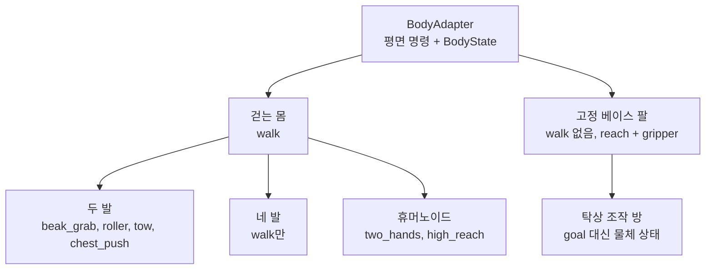

# Spec: M4 살펴본 로봇 네 종과 그에 맞는 퍼즐

Status: draft (2026-11-16). 요구사항 번호는 M3(R40–R53)에 이어 R60부터.

## 네 종류의 몸: 지금 아는 것

측정된 값과 **아직 재지 않은 값**을 구분해 적는다. 표의 "확인" 열이 그 구분이다.

| | 마이크로덕 | Unitree Go2 | Unitree G1 | lerobot 팔(SO-101 등) |
|---|---|---|---|---|
| 종류 | 두 발 보행 | 네 발 보행 | 휴머노이드 보행 | 고정 베이스 팔 |
| 운전 명령 | `(vx, vy, wz)` | `(vx, vy, wz)` | `(vx, vy, wz)` 로 추정 | 평면 명령이 아니다 |
| 질량 | 0.737 kg | 15.206 kg | 미확인 | 미확인 |
| 걷는 속도 | 선언 0.16, 측정 0.220 m/s | 선언 1.0, 측정 1.019 m/s | 미확인 | 해당 없음 |
| 발 자취 반경 | 0.11 m | 0.41 m | 미확인 | 집게 크기(미확인) |
| 최소 선회 반경 | 0.4 m | 2.0 m | 미확인 | 해당 없음 |
| 한 걸음 높이 | 0.01 m | 0.03 m | 미확인 | 해당 없음 |
| 집는 수단 | 부리 1개(0.21 m) | 없음 | 손 2개(추정) | 집게 1개 |
| 들 수 있는 무게 | 0.05 kg | 0 | 미확인 | 미확인 |
| 확인 | 구현·측정됨 | 구현·측정됨 | **자산 미확인** | **자산 미확인** |

G1과 팔의 칸이 비어 있는 것이 이 문서의 상태를 가장 정확히 말한다. M3 조사에서 확인한 단서는 하나뿐이다: lerobot이 Hugging Face에 `lerobot/unitree-g1-mujoco`를 올려 뒀다. SO-100/SO-101의 MJCF 소재와 라이선스는 확인하지 않았다.

## Requirements

- **R60 (능력 어휘를 몸의 종류까지 담게 넓힌다)**: 현재 능력 이름은 걷는 몸에서 나온 것뿐이다(`walk`, `beak_grab`, `roller`, `tow`, `chest_push`). 다음을 더한다. 각 이름은 **그 능력이 없으면 못 푸는 부품이 실제로 있을 때만** 만든다(M3 R46의 규칙: 쓰이지 않는 능력은 선언이 아니라 장식이다).
  - `reach`: 집는 수단을 평면 안에서 움직일 수 있다(고정 베이스 팔, 그리고 걷는 몸도 자기 집는 수단을 데리고 다니므로 `beak_grab`·`gripper`를 가진 몸은 전부 가진다).
  - `gripper`: 손가락으로 쥔다. `beak_grab`과 구분한다 — 부리는 한 점에서 물고 집게는 면으로 쥐므로 집을 수 있는 물건의 모양이 다르다.
  - `two_hands`: 동시에 두 곳을 잡는다.
  - `high_reach` + 값 `reach_height` [m]: 바닥에서 이만큼 위를 건드린다.
  - 값 `turn_rate` [rad/s]와 `turn_radius` [m]: 이미 있는 `walk_speed`와 짝이다. M3 R47에서 선회 반경 2.0 m가 방을 못 풀게 만든 것을 능력값으로 **말할 수 있어야** 한다. `turn_radius`는 `walk_speed / turn_rate`로 유도하되, 어댑터가 재서 선언한 값이 있으면 그것을 쓴다.
  Check: `tests/test_capability_gate.py`의 부품 × 몸 표에 새 이름이 들어가고, 새 이름을 요구하는 부품마다 그 능력이 없는 몸에서 `check_body`가 **이름을 말하며** 거부한다. 쓰이지 않는 능력 이름이 없다(표에서 열이 비면 테스트 실패).

- **R61 (고정 베이스 팔을 별도 베이스 클래스 없이 받는다)**: M3 intent는 팔에 `BodyAdapter`가 아닌 별도 베이스 클래스가 필요하다고 적었다. 그 판단을 **뒤집는다**. 근거는 §Design의 한 문단이다: 퍼즐 쪽 코드는 몸을 "평면 위의 한 점 + 방향 + 속도"로만 읽고, 탁상 조작은 평면 문제다. `BodyState.pos`를 몸통이 아니라 **집게의 위치**로 읽으면 같은 경계가 그대로 쓰인다.
  Check: 팔 어댑터가 `BodyAdapter`를 상속하고 `make_body`에 등록된다. `tests/test_boundary.py`가 통과한다(팔의 관절 이름이 `bodies/` 밖으로 새지 않는다). 팔로 만든 방이 `mpg check`의 정적 단계 전부와 스크립트 해답 20개 중 18개 이상을 통과한다. 별도 베이스 클래스가 **없다**(클래스 수가 늘지 않음을 테스트가 단정한다).

- **R62 (몸의 차이가 답이 되는 방)**: 몸마다 "그 몸이어야 풀리는" 방 프리셋이 하나 이상 생긴다. 숫자는 두 몸의 측정값 **사이**에 둔다. 아래 셋은 새 부품 없이 기존 부품의 설정만으로 된다 — 그래서 먼저 한다.
  - **무게 문턱**: 발판 `min_mass`를 0.737 kg와 15.206 kg 사이(예: 5.0 kg)에 두고 `trigger: body`. 무거운 몸은 서면 눌리고, 가벼운 몸은 자기 최대 적재(0.05 kg)를 다 들고 와도 못 누른다. **이 방은 `pressure`의 경고를 일부러 받는다**("min_mass가 몸 자체 질량보다 낮다: 서 있기만 하면 된다") — 그것이 이 퍼즐의 답이기 때문이다. 경고는 결함 표시가 아니라 정보라는 것을 이 방이 보여 준다.
  - **속도 문턱**: 속도 구역 `min_speed`를 0.6 m/s에 둔다. 측정된 걷기 상한은 0.220 m/s이고 바퀴를 달아도 기존 프리셋 측정이 0.28–0.53 m/s이므로 가벼운 몸은 어떤 수단으로도 못 넘는다. 빠른 몸은 1.019 m/s로 평범하게 넘는다.
  - **선회 비용**: 90° 꺾임이 여러 번 있는 시간제 통로. 꺾임 하나에 드는 제자리 회전 시간은 회전 속도의 역수다 — 1.0 rad/s인 몸은 1.57 s, 0.5 rad/s인 몸은 3.14 s. 즉 **빠른 몸이 불리한 방**이다. 직선 거리와 꺾임 수를 조절해 두 몸의 통과 시간이 교차하는 지점을 찾고, 그 숫자를 프리셋 주석에 적는다.
  Check: 각 방이 의도한 몸으로 20개 중 18개 이상, **의도하지 않은 몸으로는 0에 가깝게** 실패한다(실패 이유가 `check_body`의 거부이거나 해답 실패이고, 조용한 통과가 아니다). 두 숫자를 프리셋 주석과 `docs/parts-guide.md`에 적는다.

- **R63 (새 부품은 정말 필요한 것만)**: 59개 중 걷기를 요구하는 것은 15개뿐이고 32개는 몸에 아무것도 요구하지 않는다. 그래서 새 몸에 필요한 것은 대개 새 부품이 아니라 (a) 능력 이름, (b) **설정에 따라 달라지는 선언**, (c) 그 몸에서 재서 맞춘 프리셋이다. 새로 만드는 부품은 둘뿐이다.
  - `stack`: 물체 N개가 어느 높이 이상으로 쌓이면 켜진다. **쌓는 행위 자체는 이미 된다** — `cube`가 다른 큐브 위에 올라가는 것을 지원한다(중심이 아래 큐브의 윗면 위에 있어야 한다). 없는 것은 쌓인 상태를 **읽는** 부품이다: 받침대·바구니·소켓은 전부 "넣기"를 읽고, 높이를 조건으로 읽는 부품은 하나도 없다(`mpg parts`에 `height`를 묻는 부품이 0개).
  - `wide_cube`: 한 손으로는 못 잡는 폭. `two_hands`를 요구한다.
  설정에 따른 선언은 기존 방식을 그대로 쓴다(`breakable`의 `by: [peck]`가 `beak_grab`을 선언하는 것과 같다): 벽 버튼은 설치 높이가 부리 높이(0.21 m)를 넘으면 `high_reach`를, 레버는 `grab_handle`이면 집는 능력을, 아니면 `chest_push`를 요구한다.
  Check: 새 부품 둘 다 `mpg parts --markdown`과 문서 세 언어에 들어간다. **기존 부품의 기본값은 하나도 바뀌지 않는다**(`git diff`로 확인하고, 기존 방의 `mpg check` 결과가 그대로임을 느린 묶음이 확인한다).

- **R64 (자산부터 확인한다)**: 구현 전에 몸마다 ① MJCF ② 제어 정책(또는 팔의 경우 역기구학으로 충분한지) ③ 라이선스 ④ 고정할 리비전을 확인하고 적는다. 공식 배포가 아니면 그렇게 적는다(M3 R51). 확인되지 않으면 그 몸은 이 마일스톤에서 **빠진다** — 추측으로 어댑터를 쓰지 않는다.
  Check: 몸마다 lock 파일과 `mpg fetch-assets --body <몸> --json`의 `verified: true`, 그리고 `docs/bodies.md`에 출처 한 줄.

- **R65 (문서와 번역)**: `docs/bodies.md`의 부품 × 몸 표에 새 몸의 열이 늘고, 세 언어가 같이 바뀐다. 새 능력 이름의 뜻과 측정 방법을 적는다.
  Check: `tests/test_guide.py` 통과, 세 파일의 표 행 수와 숫자 토큰이 일치.

- **R66 (평가 기준)**: 몸마다 평가 성공률 기준을 **그 몸의 방에서** 정한다. M3의 60 %를 그대로 옮기지 않는다 — 몸이 다르면 같은 숫자가 같은 난이도가 아니다. 기준은 스크립트 해답의 성공률과 무작위 정책의 성공률 사이에서 정하고, 두 숫자를 같이 기록한다.
  Check: 몸마다 `docs/training-log.md`에 (스크립트 해답, 무작위, 학습된 정책) 세 숫자.

## Out of scope

- 걷는 몸의 기존 방·프리셋·측정값 변경(M3 R47과 같은 이유).
- 두 팔 로봇(ALOHA)의 양팔 협조. `two_hands`는 **이름만** 만들고, 실제 양팔 제어는 다음 마일스톤이다.
- 몸 치수에 맞춰 방을 자동으로 늘리는 기능(M3에서도 나중 후보로 미뤘다). R62의 방들은 손으로 재서 쓴다.
- 실기 로봇으로의 이식(sim-to-real). 이 저장소는 시뮬레이션 안에서 끝난다.

## Design

**팔은 왜 들어올 수 있나.** 퍼즐 쪽 코드가 몸에게 묻는 것은 네 가지뿐이다 — 평면 위의 위치, 방향, 속도, 넘어졌는지(`BodyState`). 그리고 계획은 2차원 격자에서 한다. 탁상 조작도 2차원 문제다. 그러므로:

| 걷는 몸 | 팔 |
|---|---|
| `pos` = 몸통 위치 | `pos` = **집게 위치**(평면 투영) |
| `yaw` = 몸통 방향 | `yaw` = 손목 회전 |
| `(vx, vy, wz)` = 바닥 위 속도 명령 | 같은 셋 = **집게의 평면 속도 + 손목 회전** |
| `fallen` = 넘어짐 | 항상 거짓(대신 `fall` 보상·종료를 끈다) |
| `footprint_radius` = 몸을 감싸는 원 | 집게를 감싸는 원(훨씬 작다 → 틈이 좁아도 된다) |
| 방 = 벽으로 둘러싼 바닥 | 방 = **도달 범위**. 격자는 이미 막힌 칸(`terrain`)을 다루므로, 팔이 닿지 못하는 칸을 막힌 칸으로 적으면 된다 |
| `walk` 능력 | `walk` **없음** → 걷기를 요구하는 15개 부품이 이유를 말하며 거부된다 |

이 표가 R61의 근거 전부다. 새 베이스 클래스가 필요하다고 본 M3의 판단은 "팔은 걷지 못한다"에서 "그러므로 경계가 다르다"로 건너뛴 것이었다. 걷지 못하는 것은 **능력의 문제**이고, 능력 관문은 M3이 이미 만들었다.

위험은 세 곳이다. ① 높이(z)를 평면 명령이 담지 못한다 — 기존 `grab`/`place` 행동이 집고 놓는 높이를 이미 처리하므로 거기에 맡기고, 들어 올리는 높이는 `lift_height` 값으로 선언한다. ② 도달 범위는 사각형이 아니라 고리 모양이다 — 격자의 막힌 칸으로 적으면 모양은 자유롭다. ③ 성공 조건: `goal` 부품은 "몸이 그 영역에 들어감"이다. 팔은 자기가 들어갈 수 없으므로, 팔의 방은 `goal` 대신 물체의 상태를 묻는 부품(받침대·소켓·바구니·새 `stack`)을 마지막 목표로 쓴다. 이것은 기존 부품으로 되므로 R63에 새 부품이 늘지 않는다.

**몸의 차이를 쓰는 세 가지 축.** 질량(20.6배), 속도(4.6배), 선회 반경(5배)이 지금 측정된 차이다. R62의 세 방이 각각 한 축을 쓴다. 넷째 축인 키(부리 높이 0.21 m 대 휴머노이드의 손)는 G1 자산이 확인되면 `high_reach`로 쓴다.



## How each constraint is met

- 기존 재현성: R62·R63이 새 프리셋과 새 부품만 더하고 기존 기본값을 건드리지 않는다. 느린 묶음이 기존 방의 점검 결과를 지킨다.
- R2 경계: 팔의 관절·정책 이름은 `bodies/` 안에만 둔다. 새 방 프리셋 폴더는 M3 R47처럼 몸 이름이 아니라 **요구 조건**으로 이름 짓는다(예: `puzzles/tabletop/`, `puzzles/heavy/`).
- 자산 핀: R64가 구현보다 먼저 온다. 확인 안 되면 그 몸은 빠진다.
- 측정으로 뒷받침: R60이 "쓰이지 않는 능력 이름은 테스트 실패"로, R62가 "의도하지 않은 몸에서는 실패해야 한다"로 각각 강제한다.

## Open questions

1. 순서: 팔(경계를 가장 많이 검증, 작업량 최대)과 G1(경계에 이미 맞음, 자산 사정 불명) 중 어느 쪽부터. **사용자 결정 필요.**
2. R64의 자산 조사 결과에 따라 이 스펙의 절반이 바뀔 수 있다. 조사 먼저 하고 스펙을 개정할지, 두 몸 모두 조사한 뒤 한 번에 갈지.
3. 팔의 역기구학을 직접 쓸지, 정책을 핀할지. 직접 쓰면 자산이 MJCF 하나로 줄어 R64가 쉬워지지만, "동결 정책 위에 고수준 정책" 구조가 깨진다.
4. `turn_radius`를 능력값으로 선언하면 경로 계획이 그것을 **써야** 하는가. 지금 계획은 선회 반경을 모른 채 격자에서 길을 내고 조향이 알아서 따라간다(M3 R47에서 그래서 5/20이 나왔다). 계획이 선회 반경을 쓰게 하는 것은 별개의 큰 작업이다.

## Areas of concern

- 가장 큰 위험은 **자산**이다. M3에서 Go2의 보행 정책은 공식 배포가 없어 커뮤니티 체크포인트를 썼다. 팔과 G1에서도 같은 상황이면 또 같은 판단이 필요하다.
- `BodyState.pos`를 집게로 읽는 설계는 깔끔하지만, 보상 항(`progress`)이 그 거리를 쓰므로 "집게가 목표에 가까워짐"이 곧 진척이 된다. 물체를 들고 가야 하는 과제에서는 그것이 틀린 진척일 수 있다(집게만 목표로 가고 물체는 두고 올 수 있다). 기존 `carry` 쪽 보상이 이미 이 문제를 다루는지 확인해야 한다.
- 능력 이름이 늘어나면 부품 × 몸 표가 커진다. 지금 59 × 2이고 네 몸이면 59 × 4다. 표를 손으로 쓰지 않고 코드에서 생성하는 현재 방식(M3)을 유지해야 한다.

## Parts per body (R63 상세 설계)

이 절이 "로봇마다 그 로봇에 맞는 부품"의 실제 설계다. 구현자가 이 절만 읽고 만들 수 있게 필드·단위·범위·요구 능력·판정 조건을 적는다. **몸마다 새 부품을 만들지 않는다** — 네 로봇 중 새 부품이 필요한 것은 둘뿐이고, 나머지는 능력 이름과 설정에 따른 선언, 그리고 그 몸에서 잰 프리셋이다.

### 두 발(마이크로덕) — 새 부품 0개, 선언 하나 고침

이 몸을 기준으로 59개가 만들어졌으니 새 부품은 없다. 고칠 선언이 하나 있다.

`button`은 이미 `mount: {floor, wall}`과 `height`(기본 0.2 m, 0.05–2.0)를 갖고 있는데, `mount: wall`이면 **높이와 무관하게** `walk`+`beak_grab`만 요구한다(`parts/input/button.py`). 즉 벽 버튼을 1.3 m에 달아도 부리 높이 0.21 m인 몸이 "할 수 있다"고 선언된다 — R46이 네 건 잡은 것과 같은 종류의 거짓말이고, 아직 남아 있다. 고침:

```
mount: wall 이고 height > body.capabilities.limit("beak_height") → needs_body("walk", "high_reach")
mount: wall 이고 height <= beak_height                          → needs_body("walk", "beak_grab")   (지금과 같음)
```

`beak_height`를 선언하지 않는 몸은 0을 읽으므로(`declared_limit`) 모든 벽 버튼이 `high_reach`를 요구한다 — 묻는 방향이다. Check: `height: 0.21`과 `height: 1.3`인 방 두 개를 두 발 몸으로 점검해 앞은 `ok`, 뒤는 `high_reach`를 **이름으로 말하며** 거부. 기존 프리셋 `wall_button_beak_low`(0.12 m)·`wall_button_beak_mid`(0.21 m)는 둘 다 경계 아래라 **값이 바뀌지 않는다**.

### 네 발(Go2) — 새 부품 0개, 프리셋 3개

걷기만 하는 몸이라 부품이 모자란 것이 아니다. 모자란 것은 **그 몸의 숫자로 잰 방**이고, R62의 세 축이 그것이다. 전부 기존 부품의 설정만 쓴다.

| 프리셋(안) | 쓰는 부품과 값 | 왜 그 몸만 푸는가 |
|---|---|---|
| `heavy/mass_gate` | `pressure` `trigger: body`, `min_mass: 5.0` → `door` | 무거운 몸은 서면 눌린다(15.206 kg). 가벼운 몸은 자기 질량 0.737 kg + 최대 적재 0.05 kg로 5 kg에 닿을 수 없다 |
| `heavy/sprint_gate` | `zone` `trigger: body`, `min_speed: 0.6` → `oneshot_door` | 측정 상한: 걷기 0.220 m/s, 바퀴 프리셋 0.28–0.53 m/s. 빠른 몸은 1.019 m/s |
| `heavy/turn_cost` | `floor_momentary` → `logic/hold seconds: 7.5` → `sliding_door`, 90° 꺾임 4회 통로 | 꺾임 하나의 제자리 회전 시간 = 회전 속도의 역수: 1.0 rad/s 몸 1.57 s, 0.5 rad/s 몸 3.14 s. **빠른 몸이 불리하다** |

`mass_gate`는 `pressure`의 경고("min_mass가 몸 질량보다 낮다: 서 있기만 하면 된다")를 **일부러 받는다**. 그 경고가 이 방의 답이다 — 경고는 결함 표시가 아니라 정보라는 것을 이 방이 증명한다. Check: 세 방 모두 의도한 몸으로 20개 중 18개 이상, 의도하지 않은 몸으로는 `check_body` 거부 또는 해답 실패이고 **조용한 통과가 없다**. `turn_cost`는 두 몸의 통과 시간이 교차하는 꺾임 수를 측정해 프리셋 주석에 적는다(측정 전이므로 이 방만 숫자가 비어 있다).

### 휴머노이드(G1) — 새 부품 1개, 능력 2개

걷는 몸이라 경계는 그대로다. 없는 것은 **손이 둘이고 키가 크다**는 사실을 말할 어휘다.

- 능력 `two_hands`, `high_reach`, 값 `reach_height` [m].
- **새 부품 `wide_cube`**(`parts/object/wide_cube.py`, role `prop`, stage `device`):

| 필드 | 형 | 기본 | 범위 | 뜻 |
|---|---|---|---|---|
| `size` | vec3 | [0.5, 0.18, 0.18] | 0.05–1.5 m | 상자 크기. 긴 변이 집는 폭이다 |
| `mass` | float | 1.0 | 0.05–20 kg | |
| `grip_span` | float | 0.45 | 0.05–1.5 m | 두 손이 벌어져야 하는 거리. `size[0]`에서 유도하되 적으면 그 값 |
| `handles` | list | ["+y", "-y"] | | 손이 잡는 면 |

`needs_body("two_hands")`. 한 손 몸은 이름으로 거부된다. `check_static`에서 `grip_span`이 몸의 선언값 `hand_span`보다 크면 실패한다 — **능력 관문은 이름만 비교하므로 숫자는 부품이 직접 비교한다**(`low_bar`가 `bottom`을, `pressure`가 `min_mass`를 비교하는 것과 같은 기존 방식). Check: 두 손 몸이 들어 옮기고, 한 손 몸은 `two_hands`를 이름으로 거부당하며, `grip_span`이 손 폭보다 큰 방은 두 손 몸에서도 실패한다.
- 높은 벽 버튼은 위의 `button` 선언 고침으로 끝난다. 새 부품이 아니다.

### 고정 베이스 팔(SO-101 등) — 새 부품 1개, 그리고 목표의 재정의

- 능력 `reach`, `gripper`, 값 `lift_height`·`reach_min`·`reach_max` [m]. `walk`는 **선언하지 않는다** → 걷기를 요구하는 15개 부품이 이름을 말하며 거부된다.
- **도달 범위는 격자로 적는다.** `room.grid`는 이미 막힌 칸(`terrain`)을 다루므로, 어댑터가 `reach_min`·`reach_max`를 선언하면 그 고리 밖의 칸을 막힌 칸으로 표시한다. 방 파일은 바뀌지 않는다.
- **목표가 달라진다.** `goal`은 "몸이 그 영역에 들어감"이고 팔은 자기가 들어갈 수 없다. 팔의 방은 물체 상태를 읽는 부품을 마지막 목표로 쓴다: `receptacle`(넣기), `socket`(끼우기), `basket`(담기), `scale`(무게), 그리고 아래 `stack`. 전부 기존 부품이다.
- **새 부품 `stack`**(`parts/input/stack.py`, role `sensor`, stage `input`, emits, suffixes `(".count",)`):

| 필드 | 형 | 기본 | 범위 | 뜻 |
|---|---|---|---|---|
| `size` | vec | [0.2, 0.2] | 0.05–2.0 m | 쌓임을 세는 바닥 영역 |
| `need` | int | 3 | 2–10 | 이 개수 이상 쌓이면 켜진다 |
| `height` | float | 0.12 | 0.02–1.0 m | 가장 위 물체의 아래면이 이 높이를 넘어야 한 층으로 센다 |
| `accepts` | list | [] | | 셀 물체 이름(빈 값은 전부) |
| `settle` | float | 0.3 | 0.0–5.0 s | 이만큼 흔들리지 않아야 센다(쌓다가 무너지는 중은 세지 않는다) |

`needs_body()` 없음 — 읽기만 하는 부품이다. 쌓는 행위는 `cube`가 이미 지원한다(중심이 아래 큐브 윗면 위에 있어야 한다). 켜지는 조건: 영역 안에서 `accepts`에 드는 물체들을 z로 정렬해 서로 `height` 이상 떨어진 층이 `need`개 이상이고, 모두 `settle` 동안 정지. 채널: 자기 이름 0/1과 `<name>.count`(층 수). Check: 세 개를 쌓으면 켜지고, 하나를 빼면 꺼지고, 쌓는 도중(움직이는 중)에는 켜지지 않으며, 옆으로 나란히 놓은 세 개는 **켜지지 않는다**(층이 아니다).
- 팔의 방(안): `tabletop/stack_three`(큐브 3개 → `stack`), `tabletop/sort`(색/크기별 `receptacle` 둘), `tabletop/key_drawer`(`key` → `socket` → `drawer`), `tabletop/lever_order`(`lever` `grab_handle: true` 셋을 순서대로). 전부 기존 부품이고, 숫자는 팔의 도달 범위를 재서 정한다.

### 이 설계가 만드는 새 부품은 둘뿐이다

`wide_cube`(두 손)와 `stack`(쌓임 읽기). 나머지는 능력 이름 5개(`reach`, `gripper`, `two_hands`, `high_reach`, 값들), 선언 고침 1건(`button` 벽 높이), 프리셋 7개다. 59개를 다시 만들지 않는다는 R63의 조항이 이 숫자로 확인된다.

## R64 자산 조사 결과 (2026-11-16)

구현보다 먼저 하기로 한 조사를 했다. **가장 큰 결과: 두 로봇의 MJCF가 모두 이 저장소가 이미 핀한 그 커밋 안에 있다** — Menagerie `370c43965323c0944b433b202aac5058b5f907a9`(지금 `upstream.go2.lock.json`의 github 소스)이다. 새 상류를 추가하지 않고 파일 목록만 늘리면 된다.

내가 직접 그 커밋에서 확인한 것(`?ref=370c4396…`): `robotstudio_so101/`은 `so101.xml`·`scene.xml`·`scene_box.xml`·`assets/`·`LICENSE`를 갖고 있고 그 LICENSE는 **Apache License, Version 2.0**이다. `unitree_g1/`은 `g1.xml`·`g1_with_hands.xml`·`g1_mjx.xml`·`scene.xml`·`scene_with_hands.xml`·`assets/`·`LICENSE`를 갖고 있다. 나머지 항목은 조사 보고에서 온 것이고 아직 내 손으로 확인하지 않았으므로 그렇게 적는다.

| | lerobot SO-101 | Unitree G1 |
|---|---|---|
| MJCF | Menagerie `robotstudio_so101/so101.xml` — **직접 확인** | Menagerie `unitree_g1/g1.xml`(+`g1_with_hands.xml`) — **직접 확인** |
| 라이선스 | **Apache-2.0 — 직접 확인** | BSD-3-Clause(보고: 그 폴더 LICENSE가 3절 BSD, 저작권 Unitree) |
| 핀할 커밋 | 이미 핀한 `370c4396`로 충분 | 같음 |
| 자유도 | 힌지 6개·position 액추에이터 6개 = 팔 5축 + 집게 1축(집게 범위 −0.1745…1.7453 rad) | 힌지 29개 + freejoint, position 액추에이터 29개(다리 12·허리 3·팔 14) |
| 카메라 | 없음(모델에) | **없음** — 사이트 `imu_in_pelvis`·`imu_in_torso`·양발뿐 |
| 질량·크기 | 공식 수치 **못 찾음**(비공식 페이지의 500 mm·500 g는 쓰지 않는다) | 제조사 ~35 kg, 키 1.32 m(모델 파일에는 없음) |
| 손 | 집게 1개 | 두 손(기본 모델은 손 없음, `g1_with_hands.xml`은 Dex3 3손가락 7축/손; lerobot HF 변형은 2손가락 집게) |
| 동결 정책 | **깨끗한 라이선스의 공식 체크포인트 없음.** `lerobot/g05_so101`은 비상업, `MolmoAct2-SO100_101`은 라이선스 표기 없음 | **있다.** `unitreerobotics/unitree_rl_gym`의 `deploy/pre_train/g1/motion.pt`(TorchScript, BSD-3-Clause), 관측 47·행동 12, **3원소 속도 명령 포함**. ONNX 대안 `ttktjmt/mjswan`의 `locomotion.onnx`(Apache-2.0, 차원 미표기) |

이 결과가 스펙을 두 군데 바꾼다.

1. **G1은 경계에 그대로 들어온다.** 속도 명령 `(vx, vy, wz)`를 받는 동결 정책이 이미 있으므로 Go2와 같은 구조다. 다만 관측 47차원에 **걸음 위상(sin/cos)이 들어 있다** — Go2 정책은 `gait_phase` 없이 학습됐으므로 이 몸은 위상 시계를 어댑터가 돌려야 한다. 그리고 `motion.pt`는 ONNX가 아니라 TorchScript라 `onnx_policy.py` 경로를 쓸 수 없다(torch로 직접 로드하거나 Apache-2.0 ONNX 쪽을 쓴다). 열린 질문 3의 답: **G1은 정책을 핀하고, 팔은 역기구학으로 간다** — 팔 쪽에 쓸 수 있는 라이선스의 정책이 없다는 것이 조사의 결론이므로 선택이 아니라 사실이다.
2. **팔은 자산이 가장 깨끗하다**(Apache-2.0, 이미 핀한 커밋, 정책 불필요). 작업량이 가장 크다는 판단은 유지되지만 **자산 위험은 가장 낮다**. 열린 질문 1(순서)에 이 사실을 넣어 다시 본다: 팔은 "자산 확보 + 역기구학"이고, G1은 "자산 확보 + 47차원 관측과 걸음 위상 맞추기"다.

못 찾은 것은 못 찾았다고 둔다: 두 팔 모델의 공식 도달 거리와 적재 하중 수치가 없다. 비공식 수치를 인용하지 않고 **기구학에서 계산해** 어댑터의 `reach_min`·`reach_max`로 선언한다(구현 시 측정).
