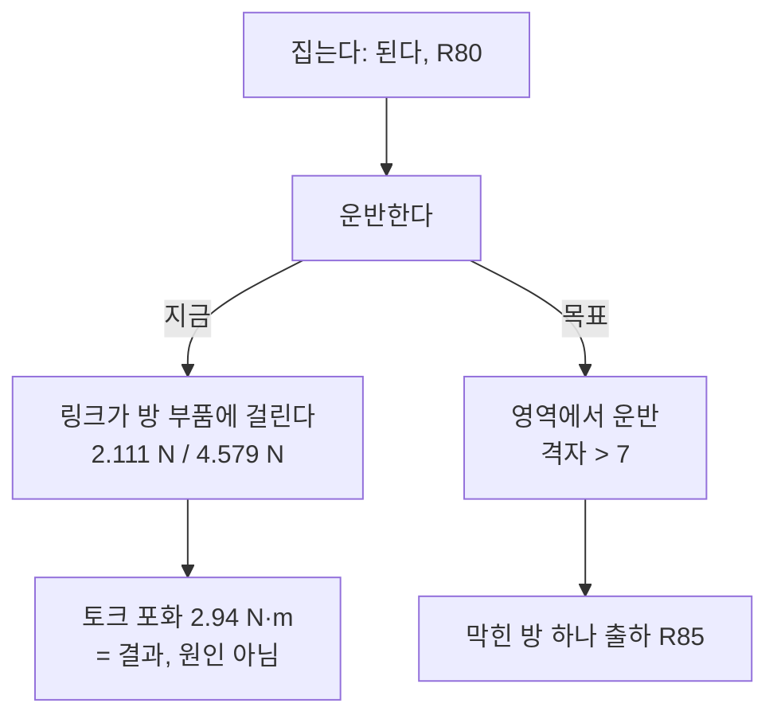

# Spec: 집은 물건을 실어 나르기 (부하 운반)
Status: draft

측정은 전부 끝나 있다(`intent.md` §Problem). 이 문서는 **무엇을 만들면 되는가**와 **무엇으로
판정하는가**만 정한다. 요구 번호는 M5에서 이어 **R81**부터다.

## Requirements

- **R81 (운반이 지나갈 길을 본다)**: 운반 중 팔이 방 부품에 **걸리면** 그것을 알아차리고 다른
  자세·경로로 간다. 지금은 걸린 채로 명령을 계속 내 토크만 포화시킨다(접촉력 2.111 N, 어깨 회전
  2.94/2.94 N·m).
  Check: `puzzles/tabletop/pick_and_place`에서 멈춘 자세의 접촉을 세는 측정이 0이 된다
  (`intent.md`에 적힌 그 두 접촉이 사라진다). 격자 점수가 7보다 커진다.
- **R82 (격자 점수가 올라간다)**: `tools/grab_grid.py`의 25칸 점수가 **7에서 올라간다**.
  Check: `python tools/grab_grid.py --room .../pick_and_place.yaml --task .../task_pick_and_place.yaml
  --part block` → "N of 25" 중 N > 7. 기준값은 §Open questions.
- **R83 (출하된 두 방은 그대로)**: `pick_and_place` 20/20(평균 16.3초 ±2초)과 `weigh_it_down`
  20/20(11.5초 ±2초)이 유지된다. **R82를 만족하면서 R83을 깨는 변경은 싣지 않는다** — 초기 자세
  변경이 그 사례다(격자 13, `weigh_it_down` 0/20).
  Check: 두 방의 `mpg check --seeds 20 --need 18`, 그리고 `--jitter 10`이 각각 8/10 이상.
- **R84 (걷는 몸은 변하지 않는다)**: 새 동작은 `BodyAdapter` 선언으로만 들어오고 기본값은 지금
  값이다.
  Check: 느린 스위트 `-m slow` 177 통과, 실패 0.
- **R85 (막힌 방 하나 출하)**: R70·R74·R71의 쌓기 방 중 **하나**가 프리셋으로 들어간다. 가장
  가까운 것은 쌓기 방이다(네 단계 전부 통과, 블록이 패치를 0.23 m 지나침).
  Check: 그 방이 20시드 18 이상, demo를 `goto goal` 한 단계로 줄이면 0/5, `--all-bodies`에서
  다른 몸이 이름이나 단계로 거부된다.
- **R86 (측정을 문서에 남긴다)**: 바뀐 숫자가 `docs/bodies.md` 세 언어와 이 spec에 들어간다.
  폐기한 시도도 이유와 숫자를 남긴다(M5의 폐기 8건과 같은 형식).
  Check: `tests/test_guide.py` 통과, 세 문서의 해당 절이 같은 숫자를 담는다.

## Out of scope

- 모델 자산 교체·액추에이터 한계 상향(2.94 N·m는 실제 서보 값이다).
- 학습(`mpg train`)으로 운반을 배우게 하는 것 — 이 spec은 **대본 해답**이 영역에서 되게 하는 것이다.
- R72의 평가 숫자 갱신(이 작업이 끝난 뒤 그 기준 위에서 다시 낸다).
- 걷는 몸 전용 방(M5 §Design에서 "문턱이 될 수밖에 없다"로 닫혔다).

## Design

막는 것이 **팔 자신의 링크**이므로, 고칠 자리는 세 곳 중 하나다.

1. **운반기(`carry.py`)**: 목표를 향해 직선으로 끄는 대신, 접었다 돌려서 뻗는 단계적 경로. 직접
   명령으로 재 보면 상자까지 0.114 → **0.088 m**까지 가고 뻗는 단계에서 멈춘다 — 방향은 맞지만
   그것만으로는 부족하다.
2. **몸(`so101.py`)의 역기구학**: 충돌을 아는 해법(여유 공간을 비용에 넣는 형태). 지금은 감쇠
   최소제곱이고 충돌을 모른다. 증분/위치 명령 두 형태는 모두 측정상 더 나빴다(출하 방 0/20).
3. **부품 쪽 선언**: 받는 부품이 "내 벽은 이만큼 높다"를 말하고 운반이 그만큼 비켜 간다
   (`approach_clearance`·`place_clearance`와 같은 계열).

세 곳 중 어디를 고쳐도 **판정은 같다**(R82·R83·R84). 그래서 이 spec은 자리를 정하지 않고 기준만
정한다 — M5에서 자리를 먼저 정하고 들어간 시도 8건이 전부 측정에 떨어졌기 때문이다.

## How each constraint is met

- 걷는 몸 기본값 불변 → R84, 선언 속성으로만.
- 격자만으로 싣지 않기 → R83이 R82와 **함께** 걸려 있다.
- 측정 없는 변경 금지 → 요구마다 명령이 적힌 Check, R86이 폐기 기록까지 요구한다.
- 자산 불변 → §Out of scope.

## Open questions

- [ ] [NEEDS CLARIFICATION] R82의 기준 N. 후보: 15/25(절반 이상), 혹은 "R85만 만족하면 됨".
- [ ] [NEEDS CLARIFICATION] `HOME` 변경 허용 여부(격자 13 vs `weigh_it_down` 0/20).
- [ ] [NEEDS CLARIFICATION] R85의 대상 방(쌓기 방이 가장 가깝다).

## Areas of concern

- **되돌리기**: 모든 변경은 선언 속성 기본값 덕분에 한 줄로 되돌아간다. M5에서 폐기한 8건이
  그렇게 되돌아갔다.
- **과적합**: 25칸은 표본이 작다. R83이 그 방어선이고, 초기 자세 사례가 그것이 필요한 이유다.
- **측정 비용**: 변경당 약 3분, 싣기 전 느린 스위트 26분. 변경을 쌓아 한 번에 재지 말 것 — M5에서
  두 번, 섞어 쟀다가 어느 쪽이 깨뜨렸는지 다시 갈라야 했다.
