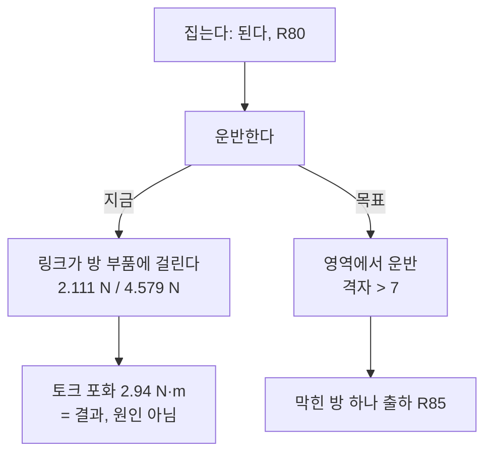

# Spec: 집은 물건을 실어 나르기 (부하 운반)
Status: approved 2026-11-17 (user: "열린질문 3개는 추천대로 해줘")

측정은 전부 끝나 있다(`intent.md` §Problem). 이 문서는 **무엇을 만들면 되는가**와 **무엇으로
판정하는가**만 정한다. 요구 번호는 M5에서 이어 **R81**부터다.

## Requirements

- **R81 (운반이 지나갈 길을 본다)**: 운반 중 팔이 방 부품에 **걸리면** 그것을 알아차리고 다른
  자세·경로로 간다. 지금은 걸린 채로 명령을 계속 내 토크만 포화시킨다(접촉력 2.111 N, 어깨 회전
  2.94/2.94 N·m).
  Check: `puzzles/tabletop/pick_and_place`에서 멈춘 자세의 접촉을 세는 측정이 0이 된다
  (`intent.md`에 적힌 그 두 접촉이 사라진다). 격자 점수가 7보다 커진다.
- **R82 (격자 점수가 올라간다)**: `tools/grab_grid.py`의 25칸 점수가 **7에서 올라간다**.
  Check: `python tools/grab_grid.py --room .../pick_and_place.yaml --task .../task_pick_and_place.yaml
  --part block` → "N of 25" 중 N > 7. 기준값은 §Open questions.
- **R83 (출하된 두 방은 그대로)**: `pick_and_place` 20/20(평균 16.3초 ±2초)과 `weigh_it_down`
  20/20(11.5초 ±2초)이 유지된다. **R82를 만족하면서 R83을 깨는 변경은 싣지 않는다** — 초기 자세
  변경이 그 사례다(격자 13, `weigh_it_down` 0/20).
  Check: 두 방의 `mpg check --seeds 20 --need 18`, 그리고 `--jitter 10`이 각각 8/10 이상.
- **R84 (걷는 몸은 변하지 않는다)**: 새 동작은 `BodyAdapter` 선언으로만 들어오고 기본값은 지금
  값이다.
  Check: 느린 스위트 `-m slow` 177 통과, 실패 0.
- **R85 (막힌 방 하나 출하)**: R70·R74·R71의 쌓기 방 중 **하나**가 프리셋으로 들어간다. 가장
  가까운 것은 쌓기 방이다(네 단계 전부 통과, 블록이 패치를 0.23 m 지나침).
  Check: 그 방이 20시드 18 이상, demo를 `goto goal` 한 단계로 줄이면 0/5, `--all-bodies`에서
  다른 몸이 이름이나 단계로 거부된다.
- **R86 (측정을 문서에 남긴다)**: 바뀐 숫자가 `docs/bodies.md` 세 언어와 이 spec에 들어간다.
  폐기한 시도도 이유와 숫자를 남긴다(M5의 폐기 8건과 같은 형식).
  Check: `tests/test_guide.py` 통과, 세 문서의 해당 절이 같은 숫자를 담는다.

## Attempts (measured, 이 spec 아래)

### A1 — 걸린 것을 알아차리고 물러나 다시 오기 (R81 첫 시도, 2026-11-17, **싣지 않음**)

막는 것이 링크 충돌이므로, 먼저 **그 상태를 알아차리게** 하고 기존 복구(`place_act`의 `back`
단계: 물러나 다시 오기)를 쓰게 해 봤다.

- `BodyAdapter.structure_blocked(data)` 기본 `False`(걷는 몸 불변 — 걷는 몸은 발판을 밟고 바구니
  벽에 기대므로 "부품에 닿았다"가 아무 뜻이 없다), 팔은 자기 운동학 하위트리의 geom과 이름이
  `part/`로 시작하는 geom 사이 접촉력이 1 N을 넘으면 `True`. 팔의 링크 geom은 모델에 이름이 없어
  (`#52`, `#64`) 접두어로 못 찾고 하위트리로 모아야 했다.
- **검출은 정확하다**: 멈춘 자세에서 k=100·200·249 모두 `True`.
- 물러나는 거리도 선언된 `place_clearance`를 쓰게 했다(`AWAY` 0.35 m는 이 몸의 포락선 밖일 수 있다).

측정:

| | 전 | A1 |
|---|---|---|
| 격자 25칸 | 7 | **7**(지도는 바뀜: `place` 실패가 `goto goal` 실패로 옮겨졌다) |
| `pick_and_place` | 20/20 16.3초 | 20/20 **16.7초** |
| `weigh_it_down` | 20/20 11.5초 | 20/20 **11.7초** |
| 쌓기 방 | 0/5 | 0/5 |

**R82를 못 넘고 두 방이 조금 느려지므로 싣지 않았다.** 남긴 사실 둘: ① 걸린 상태는 접촉력으로
정확히 검출된다(위 구현이 그 방법이다) ② **물러나 다시 오기는 답이 아니다** — 놓기가 끝나는 칸은
늘지만 그다음 단계에서 막히고 총점은 그대로다. 다음 시도는 "같은 자세로 다시 가기"가 아니라
**다른 자세로 가기**(경로·자세를 바꾸는 쪽)여야 한다.

### A2 — 영공간으로 자세만 바꾸기 (2026-11-17, **싣지 않음**) — 그리고 왜 안 되는지

A1이 "같은 자세로 다시 가기는 답이 아니다"로 끝났으므로, 교과서적인 다음 수를 했다: 팔은 5관절로
3자유도(손끝 위치) 과제를 풀므로 **영공간이 2차원**이다. 손끝을 건드리지 않고 자세만 링크가
비켜 가는 쪽(`Q_PREF`)으로 미는 항을 넣었다(감쇠 최소제곱의 사영 `N = I − J⁺J`).

| `NULL_GAIN` | 격자 |
|---|---|
| 2.0 | **0**/25 |
| 0.5 | 0 |
| 0.2 | 0 |
| 0.05 | 7 (= 기준값, 즉 효과 없음) |

**도움이 되는 창이 없다.** 효과가 없거나 전부 깨뜨린다. 그리고 그 이유가 이 spec의 설계 공간을
좁힌다: **집기는 용접(`grab.py`의 weld)이라 자세까지 물체에 전달된다.** 영공간에서 자세를 돌리면
들고 있는 블록이 같이 돌아 바닥·상자에 걸린다. 즉 **운반 중 과제는 사실상 6자유도(위치+자세)이고
관절은 5개 — 영공간이 없다.** 팔의 여유 자유도는 **빈 손일 때만** 존재한다.

**[정정 2026-11-17, A3이 측정한 뒤]** 위 단락의 설명("용접이 자세를 전달해서 영공간을 쓸 수 없다")은
**틀렸다**. A3에서 집기를 위치만 묶는 구속으로 바꿔 자세를 풀어 준 뒤에도 영공간 항은 여전히
격자를 0/25로 만든다(이득 0.2·0.5·1.0 전부). 그러니 A2가 깨지는 이유는 용접의 자세 전달이
아니고, 아직 모른다 — 유력한 쪽은 "속도 수준에서 정확한 사영이 위치 목표 적분 + 서보 지연을
거치면 손끝을 흔든다"지만 측정하지 않았다. **설명 없이 숫자만 남긴다.**

따라서 남은 후보는 셋이다(A3은 아래에서 측정했다):

1. **잡는 방식을 바꾼다**: 용접 대신 위치만 묶는 구속(점/구면 조인트)으로 집으면 자세가 풀려
   영공간이 돌아온다. `grab.py`의 결정이고 모든 몸에 영향을 주므로 선언이 필요하다.
2. **중간에 놓고 다시 잡는다**: 한 번에 못 나르는 거리를 두 번에 나눈다(놓기 → 다시 집기).
   지금 구조로 표현 가능하고 측정 비용이 가장 싸다.
3. **방이 팔의 자리를 비켜 준다**: 받는 부품이 벽 높이·접근 방향을 선언하고 방 설계가 그것을
   지킨다. R70·R74는 그래도 안 됐지만(목적지 49곳), 그건 운반 자체가 막힌 상태의 측정이다.

### A3 — 집기를 위치만 묶는 구속으로 (2026-11-17, **싣지 않음**)

A2의 (틀린) 설명을 시험하려면 자세를 풀어 보면 된다. `BodyAdapter.grab_holds_rotation`
(기본 `True` — 부리는 손잡이를 쥐므로 자세를 들고 있어야 한다; 막대가 흔들리고 끈 끝이 비틀려
빠진다), 팔만 `False` → MuJoCo 등식이 `weld` 대신 **`connect`**(위치만). `weld_now`는 그때
자식의 원점을 양쪽 프레임에 앵커로 써서, 켤 때 물체가 컴파일 시점 앵커로 튀지 않게 했다.

| | 격자 |
|---|---|
| 기준(용접) | 7/25 |
| A3 단독(연결) | **7**/25 (지도만 이동) |
| A3 + A2 영공간(0.2·0.5·1.0) | **0**/25 |

**둘 다 싣지 않았다.** A3 단독은 숫자를 바꾸지 않으므로(쓰임 없는 변경은 R67이 금지한 장식이다)
싣지 않고, 조합은 더 나쁘다. 남긴 사실: **자세를 풀어도 영공간 항은 깨뜨린다** — A2의 설명이
틀렸다는 것이 이 시도의 결과다.

### A4 — 들어서 나르기 (2026-11-17, **싣지 않음**) — 그리고 "팔은 들지 못한다"는 내 말의 정정

**정정 먼저.** M5에서 나는 "팔이 들지 못한다"고 적었다(명령 8 mm에 손끝 2 mm, 블록 0). 그 측정은
반경 **0.065 m**, 베이스 정면에 접힌 자세에서 한 것이었다. 해답이 실제로 집는 반경에서 다시 재면
**팔은 든다**: r=0.279에서 머리 수준을 1 → 0으로 25스텝에 걸쳐 올리면 블록이 **z 0.015 → 0.125 m**로
올라가고, 쥠의 힘은 0.20 N(큐브 한계 3 N)에 머물고 손끝도 0.018 → 0.117 m로 따라온다. 못 드는
것은 **접힌 자세에서만**이다.

그래서 들어서 나르는 운반을 만들었다(`BodyAdapter.carry_raised`, 기본 False — 부리는 이미 띄워
나른다): 집은 뒤 서서 끝까지 올리고, 이동하고, 받침 위에서 같은 비율로 내린 뒤 놓는다.

| 받침 | 격자 |
|---|---|
| 상자(출하 형태) | **0**/25 — 다만 **25칸 전부가 놓기 단계를 끝낸다**(끌기에서는 대부분 실패) |
| 상자 + 내부 면적 게이트 | 0/25 |
| 평판(`shape: plate`) | 1/25 |
| 넓은 영역(`object_zone` 0.24 m) | 5/25 |
| (기준: 끌기) | 7/25 |

**왜 안 되는지는 분명하다.** 들고 간 블록은 상자 중심에서 **0.056 m**까지만 들어온다(내부 면적은
0.020 이하를 요구한다) — 팔 링크가 벽에 걸려 더 못 뻗는다. 거기서 놓으면 0.12 m에서 떨어져 튀어
**0.107 m 밖**에 선다. 즉 **들기는 되고 "위에서 놓기"가 막힌다**: 이 팔이 넘어갈 수 없는 것은
0.06 m 벽이다.

그래서 남은 설계 질문은 좁다 — **이 팔이 위에서 놓을 수 있는 받침은 무엇인가**(테두리가 없고,
0.12 m에서 떨어뜨려 ~0.08 m 튀어도 담기는 넓이), 또는 **옆에서 들어가 내려놓는 경로**. 넓은 영역
5/25가 그 방향의 첫 숫자다(끌기 7보다는 낮다).

### A5 — 받침의 테두리를 없앴다 (2026-11-17, **출하**) — R70·R74가 풀렸다

A1~A4가 전부 실패한 뒤 공통점을 봤다: 받는 부품이 늘 **테두리 있는 상자**였다. 그 전제를 빼면
숫자가 뒤집힌다 — **코드 변경 0으로** 넓고 평평한 영역(`object_zone` 0.24 m)에 끌어 넣으면 격자가
**22/25**다(상자 7). 팔이 못 넘던 것은 0.06 m 벽이고, 벽이 없으면 바닥으로 밀면 된다. A4(들기)는
그래서 필요하지 않았다.

**출하된 방 둘**:

| 방 | 결과 | demo 축소 | `--all-bodies` |
|---|---|---|---|
| `puzzles/tabletop/dead_wedge` (R70) | **20/20, 11.2초** | 0/5 | 배타적 |
| `puzzles/tabletop/conveyor_triage` (R74) | **20/20, 17.0초** | 0/5 | 배타적 |

방의 숫자들은 전부 측정이고 각각 먼저 실패했다: 받침에 테두리 없음(상자로는 목적지 49곳 전부 0),
벨트가 포락선 앞에서 멈춤(0.6 m면 블록이 r=0.478까지 밀려 손잡이가 밖), 영역이 건네주는 지점
근처(테이블 건너면 운반이 0.13 m에서 포기), **블록 하나당 벨트 하나**(한 벨트에 둘을 올리면 끝에서
서로 밀어 옆으로 빠진다 — 벨트를 0.025 m/s로 늦춰도 안 된다), 그리고 영역은 **운반이 실제로 블록을
세우는 자리**에 둔다(첫 판은 두 번째 블록이 0.023 m 모자라 네 단계를 통과하고 골에서 멈췄다).

**R85 충족.** 남은 것은 쌓기 방 하나이고, 그것은 테두리 문제가 아니다 — 측정했다.

### A6 — 쌓기 방: 받침이 아니라 **놓는 높이**가 남았다 (2026-11-17 측정)

A5의 교훈(넓고 평평한 받침)을 쌓기 방에도 적용했다. 패치를 0.12 → **0.24 m**로 넓히고 `place`를
`drop`으로 바꾸면 **두 블록이 모두 패치에 올라간다** — R78 가드가 더 이상 `not on 'tower'`를 말하지
않는다(그 전에는 블록이 패치를 0.23 m 지나쳤다). 그런데 탑은 켜지지 않는다: 둘이 **나란히** 놓였고,
`stack`은 그것을 거부하도록 만든 부품이다(세 개를 줄로 세우면 패치를 채우고도 높이가 0이라는 것이
R71의 판정 시험이다). 0.32 m로 더 넓히면 오히려 두 번째 집기 전에 멈춘다(demo_step 2).

그래서 쌓기 방에 필요한 것은 **놓는 높이의 제어**다: 두 번째 블록을 첫 번째의 윗면(0.03 m) 위에서
놓아야 한다. 지금은 `drop`이 턱을 0.12 m로 들고 놓아 튀고, `place`는 `_pick_z`로 내려놓으려 하는데
그 값이 하위목표 경계에서 지워져 **내려놓기가 실행되지 않는다**(M5에서 측정하고, 고치면
`examples/rooms/laundry.yaml`이 깨져 되돌린 그 버그다 — 지금의 지움은 버그이면서 걷는 몸을 보호하는
가드다).

### A7 — R87(놓는 높이)을 만들어 보니, 묶는 제약은 **정밀도**였다 (2026-11-17, **싣지 않음**)

A6이 가리킨 대로 구현했다: `stack.place_height(obj)`(지금 탑의 윗면 + 물체 반지름)와
`stack.place_xy(obj)`(패치 중심이 아니라 **지금 탑의 자리**), 그리고 운반의 `_let_go`가 `_pick_z`가
없을 때 부품에게 높이를 묻고, `place_act`가 부품이 주는 목표 지점을 쓴다. 걷는 몸 영향 0
(`_hold_tip_at`은 `head` 채널이 없으면 무동작이고, 두 메서드는 `stack`만 구현한다).

측정 순서대로:

1. `place b1 tower`가 **통과**하기 시작했다(전엔 가드가 `not on 'tower'`를 말했다).
2. 두 번째 집기가 멈췄다 — 두 번째 블록이 반경 0.19(근접 영역)에 있어 팔이 **밀어내 버린다**
   (−0.12, 0.06 → −0.38, 0.20, 도달 밖). **방 설계 오류**였고 두 블록을 되는 반경으로 옮겼다.
3. 그 다음엔 아임이 **b2 자신**을 가리켰다 — 넓은 패치(0.24 m) 안에 b2가 처음부터 들어 있었기
   때문이다. 또 내 방 설계 오류였고 b2를 패치 밖으로 옮겼다.
4. 그러고 나니 네 단계가 전부 통과하는데 **둘이 나란히** 선다: 0.083 m 떨어져 있고 탑은 꺼져 있다.
   허용 오차를 물체 크기(0.015)로 조이면 "도달"이 성립하지 않아 단계가 멈춘다.

**결론: 묶는 제약은 높이가 아니라 놓는 정밀도다.** 대본 운반은 목표에서 **0.04~0.08 m**에 놓고,
쌓기는 **약 0.02 m**를 요구한다. 넓은 받침(R70·R74)이 되는 이유도 같다 — 거기선 정밀도가 필요
없다. 그래서 R87은 구현해도 방을 열지 못하고, 코드는 되돌렸다(쓰는 방이 없는 메서드는 R67이
금지하는 장식이다).

**남은 요구를 다시 쓴다(R88, 미구현)**: 대본 놓기의 정밀도를 0.02 m 이하로 만든다. 검사: 쌓기 방이
20시드 18 이상 + demo 축소 0/5 + 출하된 세 방(`weigh_it_down`, `dead_wedge`, `conveyor_triage`)과
격자가 유지된다.

### A8 — 정밀도를 막는 것을 찾았고, 그걸 고치면 출하된 방 둘이 깨진다 (2026-11-17, **싣지 않음**)

먼저 정밀도의 실제 한계를 재어 보니 제어기가 아니다: 운반 중 명령은 0.50으로 일정하고 블록은
**스텝당 2 mm씩 꾸준히** 좁혀 목표에서 0.049까지 온다. 멈추는 것은 **허용 오차에 들어갔기 때문**이다.
그러면 허용 오차를 조이면 될 것 같은데, 조이면 단계가 멈춘다 — 그 이유가 이것이다:

`place_act`의 마지막 접근은 "물건이 따라왔으니 여기서 멈춰"를 `steer(target, -1.0)`으로 말한다.
걷는 몸에게 `-1.0`은 **가장 느린 속도**지만, 명령이 속도에 대칭으로 매핑되는 이 몸에게는 **전속**이다
(`max(abs(-1.0), 0.25) = 1.0`). `STAND`가 여기선 후진 전속이었던 것(`stand_action`)과 **같은 계열의
버그이고, 한 호출 더 안쪽**이다.

고쳐 봤다. 두 형태 모두 출하된 방을 깨뜨린다:

| 수정 | `pick_and_place` | `weigh_it_down` | `dead_wedge` | `conveyor_triage` |
|---|---|---|---|---|
| 홀로노믹 속도를 걷는 몸 스케일로 매핑 | 20/20 (20.0초) | **0/20** | 20/20 (15.4초) | **0/20** |
| 그 호출만 `_stand()`로 | 20/20 (16.3초) | **0/20** | 20/20 (13.3초) | **0/20** |

**즉 그 잘못 읽힌 `-1.0`이 두 방의 놓기를 실제로 끝내고 있다** — 목표를 향해 전속으로 달려드는
동작이 물건을 받침 안으로 밀어 넣는다. 의미를 바로잡으면 그 밀어넣기가 사라진다.

그래서 R88의 제약이 하나 늘었다: **정밀도 수정은 그 "달려들기"를 없애는 방식이면 안 된다.**
남은 방향은 두 가지로 좁혀진다 — ① 놓기 직전에만 쓰는 별도의 조밀 접근 단계(달려들기는 그대로 두고,
그 뒤에 오차를 닫는 단계를 추가) ② 쌓기 전용 놓기(물체를 탑 위에서 **멈춘 뒤** 놓는 단계).

## Out of scope

- 모델 자산 교체·액추에이터 한계 상향(2.94 N·m는 실제 서보 값이다).
- 학습(`mpg train`)으로 운반을 배우게 하는 것 — 이 spec은 **대본 해답**이 영역에서 되게 하는 것이다.
- R72의 평가 숫자 갱신(이 작업이 끝난 뒤 그 기준 위에서 다시 낸다).
- 걷는 몸 전용 방(M5 §Design에서 "문턱이 될 수밖에 없다"로 닫혔다).

## Design

막는 것이 **팔 자신의 링크**이므로, 고칠 자리는 세 곳 중 하나다.

1. **운반기(`carry.py`)**: 목표를 향해 직선으로 끄는 대신, 접었다 돌려서 뻗는 단계적 경로. 직접
   명령으로 재 보면 상자까지 0.114 → **0.088 m**까지 가고 뻗는 단계에서 멈춘다 — 방향은 맞지만
   그것만으로는 부족하다.
2. **몸(`so101.py`)의 역기구학**: 충돌을 아는 해법(여유 공간을 비용에 넣는 형태). 지금은 감쇠
   최소제곱이고 충돌을 모른다. 증분/위치 명령 두 형태는 모두 측정상 더 나빴다(출하 방 0/20).
3. **부품 쪽 선언**: 받는 부품이 "내 벽은 이만큼 높다"를 말하고 운반이 그만큼 비켜 간다
   (`approach_clearance`·`place_clearance`와 같은 계열).

세 곳 중 어디를 고쳐도 **판정은 같다**(R82·R83·R84). 그래서 이 spec은 자리를 정하지 않고 기준만
정한다 — M5에서 자리를 먼저 정하고 들어간 시도 8건이 전부 측정에 떨어졌기 때문이다.

## How each constraint is met

- 걷는 몸 기본값 불변 → R84, 선언 속성으로만.
- 격자만으로 싣지 않기 → R83이 R82와 **함께** 걸려 있다.
- 측정 없는 변경 금지 → 요구마다 명령이 적힌 Check, R86이 폐기 기록까지 요구한다.
- 자산 불변 → §Out of scope.

## Open questions

세 질문 모두 사용자 승인으로 닫혔다 — "열린질문 3개는 추천대로 해줘"(2026-11-17).

- [x] **R82의 기준**: 격자에 합격선을 걸지 않는다. 격자는 **진단**이고 값은 보고한다. 합격선은
      R85(막힌 방 하나 출하)다. 이유가 이 작업 중에 측정으로 드러났다 — 격자 7/25는 **테두리 있는
      상자**를 전제한 숫자이고, 테두리 없는 받침으로 바꾸면 **같은 코드로 22/25**다. 숫자에 선을
      그었다면 받침을 바꿀 생각을 못 했을 것이다.
- [x] **`HOME`은 건드리지 않는다**: 격자는 7 → 13으로 오르지만 `weigh_it_down`이 20/20 → 0/20이 된다.
- [x] **R85 대상**: **R70(쐐기방)과 R74(분류방)로 달성**(아래 A5). 남은 것은 쌓기 방 하나다.

## Areas of concern

- **되돌리기**: 모든 변경은 선언 속성 기본값 덕분에 한 줄로 되돌아간다. M5에서 폐기한 8건이
  그렇게 되돌아갔다.
- **과적합**: 25칸은 표본이 작다. R83이 그 방어선이고, 초기 자세 사례가 그것이 필요한 이유다.
- **측정 비용**: 변경당 약 3분, 싣기 전 느린 스위트 26분. 변경을 쌓아 한 번에 재지 말 것 — M5에서
  두 번, 섞어 쟀다가 어느 쪽이 깨뜨렸는지 다시 갈라야 했다.
