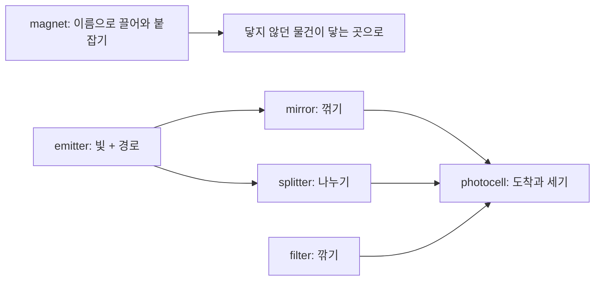

# Spec — 자석과 빛 (magnets and optics)

Status: approved (2026-11-17, 사용자 `/goal 예정된 퍼즐부품들 모두 추가`)
Intent: [intent.md](intent.md)
Baseline: `f554736` (`measure/budget-and-balance`, PR #55)

부품 다섯과 방 셋. 번호는 R97 다음부터 이어 붙인다. R98과 R99~R101은 서로 독립이므로 따로 싣는다.

## Requirements

### R98 `magnet` — 이름으로 끌어와 붙잡는 비접촉 손

`pos`의 기둥이 반경 `radius` 안의 **받는 물체**(`accept`, 비면 모든 물체)를 중심 쪽으로 `power` [N]로
끈다. `in`/`enable`이 꺼지면 힘만 사라진다 — 움직이던 물체는 관성으로 조금 더 가 마찰에 멈춘다(측정:
0.472 m에서 끊으면 0.370 m, 0.359 m에서 끊으면 0.076 m).

- 값: `pos`, `radius` [m], `power` [N, 실행 중 변경], `accept`(물체 부품 이름 목록), `hold` [m],
  `height` [m, 이보다 높은 중심은 무시].
- 채널: `<이름>` — 받는 물체가 `hold` 안에 붙어 있으면 1.
- `wind`와 다른 것 셋(탐침에서 측정): ① 힘의 방향이 **물체 위치에 따라** 정해진다(바람의 `yaw`는 상수),
  ② `accept`로 **고른다**(바람의 `trigger`는 종류뿐), ③ `hold` 안에서 힘을 끊어 **세운다**(일정한 힘은
  벽까지 민다 — 측정: x 1.1 → −1.07 m).
- `power`는 힘이므로 질량에 대한 비율로 뜻이 달라진다. `wind.check_warnings`와 같은 형식으로 경고한다.
- 검사: `tests/test_magnet.py` 8개 — 끌어온다 / 끄면 도착하지 않는다 / `accept` 밖은 안 움직인다
  (변위 1 mm 미만) / 어느 쪽에서든 끈다 / `hold` 안에서 채널 1 / 체크포인트 / `damp` 없으면 지나친다 /
  R104(바람은 세우지 못한다).
- **실린 뒤 알게 된 것**: 끌기만으로는 배달이 되지 않는다. 반경 전체에 걸린 일정한 힘은 마찰이
  같은 거리에서 되찾는 만큼의 에너지를 주므로, 대략 `2 mu m g`를 넘으면 받침을 지나 장 밖으로
  나간다. 그래서 `damp`(속도에 반대하는 힘)가 값으로 들어갔다. 0.03 kg 상자를 0.39 m에서 끈 측정:
  `damp` 0에서는 네 설정 중 하나만 배달되고(1.0 N → 0.269 m 밖), 0.4에서는 셋이 4 mm 안에 선다.

### R99 빛의 경로 — `emitter`, `photocell`, `mirror`

`laser`(R5, 끊기 센서)는 **건드리지 않는다**. 새 가족은 "빛이 도착했는가"를 묻는다.

- `emitter`(device): `pos`, `yaw` [deg, 실행 중 변경], `power` [-], `bounces`(최대 반사 수),
  `height` [m]. 매 몸 스텝 `mj_ray`로 경로를 따라가며 거울을 만나면 꺾고, 그 외의 것을 만나면 멈춘다.
  채널 `<이름>` — 경로가 하나라도 `photocell`에 닿으면 1.
- `photocell`(input): `pos`, `radius`, `min_power`. 채널 `<이름>`(세기 `min_power` 이상이면 1),
  `<이름>.power`(실수).
- `mirror`(device): `pos`, `yaw` [실행 중 변경], `width`, `loss`. 입사 광선을 거울 법선에 대해 반사하고
  세기에 `(1 − loss)`를 곱한다. 몸과 물체에 **닿는다**(벽처럼).
- 선 수 상한: 경로 전체에서 `MAX_SEGMENTS`를 넘으면 그 가지를 버린다(Codex #43: 깊이만으로는 부족).
- 왜 부품인가(탐침): 벽이 광선을 가리면 `laser`는 0을 내는데, 그 0은 "아무도 끊지 않았다"의 0과
  **같은 값**이다. 도착을 묻는 채널이 레포에 없고, 반사 코드도 없다.
- 검사: `tests/test_optics.py` — 직선으로 닿는다 / 벽이 끊는다 / 거울이 꺾어 닿게 한다 /
  `yaw`를 틀리게 두면 안 닿는다 / `loss`가 세기를 깎는다 / `bounces` 상한에서 멈춘다.

### R99 결과 (2026-11-17, 측정)

부품 셋(`emitter`, `photocell`, `mirror`)이 들어갔고 `laser`는 건드리지 않았다. 측정: 직선 1.000,
거울 한 장 0.950(기본 손실 5 %), 겨냥이 틀리면 0.000, 두 장 0.903, `bounces: 1`이면 두 번째 거울에서
멈춘다. 방 `puzzles/light/aim_the_mirror` 20/20 11.0초, demo를 한 단계로 줄이면 0/5, 배타적.

두 가지가 설계 중 바뀌었고 둘 다 측정 때문이다.

- **판을 지나는 걸음의 길이**: 두께만큼 전진하면 45도로 만난 8 mm 판을 **두 번** 통과한다
  (스플리터가 0.6 대신 0.36을 내고 반사 쪽을 두 번 먹였다). `THICK / |d·n|`로 고쳤다.
- **계획 단계는 광선을 못 따라간다**: 광전지만 두면 "unreachable: ['eye']"로 방이 거절된다. 발광기가
  `plan_driver`가 되어 "방이 선언한 조절기(판을 겨냥하는 setter)의 입력이 켜지면 빛이 도착한다"고
  주장한다. `any`로 둔 이유는 값 중 하나만 정답인 방이 있기 때문이고, 어느 값이 맞는지는 해답
  스크립트가 측정한다.

### R100 `splitter` — 하나의 빛을 나눠 쓰기

반투명 판. 입사 세기의 `split`은 그대로 지나가고 `(1 − split)(1 − loss)`는 반사된다.

- 값: `pos`, `yaw` [실행 중 변경], `width`, `split` [0..1, 실행 중 변경], `loss`.
- 왜 부품인가: 게이트 식은 **채널 사이의 산술을 거절한다**("BinOp is not allowed"). 그래서 세기를
  비율로 나누는 것은 식으로 쓸 수 없다. `budget`(R91)이 메운 빈칸과 같은 종류다.
- **판정: 선택이 된다(2026-11-17 측정, 싣는다).** `puzzles/light/split_the_beam`에서 세 결과가 나온다 —
  `split` 0.5(아무것도 안 누름) 0.400/0.450으로 **문 둘 다 닫힘**, 0.8(틀린 판) 0.640/0.180으로 막힌
  방의 문만 열림, 0.2(맞는 판) 0.160/0.720으로 골로 가는 문이 열림. 20/20 11.1초, demo를 줄이면 0/5,
  **틀린 판을 누르면 0/5**.
- 검사: `tests/test_optics.py` — 0.6/0.36으로 갈린다 / 둘 다 0.55를 요구하면 하나만 켜진다.

### R101 `filter` — 지나가는 빛을 깎는 판

- 값: `pos`, `yaw`, `width`, `transmission` [0..1, 실행 중 변경]. 지나간 세기에 곱한다. 반사는 없다.
- **스칼라 하나로 줄였다**(Codex #42는 3밴드): 밴드별 관측 배관이 없다. 직전 스펙이 계측기 전체를
  같은 이유로 뺐고, 같은 기준을 여기에 적용했다.
- **판정: 싣는다.** 두 길의 비용을 다르게 만드는 것이 이 부품의 역할이고, 그것이 R100의 선택을
  성립시킨다(필터 없는 스플리터는 대칭이라 고를 것이 없다). 측정: 한 장 0.5, 두 장 0.25(곱으로 쌓임).
- 왜 문이 아닌가(탐침): 벽·문은 빛을 **끊는다**(0/1). 필터는 깎는다 — "짧지만 어두운 길과 돌아가지만
  밝은 길" 중에서 고르게 만드는 것이 이 부품의 유일한 축이다. 그 선택이 방에서 성립하지 않으면 철회한다.
- 검사: 투과율이 곱으로 쌓인다 / `min_power` 아래로 떨어지면 `photocell`이 꺼진다.

### R102 방 셋

- `puzzles/tabletop/fetch_the_steel` (R98): 팔의 도달(0.48 m) 밖에 큐브 둘. 팔이 접시에 추를 올리면
  자석이 켜지고, `accept`에 적힌 쪽만 닿는 곳으로 온다. 미끼는 제자리(변위를 적는다).
  대조: demo를 `goto goal` 하나로 줄이면 0/5, 자석을 끄면 아무것도 오지 않는다.
- `puzzles/light/aim_the_mirror` (R99): 빛이 벽에 막혀 있다. 바닥 판이 거울의 `yaw`를 바꾸고(setter),
  닿으면 문이 열린다. 대조: 판을 밟지 않으면 0/5.
- `puzzles/light/split_the_beam` (R100+R101): 계획의 `long_way_round` 대신 이 방을 지었다. "짧고 어두운
  길 대 돌아가는 밝은 길"은 선택이 한 번뿐인데, 나눠 쓰는 쪽은 **세 결과**(둘 다 닫힘 / 틀린 문 /
  맞는 문)를 내고 고르는 것이 답이 된다. 필터는 두 가지의 비용을 다르게 만드는 자리에 들어갔다.
- 방마다 머리글에 측정값과 **실패한 시도**를 적는다(R70·R74·R88·R93 형식).

### R103 문서와 표

- `docs/parts-guide{,.en,.ja}.md`: `tools/refresh_parts_tables.py`로 표를 다시 만들고(세 언어 한 번에),
  방 셋을 더한다. `docs/bodies{,.en,.ja}.md`의 `requires_body` 감사표에 새 부품 행을 더한다.
- `examples/task_*.yaml`과 `tests/test_examples.py`의 `PRESET_TASKS`에 방 셋을 등록한다.

### R104 조합 가능성 잠금 (탐침 결과를 테스트로)

- `tests/test_optics.py::test_a_closed_door_is_already_a_shutter` — 문·벽이 이미 셔터다(필터가 0/1용이
  아니라는 근거). 닫으면 0, 같은 문을 열면 1.
- `::test_a_laser_cannot_tell_a_blocked_beam_from_a_quiet_one` — `laser`의 0이 두 뜻을 겸한다(광전지가
  메우는 빈칸).
- `::test_going_straight_through_a_filter_costs_no_bounce` — 빈 대조를 만든 그 실수를 고정한다.
- `tests/test_magnet.py::test_a_wind_cannot_hold_an_object_in_place` — 일정한 힘은 벽까지 민다(자석의
  `hold`가 메우는 자리).
- `tests/test_signals.py::test_a_gate_refuses_arithmetic_between_channels`(이미 있음)가 스플리터의 근거다.

## Out of scope

- 3밴드 스펙트럼(Codex #42), 광학 솔버, 렌더러 반사.
- 레이저 출력을 소비하는 예산 결합(R91 + R100): 먼저 스플리터가 선택이 되는지부터.
- 자기 **반발**(polarity −1): 밀기는 `wind`·`pusher`로 이미 된다. 끌기만 들인다.
- 자석으로 몸을 끄는 것: 몸의 질량 대비 힘이 schema 상한에서도 걷기를 못 흔든다(`wind`의 R46 감사와
  같은 계산). 물체만 받는다.

## Sources

- Codex-mac #30 `MAGNETIC_PUCK`, #41 `MIRROR_ROUTE`, #42 `SPECTRAL_FILTER_TILE`, #43 `BEAM_SPLITTER`
  (`/Users/songseunghun/Documents/Codex/2026-09-27-window-pc-pc/outputs/puzzle-parts-ideas-20261117/IDEAS.md`)
- 직전 스펙의 유보 결정: `docs/specs/2026-11-17-measure-and-budget/spec.md` 「Out of scope」
- 탐침 측정: intent.md 표 (2026-11-17, 이 스펙 작성 전)
