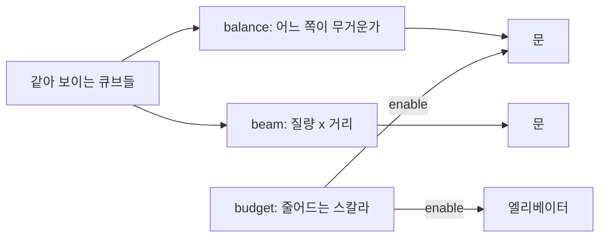

# Spec — 측정과 배분 (measure and budget)

Status: approved (2026-11-17, 사용자 "추천대로" — R89 철회 후 줄인 범위)
Intent: [intent.md](intent.md)
Baseline: `f3619c0` (main, M5 종료 직후)
View (read-only copy): 아직 만들지 않음

부품 셋과 방 넷. 번호는 M5의 R88 다음부터 이어 붙인다.

## Requirements

### R89 `balance` — 철회 (2026-11-17, 측정으로)

**이미 되는 것이었다.** `pressure` 둘 + 게이트 식이 이 요구를 그대로 만족한다. 탐침 방으로 측정했다
(pan_a 0.02 kg / pan_b 0.05 kg).

| 식 | 값 |
|---|---|
| `pan_b.mass > pan_a.mass` | 1.0 — 상대 비교 |
| `pan_b.mass >= 0.04 and pan_b.mass <= 0.06` | 1.0 — 무게 구간(Fable `weight_window`) |
| `pan_a.mass - pan_b.mass < 0.01` | **거절**: "BinOp is not allowed" — 산술 금지 |

남는 빈칸은 "차이에 공차"뿐이고, `pressure`가 질량을 1 g로 반올림해 내므로 정확한 균형은
`not (a > b) and not (b > a)`로 1 g 단위까지 표현된다. 부품 하나를 들일 값어치가 없다.

이 철회의 원인은 조사 방법이었다. 그 **부품**이 있는지 확인하고 그 **조합**이 되는지 확인하지 않았다.
같은 사실("게이트 식에 비교 연산자가 있다")로 Fable의 `compare` 제안을 이미 걸러냈는데, 같은 사실을
이 요구에 적용하지 않았다. 재발 방지는 R97이다.

### R90 `beam` — 받침점 저울 (질량 x 거리)

중앙 힌지로 기울어지는 판. 양쪽 토크가 `balance_band` 안이면 `<이름>` 1.

- 값: `pos`, `span`[m], `pivot_height`[m], `balance_band`[deg], `settle`[s], `accept`.
- 질량이 같아도 **거리가 다르면 기울어진다**. 이것이 R89와 다른 점이고, 세 모델 중 Codex만 집은 축이다.
- 기울어진 판은 길이 된다(경사 `max_slope`: 오리 5도, go2 6도).
- 비용 위험: 가벼운 하중에서 힌지 마찰과 접촉이 떨린다(Codex가 "unsure: pivot friction"으로 표시).
  떨리면 `settle` 안에 `REST_SPEED`로 가라앉는지를 먼저 측정하고, 안 되면 `damping`을 값으로 노출한다.
- 검사: `tests/test_parts.py::test_a_beam_balances_equal_mass_at_equal_distance`,
  `::test_a_beam_tips_when_the_same_mass_moves_outward`, `::test_a_beam_settles_before_it_reads`.

### R91 `budget` — 줄어드는 보존 스칼라

Gemini `battery_cell`, Fable `battery`·`toll`, Codex `METERED_RESERVOIR`는 같은 것이다. 보존되는 스칼라가
줄어들기만 하고, 쓰는 방식만 셋이다. 부품 셋이 아니라 `spend:` 하나로 갈라지는 부품 하나로 만든다.

- 값: `amount`(초기량), `spend`: `time`(켜진 load **하나당** `rate`/s) | `flow`(load가 하나라도 켜져
  있으면 전체로 `rate`/s — 공용 수도꼭지), `rate`, `loads`(채널 목록), `refill`(채널|없음),
  `pos`, `body: true`(방 안 상자 + 게이지).
- **`use`(횟수) 방식은 넣지 않는다**: `count(pass) < 3`이 이미 그것이다(2026-11-17 확인). 이 부품이
  메우는 빈칸은 둘뿐이다 — (1) **누적** 시간(`timer()`는 "끊기지 않고 켜져 있던 초"라 꺼지면 0으로
  돌아간다), (2) **여러 소비처가 나눠 쓰는 하나의 풀**(두 타이머를 더할 산술이 식에 없다).
- 채널: `<이름>`(남았으면 1, 0이면 영구히 0), `<이름>.left`(남은 양, 실수). 버스는 이미 실수를 싣는다
  (`counter`가 `float`를 쓴다).
- `enable`로 소비처를 먹이고, 다 쓰면 그 소비처가 멈춘다.
- 체크포인트에 남은 양이 들어간다.
- 검사: `tests/test_parts.py::test_a_time_budget_drains_only_while_a_load_is_on`,
  `::test_a_budget_keeps_draining_across_a_break_unlike_timer`,
  `::test_two_loads_share_one_pool`, `::test_an_empty_budget_stays_empty`,
  `::test_a_budget_survives_a_checkpoint`.

### R92 방 `odd_one_out` — 철회 (2026-11-17, 측정으로)

방은 돌아갔지만 **고르는 방이 아니었다.** 지은 뒤 대조로 걸렀다.

무게가 결정한다는 것 자체는 깨끗하게 확인됐다. 같은 자리(-0.05, -0.12), 같은 데모, 질량만 바꾸면:

| 블록 질량 | 접시가 읽은 값 | 결과 |
|---|---|---|
| 20 g | 0.020 | 실패 |
| **35 g** | **0.035** | **성공** (`in_band` 1) |
| 45 g | 0.045 | 실패 |

세 경우 모두 블록이 접시에 올라갔으므로 자리가 아니라 구간이 결정한다. 그런데 **미끼 큐브 둘을 팔이
움직이지 못했다**. 처음 자리(0.14, 0.26)는 기반에서 0.511 m로 도달(0.48) 밖이었고, `tools/grab_grid.py`로
작동 구역을 재어(이 방 주변 **15/25**, `pick_and_place`의 3/25보다 넓다) 그 안으로 옮겼더니 이번엔
셋이 붙어서 그립이 깨졌다 — 격자는 큐브가 **하나뿐인** 방에서 잰 것이었다. 미끼가 올라간 적이 없으니
"틀린 큐브를 올리면 0/5"라는 대조는 **빈 대조**였다(집지도 못해서 0/5였다).

미끼를 진짜로 만들 수 없으면 남는 것은 선택이 없는 방이고, 선택이 없는 방을 고르는 방으로 내보낼 수
없다. 이 몸과 지금의 스크립트 운반으로는 셋 중 고르는 방이 만들어지지 않는다 — 한 구역에서 블록
하나는 옮기지만 이웃이 생기면 실패한다.

보여주려던 능력(코드 0줄 무게 구간)은 R97의 테스트에 남아 있고, 그것이 이 요구의 지속되는 부분이다.
세 큐브 방은 운반이 이웃을 견디게 된 뒤의 과제로 남긴다.

### R93 방 `lever_arm` (R90)

큐브 둘의 질량은 같고, 받침점에서의 거리로만 균형이 맞는다. 맞추면 판이 수평이 되어 건너갈 길이 된다.

- 몸 이름을 적지 않고 배타적이어야 한다(질량 차이로). `--all-bodies` 결과를 방 머리글에 적는다.
- 검사: 20/20, demo 끊으면 0/5, exclusive.

### R94 방 `two_openings` (R91)

문과 엘리베이터가 `budget` 하나를 나눠 쓴다. 전량으로는 둘 다 못 돌리고, 어느 쪽에 얼마를 쓸지가 답이다.

- 검사: 20/20, demo 끊으면 0/5. `budget`의 `amount`를 1.5배로 올리면 두 길이 다 열려 **방이 쉬워지는지**
  확인한다(예산이 실제로 제약인지 보는 음성 대조).

### R95 방 `weigh_then_spend` (R91 + R92의 조합) — 보류

측정에 전력이 든다. 접시에 `enable: budget`을 걸어 저울을 켜 둔 시간만큼 `budget`이 줄고, 다 쓰면
더 못 재니 남은 추론으로 골라야 한다. 누적 시간 예산이 실제로 필요한 방이고, `timer()`로는 짤 수 없다
(꺼면 0으로 돌아가므로 껐다 켜며 무한히 재게 된다).

**보류 (2026-11-17)**: 이 방의 뜻은 "재는 횟수를 아껴라"인데, 그러려면 여러 번 재는 것이 가능해야 하고
그것이 R92가 막힌 지점이다. 한 번 재는 비용은 측정했다(**3.02초**, 접시에 올린 뒤 골에 닿기까지).
R92의 운반 문제가 풀린 뒤에 짠다.

- 검사: 20/20, demo 끊으면 0/5, exclusive.

### R96 문서와 표

- `docs/parts-guide.md`(+ `.en.md`, `.ja.md`): `TABLE_BEGIN/END` 사이 표를 `mpg parts --markdown`으로 다시
  만들고, 방 넷을 행에 더하고, "그 몸이어야 풀리는 방" 절에 R93을 더한다.
- 방 파일마다 머리글에 측정값과 **실패한 시도**를 적는다(R70·R74·R88과 같은 형식).
- 검사: `tests/test_docs.py` 통과, `tests/test_examples.py`의 `PRESET_TASKS`에 방 넷 등록.

### R97 조합 가능성 잠금 (R89 철회의 재발 방지, 급 ③)

기존 부품으로 되는 것을 다시 제안하지 못하게, **되는 조합을 테스트로 고정한다.**

- `tests/test_signals.py::test_a_gate_compares_two_plate_masses` — 접시 둘과
  `pan_b.mass > pan_a.mass`가 1을 낸다.
- `::test_a_gate_reads_a_mass_window` — `>= and <=`로 무게 구간이 된다.
- `::test_a_gate_refuses_arithmetic_between_channels` — `a.mass - b.mass < x`가 거절된다(빈칸의 경계).
- `docs/parts-guide.md`에 "새 부품을 만들기 전에" 절을 더한다: 제안된 부품을 기존 부품으로 짜 보는
  탐침 방을 먼저 돌린다. 레시피를 적는다.

급 ③을 고른 이유: 급 ④(규칙)로는 부족하다. 규칙은 이미 알고 있었고 적용하지 않았다. 더 높은 급
(① 재설계, ② 기계적 가드)은 "제안된 부품이 식으로 표현되는지"를 코드로 판정해야 하는데, 제안이
코드가 되기 전에는 판정할 대상이 없다. 테스트는 적어도 **이 세 조합을 다시 못 잊게** 한다.

## Out of scope (근거 있음)

- **상대 질량 비교·무게 구간** (7표): 이미 된다. 위 R89 참조.
- **횟수 예산**: 이미 된다(`count()` + 비교).
- **자석** (6표). 도달 연장기라서, R70·R74에서 "못 닿는다"의 해법이 새 힘이 아니라 방이었다는 교훈과
  반대 방향이다. 다음 스펙 후보. 사용자 결정 2026-11-17.
- **추론이 필요한 부품**: Codex `CALIBRATION_BENCH`·`UNKNOWN_TRANSFER_BENCH`, Fable `oracle_post`·
  `hidden_link`. 해답 스크립트가 숨은 값을 읽어 풀면 검증이 아니다(Codex도 같은 지적을 했다).
- **광학** (거울·빔 스플리터·필터, 3쪽 전부 동의): 레이저 반사는 별 스펙으로 끊는다.
- **측정 계측기** (캘리퍼·레인지 스캐너·마찰 시험대): 관측 배관이 먼저 필요하다.
- **액체·열·재료 이력** (Codex 1~15): 상태 모델은 싸지만 물체 상태를 늘리는 설계 결정이 먼저다.

## Rejected — 이미 있거나 지금 조립 가능 (116개 중 20개)

받은 아이디어 중 레포 대조로 걸러낸 것. 다시 만들지 않는다.

| 제안 | 레포의 실체 |
|---|---|
| ice/mud patch | `trap/slippery_floor`, `sticky_floor`, `brake_strip` |
| timer_relay, delay_gate | `logic/delay`, `pulse`, `hold` |
| sequence_lock | 게이트 `sequence:` (틀리면 리셋 + `<이름>.wrong`) |
| metronome, clock_source | `logic/source_clock`, `source_pattern` |
| toggle_flipflop | `input/floor_toggle`, `latch(set, reset)` |
| shape_slot, tag 필터 | `receptacle.accept` (이름·종류·마커 id), `yaw` + `angle_period` |
| high_shelf, overhead_button | `beak/wall_button_beak_low|mid` + 바디별 `reach_height` |
| stepping_stones | `floor/rising_step` + `trap/pit` + 실측 `max_step` |
| narrow_slit | `holonomic` 바디 선언 |
| fragile_vase | `breakable.py` 껍질 충격 속도 문턱 |
| stack_check | `input/stack` (R71: `need`/`height`/`accept`/`settle`) |
| speed_gate | `zone.min_speed` + 방 `puzzles/roller/speed_gate.yaml` |
| compare | 게이트 식의 비교 연산자 |
| chute | `warp` (`to`/`routes`/`cooldown`) |
| winch | `rope.reel_speed` (래칫의 추가분은 일방향 유지뿐) |
| exchanger | `destroyer` + `dispenser` |
| motion_detector | `zone.min_speed` + `not` 게이트 |
| catapult | `spring.velocity`가 이미 3축, `trigger: object` |
| crumble_tile | `pressure` + `counter` + `trapdoor` |
| stepper | `counter` + 비교 |

## Sources

- Gemini 32개 (사용자가 따로 받아 2026-11-17 이 대화에 붙여넣음)
- Fable 서브에이전트 38개 (1차 6 + 2차 32, 같은 날)
- Codex-mac 46개, 레포 `f3619c0` 기준:
  `/Users/songseunghun/Documents/Codex/2026-09-27-window-pc-pc/outputs/puzzle-parts-ideas-20261117/IDEAS.md`
- 레포 대조와 범위 해석: Claude-Mac
